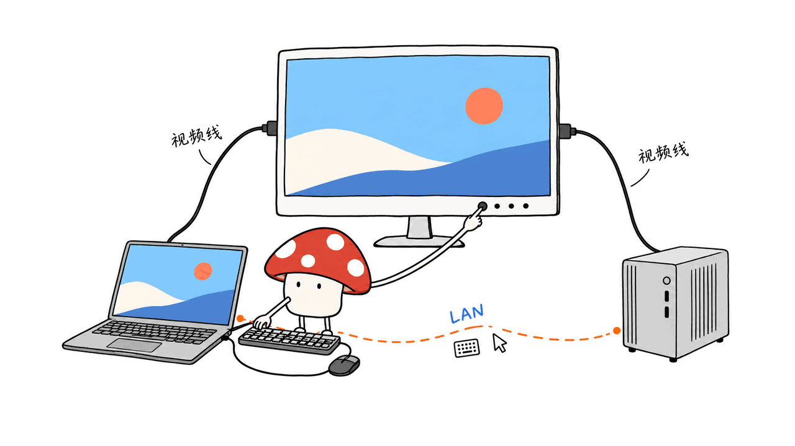
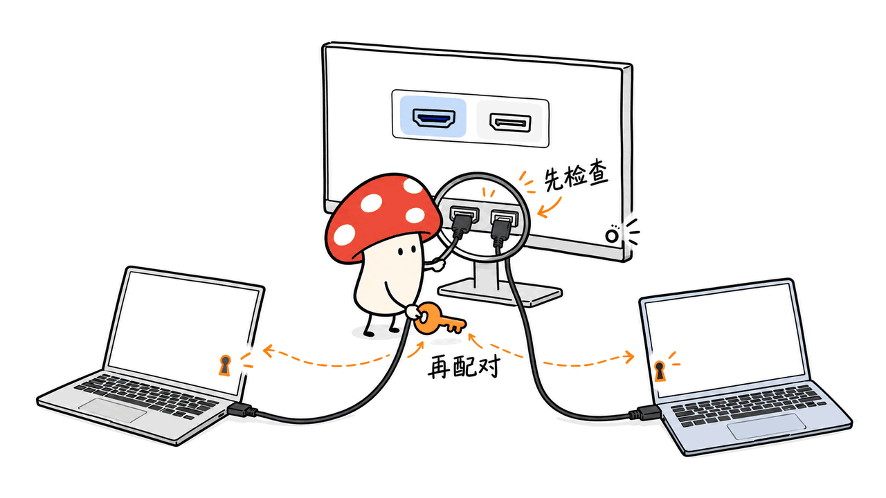
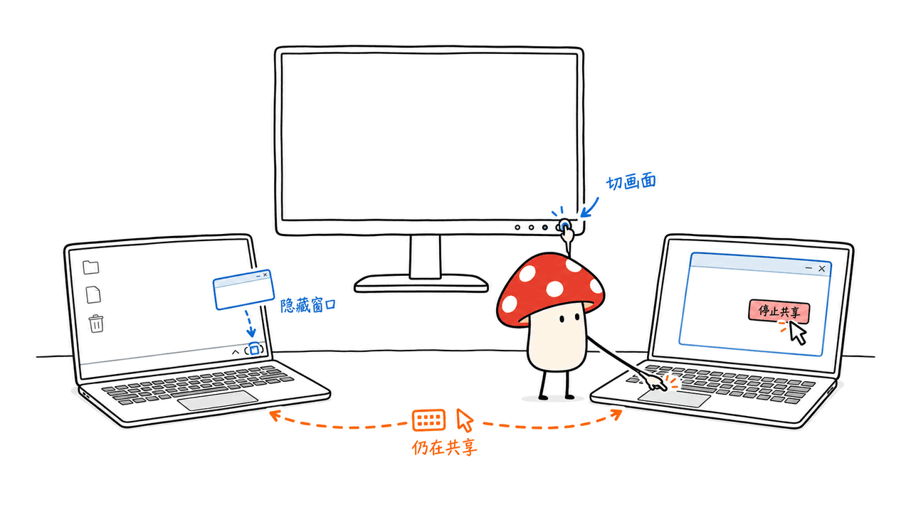

Deskflow DDC 面向一个具体问题：工作 Mac 和 Windows 电脑摆在同一张桌上，怎样共用一块显示器、一套键盘鼠标？它用 Deskflow 在局域网共享输入，用 DDC/CI 切换显示器输入源，再协调两边的状态。它不传输桌面视频，也不需要把两台电脑的视频压缩成远程画面。

这是一套有明确硬件前提的桌面工具。显示器必须支持相应 DDC/CI 指令，两台电脑各自接视频线。当前 Mac 支持范围是 Apple Silicon、macOS 14 及以上；仓库尚未提供 Intel Mac 的 DDC 后端。

源码：https://github.com/Fantasy1316/deskflow-ddc

本文核对日期为 2026-10-29，版本为 0.2.3，固定提交为 `b0bb9d8b60f00d26e24469ebf6c72e730a5331de`。它是独立项目，与 Deskflow 官方无隶属关系。

## 它怎样把“换画面”和“换键鼠”接起来？

通常这两件事分别处理：显示器按键决定显示哪个视频输入，键鼠共享软件决定操作哪台电脑。如果只切一边，就可能看着 Windows，却把键盘输入送给 Mac。

Deskflow DDC 分成三条路径：

| 路径 | 实际做什么 | 前提 |
|---|---|---|
| 视频 | 两台电脑分别直连显示器不同输入接口 | 两条可用的视频连接 |
| 键鼠与剪贴板 | 内置 Deskflow 1.27.0 在电脑间传输 | 局域网可达、权限和端口正常 |
| 输入源控制 | DDC/CI 写入 VCP `0x60` | 显示器与整条连接链路支持 |

应用采用 Rust、Tauri 2 和 Vue 3。Mac 的 DDC 助手基于 m1ddc；键鼠引擎以独立进程随应用分发，因此不必再单独安装 Deskflow。它没有把显示器、键鼠接口变成一个通用硬件 KVM：USB 外设转发、文件传输和视频串流都不在当前功能内。



最关键的实现细节出现在 `runtime/switch_flow.rs`：日志把“指令被接受”和“画面已确认”分开，发送完成时仍记录 `pictureVerified: false`。因此界面显示指令已发送，不等于软件看见并确认显示器真的切过去了。源码还会根据最近的画面来源，决定由本机还是请求对端发送 DDC 指令；发送失败后将来源标为不确定，需要恢复提供端画面再重新连接。

源码位置：https://github.com/Fantasy1316/deskflow-ddc/blob/b0bb9d8b60f00d26e24469ebf6c72e730a5331de/src-tauri/src/runtime/switch_flow.rs

## 哪些设备适合，哪些要先核对？

| 环节 | 当前支持与要求 |
|---|---|
| Mac | Apple Silicon，macOS 14+；暂不支持 Intel Mac DDC 控制 |
| Windows | Windows 10/11 x64，安装 Microsoft Edge WebView2 Runtime |
| 显示器 | 在菜单里启用 DDC/CI，并支持输入源切换 |
| 连接 | 两台电脑分别接不同视频输入；扩展坞、转接器与线材可能影响 DDC |
| 网络 | 控制 TCP 49729、键鼠 TCP 24801；mDNS 发现用 UDP 5353 |

键鼠所在的电脑是“提供端”，另一台是“接收端”，角色与操作系统无关。可以是 Mac 提供给 Windows，也可以反过来；README 也支持范围内的 Mac/Mac、Windows/Windows 组合。

官方没有在 README 给出最低内存容量、显卡型号或吞吐指标，不能据此编造一个内存门槛。实际选型首先看系统版本和 DDC 链路，而非追求更强 GPU。

mDNS 通常只适用于同一子网。访客网络、客户端隔离或 VPN 可能使自动发现失效；可解析主机名、手工备用 IP 是项目提供的兜底方式，但仍需网络互通。

## 第一次安装，按什么顺序做？

### 1. 先确认物理画面能切换

给两台电脑分别接视频线，在显示器菜单启用 DDC/CI。先确保使用显示器实体按键可以切到两台电脑的画面，再进行软件配置。

在两端的“显示器与输入”扫描并选择同一块共用显示器，分别填写本机和另一台的输入值。**不要凭 HDMI、DP 的名称猜数值**。README 的 `3` 和 `1` 只是示例：如果实测 A 对应 3、B 对应 1，A 就填本机 3、对端 1，B 反着填。两端扫描到的显示器 ID 不必相同。

停止共享后，可用“单独测试显示器切换”验证映射；这个按钮会立即改变真实画面，需保留通过实体按键恢复的办法。

### 2. 两端安装同一个版本

官方 Release 当前提供 Apple Silicon Mac ZIP 和 Windows x64 便携 ZIP；Windows 便携目录里的 DLL 与 `resources` 必须一起保留。先停止旧版或独立 Deskflow，避免端口与输入捕获冲突。

Mac 按系统提示授予辅助功能、输入监控等必要权限。主应用检测通过，不代表内置键鼠引擎也获得了权限。Windows 则需允许所用网络的防火墙通信，并满足 WebView2 要求。

本次 v0.2.3 在 10 月 28 日重新发布，作者明确要求：即使安装过此前的 0.2.3，也应重新下载并同时更新两端。Mac 构建使用 ad-hoc 签名、未经 Apple 公证，Windows 未配置发行签名；安装时应核对可信来源和 Release 的校验文件，而不是把来源提示误当成完整安全审计。

下载与更新说明：https://github.com/Fantasy1316/deskflow-ddc/releases/tag/v0.2.3

### 3. 配对，然后再试双向切换

实体键鼠所在端选择“连接在这台电脑”，先让显示器显示它的画面，点击“开始等待连接”。另一端查找设备或填写主机名/IP，输入提供端的配对码，配对并开始共享。等待工作台显示引擎就绪，再测试切换。

默认快捷键是 Mac `Ctrl + Option + F10`、Windows `Ctrl + Alt + F10`。Mac 是否加 `Fn` 取决于功能键设置。重新配对设备、重建配对码或导入旧版配置后，不能继续假定旧凭据有效。



## 鼠标滑到边缘，就一定切画面吗？

默认不会。默认模式保留手动切换画面，减少误触边缘造成的输入源跳转。两端都只有共用显示器时，主要通过按钮或快捷键切换。

有独立屏幕时，可以让键鼠移到另一台电脑，而共用显示器继续显示原来的画面。例如 Windows 占用共用显示器，MacBook 仍有内置屏，就可以滑回 Mac 内置屏工作。应把内置屏选为独立屏幕，不能误选共用显示器。

需要自动跟随时，可显式开启“跟随键鼠切换画面”；另一个模式则在目标有独立屏幕时仅转移键鼠，否则切画面。应根据实际桌面布局选择，而不是统一开启自动模式。

跨系统复制、粘贴还可开启“统一常用快捷键”：Mac Command 与 Windows Ctrl 对应。它会交换相关组合键，并不自动把 `Command + Tab` 和 `Alt + Tab` 等所有系统操作变成同一套规则。

## 真正需要注意的限制是什么？

作者在 README 和 Release 均保留了“输入被捕获后无法点击或打字”的报告，完整触发条件尚未确定。0.2.3 的退出清理与守护进程改进，不能解释成已根治该问题。

关闭窗口只是隐藏到托盘，后台共享继续。需要释放输入，应选择“停止共享”；结束程序则选择“退出”。如果还可操作另一台电脑，可优先在那里停止共享。

内置返回提供端快捷键是 Windows `Ctrl + Alt + Esc`、Mac 提供端 `Ctrl + Command + Esc`，但它只请求转移键鼠，不保证恢复显示器输入，且引擎无响应时也可能失效。项目尚未提供独立于引擎的紧急停止机制。第一次测试应保留可用的另一端或管理途径，而非立即替换唯一工作入口。



剪贴板共享可以关闭并设置容量；图片与富文本兼容性取决于两端系统和 Deskflow。日志包含设备名和局域网地址，反馈前应检查，不公开配对码或私钥。应用不提供云中转，但“局域网直连”本身不代表完成了独立安全审计。

## 本次核验了什么，哪些仍未实测？

固定提交在隔离源码目录完成以下检查，未修改上游代码或本机输入权限：

| 检查 | 结果 | 能说明什么 |
|---|---|---|
| 锁定依赖安装 | `pnpm install --frozen-lockfile --ignore-scripts` 成功 | 依赖可按锁文件解析，不运行安装脚本 |
| 前端测试 | 6 个文件、17 项全部通过 | 配置、配对校验、协议夹具、修饰键设置和状态草稿的既有检查通过 |
| 前端生产构建 | `pnpm build:web` 成功 | Vue 类型检查和 Vite 打包通过 |
| 双机真实切屏 | 未测试 | 不宣称兼容某款显示器、成功率或切换延迟 |
| 原生应用与系统事件 | 未测试 | 不宣称完成 Mac/Windows 安装、权限、休眠或退出回归 |

构建说明要求 Node.js 22.13+、pnpm 11、Rust 1.90+，再加目标系统的 Tauri 环境。源码打包还需准备内置引擎，这不同于仅构建前端：

```sh
pnpm install --frozen-lockfile
pnpm prepare:engine
pnpm pack:mac
# Windows 构建机使用 pnpm pack:win
```

首次准备引擎会联网下载并核对固定资源。若只是使用工具，直接选择对应 Release 更省事。不要把前端测试通过写成整套双机硬件路径已经验证。

## 许可证和适用场景怎样判断？

原创应用代码是 MIT；随包 Deskflow 保留 GPL-2.0-only 与 OpenSSL 例外，其他组件也有各自声明。重新分发完整安装包时，不能仅凭仓库 MIT 标签忽略随包源码与许可材料。

第三方声明：https://github.com/Fantasy1316/deskflow-ddc/blob/b0bb9d8b60f00d26e24469ebf6c72e730a5331de/THIRD_PARTY_NOTICES.md

它适合已经有两台电脑、一块支持 DDC 的显示器，希望减少手动切换的桌面。若要远程看视频、传文件、切 USB 摄像头或获得硬件级独立切换，应按这些需求选择其他路径。Deskflow DDC 的实际收益，是把两条已有能力协调成一个操作流程；成败仍取决于显示器、连接链路和输入恢复是否可靠。

延伸阅读：[OpenDisplay 第二屏项目](https://blog.mushroom.cv/blog/opendisplay-free-open-source-sidecar-iphone-ipad-second-monitor/)。评估多设备桌面时，可以分别检查视频连接、屏幕扩展与输入控制的需求。

## 常见问题

### 可以不接两条视频线吗？

不能靠这个工具代替视频连接。它切换已有显示器输入，不传送另一台的桌面画面。

### Intel Mac 能直接使用完整功能吗？

当前支持范围不包括 Intel Mac 的 DDC 后端，不能因为 Deskflow 本身跨平台就推断封装应用也全部支持。

### 有独立屏幕时能只切键鼠吗？

可以按布局和模式配置，并正确选择独立屏幕；实际睡眠、热插拔和 DPI 行为仍受系统与引擎限制。

> © 2026 Author: Mycelium Protocol. 本文采用 [CC BY 4.0](https://creativecommons.org/licenses/by/4.0/deed.zh) 授权——欢迎转载和引用，须注明作者姓名及原文链接，不得去除署名后以原创发布。

<!--EN-->

Deskflow DDC coordinates two separate operations: sharing a keyboard and mouse over a LAN, and selecting the physical video input on a shared monitor. It addresses a practical Mac/Windows desk setup without streaming either computer's desktop video.

This review covers version 0.2.3 at commit `b0bb9d8b60f00d26e24469ebf6c72e730a5331de`, checked on October 29, 2026. It is an independent project, unaffiliated with the Deskflow maintainers.

Repository: https://github.com/Fantasy1316/deskflow-ddc

## What travels over each connection?

Each computer connects directly to a different monitor input. The bundled Deskflow 1.27.0 process transfers keyboard, mouse and clipboard data over the network. DDC/CI writes VCP `0x60` to select a monitor input. The Rust/Tauri 2/Vue 3 application coordinates these paths; the Mac DDC helper is based on m1ddc.

This does not provide USB peripheral forwarding, file transfer or desktop-video transport. Both physical video connections remain necessary.


A useful source detail is that `runtime/switch_flow.rs` records `pictureVerified: false` after accepting a display command. A successful write is not independent confirmation of what the physical screen now shows. The runtime uses the last known picture source to choose a local write or a peer request; failure leaves the picture state uncertain and requires recovery before sharing restarts.

Source: https://github.com/Fantasy1316/deskflow-ddc/blob/b0bb9d8b60f00d26e24469ebf6c72e730a5331de/src-tauri/src/runtime/switch_flow.rs

## Which hardware is supported?

| Component | Requirement |
|---|---|
| Mac | Apple Silicon, macOS 14 or newer; no Intel Mac DDC backend currently |
| Windows | Windows 10/11 x64 and Microsoft Edge WebView2 Runtime |
| Monitor | DDC/CI enabled, with input-source switching support |
| Cabling | Separate video connections from both computers |
| Network | TCP 49729 for control, TCP 24801 for input, UDP 5353 for mDNS |

The computer with the physical keyboard and mouse is the provider, regardless of operating system. Compatible Mac/Mac and Windows/Windows pairings are also documented. The README gives no minimum RAM or GPU specification; monitor and connection compatibility are the important prerequisites.

Docks, adapters and cables can interrupt DDC. mDNS discovery generally stays within a subnet; a resolvable hostname or backup IP can help when discovery fails, but cannot replace network reachability.

## How should the first setup proceed?

First verify both video inputs with the monitor's physical controls. Enable DDC/CI, scan the shared display on each computer, and enter the verified local and peer input values. Do not infer numeric codes solely from connector names. The README's values 3 and 1 are examples, not universal HDMI or DisplayPort mappings. The two systems may assign different monitor IDs.

Install the same release on both ends and stop any older or standalone Deskflow instance. Keep the Windows portable package's DLLs and resources intact. Grant the necessary macOS accessibility/input-monitoring permissions; the app and bundled engine may require separate attention. Allow the appropriate Windows firewall communication and install WebView2 when needed.

Version 0.2.3 was republished on October 28. Its release explicitly requests re-downloading both packages even when the previous 0.2.3 was installed. The Mac build uses ad-hoc signing without Apple notarization; Windows lacks a release signature. Use the official package and checksum files, without treating a checksum as a full security audit.

Release: https://github.com/Fantasy1316/deskflow-ddc/releases/tag/v0.2.3

On the provider, choose the local keyboard role and wait for connections while its video is visible. On the receiver, discover the provider or enter its hostname/IP, supply the pairing code, and start sharing. Wait for the input engine to become ready before trying both directions.

Default shortcuts are `Ctrl + Option + F10` on Mac and `Ctrl + Alt + F10` on Windows. Mac function-key settings may also require `Fn`.


## Does moving the pointer always change the picture?

No. Manual video switching is the default, reducing accidental input changes at screen edges. Optional modes can make video follow input, or transfer only input when the target has a separate visible screen.

For example, a MacBook's internal display may remain usable while Windows occupies the shared monitor. Select that internal display as the independent screen; do not mistakenly select the shared monitor. Cross-system modifier mapping can align common Command/Ctrl shortcuts, but does not make every operating-system shortcut identical.

## What limitations matter during actual use?

The README and release retain reports of captured input becoming unable to click or type. The full cause is unresolved. Version 0.2.3's exit cleanup and engine guard should not be described as a complete fix.

Closing the window only hides the application in the tray. Select **Stop sharing** to release sharing, or **Quit** to end the app. If another computer remains controllable, stopping sharing there is the documented first option.

The bundled return shortcuts are `Ctrl + Alt + Esc` on Windows and `Ctrl + Command + Esc` for a Mac provider. They request input transfer, do not guarantee monitor restoration, and may fail when the engine is unresponsive. There is no engine-independent emergency stop yet. Keep an operable recovery path for initial trials.


Clipboard sharing is optional and capacity-limited; image/rich-text compatibility depends on the engine and systems. Diagnostic logs include device names and LAN addresses. Do not publish pairing secrets or private keys. Direct LAN operation removes the project's cloud relay requirement, but is not evidence of an independent security audit.

## What was independently checked?

A clean isolated checkout installed its locked JavaScript dependencies with scripts disabled. All **17 existing frontend tests across six files passed**. `pnpm build:web` passed Vue type checking and the Vite production build. These checks cover configuration, pairing validation, protocol fixtures, modifier settings and frontend draft/state behavior.

No native application was installed or exercised. No dual-computer display switch, DDC hardware compatibility, input permission, sleep/resume path or latency measurement was tested. Those paths must not be inferred from frontend checks.

Source builds require Node.js 22.13+, pnpm 11, Rust 1.90+ and the target platform's Tauri prerequisites. Preparing and packaging the bundled engine is separate from a web build:

```sh
pnpm install --frozen-lockfile
pnpm prepare:engine
pnpm pack:mac
# On a Windows build host: pnpm pack:win
```

## How do licensing and suitability affect adoption?

Original application code uses MIT. Bundled Deskflow retains GPL-2.0-only with its OpenSSL exception; dependencies retain their own terms. The MIT label does not replace the source and license materials required for the bundled components.

Notices: https://github.com/Fantasy1316/deskflow-ddc/blob/b0bb9d8b60f00d26e24469ebf6c72e730a5331de/THIRD_PARTY_NOTICES.md

This is a focused coordination tool for an existing two-computer, DDC-compatible desk. Its practical value depends on reliable monitor control and input recovery, rather than a novel video or USB transport layer.

## FAQ

### Can it replace a video cable?

No. It switches physical monitor inputs and transfers input events, not desktop video.

### Does Deskflow support imply Intel Mac support here?

No. This wrapper currently lacks an Intel Mac DDC backend.

### Can a separate display keep its picture while input moves?

Yes, the documented modes support that arrangement when the independent screen is correctly selected. Actual sleep, hotplug and DPI behavior still depends on the platform and engine.

> © 2026 Author: Mycelium Protocol. Licensed under [CC BY 4.0](https://creativecommons.org/licenses/by/4.0/) — free to share and adapt with attribution. You must credit the author and link to the original; removing attribution and republishing as original is not permitted.
