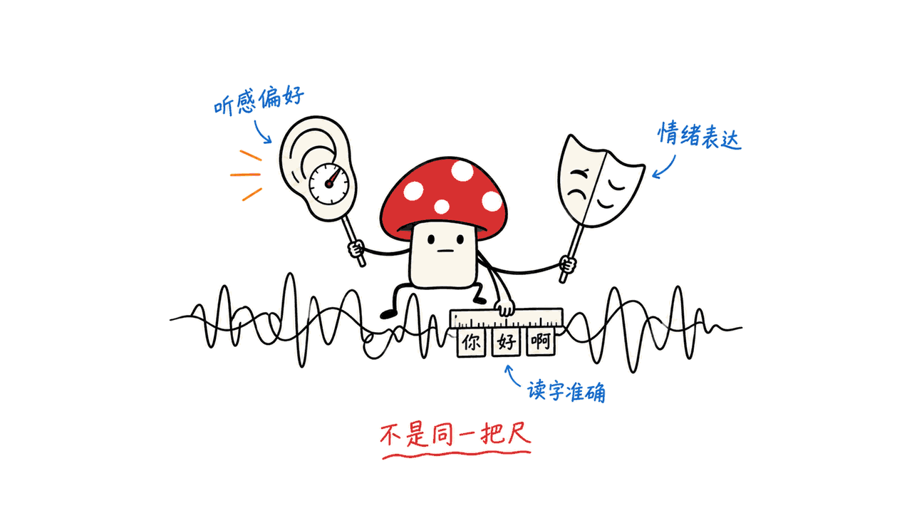
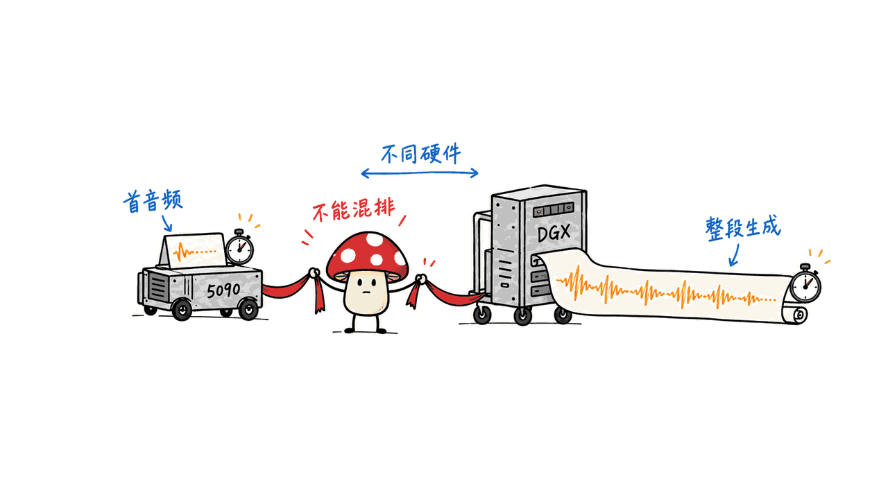

Drama 3 适合需要多角色表演和反复修改的语音创作；Breeze TTS 2 擅长把声音描述变成可控音色；Fish S2 Pro 则提供较小规模的多语种克隆与情绪控制。这三款模型都能获得公开权重，但部署成本和商业授权差别很大。

截至 2026 年 10 月 14 日，Artificial Analysis 的开放权重原生音色榜把 **Drama 3 Preview 排在 Breeze TTS 2 和 S2 Pro 前面**。这个结果支持优先关注 Drama 的听感，却不能证明每段文本、每种语言、每台本地机器都如此。

本文只整理官方资料与公开测试，不运行模型、不生成测试音频。素材里的“生动”“更强”以及 RTX 5090 的时间数据，作为提供者的观察保留，不写成 Mycelium 的实测结论。

## 三款模型到底有什么不同？

| 项目 | Drama 3 | Breeze TTS 2 | Fish S2 Pro |
|---|---|---|---|
| 团队 | Fish Audio | BreezeBlue | Fish Audio |
| 规模 | 35B MoE 主干，每 token 激活约 3B | 约 3.5B | 约 4.6B |
| 主要能力 | 多角色场景、克隆、自然语言控制、多轮改稿、局部编辑 | 声音设计、声音克隆、带参考音频的声音指导 | 多语种克隆、多角色、行内情绪与韵律标签 |
| 参考部署路线 | Fish Speech；SGLang-Omni Cookbook | 官方 Python / Linux / NVIDIA CUDA | Fish Speech；官方服务与推理文档 |
| 重点成本 | 大量权重仍需存储与加载 | eager 与加速模式显存不同 | 较小权重，仍需计算 codec 和服务开销 |

规模按官方口径取整。HF 元数据包含各组件时，Drama 总参数约 35.90B、Breeze 约 3.47B、S2 Pro 约 4.56B；不能把 Drama 的“3B 激活”理解成只需加载一个 3B 模型。

### 官方仓库与 Hugging Face 页面

Drama 3 与 S2 Pro 共用 Fish Speech 项目；当前 README 明确列出两种模型，不能据此把 Drama 当成 S2 的小升级权重。

- Drama 3 权重：https://huggingface.co/fishaudio/drama-3
- Fish Speech 仓库：https://github.com/fishaudio/fish-speech
- Drama 3 部署项目：https://github.com/sgl-project/sglang-omni
- Drama 3 Cookbook：https://sgl-project.github.io/sglang-omni/cookbook/fishaudio_drama3.html
- Breeze TTS 2 权重：https://huggingface.co/BreezeBlue/Breeze-TTS-2
- Breeze 官方仓库：https://github.com/breezeblue-ai/breeze-tts
- Fish S2 Pro 权重：https://huggingface.co/fishaudio/s2-pro

本次记录 HF 版本：Drama `e0a9218aa488`，Breeze `3e28c5151381`，S2 Pro `1de9996b6be3`。这些是资料快照，不代表我们验证过对应权重的运行表现。

## 公开听感测试支持“Drama 最好”吗？

Artificial Analysis 通过匿名成对听音收集偏好。原生音色榜保留各厂商的声音选择；固定音色榜则使用统一的克隆声音。它们回答不同问题，Elo 属于各自榜单，不能跨榜相减。

| 模型在榜名称 | 开放权重原生音色 Elo | 固定音色 Elo |
|---|---:|---:|
| Fish Audio Drama 3 Preview | 1243，95% 区间 1227–1259 | 1058，1043–1073 |
| Breeze TTS 2 | 1221，1207–1235 | 1017，1003–1031 |
| Fish Audio S2 Pro | 1118，1106–1130 | 1001，988–1014 |

来源：2026-10-14 页面快照。
原生音色开放权重榜：https://artificialanalysis.ai/text-to-speech/leaderboard/provider-voice/open-weights
固定音色榜：https://artificialanalysis.ai/text-to-speech/leaderboard/controlled-voice

Drama 在两个榜单都领先这两位对手，但 Drama 与 Breeze 的原生音色置信区间重叠，Breeze 与 S2 的固定音色区间也重叠。榜上明确写的是 **Preview**，公开服务的解码设置、后处理和本地 checkpoint 未必完全一致。

固定音色测试目前使用英语的美国、英国口音声音。它有助于减少音色选择的影响，不能直接外推为中文、日语或所有情绪的排名。把独立听感榜看作筛选候选的证据，比把它当成“所有场景最强”的保证更有用。

## 厂商公开测试还告诉了我们什么？

Fish 的 S2 技术报告与仓库公布 Seed-TTS Eval：中文 WER 0.54%、英文 0.99%；同表的 Qwen3-TTS 为 0.77%、1.24%。这是作者报告的同协议比较，可以说明该测试里的读字准确率优势，不能代表所有 Qwen3-TTS 版本、声音或语言。

S2 同时报告 EmergentTTS-Eval 胜率 81.88% 和自建指令测试 TAR 93.3%。不同指标分别侧重表达偏好与指令执行；自建测试还需要留意任务选择和评判方式。

S2 报告：https://arxiv.org/abs/2603.08823
官方结果与对照：https://github.com/fishaudio/fish-speech#fish-audio-s2-pro

Breeze 公开了 Voice Design、Voice Direction 和 Latency 三套评测仓库。作者的声音设计表中，RoleFit 为 78.02，Qwen3-TTS-VD 为 58.48；这套评测用 Gemini 3.1 Pro Preview 评分，并设转写通过门槛，属于作者组织的模型评判，不能替代独立人类盲听。

Breeze 介绍与结果：https://breezeblue.ai/breeze-tts-2
声音设计评测：https://github.com/breezeblue-ai/TTS-Voice-Design-Benchmark
声音指导评测：https://github.com/breezeblue-ai/TTS-Voice-Direction-Benchmark
延迟评测：https://github.com/breezeblue-ai/TTS-Latency-Benchmark

Drama 的官方仓库报告多语种克隆、Ming-Freeform 编辑和 Step-Audio-Edit 多轮情绪修改的进步，技术报告入口为 https://arxiv.org/abs/2610.18010 。这里保留它的公开研究入口与作者归属，不把官方示例或对旧版本的比较扩展成三款模型的统一实测。

Drama 的技术报告还给出了改稿的实际边界：Step-Audio-Edit 中，三轮修改后情绪准确率从 55.5% 升到 58.2%，风格从 76.5% 升到 81.8%，使用官方 Gemini 2.5 Pro 评判协议。同表 Step-Audio-EditX 的最终情绪准确率是 69.3%，高于 Drama；Drama 的最终风格准确率则更高。因此，“支持反复导演”不等于所有情绪编辑指标都领先。报告第 5.6 节：https://arxiv.org/html/2610.18010v1#S5.SS6

素材提到每段音频的转写都“零词错误”，但未给出原音频、文本、识别器版本和样本数，“Whicner”也未明确指向具体工具。即便能复核 WER=0，它也只说明读字正确：情绪是否自然、停顿是否合适、角色是否稳定，还需要别的评价。

## 生成 10 秒音频，能直接比较速度吗？

素材报告 RTX 5090 上 S2 Pro 用 3.6 秒、Breeze 用 6.8 秒生成 10 秒音频。单纯按时间除以音频长度，得到 RTF 0.36 与 0.68；这是对素材数字的换算，没有补做测量。缺少精度、加速模式、预热、输入和计时边界，不能作为可复现基准。

Drama 与素材中的 Qwen3-TTS 使用 DGX Spark，因此不参与这一台 5090 的速度排序。

| 官方公开服务指标 | 硬件与条件 | 结果 |
|---|---|---|
| Drama 3 | 单 H200，流式，并发 1，预编码参考音频 | TTFA p50 88.9ms；平均 RTF 0.131 |
| Breeze TTS 2 | H100，预热后的加速配置 | 作者称 TTFA <40ms；RTF 0.32 |
| S2 Pro | 单 H200，官方生产流式配置 | 作者称首音频约 100ms；RTF 0.195 |

来源为各自 HF 模型卡及官方 README。Drama 在并发 16 时 TTFA p50 已变为 210.1ms、RTF 0.373，说明并发是比较条件的一部分。Breeze 的延迟仓库还区分网络收到首字节 TTFB 与开始可听的 TTFA；该仓库中 Fish 条目是 S2.1 Pro，不能替换成这里的 S2 Pro。

首音频延迟决定对话会不会“等很久才开口”；RTF 决定整段生成能否跟上播放。GPU、参考音频预处理、网络和并发不同，三行服务数字不能拼成一张速度冠军榜。

## 本地部署与商业使用应该先看什么？

Drama 的 MoE 降低每步激活计算量，全部专家权重仍需存放。官方使用 FP8 专家、其他权重 BF16；HF 文件规模约 41.5GB，也不是完整运行显存测量。选它之前，应按具体推理实现、权重精度和上下文规划容量，别按“3B”采购硬件。

Breeze 官方给出 eager 约 7.7GiB、建议至少 12GB 显存；`--fast-all` 约 14.4GiB、建议 24GB，并涉及冷启动与预热。3.5B 和 4.6B 的参数比较不能代替实际运行预算。官方 Breeze 路线是 CUDA；社区移植需另外检查兼容性，本文没有验证 Mac 或量化版本。

更容易被漏掉的是授权：公开代码与可下载权重，不能合并理解为无条件商业使用。

| 当前版本授权 | 商业使用要点 |
|---|---|
| Drama 3 Community License v1，2026-10-13 | 在协议条件下，使用者及关联方过去 12 个月合计收入低于 50 万美元可享有限商业许可；提供协议定义的 Hosted Service 通常另需书面许可，不能只看收入门槛 |
| Breeze 代码 Apache 2.0；模型 Research Non-Commercial | 自部署权重及其输出的商业使用需另获授权；购买官方托管服务不自动取得自托管模型许可 |
| S2 Pro Research License，2026-03-07 | 研究、非商业用途按条款使用；商业用途需另外签约，不套用 Drama 的新社区许可 |

Drama 页面顶部许可证元数据与正文可能不同；这里核对的是对应版本的许可证文件。收入定义、客户代部署、输出交付和服务例外应查看全文，不能把这张摘要表当成完整授权。

Drama 许可：https://huggingface.co/fishaudio/drama-3/blob/main/LICENSE
Breeze 许可：https://huggingface.co/BreezeBlue/Breeze-TTS-2/blob/main/LICENSE
S2 Pro 许可：https://huggingface.co/fishaudio/s2-pro/blob/main/LICENSE.md

## 三款模型分别值得谁优先关注？

需要配音导演式的多轮修改、局部替换和多角色长场景，优先研究 Drama 3。它的价值不只是第一遍听着好，而是能减少重录和后期拼接；代价是大模型部署与授权安排。

没有现成参考声音、希望用文字创建和调整音色，优先研究 Breeze TTS 2。它把设计、克隆和指导做成清晰入口；同时必须确定自己的任务在英语、中文覆盖范围内，并接受不同运行模式的显存成本。

需要较小模型的多语种克隆、情绪标签和流式服务，优先研究 S2 Pro。独立榜单分数落后，并不自动取消它在硬件预算或现有工作流里的价值；这类取舍需要按实际目标文本与系统条件决定。

Mycelium 的独立判断是：本地 TTS 正从“给文字换个声音”走向“可以修改的声音生产工具”。采购时，编辑能力、延迟、显存和授权决定能不能进入工作流，单一听感排名不能回答这些问题。相关背景：https://blog.mushroom.cv/blog/audio8-tts-preview-0.6b-multilingual-zero-shot-voice-cloning-dualAR/

## 常见问题

### Drama 的 3B 激活意味着和 3B 模型一样轻吗？

不意味着。Drama 的官方主干为 35B MoE，每步只激活部分参数；存储与加载仍涉及大量专家权重，运行内存还包括 codec、缓存与框架开销。

### 能据此认定 Breeze 和 S2 Pro 全面超过 Qwen3-TTS 吗？

不能。S2 的 Seed-TTS WER、Breeze 的声音设计评分，各自支持特定协议中的结论；它们不是同一套全面考试，素材的主观听感也不能取代它们。

### 这些结果是作者自己跑出来的吗？

本文作者没有运行模型测试。独立听感结果来自 Artificial Analysis，性能与专项测试来自厂商公开材料，5090 时间和零词错误说法来自用户素材，三者分别标注。

---

> © 2026 Author: Mycelium Protocol. 本文采用 [CC BY 4.0](https://creativecommons.org/licenses/by/4.0/deed.zh) 授权——欢迎转载和引用，须注明作者姓名及原文链接，不得去除署名后以原创发布。

<!--EN-->

Drama 3 is the strongest candidate here for editable multi-character performances; Breeze TTS 2 emphasizes designing and directing voices; Fish S2 Pro offers a smaller multilingual cloning and expressive-speech model. Their public weights come with different hardware and commercial-use conditions.

On October 14, 2026, Artificial Analysis ranked Drama 3 Preview ahead of Breeze TTS 2 and S2 Pro on its open-weight provider-voice board. This supports considering Drama first for perceived quality, but does not establish a winner for every language or local deployment.

This article uses public research only. We did not run models or generate test audio. The supplied listening impressions and RTX 5090 timings remain attributed observations.

## What separates the three models?

| Model | Official scale | Main capabilities | Reference deployment |
|---|---|---|---|
| Drama 3 | 35B MoE backbone, approximately 3B active per token | Multi-character scenes, cloning, conversational revision, local editing | Fish Speech and SGLang-Omni |
| Breeze TTS 2 | Approximately 3.5B | Voice design, cloning and instruction-based voice direction | Python, Linux and NVIDIA CUDA |
| Fish S2 Pro | Approximately 4.6B | Multilingual cloning, multiple speakers and inline expressive tags | Fish Speech |

HF metadata counting model components gives approximately 35.90B, 3.47B and 4.56B respectively. Active parameters describe computation per step; they do not make Drama a three-billion-parameter storage problem.

Official repositories and weights:

- Drama 3: https://huggingface.co/fishaudio/drama-3
- Shared Fish Speech repository: https://github.com/fishaudio/fish-speech
- Drama deployment: https://github.com/sgl-project/sglang-omni
- Cookbook: https://sgl-project.github.io/sglang-omni/cookbook/fishaudio_drama3.html
- Breeze TTS 2: https://huggingface.co/BreezeBlue/Breeze-TTS-2
- Breeze repository: https://github.com/breezeblue-ai/breeze-tts
- S2 Pro: https://huggingface.co/fishaudio/s2-pro

Snapshot revisions are `e0a9218aa488` for Drama, `3e28c5151381` for Breeze and `1de9996b6be3` for S2 Pro. These identify researched documents, not tested checkpoints.

## Does public listening evidence make Drama the winner?

Artificial Analysis uses anonymous paired listening preferences. Provider voices and standardized cloned voices are separate evaluation settings; their Elo scales cannot be subtracted from each other.

| Listed model | Open-weight provider-voice Elo, 95% interval | Controlled-voice Elo, 95% interval |
|---|---:|---:|
| Fish Audio Drama 3 Preview | 1243, 1227–1259 | 1058, 1043–1073 |
| Breeze TTS 2 | 1221, 1207–1235 | 1017, 1003–1031 |
| Fish Audio S2 Pro | 1118, 1106–1130 | 1001, 988–1014 |

Snapshot sources, October 14, 2026:
https://artificialanalysis.ai/text-to-speech/leaderboard/provider-voice/open-weights
https://artificialanalysis.ai/text-to-speech/leaderboard/controlled-voice

Drama leads these candidates on both boards. However, Drama and Breeze overlap on provider-voice uncertainty intervals, while Breeze and S2 overlap on controlled voices. The Drama entry is explicitly Preview; hosted decoding and post-processing may differ from a downloaded checkpoint. Controlled voices cover US and UK English, not every language.

## What do developer-run evaluations add?

Fish reports Seed-TTS Eval WER of 0.54% Chinese and 0.99% English for S2, against 0.77% and 1.24% for Qwen3-TTS in the same table. It also reports 81.88% EmergentTTS-Eval wins and 93.3% TAR on its own instruction benchmark. These are author-reported results with distinct objectives, not a universal quality ranking.

S2 report: https://arxiv.org/abs/2603.08823
Results: https://github.com/fishaudio/fish-speech#fish-audio-s2-pro

Breeze publishes voice-design, voice-direction and latency benchmark repositories. Its voice-design comparison reports RoleFit 78.02 versus 58.48 for Qwen3-TTS-VD, using Gemini 3.1 Pro Preview judging with a transcription gate. This developer-organized model-judged evaluation differs from independent human listening.

Overview: https://breezeblue.ai/breeze-tts-2
https://github.com/breezeblue-ai/TTS-Voice-Design-Benchmark
https://github.com/breezeblue-ai/TTS-Voice-Direction-Benchmark
https://github.com/breezeblue-ai/TTS-Latency-Benchmark

Drama's repository reports improvements in multilingual cloning, Ming-Freeform editing and Step-Audio-Edit revision. Its report entry is https://arxiv.org/abs/2610.18010 . We identify the developers' findings without converting examples or predecessor comparisons into a common three-model benchmark.

Drama's report also shows limits: over three Step-Audio-Edit revisions, emotion accuracy rises from 55.5% to 58.2%, and style from 76.5% to 81.8%, under the official Gemini 2.5 Pro protocol. The cited Step-Audio-EditX baseline reaches 69.3% emotion accuracy, above Drama; Drama leads on final style accuracy. Revision support does not mean dominance on every editing metric. Section 5.6: https://arxiv.org/html/2610.18010v1#S5.SS6

The supplied claim of zero transcription errors lacks audio, transcripts, recognizer version and sample count; “Whicner” does not identify a tool unambiguously. Even verified zero WER would assess words, rather than acting, timing or character consistency.

## Can the generation times be compared directly?

The supplied RTX 5090 observation says S2 Pro took 3.6 seconds and Breeze 6.8 seconds for ten-second clips. Dividing by duration gives RTF 0.36 and 0.68. This is arithmetic on supplied numbers, not a new measurement; precision, warm-up, acceleration and timing boundaries remain unspecified. Drama and Qwen ran on DGX Spark, so they are excluded from that hardware comparison.

| Developer-reported configuration | Hardware | First audio / RTF |
|---|---|---|
| Drama 3, streaming, concurrency 1, pre-encoded reference | One H200 | TTFA p50 88.9ms / mean RTF 0.131 |
| Breeze, warmed accelerated configuration | H100 | Claimed TTFA <40ms / RTF 0.32 |
| S2 Pro, production streaming | One H200 | Claimed approximately 100ms / RTF 0.195 |

Sources are the official model cards and repository documentation. Drama's concurrency-16 figures change to 210.1ms and 0.373. Hardware, reference preprocessing, concurrency and networking prevent turning this table into a speed ranking. Breeze's latency benchmark also distinguishes first bytes from audible onset, and its Fish entry is S2.1 Pro rather than S2 Pro.

## What do deployment and licenses change?

Drama uses FP8 experts with other weights in BF16. The HF files occupy approximately 41.5GB, which is not a measured runtime VRAM requirement. Expert storage, context caches and codec overhead still matter despite sparse activation.

Breeze documents approximately 7.7GiB in eager mode with a 12GB recommendation, and 14.4GiB for `--fast-all` with a 24GB recommendation. Cold start and warm-up differ. Its official CUDA implementation does not establish performance for community Mac or quantized ports; we did not test them.

| Version license | Commercial-use boundary |
|---|---|
| Drama Community License v1, October 13, 2026 | Conditional limited commercial use below $500,000 trailing annual aggregate revenue including affiliates; defined hosted services generally require separate written licensing |
| Breeze code Apache 2.0; weights Research Non-Commercial | Commercial self-hosted model use and outputs require authorization; hosted-service subscriptions do not automatically license self-hosted weights |
| S2 Pro Research License, March 7, 2026 | Research/noncommercial use under its terms; commercial use requires separate agreement |

Drama's license file controls this summary rather than stale page-header metadata. Revenue definitions, deployment for clients and service exceptions require reading the full terms. Public weights are not equivalent to unrestricted commercial permission.

https://huggingface.co/fishaudio/drama-3/blob/main/LICENSE
https://huggingface.co/BreezeBlue/Breeze-TTS-2/blob/main/LICENSE
https://huggingface.co/fishaudio/s2-pro/blob/main/LICENSE.md

## Which workflow fits each model?

Prioritize Drama for directed revision, local replacements and long multi-character scenes. Editing can reduce re-recording and manual stitching, provided the deployment and licensing costs fit.

Prioritize Breeze when a descriptive prompt must create a voice without an existing reference recording, or when English/Chinese voice direction is central. Budget for the chosen acceleration mode.

Prioritize S2 Pro for a smaller multilingual cloning and streaming candidate with expressive tags. Lower preference scores do not erase its value under a hardware budget or an existing production workflow.

Mycelium's analysis is that local TTS is becoming editable audio production infrastructure. Listening quality, editing, latency, memory and licenses answer different purchasing questions. Background: https://blog.mushroom.cv/blog/audio8-tts-preview-0.6b-multilingual-zero-shot-voice-cloning-dualAR/

## Frequently asked questions

### Does Drama's 3B activation mean 3B-sized memory?

No. Its 35B MoE backbone activates only part of the parameters per step, while expert weights, codec components and runtime caches still consume storage and memory.

### Do Breeze and S2 Pro universally beat Qwen3-TTS?

No. S2's WER comparison and Breeze's voice-design comparison cover different protocols. Neither establishes superiority across all tasks, languages and Qwen variants.

### Did Mycelium test these models locally?

No. Artificial Analysis supplies independent listening results; developers supply specialized evaluations and performance claims; the user supplied the 5090 timings and transcription observation. We keep those evidence categories separate.

---

> © 2026 Author: Mycelium Protocol. Licensed under [CC BY 4.0](https://creativecommons.org/licenses/by/4.0/) — free to share and adapt with attribution. You must credit the author and link to the original; removing attribution and republishing as original is not permitted.
