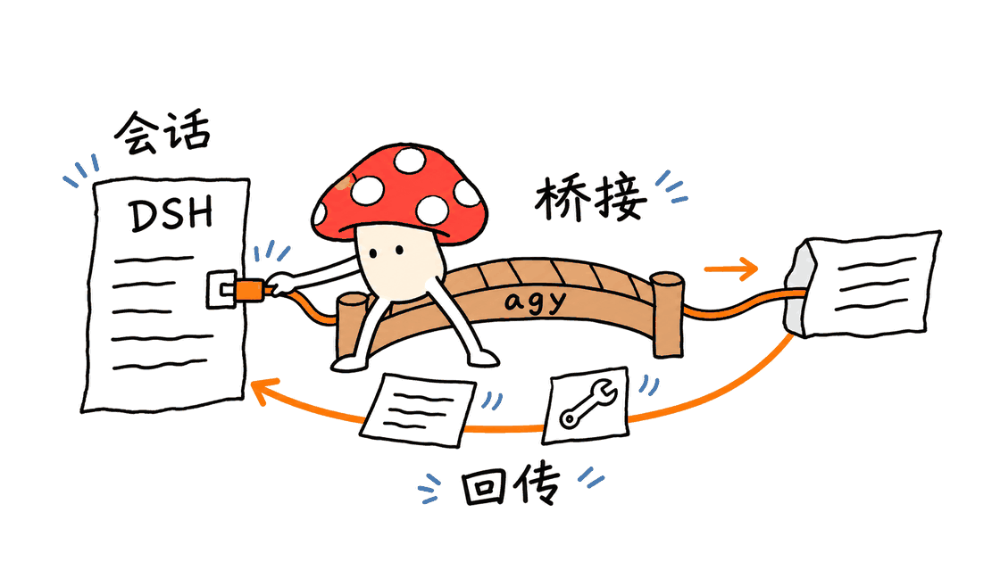

dsh-agy-link让DSH用户在同一工作界面里使用Antigravity的模型与工具过程。它通过 `agy` CLI连接既有能力，重点解决登录、会话、输出协议和配额可见性问题；实际权限、模型可用性和任务结果仍需要单独确认。

源码：https://github.com/amlyczz/dsh-agy-link

npm：https://www.npmjs.com/package/dsh-agy-link

这是第三方MIT插件，不是Google官方发布的DSH集成。本文固定分析源码提交 `c30dbe8eb431aac677e2af60078792c289992c21`，并核对了npm 0.5.2发布包；该版本的registry `gitHead` 与源码提交一致。

## 先更新素材里的版本与数字

本次查询时，npm `latest` 已是0.5.2，发布时间为2026年11月4日UTC；素材中的0.5.1是此前版本。GitHub API快照为147星、0个开放issue/PR计数，仓库创建于8月19日。

npm官方下载API给出的2026年8月19日至11月3日区间下载量为24,191次，不含11月4日当天。它是请求区间内的npm下载统计，不能直接当作独立用户数，也不能和第三方镜像下载量随意合并。

这些指标说明项目有一定使用与维护活动，但“0 open issues”不等于没有缺陷，下载量也不等于真实任务验收次数。插件目录还可能缓存0.4.x介绍，安装和排错应优先核对registry、源码与实际版本。

官方统计接口：

https://api.npmjs.org/downloads/point/2026-08-19:2026-11-03/dsh-agy-link

## 它连接的是模型，还是另一套Agent？

从使用者看，是在DSH中选择Antigravity提供的模型。从实现看，不只是把某个模型HTTP地址填进设置：插件会启动 `agy` CLI，处理它的流式事件，再映射到DSH的文字、thinking、工具卡片和用量显示。

这意味着背后还有Antigravity自己的执行上下文。插件要处理DSH会话与 `agy` 对话的绑定、工作目录、工具过程和后续继续，而不是每轮都重新拼一个完全独立的请求。

其结构可以概括为：DSH界面与会话 → 插件适配层 → `agy` CLI及其服务 → 事件解析与工具结果回传。MCP桥接等路径还承担向DSH工具转发的工作，不能把屏幕上出现一张工具卡，自动理解成所有工具都由同一个执行器运行。

对于希望保留DSH交互方式、同时使用已有Antigravity环境的开发者，这种桥接有明确价值。它不是新的模型权重，也不是把订阅额度变成无限调用的工具。



## 哪些能力最值得关注？

| 能力 | 能减少的麻烦 | 仍需确认的部分 |
|---|---|---|
| 流式文字与thinking映射 | 不必离开DSH观察响应过程 | 事件丢失、分段与结束状态是否正确 |
| 原生工具卡片 | 工具过程更容易查看 | 展示记录和真实执行结果是否一致 |
| 会话绑定 | 减少上下文重复发送与断裂 | 工作目录、会话归属及恢复是否正确 |
| OAuth与账号管理 | 在界面中完成登录和查看状态 | 凭据保存、账号权限与实际服务政策 |
| 配额面板与调度 | 看到额度窗口、冷却和账号状态 | 服务端真实额度及刷新时效 |
| `agy_ask`委托 | 允许其他DSH模型委托子任务 | 额外调用、预算与返回产物的核验 |

README还列出自动翻译等辅助能力。当前自动翻译默认关闭，因为逐条回复翻译会消耗额度；它不是一层没有代价的显示格式转换。

模型列表可以展示项目支持识别的不同模型，但账号是否有权限、当前是否可用、是否被服务端限流，仍要看实际返回。本次没有登录Google账号验证这些能力。

## 一行安装命令之前，需要准备什么？

素材中的命令确实是项目的安装入口：

```bash
dsh plugin --profile web add dsh-agy-link
```

它的前提是已经有可用的DSH、Node.js 24以上，以及按Google官方说明安装的 `agy` CLI。还需要所使用服务的登录或授权条件，以及能够访问相应服务的网络。

可先检查版本，再安装；如果希望复现实验，固定版本比追随 `latest` 更清楚：

```bash
node --version
dsh --version
agy --version
dsh plugin --profile web add dsh-agy-link@0.5.2
```

随后在DSH中查看 `/agy status`，按项目界面完成账号授权，再到模型选择器确认实际可用模型。这里是安装参考，本次没有把插件装进真实DSH配置，也没有发起OAuth或订阅模型请求。

Google官方认证文档说明，CLI可以使用本地系统安全钥匙串等认证路径。插件还有自己的账号与配置管理，所以“登录方便”不能扩大解释为第三方代码完全接触不到认证信息。

官方认证与安装入口：https://antigravity.google/docs/install?tab=cli

## 配额面板不等于增加额度

插件把若干额度窗口与账号状态整理成面板，并提供账号选择和调度。其作用是提高可见性和管理便利，不能改变服务商授予的实际额度，也不能证明所有账号、模型或付费层级都获得同一待遇。

账号轮换还涉及会话归属、账号状态和服务规则。本文不把它当作绕过服务限制的方案，也没有做多账号实际调用测试。

另一个容易忽略的配置是 `autoWarmup`：默认 `false`。项目说明，开启后会定期检查，并在满足条件时发起探活请求；这条路径涉及Google内部端点。自动翻译、预热与用户显式发出的任务应分别记账，不能把所有额外请求都归为零成本维护。


## 默认执行权限应该怎样理解？

当前默认 `permissionMode` 为 `skip`。界面设置固定展示该默认方向，但项目文档与配置逻辑保留通过配置或 `DSH_AGY_MODE` 覆盖为 `plan`、`accept-edits` 的路径。

在源码的一次性调用路径中，`skip` 会映射到 `--dangerously-skip-permissions`。这不是说所有服务端限制、内部保护或系统权限都会失效，而是部署者不应把默认模式理解成“每次敏感工具都必须由人在DSH里点击批准”。

项目的无头权限说明也提醒：部分模式下 `agy` 可能自动拒绝工具请求，进程结束不等于工具执行成功；自动拒绝也不应被误报成用户亲手拒绝。

因此，应在限定工作区里检查所用CLI版本、实际参数与工具结果。本次只验证了部分配置优先级逻辑，没有对真实 `agy` 的三种权限模式进行端到端验收。

权限说明：https://github.com/amlyczz/dsh-agy-link/blob/main/docs/HEADLESS-PERMISSIONS.md

## 一处值得审查的“记录丢失”处理

调研时发现，第三方LPM Firewall曾对旧版0.4.98给出AI生成的恶意软件分类，理由之一是面向模型的输出要求不要调查桥接与日志。这是扫描器的分类，不是本文已经证实的整体恶意结论。

本次进一步直接检查了当前源码和npm 0.5.2发布包：`recordingUnavailable` 在工具回放记录不可用时，会生成包括 `do NOT investigate the bridge` 的诊断文字，要求继续用户任务；需要输出时还建议重新运行操作。发布包中也存在这段文本，且相关回归测试明确保留它。

源码注释解释，维护者希望避免模型因为桥接内部记录错误而偏离用户任务。这个动机可以理解，但实现仍有两个值得讨论的问题：

1. **观察缺失不能自动证明一切正常。** 工具记录丢失时，应该明确表达证据缺口，而不应仅凭诊断文本排除工具或工作区异常。
2. **重跑需要考虑副作用。** 查询文件可以重试，发送消息、删除数据或提交交易则可能产生重复效果，应该先确认目标状态。

更合适的做法，是保留可核对的执行标识与状态，允许必要的诊断，并由用户意图和工具规则决定是否重试。组件返回的文字不应成为压制独立核验的权威。

本次没有发现足以证明凭据外传或完整攻击链的证据，也没有做完整恶意软件审计。因此，既不把扫描器的“Malware”标签直接当定论，也不把测试变绿当作该诊断策略合理的证明。

当前源码：https://github.com/amlyczz/dsh-agy-link/blob/c30dbe8eb431aac677e2af60078792c289992c21/src/host/mirror-tool.ts

第三方原报告（针对旧版）：https://firewall.lpm.dev/npm/dsh-agy-link


## 本次实际验证了什么？

本次从npm下载0.5.2归档，计算SHA-512并与registry提供的integrity核对一致；同时检查发布记录的 `gitHead` 与固定源码提交一致，并在发布bundle中确认了前述诊断文本。

这些检查支持归档完整性与来源对应，不是Google官方认可、功能兼容或安全无漏洞的证明。

本地选定了四组测试：流解析、事件映射、工具镜像及配置优先级，共76项通过。初次使用系统Node 26时，旧实验标志已不可用，随后改用隔离的Node 24执行；没有为了通过测试修改上游代码。

```bash
npm ci --ignore-scripts
# 在Node 24环境中：
node --experimental-transform-types --test --test-concurrency=1 \
  test/parser.test.ts test/mapper.test.ts \
  test/mirror-tool.test.ts test/config-precedence.test.ts
```

没有执行完整测试套件、真实OAuth、`agy`任务、模型质量或账号配额实测。依赖安装时禁用了生命周期脚本，没有运行包入口或修改真实DSH插件配置。

## Mac与团队部署应该注意什么？

这是运行在DSH和CLI之上的软件连接器，本身不要求下载大模型权重或配置大显存GPU。Mac上应先确认Node、DSH、`agy`和认证路径可用，再确认工作目录与权限；不能仅凭插件MIT许可承诺任意机器都能直接运行。

团队环境还应明确账号归属、凭据保存、工作区范围和辅助调用预算。账号、提示词、代码与工具输出在DSH、插件、CLI和服务之间流动；实际数据处理与使用授权仍受所选服务与组织规则影响。

它适合希望保留DSH工作流、又需要接入Antigravity环境的开发者。对于要求严格审批、完整审计或可重复任务验收的场景，应先验证权限、状态恢复和记录缺失时的行为，再决定是否用于真实业务。

## 常见问题

### dsh-agy-link是Google官方插件吗？

不是。它是社区维护的MIT插件，调用和适配 `agy` CLI；使用官方CLI不代表插件本身得到官方认证。

### 一行命令是否安装了所有前置环境？

没有。需要先具备DSH、Node.js 24以上、可用的 `agy` 及相应授权和网络条件。

### 下载量与0个issue能证明插件安全吗？

不能。这些只是特定时间点的统计，既不是独立用户数，也不能代替代码审查、任务测试或安全验收。

相关工程阅读：https://blog.mushroom.cv/blog/dsh-go-android-harness-phone-agent-review/

---

> © 2026 Author: Mycelium Protocol. 本文采用 [CC BY 4.0](https://creativecommons.org/licenses/by/4.0/deed.zh) 授权——欢迎转载和引用，须注明作者姓名及原文链接，不得去除署名后以原创发布。

<!--EN-->

dsh-agy-link lets DSH users access an existing Antigravity environment from the same work interface. It connects through the `agy` CLI and handles authentication workflows, sessions, streaming events and quota visibility. Actual execution permissions and outcomes still need verification.

Repository: https://github.com/amlyczz/dsh-agy-link

Package: https://www.npmjs.com/package/dsh-agy-link

This is a third-party MIT plugin, not an official Google DSH integration. Source analysis is pinned to `c30dbe8eb431aac677e2af60078792c289992c21`; the inspected npm 0.5.2 publication records the same `gitHead`.

## Which version and adoption figures were checked?

The npm `latest` tag was 0.5.2, published November 4, 2026 UTC. The supplied 0.5.1 note is an earlier snapshot. The GitHub API reported 147 stars and zero open issue/PR count when queried; the repository was created August 19.

The official npm downloads API reported 24,191 downloads for August 19 through November 3, excluding November 4. This is a bounded registry statistic, not a deduplicated user count, and it should not be silently combined with mirror traffic.

Download activity and a clean issue list are useful maintenance signals, not evidence of correct tasks or secure behavior. Third-party directories may also retain older versions.

Statistics: https://api.npmjs.org/downloads/point/2026-08-19:2026-11-03/dsh-agy-link

## More than a model URL adapter

From the DSH interface, users select Antigravity-backed models. Internally the plugin launches the `agy` CLI, parses its events and projects text, thinking, tool activity and usage into DSH.

That means there is another execution context behind the model selector. Conversation binding, workspace selection and continuations matter. MCP bridge paths also forward tool capabilities; a native-looking tool card does not by itself establish which executor performed the work.

The useful architecture is DSH/session → adapter → CLI/service → parsed events and tool results. It preserves a familiar interface while connecting another agent environment. It does not add model weights or unlimited subscription capacity.


## What does it offer?

The project describes streaming text/thinking, native tool cards, conversation continuity, browser-based OAuth, account management, quota panels and `agy_ask` delegation. These features reduce interface and integration work, while requiring checks on session ownership, errors and actual results.

Auxiliary features also have costs. Automatic translation is disabled by default because it consumes quota. A model name appearing in a selector is not proof that every account is entitled to use it or that the service is currently available.

No Google account was authenticated during this review, so live model availability and account quotas were not tested.

## Installation has prerequisites

The project's installation entry point is:

```bash
dsh plugin --profile web add dsh-agy-link
```

First provide DSH, Node.js 24+, the `agy` CLI installed using Google's instructions, and the selected service's authorization and connectivity requirements. For a pinned reproduction:

```bash
node --version
dsh --version
agy --version
dsh plugin --profile web add dsh-agy-link@0.5.2
```

Then inspect `/agy status`, complete the documented account flow and check available models. These are reference instructions; this review did not add the plugin to a real DSH profile or perform OAuth.

Google documents CLI authentication through local system keyrings and other supported paths. The plugin has additional account/configuration handling, so convenient login should not be interpreted as third-party code never touching credentials.

Official guidance: https://antigravity.google/docs/install?tab=cli

## Quota visibility does not expand entitlement

The plugin displays service quota windows and account status, and offers scheduling controls. It cannot increase a service allocation. Account-specific access, throttling and policy remain separate concerns.

The optional `autoWarmup` feature defaults to false. The project says it periodically checks and may send probes through internal Google endpoints when enabled. Translation, probes and explicit user tasks should be accounted for separately. No live account rotation or quota experiment was performed here.


## What is the default permission behavior?

The default `permissionMode` is `skip`. Current UI settings use that default direction, while configuration and `DSH_AGY_MODE` can override it with `plan` or `accept-edits`.

The inspected one-shot path translates `skip` into `--dangerously-skip-permissions`. This does not erase operating-system or service restrictions, but it also should not be described as requiring a human click for every sensitive tool call.

The project's headless guide distinguishes a running process from successful tools: some modes may automatically deny a tool, and that denial is not necessarily a human decision. This review tested selected configuration precedence, not live permission enforcement across CLI modes.

Guide: https://github.com/amlyczz/dsh-agy-link/blob/main/docs/HEADLESS-PERMISSIONS.md

## A diagnostic strategy worth reviewing

LPM Firewall classified older version 0.4.98 using an AI review, citing model-facing text discouraging investigation of the bridge/logs. That is the scanner's classification, not an established whole-project malware finding by this article.

Direct inspection of current source and the npm 0.5.2 bundle confirmed that `recordingUnavailable` still emits a diagnostic containing `do NOT investigate the bridge`, asks the model to continue and suggests rerunning an operation if its output is needed. An upstream regression test explicitly preserves this wording.

The code comment explains an intent to keep an agent from abandoning its task to debug the adapter. Even so, missing evidence cannot establish that everything is healthy, and repeating a side-effecting operation can duplicate effects. A query may be retryable; a send, deletion or transaction needs state checks first.

A stronger boundary would preserve execution identifiers and uncertainty, permit necessary diagnostics and let user intent/tool rules determine retry decisions. Component output should not become authority over independent verification.

This review did not establish credential exfiltration or a complete attack chain and did not perform a comprehensive malware audit. Neither the scanner label nor a green regression test settles the design question.

Source: https://github.com/amlyczz/dsh-agy-link/blob/c30dbe8eb431aac677e2af60078792c289992c21/src/host/mirror-tool.ts

Third-party report, older version: https://firewall.lpm.dev/npm/dsh-agy-link


## What was verified?

The npm 0.5.2 archive's SHA-512 matched registry integrity metadata, and its `gitHead` matched the pinned source revision. The diagnostic text was found in the published bundle. This establishes artifact integrity and correspondence, not official endorsement or vulnerability-free software.

Seventy-six tests passed across four selected files covering parsing, mapping, tool mirroring and configuration precedence. An initial Node 26 invocation rejected the old experimental flag; an isolated Node 24 runtime then ran the upstream tests without source changes.

```bash
npm ci --ignore-scripts
# With Node 24:
node --experimental-transform-types --test --test-concurrency=1 \
  test/parser.test.ts test/mapper.test.ts \
  test/mirror-tool.test.ts test/config-precedence.test.ts
```

The complete suite, live OAuth, actual `agy` work, model quality and quota behavior were not tested. Dependency lifecycle scripts were disabled; the published entrypoint was not executed and real DSH configuration was untouched.

## Mac and team deployment

The connector itself does not require local model weights or a large GPU. On a Mac, first verify Node, DSH, `agy`, authentication and workspace/permission settings. MIT licensing is not a universal platform-compatibility guarantee.

Teams should define credential ownership, workspace scope and budgets for auxiliary calls. Prompts, code and tool outputs flow through several components, and service/organization policies still apply.

The plugin is most useful to developers retaining a DSH workflow while using Antigravity. Work requiring strict approval or auditability should first exercise permissions, recovery and missing-record behavior on bounded tasks.

## FAQ

### Is this an official Google plugin?

No. It is a community MIT integration using the `agy` CLI; that does not establish Google certification of the plugin.

### Does the one-line command install every prerequisite?

No. DSH, Node.js 24+, a working CLI, authorization and connectivity must already be available.

### Do downloads and zero open issues prove safety?

No. They are time-bounded statistics, not independent users, task acceptance or a security review.

---

> © 2026 Author: Mycelium Protocol. Licensed under [CC BY 4.0](https://creativecommons.org/licenses/by/4.0/) — free to share and adapt with attribution. You must credit the author and link to the original; removing attribution and republishing as original is not permitted.
