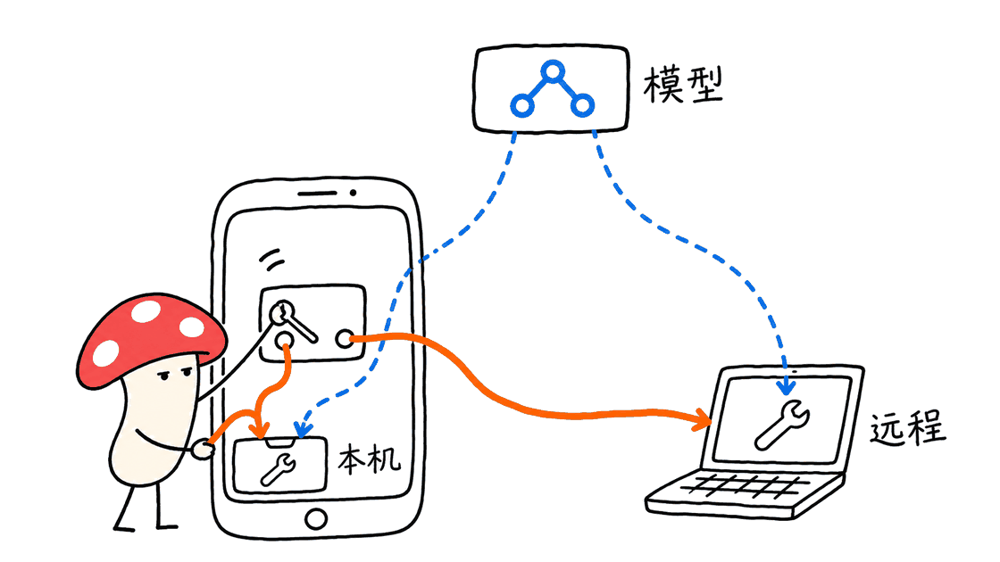
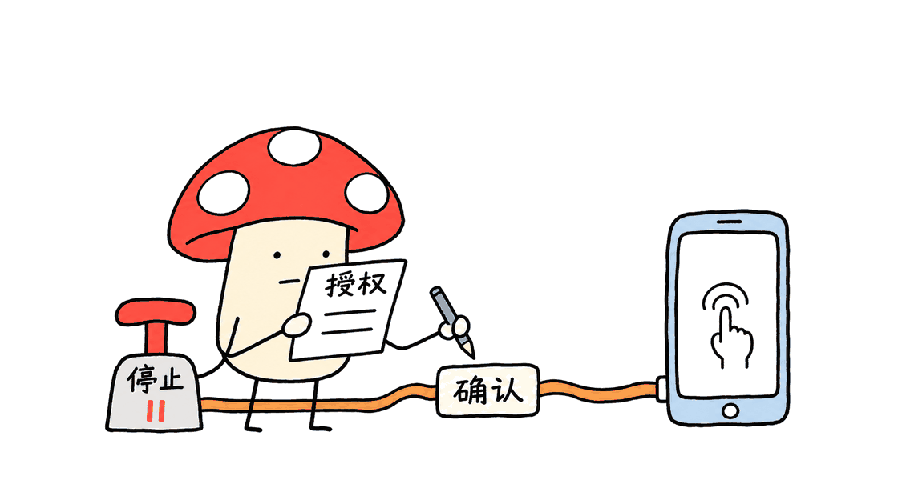

DSH Go让Android手机拥有一个可以调用工具、处理文件和连接远程主机的Agent入口。它的实际价值，是把DSH运行环境与移动交互接起来；能否完成复杂任务，仍取决于模型、工具、权限、环境和结果核验。

项目源码：https://github.com/ccch1mneyyy/dsh-go

下载入口：https://github.com/ccch1mneyyy/dsh-go/releases/latest

项目明确说明，它是社区开发的第三方客户端，与DeepSeek公司没有关联，也不代表DeepSeek。本文以提交 `f75d4a19dd0846ae2764fa63758c7abdb25ab44d` 分析源码，不把作者展示、主分支功能和APK实际验收混为一谈。

## “手机上运行”，到底运行了什么？

运行在手机上的是DSH引擎及其工具环境。模型请求仍发往用户配置的模型提供方，需要相应连接与账户；手机本机运行不等于本地大模型推理，也不代表没有Token费用。

源码架构包含Flutter界面、Dart通信包、Kotlin平台实现，以及在PRoot兼容环境中运行的Ubuntu、Node.js和DSH。PRoot减少了用户另装Termux或取得Root的步骤，但不能把这个Linux环境理解为完全独立于Android的虚拟机。

因此，它与一个只显示聊天消息的壳有区别：任务可以在真实的工具环境中推进。与此同时，“有运行环境”也不意味着手机自动具备电脑上所有编译工具、应用权限和后台稳定性。

上游引擎：https://github.com/deepseek-ai/deepseek-harness



## 本机、SSH与DSH Remote，应该怎么选？

| 路径 | 任务实际在哪里运行 | 适合的起点 | 主要边界 |
|---|---|---|---|
| 本机引擎 | 手机内的运行环境 | 文件处理、脚本、小型工作区与手机工具 | 存储、内存、后台策略及手机权限 |
| SSH主机 | 自己的电脑或服务器 | 已有代码库、开发环境和长任务 | SSH可达、主机身份核对、DSH进程可用 |
| DSH Remote | 配套远程服务连接的主机 | 不在同一网络时访问既有DSH | 主机与服务支持，以及连接方式的功能限制 |

只连接远程主机时，不必先在手机安装本机环境。反过来，手机本机可用也不代表远程主机的所有功能都在同一个会话中自动出现。

使用指南特别说明，对话、工作区和插件属于各自的主机。继续操作同一台远程电脑上的会话是合理用法；切换本机和另一台主机，则不能自动理解为会话、文件和运行状态被无缝迁移。

当前DSH Remote路径还有具体差异：仅支持图片附件，不能在App内打开网页版，插件管理限于开关，DS Bot和对话日志导出不可用。不能只看主界面有一个入口，就假定每种连接方式能力相同。

主机指南：https://github.com/ccch1mneyyy/dsh-go/blob/main/docs/guide/zh/03-engine-hosts.md

## Harness为什么能让它处理更复杂的事？

复杂任务通常需要反复读取材料、调用工具、查看结果和修正方案。DSH Go提供的不只是输入框，还包括工具审批、提问、生成过程、模型切换、插话、附件以及插件界面。

例如，一份账单可以经历读取文件、写处理脚本、生成表格与图表、交付文件的过程。一个代码问题则可能在远程电脑上经历读源码、修改、运行测试和检查差异。仓库展示了类似交互，但演示不构成本次对这些任务的复现。

移动端的作用，是让任务过程可见、可干预：模型生成期间可以插话，排队消息可以提前发送，完成后的工具过程可以折叠。插件SDK还允许把某些工具结果呈现为原生卡片、表单和面板，减少用户阅读长日志的负担。

这些能力增加了可处理任务的范围，但不会自动消除模型误判、工具缺失或环境差异。尤其是编译大型项目、跨App事务和依赖登录状态的操作，应检查实际产物与目标状态，而不是只看回复里出现“完成”。

## 手机操控如何工作，哪些条件不可少？

手机操控是另一组能力：在用户授权后，让本机引擎读取屏幕信息、点按和输入。它只在本机正常模式下开放，安全模式不加载；远程连接电脑与本机控制手机不能混成同一条执行路径。

指南要求开启无障碍等权限，并保持亮屏与解锁。锁屏会停止任务；系统省电与后台弹出限制也会影响运行和确认界面。App提供暂停、停止与悬浮条，并不意味着Android一定允许它永久在后台运行。

源码中的 `ScreenVerdict.kt` 有一个值得关注的判断：缺少前后可读观察时，返回“无法验证结果”，而不是断言“界面没变化”。对于Agent，这能避免把看不到的结果当成失败，继而反复点一个已经生效的按钮。

这是一项源码设计观察。本次没有在Android上执行该分支，也没有验证不同厂商ROM的无障碍行为。

### “不打扰模式”不是没有额外权限

当前指南将其描述为在不可见屏幕上操作，同时保留用户自己的使用界面。它要求Android 14以上，并选择Shizuku、Sui、Root或自连ADB等相应通道，仍有授权、服务和设备状态条件。

所以，普通安装免Root，与某个进阶模式需要更高权限并不矛盾。使用前需要确认当前模式、实际通道和权限状态，不能只凭“免Root”三个字推断所有功能开箱即用。

操控指南：https://github.com/ccch1mneyyy/dsh-go/blob/main/docs/guide/zh/04-phone-control.md



## 敏感操作是不是永远无法执行？

不应这样承诺。当前默认策略会对银行、支付等App设置限制，对系统权限、密码和验证码等步骤交还用户处理；确认方式包括逐次询问、任务内免确认和始终免确认。

但指南同时提供应用名单调整与“解除限制”选项。因此，默认保护不是不可修改的系统边界；某些旧介绍中的“永远交还给用户”，并不适合概括当前全部配置。

这对团队落地很重要：应先记录实际配置，再评价任务行为。某个演示顺利完成，可能依赖已授予的权限、登录状态或放宽规则，不应由演示直接推导普通用户的成功率。

数据流也需要单独理解。开启手机操控后，屏幕文字可能发给所选模型，支持视觉的模型还可能收到截图。项目说明有打码措施，但本文没有做完整隐私审计，不能据此承诺所有敏感内容都会被过滤。

“发送匿名使用统计”默认开启，可在引导或隐私设置关闭。对话分享支持项目所述的端到端加密链接，但拿到完整链接的人仍可能保存内容；这与模型端是否接收任务数据是两回事。

## 需要什么手机，Mac用户能用吗？

当前安装要求是Android 8.0 / API 26以上，常见64位手机选arm64 APK。仓库没有32位ARM构建；README提供x86_64构建与对应设备、模拟器的说明。

本次查询到的最新Release为v1.0.10，发布时间为2026年11月3日UTC，公开arm64 APK为192,768,115字节，约193MB。这是安装包体积，不是安装后总占用。README建议为本机运行环境预留约1GB，实际还要考虑工作区、文件和缓存。

Android版本满足门槛，也不等于所有复杂任务都流畅。项目没有提供可覆盖所有手机、模型和工作负载的统一最低内存或成功率承诺。只用远程主机的资源需求，与手机本机跑脚本和工具也不同。

iPhone和鸿蒙适配仍属于项目计划，不能把Flutter具备跨平台潜力写成已有可用版本。Mac可以作为远程DSH主机，但DSH Go本身是Android应用；本文没有验证Mac端SSH连接或模拟器运行。

源码当前 `targetSdk = 28`，仓库明确以APK侧载为目标，不是Google Play发布配置。若要自行构建，README的完整工具链流程面向Linux x86_64，涉及JDK、Flutter、Android SDK/NDK和运行时打包，不能把它当成一条在任意Mac上直接成功的编译命令。

首次尝试可按一条短流程推进：从Release下载匹配的APK，选择本机或远程主机，为所选主机配置模型与凭据，再用无敏感数据的文件整理或只读任务检查结果。需要手机操控时，再按指南单独开启权限；先确认当前运行在哪台主机，避免把文件或命令发到错误环境。

还有一个实际升级问题：不同签名的早期测试包无法直接覆盖。卸载会清除对话、环境和设置，遇到冲突应先确认备份及签名，不要用删数据来盲目排错。

## 本次实际检查了哪些内容？

本次没有可用的Flutter/Dart、ADB或Android真机环境，因此没有安装APK、编译应用、启动手机PRoot环境或执行真实App任务。

可以独立运行的源码检查完成了两组：

```bash
node --test runtime/tests/native-unit.test.mjs \
  runtime/tests/session-deletion-route.test.mjs
# 27项通过

cd sdk/plugin-kit
npm install --ignore-scripts --no-package-lock
npm test
# 78项通过
```

第一组覆盖选定的桥接原生插件模块与会话删除契约，第二组覆盖插件SDK。它们支持的是协议和局部逻辑，不是手机画面读取、手势执行、后台存活或敏感操作保护的真机验收。

源码检查也只对应固定的主分支提交。本次记录了Release信息，但没有把该提交的每项功能与v1.0.10安装包逐项比对。读者部署时应以所安装版本的说明及实测为准。

## “最强AI手机方案”，现在能下结论吗？

暂时没有足够证据。本次查阅的项目资料中，没有一套与现有AI手机进行同条件横评的公开结果，能支持“其他方案完全做不到”的普遍判断。

更合适的评价方式，是给它明确任务、环境与验收标准。例如选几类文件处理、代码修改或跨App任务，固定模型、账号状态、权限和步数预算，分别记录完成率、重试次数、人工接管、费用与产物正确性。

DSH Go已经呈现出一个有价值的方向：把通用Agent工作环境带到手机，让用户可以继续电脑工作，也可以探索经过授权的手机操作。它更适合愿意配置模型、管理权限并核验结果的开发者和进阶用户，而不是把任何手机立即变成无人值守的万能代理。


## 开源许可还需要分清什么？

主代码为AGPL-3.0，`sdk/`和`examples/`为MIT。名称、品牌及Deepy、鲸娘等美术素材另有条款；`ASSETS.md`允许项目展示素材用于转载介绍，本文封面采用项目公开展示图，并不代表本文实测了图中的任务。

README同时明确，提前联系作者及特定署名位置属于协作请求，不是额外改变代码许可证的限制。修改、再发布、商业使用与品牌使用应分别按适用条款处理，不能把品牌限制误读成全部AGPL代码禁止商业使用。

素材条款：https://github.com/ccch1mneyyy/dsh-go/blob/main/ASSETS.md

## 常见问题

### DSH Go是DeepSeek官方手机App吗？

不是。它是社区开发的第三方客户端，项目明确说明与DeepSeek没有关联，也不代表DeepSeek。

### 手机本机运行是否意味着模型离线？

不是。本机运行的是DSH引擎和工具环境；模型请求仍交给所配置的提供方，数据流和费用取决于服务与配置。

### 手机能连接Mac继续工作吗？

项目支持连接安装DSH的远程主机，Mac可以作为这种主机使用。具体SSH、网络与工具条件仍需配置；本次没有做Mac远程连接实测。

相关工程阅读：https://blog.mushroom.cv/blog/northcua-pro-computer-use-harness-guide/

---

> © 2026 Author: Mycelium Protocol. 本文采用 [CC BY 4.0](https://creativecommons.org/licenses/by/4.0/deed.zh) 授权——欢迎转载和引用，须注明作者姓名及原文链接，不得去除署名后以原创发布。

<!--EN-->

DSH Go gives an Android phone an agent interface backed by tools, files and local or remote execution. Its value is connecting a DSH runtime to mobile interaction. Completing complex work still depends on the model, tools, permissions, environment and outcome checks.

Repository: https://github.com/ccch1mneyyy/dsh-go

Releases: https://github.com/ccch1mneyyy/dsh-go/releases/latest

This is a community-developed third-party client, not an official DeepSeek app. This review fixes source analysis to `f75d4a19dd0846ae2764fa63758c7abdb25ab44d`, and keeps project demonstrations separate from source behavior and device acceptance.

## What runs on the phone?

The phone runs the DSH engine and tool environment. Model requests still go to the provider configured by the user. Local execution of an agent runtime does not establish offline model inference, zero token cost or a guarantee that data stays on the device.

The architecture combines Flutter UI, Dart communication packages, Kotlin platform code and Ubuntu/Node.js/DSH inside a PRoot compatibility environment. Avoiding a separate Termux installation or Android root access simplifies setup; it does not turn this environment into a fully isolated virtual machine.

Upstream runtime: https://github.com/deepseek-ai/deepseek-harness


## Local execution, SSH or DSH Remote?

Local mode runs work inside the phone. It can support scripts and file workflows within the installed environment, subject to resources, background policy and permissions.

SSH connects to a computer or server with DSH installed. That is useful when the codebase, development tools or long-running work already live on another machine. Host identity and network reachability remain part of setup.

DSH Remote offers another connection path with its own host/service requirements. The current guide lists image-only attachments, no embedded Web UI, toggle-only plugin management, and no DS Bot or conversation-log export on that path.

Conversations, workspaces and plugins belong to each host. Continuing a session on the same remote computer is different from migrating all state when switching between local and remote hosts. The UI should not be read as a promise of automatic state transfer.

Guide: https://github.com/ccch1mneyyy/dsh-go/blob/main/docs/guide/zh/03-engine-hosts.md

## How does the Harness help with complex work?

The app exposes tool approvals, questions, attachments, streaming interaction, model selection and plugin UI. A file task can involve reading input, generating a script, producing a spreadsheet and handing back artifacts. A coding task on a remote host can involve edits, tests and diff inspection.

Those are meaningful workflows, but the repository's demonstrations are not reproductions performed for this article. The presence of a runtime does not automatically install every compiler, provide every application permission or make every model plan correctly.

Mobile interaction matters because users can intervene while work continues. Queued messages can be sent early, completed tool activity can collapse, and plugin authors can provide native cards, forms and panels rather than long unstructured logs.

## What does phone control require?

Phone control is available to the local engine in normal mode, after the user grants the required permissions. It is not the same execution path as remotely operating a computer.

The guide requires accessibility-related setup and an awake, unlocked device. Locking the phone stops the task. Background execution and confirmation UI are also affected by vendor power management and Android restrictions.

An interesting source detail is `ScreenVerdict.kt`: insufficient readable observation produces an unverifiable result rather than a claim that the screen did not change. That distinction can prevent repeated actions when an effect occurred but could not be observed. This review inspected the code, not the corresponding Android branch on hardware.

The advanced non-interference mode has additional conditions: Android 14+ and an appropriate Shizuku, Sui, root or self-connected ADB path. Root-free basic setup does not mean every advanced feature works without further authorization or device preparation.

Guide: https://github.com/ccch1mneyyy/dsh-go/blob/main/docs/guide/zh/04-phone-control.md


## Are sensitive operations permanently impossible?

No such blanket claim is justified. Default policies restrict certain apps and return sensitive steps to the user. Confirmation can be per-action, per-task or disabled, and the guide documents app-rule changes and unlock options.

Defaults therefore need to be distinguished from immutable boundaries. A successful demonstration may depend on granted permissions, login state or relaxed rules. Record the actual configuration before comparing results.

Phone-control text, and potentially screenshots for vision-capable models, can be sent to the selected provider. The project's masking measures were not independently audited here. Anonymous usage statistics are enabled by default and can be disabled. Encrypted conversation-sharing links are another data path; someone holding a complete link may still save its contents.

## Android requirements and the role of a Mac

Installation starts at Android 8.0/API 26. Typical 64-bit phones use the arm64 APK; the repository does not provide a 32-bit ARM build. It documents x86_64 builds for suitable devices and emulators.

The latest release queried was v1.0.10, published November 3, 2026 UTC. Its public arm64 APK is 192,768,115 bytes, approximately 193 MB. That is download size rather than installed footprint. The README suggests reserving roughly 1 GB for the local runtime, with workspace files and caches adding more.

Android version eligibility does not establish a universal memory threshold, task completion rate or speed. Remote-only usage differs from running local scripts and tools. iOS and HarmonyOS adaptation remain project plans rather than verified available clients.

A Mac can be a remote DSH host. DSH Go itself is an Android application; this review did not test a Mac SSH connection or emulator. Current source targets APK sideloading with `targetSdk = 28`, explicitly not a Google Play release configuration. The complete source-build recipe targets Linux x86_64 and includes Flutter, JDK and Android SDK/NDK preparation.

For a first run, download the matching APK, choose local or remote execution, configure that host's model credentials, and inspect a small read-only or non-sensitive file task. Enable phone-control permissions separately when needed, and confirm which host owns the task.

Older APKs signed differently may not support an in-place update. Uninstalling can remove conversations, the environment and settings; investigate signatures and backups before using deletion as a troubleshooting step.

## What was actually tested?

No Flutter/Dart toolchain, ADB setup or Android hardware was available for this review. The APK, PRoot execution, accessibility actions and real app workflows were not tested.

Two scoped source checks ran successfully:

```bash
node --test runtime/tests/native-unit.test.mjs \
  runtime/tests/session-deletion-route.test.mjs
# 27 passed

cd sdk/plugin-kit
npm install --ignore-scripts --no-package-lock
npm test
# 78 passed
```

The first group checks selected bridge/native-plugin modules and the session-deletion contract. The second checks the plugin SDK. Neither proves device-level input, background survival or Android sensitive-operation protection.

These results belong to the pinned source revision. Release metadata was checked, but every main-branch capability was not mapped to the v1.0.10 APK. Use the documentation and observed behavior of the installed version.

## Is it already the strongest AI-phone solution?

The reviewed project material does not supply a controlled comparison that establishes this universal ranking or proves that all competing phones cannot perform the demonstrated work.

A useful evaluation would fix task types, model, accounts, permissions and budgets, then record completion, retries, human intervention, cost and artifact correctness. That would distinguish a broadly useful runtime from a successful individual demonstration.

DSH Go offers a concrete direction: mobile access to an agent tool environment, remote work and authorized phone interaction. It is most compelling for developers and advanced users willing to manage configuration and inspect results.


## How do the licenses differ?

Main code uses AGPL-3.0; `sdk/` and `examples/` use MIT. Branding and the Deepy/whale-girl art have separate terms. ASSETS permits project presentation material to accompany introductions; this article's official project cover is not evidence that its pictured tasks were reproduced here.

The README clarifies that advance contact and specified attribution placements are collaboration requests, not extra restrictions on the code license. Code redistribution, commercial use and branding should be assessed within their respective scopes.

Asset terms: https://github.com/ccch1mneyyy/dsh-go/blob/main/ASSETS.md

## FAQ

### Is DSH Go an official DeepSeek phone app?

No. It is a community-developed third-party client and explicitly disclaims DeepSeek affiliation.

### Does local mode mean offline model inference?

No. The phone runs the runtime and tools; model processing goes to the configured provider, with its own data and billing conditions.

### Can it continue work on a Mac?

The project supports remote DSH hosts, which can include a configured Mac. Actual SSH/network/tool requirements still apply; this review did not test that connection.

---

> © 2026 Author: Mycelium Protocol. Licensed under [CC BY 4.0](https://creativecommons.org/licenses/by/4.0/) — free to share and adapt with attribution. You must credit the author and link to the original; removing attribution and republishing as original is not permitted.
