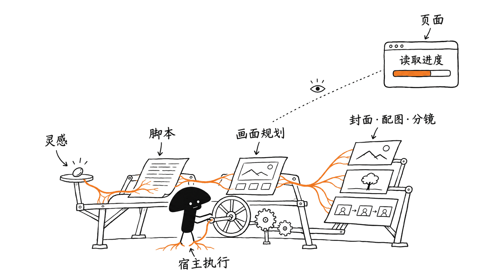
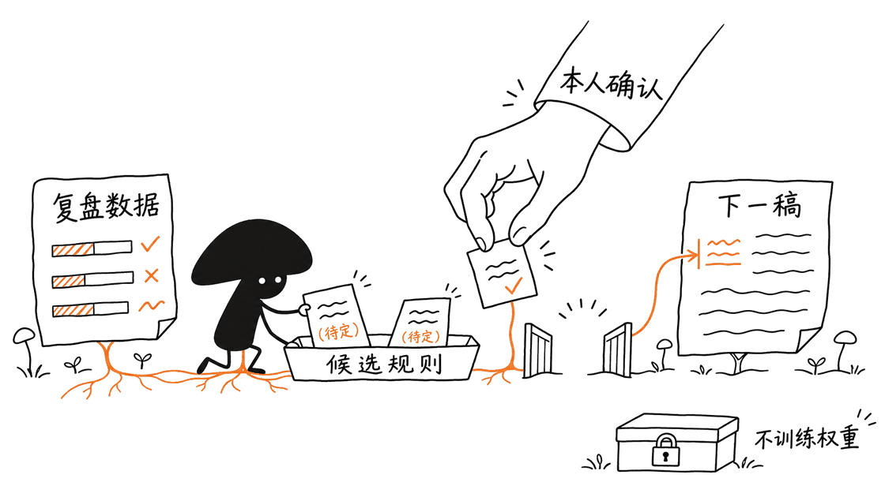
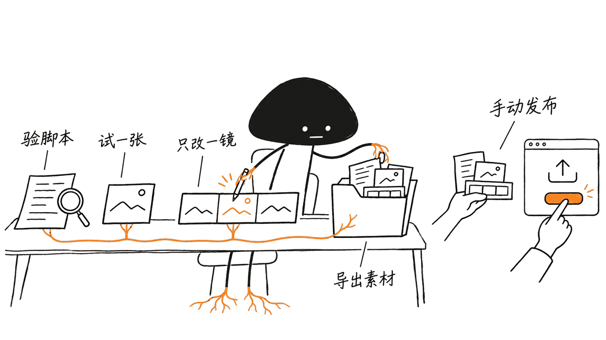

dsh-media-desk 把自媒体创作中分散的灵感、脚本、图片、分镜、排期和复盘放进同一个工作台。它适合想减少工具切换的个人创作者，但负责的是素材准备与管理，不会替你直接发布到各个平台。

项目仓库为 `woniuniuniu/dsh-media-desk`，MIT许可，由“蜗牛的科技笔记”开发，是DeepSeek Harness社区插件，不是DeepSeek官方产品。2026年11月10日核对时，源码与npm latest均为2.6.2；本文固定提交 `fc237f3388d048f51c3145cfd411dbb80ba2b388`。
https://github.com/woniuniuniu/dsh-media-desk
https://www.npmjs.com/package/dsh-media-desk

## 为什么要给创作流程单独做一个工作台？

聊天模型能写脚本，生图工具能画封面，日历能记发布时间，但这些工具之间往往缺少同一个内容对象。你修改了口播，分镜未必更新；换了标题，不一定知道该重画哪张图；发完后，修改经验也容易留在聊天里。

这个插件的思路，是把内容生命周期做成五个页面：灵感、内容、排期、复盘、风格。灵感可以是文字、链接、图片或视频；成稿聚合脚本、标题、封面和分镜；排期用于管理计划；复盘把数据变成候选写作规则；风格卡描述希望如何表达。

它支持中文和英文界面与文案，也能按小红书、抖音、B站、公众号、TikTok、Instagram、YouTube和X等目标组织内容。但要区分三种“支持”：为某个平台准备文案、导入该平台数据，以及向它发布，分别是不同能力。

| 环节 | 项目提供什么 | 需要你补什么 |
| --- | --- | --- |
| 灵感 | 卡片、画布、信息流、相关素材查找 | 判断事实、来源与选题价值 |
| 成稿 | 脚本、标题、封面、配图、分镜及对话修改 | 模型连接、画面与内容审校 |
| 排期 | 日历、待发布状态、下一条内容 | 到平台完成实际发布 |
| 复盘 | 手动数据、CSV及可选账号导入、规则建议 | 正确指标、确认建议与持续实验 |
| 风格 | 预设、个人样稿提炼、规则导出 | 提供有代表性的个人表达 |

## 技术上它是独立应用，还是宿主插件？

它依赖DSH。一个npm包同时提供Host服务半片和浏览器界面半片，通过Cordis patch注册到宿主。前端由React与自定义界面代码组成，esbuild打包为DSH延迟加载模块，React由宿主提供；后端是Node模块，处理 `/media-desk` 路由、数据与文件访问、模型和图片请求。

Host会调用宿主的连接检查，缺少对应能力时拒绝请求。文字模型主要复用DSH已经配置的服务，工作台助手也有单独选择模型的能力。它不是又实现了一整套聊天供应商登录系统。

这种划分让流程管理与长时间生成不必跟着页面一起消失。关闭工作台页面不等于结束Host里的任务，不过宿主退出或进程重启是另一回事：源码会把遗留的进行中状态标成中断或失败，避免界面永远转圈。这不等于已经有一个可跨机器恢复的持久任务队列。



## 一次“一键成稿”实际上做了多少工作？

流水线将灵感组织为文案和画面规划，再生成封面、配图及分镜，并逐步保存和展示结果。模型输出会经过结构化字段筛选与长度、数量限制，而不是原样写入所有内容。

默认配置是1张封面、2张配图、6张分镜图，共9张图；数量可以调整。图片工作并发上限为3，这是代码中的调度参数，不是本文测得“三倍更快”。文字阶段有超时和结构草稿回退，没接生图时也可以保留脚本与分镜文案，并合成纯文字封面。

因此，“界面出现完整稿面”不一定代表完整AI生成已经成功。初次打开还有作者准备的示例数据；试用时应清空示例，再检查模型状态、任务反馈与实际产物。

对话修改会定位到标题、脚本片段、某张配图或某个镜头，尽量只重画受影响的资产。撤销也采用按变更合并的思路，避免撤销一次风格修改时，把后来生成的图片一并抹掉。

工程上还有一个实用细节：已生成但图片下载失败，与生图请求本身失败分开处理，避免为了拿到已有图片而再次付费重画。仓库为相对地址下载、网关错误、限流和取消等情况保留了测试。

## 生图有哪两条路，为什么不是登录订阅就能用？

| 路线 | 如何接入 | 关键边界 |
| --- | --- | --- |
| 图片HTTP API | 配置兼容 `POST /images/generations` 的服务、模型和密钥 | 兼容协议不保证所有模型参数和返回格式相同 |
| DSH生成工具 | 复用受支持插件注册的根生图工具 | 需要工具、执行器、返回结构和图片目录都符合约定 |

默认使用图片API。设置中的“试画一张”会真实调用服务并可能计费，不是只验证密钥字符串。图片密钥保存到本机 `settings.json`，代码设置0600权限，公开设置响应会移除密钥字段。0600是文件访问权限，不是加密，也不能把备份随意当普通素材共享。

目前DSH工具路径适配 `dsh-plugin-subscriptions` 注册的 `image_generate` 及约定别名，走宿主工具执行管线，不读取订阅插件内部凭据。只接入聊天模型、只登录某个订阅，或仅存在Agent私有工具，都不足以证明这条生图路径可用。

还有一个容易忽略的区别：这是独立后台操作，不继承当前聊天会话的账号偏好、历史开关和权限上下文。工具按自己的提供方、账号及回退规则运行；全局策略仍生效，需要会话审批但没有可用会话时，宿主会拒绝调用。

纯Code Mode/PTC执行器当前不接受这种直接根工具调用，会被检测为不可用。工具失败后工作台不会自动切到HTTP路径，也不追加工具重试；选择前先看检测结果，再做一张真实试画。

## 账号导入、平台支持和“自动发布”是三回事

可选的Monid集成通过本机CLI，读取自己账号的近期公开内容和互动数据，供风格提炼与复盘使用。它是第三方按次计费服务，具体费用以服务商为准；没有它也可以手工填数据、粘贴CSV或自己的样稿。

当前导入列有小红书、抖音、B站、TikTok、Instagram和X。公众号、视频号、YouTube暂不能通过这条路径导入，但仍可准备文案和安排日历。

字段也不完全一样：小红书和抖音公开接口不提供这里需要的播放量，项目会按互动指标复盘；小红书正文长度有限，B站往往主要有标题。用这些资料提炼的风格与效果判断，需要人工补充，不能把“互动高”直接当成“播放量高”。

导入链接会发给Monid及其数据服务商，不是纯本机抓取。仓库要求只导入自己的账号，并确认符合平台及服务条款。密钥由Monid自己的配置管理，工作台调用CLI，不让你在聊天里粘贴密钥。

项目明确不直接发布。完成后复制脚本或导出文件夹，由自己去对应平台发布；日历的“待发布”是工作流状态，不是承诺到点自动发送。分镜图也不是已经剪辑好的视频。

## “复盘会越用越懂我”，是不是在训练模型？

不是。源码会汇总内容数据、比较分组表现，并观察你对草稿的修改，提出可确认的写作规则。规则生效后作为后续提示和风格约束，也可以导出为DSH Skill。

这是在积累操作规范与个人偏好，没有训练模型权重。建议里有用的部分应当能被你解释，例如“标题更短”“先写结论”“镜头减少无意义切换”。

小样本也很容易误导：题材、发布时间、粉丝增长、平台分发和内容质量共同影响互动。某一风格平均互动较高，只是进一步试验的线索，不是因果证明。先统一指标，再多做几次可比内容，比把每条建议都永久写入规则更可靠。

灵感关联同样并非复杂语义模型：当前实现使用英文词边界、中文片段和权重匹配。它轻量、可解释，但同义表达和跨语言关联仍需自己验收。



## 数据存在哪，能当团队协作系统吗？

默认目录是 `~/.dsh/media-desk/`，遵循 `DSH_HOME`；内容状态在 `state.json`，另有素材文件与设置。桌面和Web读取同一份本机数据，卸载插件不会自动删除内容。

存储使用进程内写队列、修改时间刷新以及临时文件重命名；撤销保留最近的有限步骤。它适合个人工作台，但这些机制不等于多用户数据库事务、权限隔离或云端协同。本次没有进行多进程压力测试。

默认导出目录是 `~/Documents/自媒体工作台/`。备份时同时考虑状态、素材和敏感配置；真实模型、图片服务与Monid请求仍可能把选题和材料送到外部。

## 怎样安装，第一次应该验收什么？

插件要求DSH `>=0.2.1-rc.5 <0.3.0`。作者README报告在 `0.2.2-rc.1` 桌面版与Web版验证过；这不是本文做过的宿主兼容性测试，也不保证未来0.3.x可直接使用。插件自身声明Node.js 20及以上，完整宿主要求仍以DSH文档为准。

桌面版可在“插件→添加插件”输入 `dsh-media-desk`。命令行按实际使用的profile选择一条：

```bash
# 桌面版：先完全退出宿主，安装后重新打开
dsh plugin --profile desktop add dsh-media-desk

# Web版：安装后重启 dsh web
dsh plugin --profile web add dsh-media-desk
```

没有 `dsh` 命令时，按宿主菜单的“管理dsh命令”设置。更新可用插件页，或按文档重新执行安装；需要固定版本时保留对应release包和原数据备份。本文没有向真实DSH profile安装插件。

建议第一轮这样试：清空示例，记一条自己的灵感；先生成脚本并核对来源，再只画一张图确认配置；增加分镜后修改其中一镜，检查其余产物是否保留；最后导出文件夹并手工完成一次发布。复盘先录入同口径数据，不急着购买导入额度。

## 本次实际验证到了哪里？

我们在临时克隆中执行 `npm ci --ignore-scripts`、`npm run build` 和完整的 `npm test`。构建成功，六个测试文件共87项通过，无失败或跳过。测试使用隔离的DSH数据目录，并将时区设为Asia/Shanghai，以匹配中文时间样例。

覆盖范围包括结构草稿、生成状态、图片返回与下载、受支持工具适配、Monid模拟导入、指标口径、撤销与中英文相关逻辑。图片及模型请求使用测试替身，没有真实生图、付费导入或外部发布。

这验证的是插件代码的构建与既有测试，不是“已经在真实DSH里跑通”。我们未验证完整宿主界面交互、真实模型质量、订阅账号额度、第三方数据可用性、生成耗时或涨粉效果。

从源码复核这些检查，可使用：

```bash
git clone https://github.com/woniuniuniu/dsh-media-desk.git
cd dsh-media-desk
git checkout fc237f3388d048f51c3145cfd411dbb80ba2b388
npm ci --ignore-scripts
npm run build
DSH_HOME="$(mktemp -d)" TZ=Asia/Shanghai npm test
```

对已经使用DSH、希望把个人创作步骤收拢的人，它值得试。若需要团队审批、可靠自动发布、多账号权限或跨机器协作，则还要配合其他系统，不能把界面的“灵感到复盘”误读成所有外部环节都已经自动完成。



## 常见问题

### 不装DeepSeek Harness能单独运行吗？

当前产品形态是宿主插件，界面和模型能力依赖DSH；源码构建成功不代表它是独立桌面应用。

### 插件免费，是否生成内容也都免费？

不是。文字模型、图片服务或订阅工具、可选Monid导入按各自账户与额度运行。默认一次完整成稿可能涉及9张图，建议从一张试画开始。

### 排期能自动发小红书或公众号吗？

不能。排期记录计划与状态，复制脚本或导出素材后仍需要自己发布。

### 风格学习和复盘是不是微调？

不是。它提炼并应用写作规则与风格提示，需你确认，不能视为模型权重更新或流量提升保证。

相关背景：个人Agent和稳定工作流的区别：
https://blog.mushroom.cv/blog/n8n-nod-local-personal-agent-engineering-guide/

---

> © 2026 Author: Mycelium Protocol. 本文采用 [CC BY 4.0](https://creativecommons.org/licenses/by/4.0/deed.zh) 授权——欢迎转载和引用，须注明作者姓名及原文链接，不得去除署名后以原创发布。

<!--EN-->

dsh-media-desk puts ideas, scripts, images, storyboards, scheduling and review into one creator workbench. It suits individual creators who want fewer disconnected tools. Its scope is production preparation and management; it does not publish directly to social platforms.

The repository is woniuniuniu/dsh-media-desk, MIT licensed, created by 蜗牛的科技笔记. It is a community DeepSeek Harness plugin, not an official DeepSeek product. On November 10, 2026, both source and npm latest were 2.6.2. This review pins commit `fc237f3388d048f51c3145cfd411dbb80ba2b388`.
https://github.com/woniuniuniu/dsh-media-desk
https://www.npmjs.com/package/dsh-media-desk

## Why create a dedicated content workbench?

A chat tool can draft, an image service can draw, and a calendar can hold dates. Without a shared content object, changing the script may leave the storyboard stale, and lessons from editing may disappear into old conversations.

This plugin organizes five pages: ideas, content, schedule, review and style. Ideas become material cards; a production groups script, title, cover and shots; review proposes reusable writing rules. Chinese and English are supported.

Preparing content for a platform, importing its metrics and publishing to it are separate capabilities. The project targets domestic and international platforms, but that does not mean every import or publishing API exists.

| Stage | Provided | Still needed |
| --- | --- | --- |
| Ideas | Cards, canvas, feed and related material | Source and topic judgment |
| Production | Scripts, titles, images, storyboards and revisions | Model connections and editorial review |
| Schedule | Calendar and pending status | Actual platform publication |
| Review | Manual/CSV data, optional imports, rule suggestions | Comparable metrics and confirmation |
| Style | Presets, samples and exported rules | Representative personal examples |

## What is the architecture?

It depends on DSH. One npm package supplies a Host module and browser client through a Cordis patch. React is supplied by the host; esbuild creates a lazy-loaded client module. Node handles /media-desk routes, files, state, model calls and image operations.

The Host delegates connection checks to DSH and rejects requests if the required check is unavailable. Text uses DSH's configured model services, with a separate assistant-model selection available. The plugin does not recreate provider authentication from scratch.

Generation runs in the Host, so closing a page does not itself stop the task. Exiting or restarting the host is different: interrupted running states are settled as failed/interrupted instead of spinning forever. That is not a claim of a durable cross-machine task queue.


## What does one-click production actually do?

The pipeline creates writing and visual plans, generates assets and saves progress. Model output is filtered into expected fields with length and quantity limits.

Defaults are one cover, two illustrations and six shot images: nine images total, configurable. Image concurrency is three, a code setting rather than a measured threefold speedup. Text has a timeout and structured-draft fallback. Without image generation, scripts and shot descriptions remain usable and a text-only cover can be composed.

A complete-looking page therefore does not prove a complete model run. Initial sample data also needs to be distinguished from personal production. Clear it, then inspect provider status, task feedback and actual outputs.

Revisions target a title, script passage, illustration or shot. Undo merges the relevant change rather than blindly restoring everything and discarding later images. Generation errors and failures downloading an already-generated image are distinguished to reduce unnecessary paid redraws. Existing tests cover relative image URLs, gateway failures, cancellation and rate limits.

## Which image-generation routes exist?

| Route | Setup | Boundary |
| --- | --- | --- |
| HTTP image API | A service compatible with POST /images/generations, model and key | Parameters and response details can still vary |
| DSH generation tool | A supported plugin's registered root image tool | Tool, executor, response shape and output directory must match |

HTTP is the default. “Try one image” makes a real request and may incur charges. Keys are stored locally in settings.json with mode0600 and removed from public settings responses. File permissions are not encryption; backups containing settings remain sensitive.

The tool route currently adapts dsh-plugin-subscriptions image_generate and the expected alias through DSH's execution pipeline. It does not read private subscription-plugin credentials. A chat-model connection, subscription sign-in or agent-private tool alone does not establish compatibility.

This is an independent background call, not the current chat session's account preferences, history switches or permission context. The tool's provider/account/fallback rules apply, as do global policies. If approval requires a session that is unavailable, the host refuses the call.

Pure Code Mode/PTC executors currently reject this direct root-tool invocation. A failed tool call is not automatically switched to HTTP or given additional plugin retries. Inspect availability and try one real image before committing to a batch.

## Do account import, platform support and publishing mean the same thing?

Optional Monid integration calls a local CLI to retrieve recent public content and engagement from the creator's own accounts. It is a separately billed third-party service. Manual data, CSV and personal writing samples remain alternatives.

Imports currently cover Xiaohongshu, Douyin, Bilibili, TikTok, Instagram and X. WeChat, Channels and YouTube cannot use this import route yet, although content and schedules can still target them.

Metrics also differ: the available Xiaohongshu/Douyin data lacks the required view counts, so review uses engagement. Some sources provide limited text or mainly titles. Engagement is not interchangeable with views, and a sparse sample is not a complete style profile.

Links reach Monid and its data providers; this is not local-only scraping. The project requires own-account use and appropriate terms compliance. Credentials remain in Monid's configuration rather than being pasted into chat.

Direct publishing is explicitly unsupported. Copy the script or export a folder, then publish yourself. A pending calendar entry is workflow state, not automatic sending. Storyboard images are not an edited final video.

## Is review training the model?

No. The code aggregates metrics, compares groups and observes edits to propose rules. Confirmed rules influence future prompts/style and can be exported as a DSH Skill. This updates instructions and workflow, not model weights.

Small samples are confounded by topic, timing, audience growth and platform distribution. A style with higher average engagement suggests another experiment, not a causal conclusion. Keep metric definitions consistent and confirm rules deliberately.

Related-idea matching is also lightweight: English word boundaries, Chinese fragments and weighted lexical matches. It is explainable, but synonym and cross-language retrieval need separate acceptance checks.


## Where is state stored, and is this a team system?

The default is ~/.dsh/media-desk/, respecting DSH_HOME, with state.json, material files and settings. Desktop and web share the same local data. Removing the plugin does not automatically delete content.

An in-process write queue, modification-time refresh and temporary-file rename support persistence. Undo retains a bounded history. This is useful for an individual workspace, not equivalent to multi-user database transactions, permissions or cloud collaboration. We did not stress-test concurrent processes.

The default export path is ~/Documents/自媒体工作台/. Back up state and material files while treating credential configuration separately. Model, image and Monid requests can still send selected material outside the machine.

## How do you install and trial it?

The declared host range is DSH >=0.2.1-rc.5 and <0.3.0. The author reports desktop/web testing on 0.2.2-rc.1; we did not reproduce native host compatibility. The plugin declares Node20+, while the host's complete requirements must be checked independently.

Use Plugins → Add plugin and enter dsh-media-desk, or select the applicable profile:

```bash
# Fully quit the desktop host first, then reopen after installation
dsh plugin --profile desktop add dsh-media-desk

# Restart dsh web after installation
dsh plugin --profile web add dsh-media-desk
```

If dsh is missing, use the host's command-management menu. Updates are available through the plugin page or documented reinstall path. Keep a matching release archive and data backup when pinning a version. We did not install into a real DSH profile.

Clear samples, record one real idea, draft and fact-check it, then test a single image. Increase the shot count, revise one shot and verify unrelated output survives. Export the folder and publish manually before starting analytics. Use comparable manual metrics before buying import capacity.

## What did we actually verify?

In a temporary checkout we ran npm ci --ignore-scripts, npm run build and the complete npm test command. The build succeeded; six test files reported 87 passes, no failures or skips. DSH_HOME was isolated and TZ set to Asia/Shanghai for the Chinese date fixtures.

Coverage includes fallback drafts, production state, image responses/downloads, supported tool adapters, mock Monid imports, metric interpretation, undo and language-related behavior. Model/image services were test doubles. No paid generation, real import or external publishing occurred.

This verifies build and existing plugin tests, not a native DSH session. We did not assess complete host UI behavior, model quality, subscription quota, third-party availability, latency or audience growth.

```bash
git clone https://github.com/woniuniuniu/dsh-media-desk.git
cd dsh-media-desk
git checkout fc237f3388d048f51c3145cfd411dbb80ba2b388
npm ci --ignore-scripts
npm run build
DSH_HOME="$(mktemp -d)" TZ=Asia/Shanghai npm test
```

It is a reasonable trial for individual DSH users consolidating creation steps. Team approvals, reliable automated publishing, account isolation and cross-machine collaboration need additional systems.


## FAQ

### Can it run without DeepSeek Harness?

Its current product form is a DSH plugin. Successful source compilation does not make it a standalone desktop application.

### Does free code mean free generation?

No. Text, image APIs/subscription tools and optional Monid imports use their own accounts and quotas. A default production can request nine images; start with one.

### Does scheduling automatically post to Xiaohongshu or WeChat?

No. It records plans and state. Publishing remains manual after copying or exporting material.

### Is style learning or review fine-tuning?

No. It proposes writing rules and style prompts for confirmation. It does not update model weights or guarantee more reach.

Related background on personal agents and stable workflows:
https://blog.mushroom.cv/blog/n8n-nod-local-personal-agent-engineering-guide/

---

> © 2026 Author: Mycelium Protocol. Licensed under [CC BY 4.0](https://creativecommons.org/licenses/by/4.0/) — free to share and adapt with attribution. You must credit the author and link to the original; removing attribution and republishing as original is not permitted.
