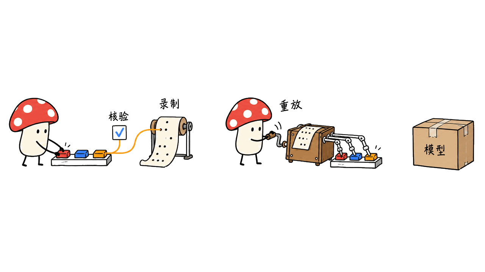

tester-army/e2e 是让你用自然语言描述目标、由 Agent 操作网页或手机应用的测试框架，结果仍可以用定位器和断言检查。

这个项目的实用之处，是把“找到一条能完成目标的操作路径”和“以后重复验证这条路径”接起来。**经后续检查验证的 `agent.act()` 可以记录并重放，但 `agent.assert()`、`waitFor()` 和 `extract()` 仍实时执行。** 不能把某个动作零模型调用，直接写成整条测试零模型调用。

项目由 TesterArmy 开发，代码采用 Apache-2.0。我们按 2026 年 10 月 13 日资料核对，固定源码提交 `fc9064415d427060fad1d406c4c491dda248ad4f`，其中 SDK 版本为 0.20.0、Web 引擎为 0.14.0。项目仍在走向 1.0，官方提示小版本间 API 和配置可能变化。

用户素材提到“一周新增 6,440”。我们未取得可复核的两端历史快照，因此不把它写成已验证的增长数据；本次 GitHub API 快照为 9,590 stars，也只是当天热度，不能证明测试可靠性。

官方仓库：https://github.com/tester-army/e2e

## “用大白话测 App”，测试代码还需要什么？

官方示例把自然语言动作和传统断言放在同一条测试里：

```ts
import { test, expect } from 'e2e';

test('a member upgrades to Pro', async ({ app, agent, screen }) => {
  await app.open('/settings/billing');
  await agent.act('upgrade the workspace to the Pro plan');
  await expect(screen.getByRole('status')).toContainText('Pro');
});
```

这是按 README 简化的示意，页面路径和业务状态要按自己的测试应用修改，本次没有对真实付费业务执行操作。Agent 负责按目标操作，定位器断言则定义成功条件。自然语言降低了描述操作的门槛，业务验收标准仍由测试作者确定。

与完全依赖模型判断相比，明确断言能指出“到底哪里错了”。登录之后只看到首页，不等于权限正确；点击提交后弹出提示，也不等于后端保存成功。框架能操作页面，测试作者仍要选择能代表业务结果的检查。


| 组成部分 | 官方用途 | 使用前要确认 |
| --- | --- | --- |
| `e2e` | SDK、runner 与 CLI | 固定依赖版本和配置 |
| `@e2e-dev/web` | Playwright 驱动 Chromium、Firefox、WebKit | 所需浏览器与应用启动环境 |
| `@e2e-dev/mobile` | `agent-device` 驱动 iOS、Android | 应用构建、设备与平台工具链 |
| 模型渠道 | 执行 Agent 步骤 | 订阅、API key 或本地模型接入 |
| 定位器与断言 | 验证业务结果 | 结果应该具体、可复现 |

移动端不是免环境部署：官方文档要求 iOS 准备 Xcode 和模拟器，Android 准备 SDK 和模拟器。仓库列出 Vite、Next.js、Astro、Expo、SwiftUI、Jetpack Compose、Kotlin Multiplatform 和 Flutter 示例；存在示例不等于任意项目都已验证兼容。

## 跑通一次，什么时候才会“记住”？

录制动作和证明动作正确是两件事。`read-write` 模式在本次尝试结束时，保存被后续验证步骤确认的动作。只让测试结束、再调用一个 `act()`、读取文本或对普通值做 `expect(value)`，都不等于合格的验证。

官方列出的合格检查包括定位器断言、引擎断言、定位器等待以及 `agent.assert()`、`agent.waitFor()`。其中自然语言检查仍可能使用模型；对于稳定且可精确判断的状态，定位器断言往往更便于复核。



缓存也不只是“页面没变”。条目绑定测试、target、指令、参数、Agent 上下文、引擎及应用身份。改名、改指令或普通参数，可能直接未命中。重放时还要检查起始路由、定位语义控件、重复动作，并核对结束路由与相关控件状态。

控件不存在、匹配变得歧义、动作失败或结束状态不一致，默认交回 Agent，从当前页面继续。它不会仅因为整张截图相似就把流程判成成功，也不会因为某个无关像素变化必然失效。

动态测试数据可用 `unique()` 表示每次不同的值，让重放代入当前值；普通参数则适合影响流程的选项。仍要做数据隔离和清理，旧数据、重复按钮或间歇出现的提示，都可能让重放产生不同结果。

官方缓存说明：https://e2e.tester.army/docs/cache

## CI 会自动享受零模型成本吗？

本地默认 `read-write`，CI 在未配置缓存时默认 `read-only`。`e2e init` 会把 `.e2e/cache/` 加进 `.gitignore`，因此 CI 不会自动拥有本机录好的条目。要共享重放记录，需要明确把缓存当作测试数据审查和保存。

| 情况 | 缓存行为 | 是否可能调用模型 |
| --- | --- | --- |
| 已验证 `act` 完整命中 | 重放动作并核对状态 | 该动作不调用模型 |
| 控件或结果不匹配 | 默认交回 Agent | 是 |
| 新步骤或新指令没有记录 | 重新执行 | 是 |
| `agent.assert/waitFor/extract` | 实时执行 | 是，不能按动作缓存推断 |
| 没有 Agent 的确定性测试 | 不需要模型 | 否 |

`--strict-cache` 可以让某些陈旧记录以 `REPLAY_STALE`、退出码 2 失败，而不是悄悄接管；但它并非通用的“禁止所有模型调用”开关。官方明确列出，新且未录制的步骤、不可重放的 gap、截断记录和 store 读取失败，仍可能实时执行。


同样，报告里的模型 prompt cache 只是供应商降低一次调用的成本；动作重放才是跳过调用。两者都叫缓存，却应分别统计。

CI 文档：https://e2e.tester.army/docs/ci

## 我们实际测了什么？

本次在隔离源码目录安装依赖，构建 SDK 与 Web 引擎，关闭遥测，复跑两份缓存单元测试和一份真实浏览器集成测试。集成测试使用本地 fixture 应用、无头 Chromium，以及按既定步骤返回工具调用的脚本化模型。

结果为 **3 份测试文件、99 项测试全部通过**。浏览器集成用例中的 9 条 fixture 流程首次录制、第二次运行重放；通过的断言核对了第二次整轮脚本模型调用数为 0，以及控件变化后接管、严格模式陈旧记录失败等行为。

这套上游测试覆盖首次记录、第二次重放、控件和路由变化后的接管、严格缓存、动态值替换、多 target 隔离与重复运行。它能验证缓存机制是否按文档工作，不能衡量真实模型理解陌生页面、完成自然语言目标的成功率。

因此本文不提供真实模型 token 成本、速度提升倍数或手机应用成功率，也没有运行 iOS 或 Android 测试。文章中的移动端能力来自官方接口与文档核对。

## 应该怎样开始，才能得到有价值的反馈？

先选择一条短、稳定、结果明确的业务路径，例如在测试环境添加条目并检查状态。跑通后再检查是否真的写入缓存，下一次的报告是 `replayed`、`handed off` 还是 `missed`，以及模型调用数是否与预期一致。

接着主动改一个按钮名称或成功提示，观察框架是明确失败、接管修复，还是仍然通过。对团队来说，这比只看“第一次能点击成功”更能判断是否适合接入回归测试。测试通过率、误通过率、接管次数和成本应一起记录。

官方入门命令：

```bash
npx e2e init
```

按向导选择 Web 或 mobile、配置模型并安装对应依赖，具体步骤以所固定版本文档为准。源码 SDK 的 Node 要求为 `^22.22.3 || >=24.8.0`，不能只看到“支持 Node 22”就忽略补丁版本。

缓存 JSON 不保存 prompts、对话、截图或注册 secret 的实际值，但会保存普通输入文本和目标描述。分享条目前应检查测试数据；模型执行时的数据发送边界则取决于所选渠道，不能把缓存里的隐私边界扩展成全部运行过程的承诺。

CLI 遥测默认开启，官方说明仅发送命令、引擎与失败等匿名使用信息，不含测试或应用内容、凭据。可用 `E2E_TELEMETRY_DISABLED=1` 或 `npx e2e telemetry disable` 关闭；本次测试关闭了遥测，未做网络流量审计。

若想比较自然语言 GUI 操作与原生桌面自动化，可继续阅读本站 Peekaboo 分析：https://blog.mushroom.cv/blog/peekaboo-macos-native-ui-agent/

## 常见问题

### e2e 能替代所有测试吗？

它面向端到端流程，不会自动提供业务验收标准，也不能替代单元测试、接口测试和性能测试。稳定步骤可继续使用定位器，自然语言用于更难直接描述的操作。

### 第二次运行一定不调用模型吗？

只有成功匹配的可重放动作能跳过模型。实时 Agent 检查、新步骤和接管仍可能调用模型，要查看整条测试的报告，而不是只看一个缓存命中。

### 缓存是否保存密钥？

注册为 secret 的填充只保存名称，重放时解析当前值并重新授权；普通输入文本会原样保留。只有明确注册为 secret 的值才适用这条规则。

### 现在能放心长期固定 API 吗？

官方明确项目仍未到 1.0，API 和配置可能在小版本间变化。团队应固定版本、保留可复核报告，在升级时检查缓存和业务验收结果。

## 一手来源

- 固定源码：https://github.com/tester-army/e2e/tree/fc9064415d427060fad1d406c4c491dda248ad4f
- 缓存文档源码：https://github.com/tester-army/e2e/blob/fc9064415d427060fad1d406c4c491dda248ad4f/docs/cache.mdx
- 浏览器缓存集成测试：https://github.com/tester-army/e2e/blob/fc9064415d427060fad1d406c4c491dda248ad4f/packages/e2e/tests/integration/trace-cache-replay.test.ts
- 快速开始：https://e2e.tester.army/docs/quickstart
- 遥测：https://e2e.tester.army/docs/telemetry

---

> © 2026 Author: Mycelium Protocol. 本文采用 [CC BY 4.0](https://creativecommons.org/licenses/by/4.0/deed.zh) 授权——欢迎转载和引用，须注明作者姓名及原文链接，不得去除署名后以原创发布。

<!--EN-->

tester-army/e2e is a framework for describing a goal in natural language, letting an agent operate a web or mobile app, and checking the result with locators and assertions.

Its useful idea connects discovering an action sequence with repeatedly verifying it. **A verified `agent.act()` can replay without model calls; `agent.assert()`, `waitFor()` and `extract()` still run live.** A cached action does not establish that the entire test avoids a model.

TesterArmy develops the Apache-2.0 project. We pinned source commit `fc9064415d427060fad1d406c4c491dda248ad4f` on October 13, 2026. It contains SDK version 0.20.0 and Web engine 0.14.0. The project remains pre-1.0, with APIs and configuration subject to change between minor releases.

The supplied note claims 6,440 new stars in one week. Without verifiable historical endpoints, we do not present that as a measured gain. Our GitHub API snapshot showed 9,590 stars; popularity is not evidence of testing reliability.

Official repository: https://github.com/tester-army/e2e

## What code still belongs in a natural-language test?

A simplified README example combines an agent action with an explicit assertion:

```ts
import { test, expect } from 'e2e';

test('a member upgrades to Pro', async ({ app, agent, screen }) => {
  await app.open('/settings/billing');
  await agent.act('upgrade the workspace to the Pro plan');
  await expect(screen.getByRole('status')).toContainText('Pro');
});
```

This is an illustration, not a run against a real paid service. Paths and expected states must match the test application. The agent performs the requested operation; the author still defines meaningful acceptance criteria.

Seeing a home page does not prove correct permissions. Seeing a submission toast does not prove the backend persisted the record. Explicit checks make those distinctions observable.


| Component | Documented role | Setup to verify |
| --- | --- | --- |
| `e2e` | SDK, runner and CLI | Pin versions and configuration |
| `@e2e-dev/web` | Playwright-based Chromium, Firefox and WebKit | Browser and app startup environment |
| `@e2e-dev/mobile` | iOS and Android through `agent-device` | App build, device and platform tools |
| Model channel | Execute agent steps | Subscription, API key or local model |
| Locators and assertions | Check business outcomes | Concrete, repeatable criteria |

Mobile testing still needs its platform environment: Xcode and a simulator for iOS, Android SDK and an emulator for Android. The repository includes examples for Vite, Next.js, Astro, Expo, SwiftUI, Jetpack Compose, Kotlin Multiplatform and Flutter. Examples do not prove universal compatibility.

## When does a successful run become a recording?

Recording actions and proving their result are distinct. In `read-write` mode, the runner saves actions confirmed by a later verification step at the end of an attempt. Merely finishing the attempt, running another `act()`, reading text or asserting an ordinary value does not qualify.

Qualifying checks include locator and engine assertions, locator waits, `agent.assert()` and `agent.waitFor()`. Natural-language checks may still use a model; stable, precisely observable states are often easier to audit with locator assertions.


A cache entry is bound to a test, target, instruction, params, agent context, engine and app identity. Renaming or changing ordinary parameters can miss the cache. Replay checks the starting route, relocates semantic controls, repeats actions, then checks the ending route and relevant control state.

Missing or ambiguous controls, failed actions and mismatched end states hand the step back to the agent by default. Matching is not simply an identical screenshot, and an unrelated pixel change does not necessarily invalidate it.

`unique()` lets new test values substitute into a recording. Ordinary parameters should represent choices that affect the flow. Isolation and cleanup remain necessary: old data, repeated controls and intermittent banners can change the outcome.

Caching documentation: https://e2e.tester.army/docs/cache

## Does CI automatically get zero-model runs?

Local defaults are `read-write`; CI defaults to `read-only` when caching is unspecified. `e2e init` puts `.e2e/cache/` in `.gitignore`. CI therefore does not automatically receive a developer's recordings. Shared entries need explicit storage and review as test data.

| Situation | Behavior | Model calls possible? |
| --- | --- | --- |
| Verified action fully matches | Replay and check state | None for that action |
| Control or outcome diverges | Agent takes over by default | Yes |
| New step or instruction | Run live | Yes |
| `agent.assert/waitFor/extract` | Always live | Yes |
| Deterministic test without agent steps | No model needed | No |

`--strict-cache` makes some stale recordings fail with `REPLAY_STALE`, exit code 2, instead of handing off. It is not a universal model-call prohibition. The documented exceptions include genuinely new steps, replay gaps, truncated entries and store-read failures, which can still run live.


Provider prompt caching reduces the cost of a model call. Action replay skips that call. Reports should distinguish the two.

CI documentation: https://e2e.tester.army/docs/ci

## What did our local verification cover?

We installed dependencies in an isolated checkout, built the SDK and Web engine, disabled telemetry and ran two cache unit-test files plus one real-browser integration file. The integration uses a local fixture app, headless Chromium and a scripted model returning predetermined tool calls.

**All three files passed: 99 tests in total.** The browser suite records nine fixture flows on the first run and replays them on the second. Passing assertions check zero scripted-model calls across that second run, changed-control handoff and stale-recording failure under strict mode.

The upstream suite covers first-run recording, second-run replay, changed-control and changed-route handoff, strict cache, dynamic substitution, target isolation and repeated runs. It tests cache mechanics, not a real model's ability to understand unfamiliar pages or complete arbitrary natural-language goals.

We did not measure real-model token costs, speedup factors or mobile-app success rates, and did not run iOS or Android tests. Mobile capabilities in this article are based on official interfaces and documentation.

## How should a team evaluate it?

Start with a short flow in a test environment that has a clear outcome. After it passes, check whether a recording was written and whether the next report says `replayed`, `handed off` or `missed`. Inspect model-call counts across the complete test.

Then deliberately rename a button or change the success state. Observe whether the test fails, hands off or still passes. This is more useful for regression-testing decisions than watching one successful click sequence. Record pass rates, false passes, handoffs and cost together.

The official setup command is:

```bash
npx e2e init
```

Select an engine, configure a model and install its dependencies using the documentation for the pinned version. The SDK source requires Node `^22.22.3 || >=24.8.0`; the patch-level floor matters.

Cache JSON omits prompts, conversations, screenshots and registered secret values, but ordinary typed text and target descriptions remain. Review entries before sharing them. Model execution's data boundary depends on the provider; cache contents do not define the privacy boundary of the entire run.

CLI telemetry defaults on. The project says it sends anonymous command, engine and failure information without test content, app content or credentials. Disable it with `E2E_TELEMETRY_DISABLED=1` or `npx e2e telemetry disable`. We disabled it for this test and did not audit network traffic.

For a related view of native desktop automation, read our Peekaboo analysis: https://blog.mushroom.cv/blog/peekaboo-macos-native-ui-agent/

## FAQ

### Does e2e replace all testing?

It targets end-to-end workflows. It does not supply acceptance criteria automatically or replace unit, API and performance tests. Stable steps can still use locators.

### Will the second run definitely avoid a model?

Only matching, replayable actions skip calls. Live agent checks, new steps and handoffs can still use a model. Inspect the full report.

### Does the cache save credentials?

Registered secret fills store a name, resolve its current value and authorize again on replay. Ordinary text is retained. The rule applies to values explicitly registered as secrets.

### Can teams assume a stable API?

The project remains pre-1.0. Pin dependencies, retain reports and inspect both cache behavior and business assertions when upgrading.

## Primary sources

- Pinned source: https://github.com/tester-army/e2e/tree/fc9064415d427060fad1d406c4c491dda248ad4f
- Pinned caching documentation: https://github.com/tester-army/e2e/blob/fc9064415d427060fad1d406c4c491dda248ad4f/docs/cache.mdx
- Browser replay integration test: https://github.com/tester-army/e2e/blob/fc9064415d427060fad1d406c4c491dda248ad4f/packages/e2e/tests/integration/trace-cache-replay.test.ts
- Quickstart: https://e2e.tester.army/docs/quickstart
- Telemetry: https://e2e.tester.army/docs/telemetry

---

> © 2026 Author: Mycelium Protocol. Licensed under [CC BY 4.0](https://creativecommons.org/licenses/by/4.0/) — free to share and adapt with attribution. You must credit the author and link to the original; removing attribution and republishing as original is not permitted.
