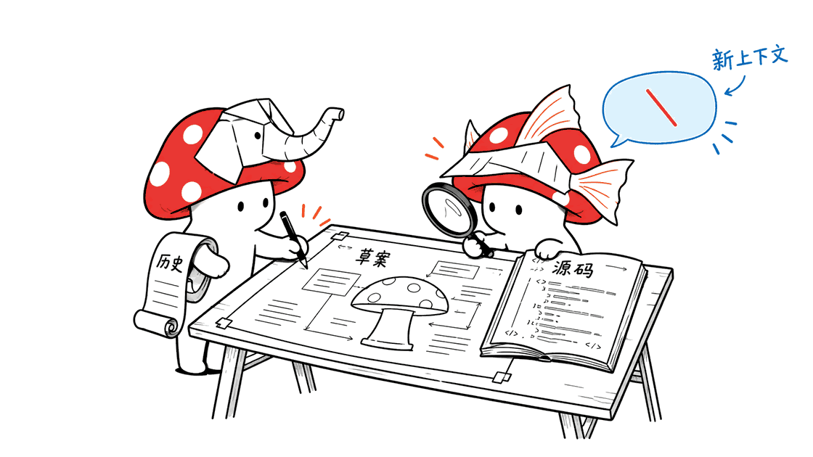
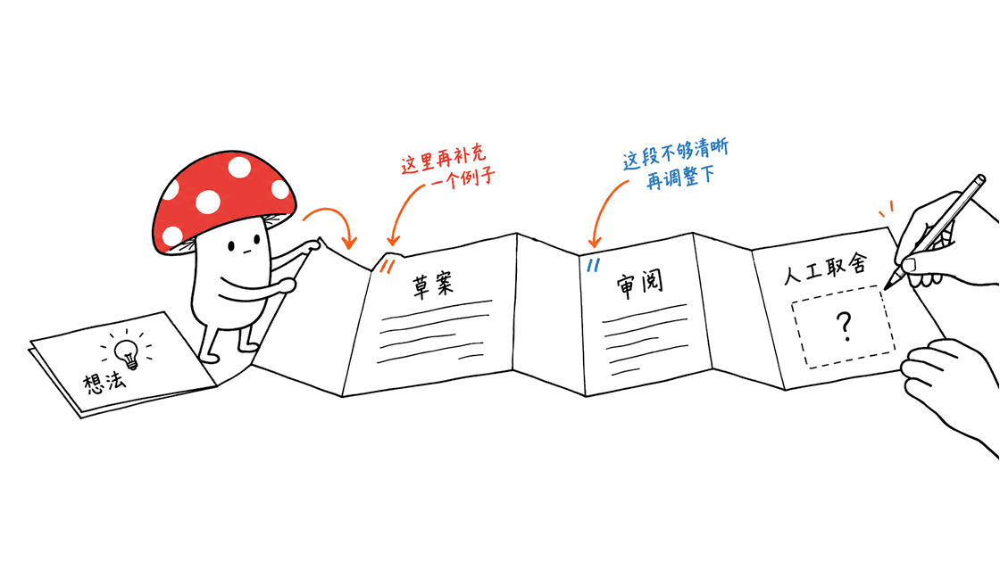
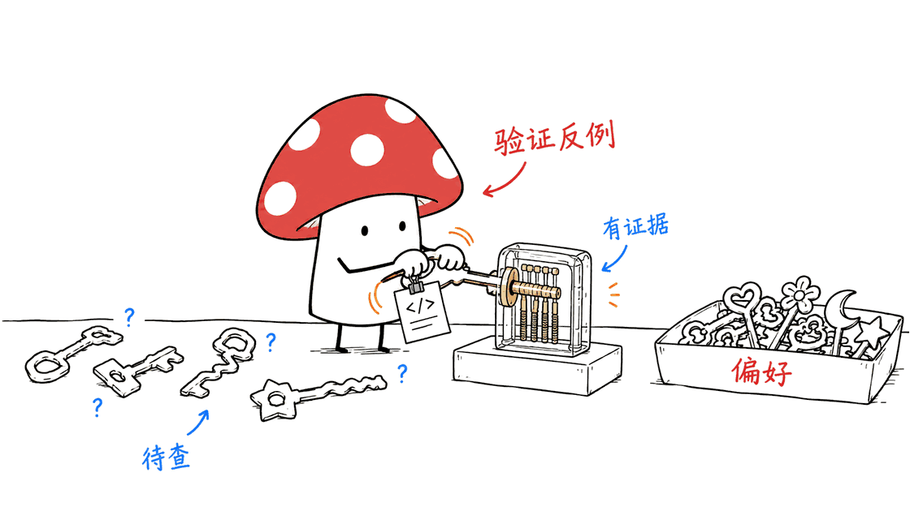

Elephant-Goldfish把深上下文设计与新上下文审阅分开，让独立意见在写代码前暴露规范遗漏，人类仍负责取舍。

官方仓库：https://github.com/google/elephant-goldfish-model

核查日期：2026年11月1日。以下区分官方资料与本文建议。

## 它不是又一个模型权重

Elephant-Goldfish Model（EGM）是规范驱动开发的插件与流程，不是发布新的神经网络。官方仓库位于google组织下，采用Apache 2.0，同时明确说明它不是Google正式支持的产品。核查时约8,241星，不能仅凭组织归属推导出企业服务承诺。

## 大象与金鱼分别负责什么？

大象保留项目历史、边界和用户需求，用于澄清与起草设计。金鱼审阅者从新上下文开始，只读草案及引用的源码材料，寻找未写清的假设。人类负责取舍和批准。所谓零上下文，是不继承前面的对话，并非不需要证据或允许脱离代码猜测。

## 标准工作流怎样衔接？

README的主线是brainstorm、draft和review。头脑风暴产生concepts_brief.md，草案阶段形成design_draft.md，并按章节征求反馈；随后由不同视角审阅设计，再决定处理哪些意见。它适合需要架构取舍的功能，官方也建议小而明确的bug采用普通编码流程。

## 怎样理解安装与适配？

项目提供Antigravity、Claude Code、Codex等环境的安装说明。命令与可用前缀随宿主和版本不同，应以仓库当前harness文档为准。审阅流程需要宿主能创建新的子代理。安装插件并不代表已经证明不同宿主的行为完全等价。本文未安装插件、未执行真实设计审阅。

## 怎样用在Webhook功能？

以下是本文自拟案例：先让设计者写明投递超时、重试、重复事件和签名验证规则，再请独立审阅者分别查状态机、调用方契约与运维条件。要求每条意见指向规范段落、源码证据和可验证后果，而不是只输出赞成或反对。这个示例不是项目团队的实测。

## 新视角会不会变成更多噪声？

会。多个角色若读到同一份含糊材料，也可能重复同一误解。建议将意见分为已证实问题、待查假设和风格偏好，优先处理有证据的阻断项。审阅者提出反例后，也应验证反例本身；数量更多的评论不自动代表质量更高。

## 如何评估是否值得用？

固定一个功能及代码版本，记录规格遗漏、实现后返工、误报意见和总时间。比较有无独立审阅的结果，并保留人工取舍。不要把“大家最终同意了”当作正确性证明，也不要把规范批准自动变成部署授权。

## 常见问题

### 它会训练模型吗？
该仓库提供开发流程和插件资源，不是模型训练配方。

### 金鱼是否完全看不到项目资料？
不是，它会读取草案和相关源码，只是不继承设计对话。

### 能否取消人类批准？
官方流程仍让人类承担架构决定与最终结果，本文也没有验证无人批准的生产部署。

相关领域评测方法：https://blog.mushroom.cv/blog/hamel-domain-specific-agent-evals-guide/

补充一手来源：

https://github.com/google/elephant-goldfish-model/blob/main/docs/getting_started.md

https://github.com/google/elephant-goldfish-model/blob/main/docs/harnesses.md

---

> © 2026 Author: Mycelium Protocol. 本文采用 [CC BY 4.0](https://creativecommons.org/licenses/by/4.0/deed.zh) 授权——欢迎转载和引用，须注明作者姓名及原文链接，不得去除署名后以原创发布。

<!--EN-->

Elephant-Goldfish Model is a spec-driven development plugin and workflow, not a new model checkpoint. The google-hosted repository uses Apache 2.0 and explicitly states that it is not an officially supported Google product.

## Why separate design from review?

An Elephant agent uses project context to explore requirements and draft a specification. Fresh Goldfish reviewers examine the draft and referenced code without inheriting the design conversation. Humans own architectural decisions. Fresh context does not mean absent evidence.

## How does the workflow proceed?

The documented stages are brainstorming, drafting and review, producing a concept brief and design draft before implementation. Follow the current harness documentation for installation, prefixes and host requirements; fresh-subagent capability is required for review. Small, clear fixes need not use the entire process. No plugin installation or real review was executed for this article.

## How could a team apply it?

An original proposed webhook example would specify timeouts, retries, duplicate events and signature validation. Independent reviewers would inspect state transitions, caller contracts and operations. Each finding should cite evidence and a testable consequence. Separate demonstrated defects, unresolved hypotheses and stylistic preferences. Reviewers can invent invalid counterexamples too.

## How can value be measured?

Hold the feature and source revision fixed. Track omissions, implementation rework, false-positive findings and total time, rather than counting comments or treating consensus as proof. Human specification approval is distinct from deployment authorization.

## FAQ

### Is it a model-training system?
No; the repository provides workflow and plugin resources.

### Do Goldfish reviewers have no project evidence?
They read the draft and related source, without the earlier conversation.

### Does this replace human responsibility?
No. The documented workflow retains human decisions and accountability.

Primary repository: https://github.com/google/elephant-goldfish-model

---

> © 2026 Author: Mycelium Protocol. Licensed under [CC BY 4.0](https://creativecommons.org/licenses/by/4.0/) — free to share and adapt with attribution. You must credit the author and link to the original; removing attribution and republishing as original is not permitted.
