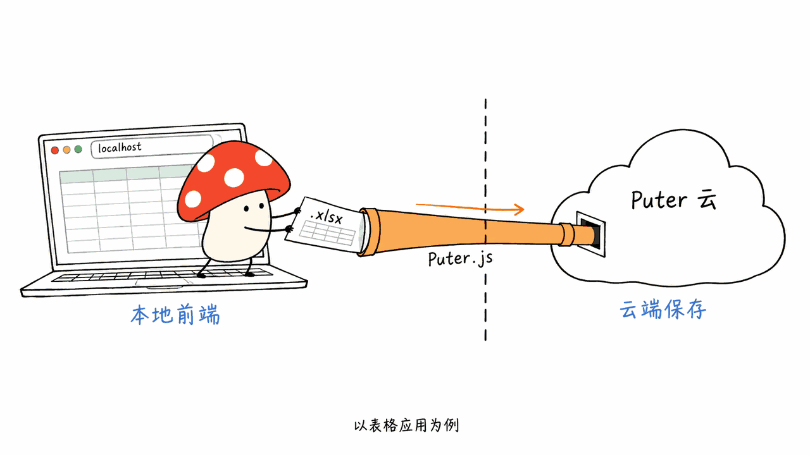

Everything 是把表格、文档、演示、创作和工程工具放进一个仓库的浏览器应用合集。完整地址是 HeyPuter/everything；截至本次 API 快照约 2,452 星，根目录采用 MIT，但子项目的许可证还需要逐项核对。

它提出“重建并开源世界软件”的目标，值得关注的不是这句话有多大，而是你能从中拿走什么：独立应用源码、可试用界面、面向 Puter 的集成方式，以及需要自己验收的兼容性与数据边界。

仓库：https://github.com/HeyPuter/everything
源码版本：0fc4d361c1653bd29dcf96ff7e71eb8d9bab47a1
核验日期：2026-10-20。

## Everything 到底收录了什么？

官方 README 按办公、协作、创作、工程、生产力、财务、业务、开发工具和游戏九类组织入口。例子包括 Spreadsheet、Documents、Presentation、Teamchat、Photo Studio、CAD、Tasks、CRM、API Client 与 Chess。

在固定版本目录树中，我们核对到 `src` 下一层有 51 份应用级 package.json。这个数字是目录清点，不是“51 款已验证成熟产品”；没有 package.json 的目录、共享资源与应用名称也不能随意混成同一个统计口径。

| 使用目标 | 可先看哪些应用 | 首轮验收重点 |
| --- | --- | --- |
| 办公文档 | Spreadsheet、Documents、Presentation | 导入导出、公式与版式 |
| 内容创作 | Photo Studio、Video Studio、3D Studio | 资产、格式、渲染与导出 |
| 团队协作 | Teamchat、Meetings、Calendar | 身份、权限、同步和失败恢复 |
| 业务流程 | CRM、Inventory、Help Desk | 数据持久化与流程闭环 |
| 学习二次开发 | 单个应用目录 | 构建、依赖、许可证、后端调用 |


README 的“Alternative to”是用途定位，不能直接转述成与 Excel、Photoshop 或 AutoCAD 完整等价。要替换既有工具，仍需拿自己的文件和工作流测试。

## 如何启动，是否是一条命令安装整个套件？

README 要求 Node.js 22.12 或更新版本，按应用进入目录安装与启动。例如先研究表格应用：

```bash
git clone https://github.com/HeyPuter/everything.git
cd everything/src/spreadsheet
npm install
npm run dev
```

这启动的是单个应用的开发环境，不是部署一套已经集成账户、备份、监控和升级的完整企业平台。不同应用有不同依赖和构建脚本，不能假定在仓库根目录运行一次命令就能启动所有工具。

我们检查了目录树、README、Spreadsheet 的 package.json、LICENSE、入口 HTML 和应用说明，没有安装并跑通全部应用，也没有用真实业务文件做兼容性评测。以上命令是官方方式的具体化，不是本次已经执行成功的部署报告。

## 本地前端与 Puter 云是什么关系？

Spreadsheet 的官方子项目说明写得很直接：Puter.js 是它的唯一后端，文件以 `.xlsx` 保存到用户的 Puter 云。入口 HTML 也加载 `https://js.puter.com/v2/`，另有 Plausible 分析脚本。

因此，“把源码拉到本机”与“数据不出本机”是两件事。页面在 localhost 打开，并没有自动把身份服务、文件服务和应用依赖迁移到你的电脑里。分析脚本的存在同样不能被“开源”二字抹去。



这不是说整套应用的每个功能都必须联网，而是数据路径需要按应用、按操作核对。我们实际抽查的是 Spreadsheet，不能把它的后端结构无条件推广到所有游戏或其他应用。

如果你的目标是私有化，要进一步梳理认证、文件与键值存储、实时同步、AI 调用、邮件或其他集成。Puter 本身另有开源仓库，但这里不能把“后端项目也开源”当作 Everything 全应用已经完成自托管适配的证明。

## 根目录 MIT，为什么还要查看子目录？

这是本次源码核验中最值得注意的地方：根目录 README 和 LICENSE 描述 MIT；但同一固定版本的 `src/spreadsheet/package.json` 标记 `AGPL-3.0-only`，该子目录的 LICENSE 也是 GNU Affero GPL v3。

这形成了需要维护者澄清的许可证不一致。本文不替维护者宣布哪一个声明覆盖另一个，也不给出商用法律结论。准备分发、修改或提供托管服务时，应保留所有声明，核对目标子项目与依赖，并向维护者确认。


这一点会改变介绍文章的写法：可以说“根目录标 MIT 的开源应用合集”，但现在不能无条件承诺“所有应用都只有 MIT”。代码开放程度、素材许可与托管服务条款也应分别查看。

## 普通团队怎样判断能不能用？

先挑一个边界明确、可替换的小任务，例如用不敏感的样例表格验证读取、修改、保存、下载、再由原软件打开。检查公式、日期、合并单元格、图表、字体与图片，而不是只看第一页能否显示。

第二轮检查保存语义：断网或认证失效时发生什么，保存失败有没有提示，重新打开是否得到同一份文件，多人修改是否会互相覆盖。再检查数据删除、导出、备份与账号权限。

最后才比较迁移成本。应用功能多，不等于你最依赖的那一个文件格式或团队权限已经完善。若目的只是学习一个编辑器怎么实现，源码的价值可能立即成立；若目的是真正替换企业生产系统，验收标准就高得多。

我的判断是：Everything 更适合作为一个可以逐项评估的产品与源码集合。先从一个应用、一条完整任务链路入手，比把整张软件名单当作迁移计划更可靠。

## 常见问题

### 它是 Windows 的 Everything 文件搜索工具吗？

不是。这篇介绍的是 HeyPuter/everything 浏览器应用合集，应通过完整组织名和仓库地址区分。

### 所有应用都能离线使用吗？

本次没有验证这样的能力。Spreadsheet 明确依赖 Puter 云；其他应用必须分别检查网络和持久化路径。

### 可以直接说它全面替代商业软件吗？

不能。“Alternative to”表示功能方向，实际替换还要核对格式兼容、性能、权限、可靠性和许可。我们没有进行全套应用实测。

## 一手来源与延伸阅读

项目说明：https://github.com/HeyPuter/everything/blob/0fc4d361c1653bd29dcf96ff7e71eb8d9bab47a1/README.md
根许可证：https://github.com/HeyPuter/everything/blob/0fc4d361c1653bd29dcf96ff7e71eb8d9bab47a1/LICENSE
表格应用说明：https://github.com/HeyPuter/everything/blob/0fc4d361c1653bd29dcf96ff7e71eb8d9bab47a1/src/spreadsheet/README.md
表格应用声明：https://github.com/HeyPuter/everything/blob/0fc4d361c1653bd29dcf96ff7e71eb8d9bab47a1/src/spreadsheet/package.json
表格应用许可证：https://github.com/HeyPuter/everything/blob/0fc4d361c1653bd29dcf96ff7e71eb8d9bab47a1/src/spreadsheet/LICENSE
相关工程阅读：https://blog.mushroom.cv/blog/openui-1-generative-ui-engineering/

封面为办公与创作工具的原创概念图，正文配图解释工程边界，不是实际应用截图。本次是源码与元数据核验，没有完整应用运行、性能或兼容性实测。

---

> © 2026 Author: Mycelium Protocol. 本文采用 [CC BY 4.0](https://creativecommons.org/licenses/by/4.0/deed.zh) 授权——欢迎转载和引用，须注明作者姓名及原文链接，不得去除署名后以原创发布。

<!--EN-->

Everything is a monorepository of browser applications for office work, creation, engineering, and collaboration. The complete repository is HeyPuter/everything; our API snapshot shows about 2,452 stars. Its root is MIT-licensed, but individual app notices need inspection.

The ambition is to rebuild and open-source everyday software. The useful engineering questions are narrower: which app can you run, where does it save data, what formats survive a round trip, and what terms apply to the code you intend to reuse?

Repository: https://github.com/HeyPuter/everything
Pinned source: 0fc4d361c1653bd29dcf96ff7e71eb8d9bab47a1
Checked October 20, 2026.

## What is in the repository?

The README groups apps into nine categories: office, collaboration, creative tools, engineering, productivity, finance, business, developer tools, and games. Examples include Spreadsheet, Documents, Presentation, Teamchat, Photo Studio, CAD, Tasks, CRM, API Client, and Chess.

Our pinned-tree audit found 51 immediate app-level package.json files under `src`. This is a directory count, not 51 independently verified production-ready products. App names, directories without package files, and shared assets require separate counting rules.

| Goal | Starting points | Acceptance focus |
| --- | --- | --- |
| Office documents | Spreadsheet, Documents, Presentation | Import, export, formulas, layout |
| Content creation | Photo Studio, Video Studio, 3D Studio | Assets, formats, rendering, export |
| Collaboration | Teamchat, Meetings, Calendar | Identity, permissions, sync, recovery |
| Business workflow | CRM, Inventory, Help Desk | Persistence and complete workflows |
| Learning and adaptation | One app directory | Build, dependencies, licensing, backend calls |


“Alternative to” describes an intended use. It does not establish full parity with Excel, Photoshop, or AutoCAD. Your files and workflow remain the relevant acceptance tests.

## How do you start an app?

The documented requirement is Node.js 22.12 or newer. Install and start an individual application, for example:

```bash
git clone https://github.com/HeyPuter/everything.git
cd everything/src/spreadsheet
npm install
npm run dev
```

This starts one development frontend. It does not deploy an integrated enterprise platform with accounts, backups, monitoring, and upgrades. Each app has its own dependencies and scripts.

We inspected the repository tree, README, and Spreadsheet's package metadata, license, entry HTML, and documentation. We did not install all apps or test real business files. These commands are reader instructions, not a completed deployment report.

## Does a local frontend keep files local?

Spreadsheet's own README describes Puter.js as its only backend and says `.xlsx` files are saved to the user's Puter cloud. Its HTML loads `https://js.puter.com/v2/` and includes a Plausible analytics script.

Cloning frontend source is therefore different from keeping all data on-device. Serving it from localhost does not relocate its authentication, storage, and other services into your machine. Open source also does not imply absence of analytics.


This observation applies to the audited Spreadsheet paths. It does not prove that every feature of every app or game needs the same backend. Evaluate data flow per application and operation.

For private deployment, inventory authentication, files, key-value storage, synchronization, AI calls, and integrations. Puter has a separate open-source repository, but that alone does not establish that the entire Everything suite is already adapted and verified for self-hosting.

## Why inspect app licenses beneath an MIT root?

The pinned root README and LICENSE describe MIT. However, `src/spreadsheet/package.json` declares `AGPL-3.0-only`, and its local LICENSE contains the GNU Affero GPL v3.

That is a licensing inconsistency requiring maintainer clarification. We do not decide which notice overrides another or provide a commercial-use legal conclusion. Preserve the notices, inspect the exact app and dependencies, and seek clarification before distributing modifications or providing hosted services.


A precise description is an open application collection with an MIT-marked root. The pinned evidence does not support an unconditional claim that every app is solely MIT. Code, assets, and hosted-service terms are separate questions.

## How should a small team evaluate adoption?

Start with one bounded task and non-sensitive fixtures. For a spreadsheet, open a file, edit it, save and download it, then reopen it in the original program. Check formulas, dates, merged cells, charts, fonts, and images, not just the first visible sheet.

Next, interrupt the network or authentication. Check failure messages, reopened data, simultaneous edits, deletion, export, backups, and access controls. Only then estimate migration effort.

A large app catalog is not evidence that your critical format or permission model works. Source code may be valuable immediately for learning or adaptation; production replacement requires a higher acceptance bar. Treat Everything as a collection to evaluate one app and one complete workflow at a time.

## Frequently asked questions

### Is this the Windows Everything file-search application?

No. This is HeyPuter/everything, a browser application collection. Use the full repository name to distinguish it.

### Can all apps work offline?

We did not verify that. Spreadsheet explicitly depends on Puter cloud services; other apps need individual network and persistence audits.

### Does it fully replace the proprietary tools named in its catalog?

The catalog describes intended categories, not verified parity. Compatibility, performance, permissions, reliability, and licensing remain application-specific acceptance questions. No full-suite runtime test was performed.

## Primary sources

Project README: https://github.com/HeyPuter/everything/blob/0fc4d361c1653bd29dcf96ff7e71eb8d9bab47a1/README.md
Root license: https://github.com/HeyPuter/everything/blob/0fc4d361c1653bd29dcf96ff7e71eb8d9bab47a1/LICENSE
Spreadsheet README: https://github.com/HeyPuter/everything/blob/0fc4d361c1653bd29dcf96ff7e71eb8d9bab47a1/src/spreadsheet/README.md
Spreadsheet package: https://github.com/HeyPuter/everything/blob/0fc4d361c1653bd29dcf96ff7e71eb8d9bab47a1/src/spreadsheet/package.json
Spreadsheet license: https://github.com/HeyPuter/everything/blob/0fc4d361c1653bd29dcf96ff7e71eb8d9bab47a1/src/spreadsheet/LICENSE
Related engineering reading: https://blog.mushroom.cv/blog/openui-1-generative-ui-engineering/

The cover is an original conceptual office scene. Body figures explain engineering boundaries rather than show an application session. This report is a source and metadata audit, not a complete app runtime, performance, or compatibility test.

---

> © 2026 Author: Mycelium Protocol. Licensed under [CC BY 4.0](https://creativecommons.org/licenses/by/4.0/) — free to share and adapt with attribution. You must credit the author and link to the original; removing attribution and republishing as original is not permitted.
