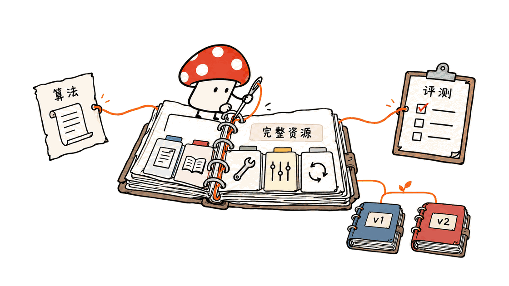
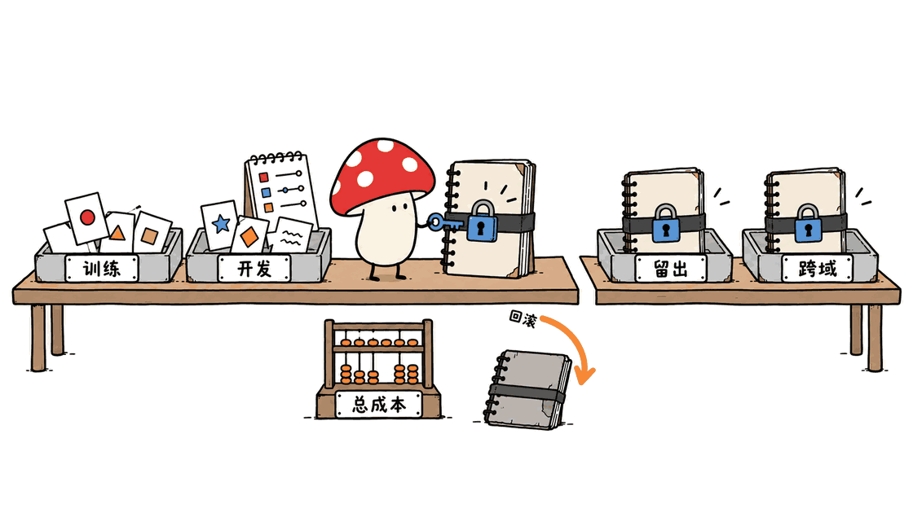

FlashRSI是一套用于比较和开发Agent自改进方法的实验框架。它把“改了什么、怎样运行、得到多少分”绑定到同一个资源版本，帮助研究者判断改进是否有效，以及能否迁移到新任务。

项目来自中国人民大学高瓴人工智能学院RUC-NLPIR团队，主体代码采用Apache 2.0。它不是一个新基础模型，也不能仅凭“递归自我改进”这个名称，就推导出模型权重会自动训练、能力会无限增长。

官方仓库：https://github.com/RUC-NLPIR/FlashRSI
项目页：https://ruc-nlpir.github.io/FlashRSI/project.html
文档：https://ruc-nlpir.github.io/FlashRSI/
准备数据：https://huggingface.co/datasets/RUC-NLPIR/FlashRSI

本文核查于2026年11月1日，代码固定在提交`98bebaf7f6d5f3f6f69ee22d87e02d0d8b89b591`。Mycelium Protocol完成了本地离线算法接口检查；没有调用付费模型、执行模型训练或复跑官方成绩。封面是针对实验版本与评估主题生成的概念照片，不是产品界面。

## FlashRSI究竟让什么东西“进化”？

日常使用Agent时，开发者会改系统提示、加Skill、调整工具、保存经验，甚至修改运行循环。问题是，一次改动经常同时牵动多个文件，后来看到分数提高，很难说清是哪一版资源产生的结果。

FlashRSI把这些行为资源组织成Snapshot。算法在限定范围内提出修改，生成新候选；目标Agent使用候选资源完成任务，评测器再给出反馈。算法决定保留哪个版本，最后用独立测试集评估选中的版本。

这个循环可以包含代码、提示词、技能和配置的变化。当前公开实验的核心是Harness与资源的演化，不是已经展示了从数据、梯度更新到权重发布的完整递归训练闭环。用户素材中的“持续接入Training相关结果”应当按后续计划理解。

可以把它理解为三种职责：Target负责做题，Worker负责提出或执行修改，Benchmark负责出题和评分。Target与Worker能用不同模型、不同服务地址和独立凭证，避免把“会完成任务”与“会改进完成任务的系统”混为一谈。



## 13种算法、30套基准，是否都已经有成绩？

当前README列出13种方法，包括OPRO、GEPA、EvoPrompt、ACE、SkillOpt、Evo-Harness、AHE、ADAS、DarwinX、Meta-Harness、ModularRSI、RRSI和Arbor。统一接口保留各方法自身的搜索、记忆和选择逻辑，并不意味着它们都在优化同一种对象。

| 范围 | 当前官方资料能确认的内容 | 阅读时要保留的边界 |
|---|---|---|
| 算法 | 接入13种方法 | 公开总成绩表覆盖12种；新接入Arbor尚无真实模型成绩 |
| 任务 | 30套基准，覆盖问答、数学、代码、文档、工具与交互 | 接入能力不等于30套都已完成全部组合实验 |
| 准备数据 | 为29套基准提供34个固定版本的Hugging Face配置 | 配置数量、基准数量、任务样本数是不同概念 |
| Harness | MiniAgent、Claude Code、Codex、Pi四种可用集成 | 不代表四者都在成绩表中完成了同等规模验证 |
| 总成绩 | Claude Code与Mini-Agent上的12方法研究 | 不能外推为所有模型、所有Harness都获得相同收益 |

官方框架图仍标着12种算法，而当前文字已经更新到13种，README对此解释为新增Arbor。这是资料更新阶段的差异，不该把旧图和新数字拼成“13种算法全部测完”。

官方纸张徽章目前指向arXiv搜索页，引用条目没有明确论文编号。因此本文引用可核查的仓库、项目页和实现文档，不为FlashRSI补造arXiv链接。

## Snapshot怎样提高实验可信度？

Snapshot不是仅保存一段最终提示词。它记录Harness声明的完整资源树，包括文件字节、资源角色、可执行标志与父子关系。当前实现以JSON持久化，文件内容使用base64，版本标识使用SHA-256。

版本标识还绑定组件规则和谱系元数据。因此它适合确认“这次执行用的是哪份资源及历史”，但不能简单理解成全局内容去重库：相同文件内容处在不同谱系下，仍可能得到不同版本ID。

算法的编辑范围是一层临时权限视图。比如只让SkillOpt修改技能，运行候选时仍加载周围的指令、工具和运行逻辑。把只改技能的实验改成只执行技能，会破坏原来的系统条件，也会让比较失真。

候选评估和候选激活是两个步骤。一个新版本可以被测试、判为退步、保留记录，然后不被采用。自改进实验需要的不是“只留下成功故事”，而是能够解释为什么没有采用某次修改。

凭证、任务数据、依赖和运行状态不属于资源Snapshot。由此也能看出它的边界：只拿到Snapshot，仍未必具备复现条件，还需要模型版本、数据版本、工具环境、任务切分和执行参数。


## 官方成绩说明了什么，又没说明什么？

公开表将四个源任务、五个近域迁移方向和两个远域迁移方向分开。迁移阶段冻结已经选中的资源版本，再到目标基准上评估，这比在目标测试题上继续调提示更有解释力。

以下只是官方自报表格的几项例子，单位为百分比分数，变化为百分点，不是本文实测：

| Harness与方法 | 任务 | 初始 → 最终 | 变化 |
|---|---|---|---|
| Claude Code + Meta-Harness | SearchQA源任务 | 73.93 → 85.07 | +11.14个百分点 |
| Mini-Agent + SkillOpt | AppWorld源任务 | 65.48 → 91.67 | +26.19个百分点 |
| Claude Code + SkillOpt | HotpotQA → DeepSearchQA远域迁移 | 66.00 → 58.00 | -8.00个百分点 |
| Mini-Agent + GEPA | HotpotQA → DeepSearchQA远域迁移 | 52.00 → 34.00 | -18.00个百分点 |

正负结果同时出现，提示了一个实际问题：针对某类错误积累的策略，可能在另一个任务分布里成为负担。更长的提示、更复杂的工具选择或更专门的技能，都可能带来迁移代价。

这些结果支持“值得对自改进做系统比较”，还不足以支持“某方法在任何任务都最好”。完整判断还要核对搜索预算、模型设置、样本量、随机种子、方差、失败重试与总成本。一个最终分数无法交代这些条件。

## 实验日志已经全部公开了吗？

没有足够证据支持这个结论。核查时项目页明确显示“summary table available，raw logs pending”，分析弹窗也说明需要提供原始日志后，才能展示任务结果、Worker提案、Snapshot谱系、用量和失败簇。

这与用户提供的“后续逐步公开实验log”一致。框架具有保存轨迹、配置、资源版本和结果的能力，不等于每一项公开成绩背后的完整原始证据已经可以下载。演示GIF里的Training、Held-out与OOD曲线，文档明确说是示意曲线，也不能当作真实训练日志。

当前最合理的评价是：实验基础设施、准备数据和汇总结果已经公开，成绩的逐条复核仍取决于后续日志与实验条件披露。团队选择公开负迁移，是有用的信息；下一步更重要的是让第三方能重算表格里的每一格。

另外，配置与日志脱敏不保证所有文件都不含敏感内容。官方说明，Harbor交付物和补丁保留原始字节，已知凭证会在UTF-8日志中脱敏，强制结束进程的归档不在保证范围内。企业数据实验仍应使用独立凭证、测试数据和权限边界。

## 四种Harness集成，有哪些工程区别？

MiniAgent是直接映射资源的Python运行入口，适合先理解最小循环。Claude Code通过官方Agent SDK暴露的接口组织指令、技能、Hook和设置，不能据此修改闭源产品内部任意行为。

Codex集成采用基于固定上游版本的Snapshot内Python核心，文档写明覆盖范围。它不是调用本机Codex CLI来兜底，也不是完整移植：WebSocket、HTTP/OAuth MCP、完整执行策略等分支仍有限制。

Pi集成同样是Snapshot内的纯Python运行时，遵循Pi v1.4.0无界面循环和事件形状，不依赖Node/npm或已有Pi安装。它适合实验版本化，但不能把结果直接当作当前官方Pi的所有执行路径表现。

这些差别会影响复现。对外报告“Codex表现提高”时，应同时写清FlashRSI适配器版本、源版本、模型、工具能力和沙箱设置，而不是只保留一个产品名字。

尤其不能为了跑通测试而把`danger-full-access`当作沙箱。Codex适配器文档说明，受限shell在macOS使用Seatbelt，Linux受限沙箱尚未移植，Windows shell后端也有限制。实验资源的编辑范围和操作系统权限是两层问题。

## 普通团队怎样从一个小实验开始？

先安装到独立环境，避免把所有基准的依赖混进生产应用。项目要求Python至少3.11，官方示例使用3.12：

```bash
git clone https://github.com/RUC-NLPIR/FlashRSI.git
cd FlashRSI
uv venv --python 3.12
source .venv/bin/activate
uv sync --extra all
flashrsi run --config examples/quickstart.yaml --prepare-only
```

`--prepare-only`只生成脱敏配置目录，不检查全部运行环境、不调用模型，也不产生真实成绩。下一步可用`--check-only`检查选定任务的依赖与数据准备；它仍不能证明远程API鉴权、模型可用性或实际效果。

官方quickstart只有12道本地QA题，按0.5/0.25/0.25配置划分训练、开发和测试。它适合学习流程，不足以支撑研究结论。真实实验再分别配置Target与Worker的模型和凭证；开源许可并不免除API费用。

对于业务团队，可按下面的顺序推进：

1. 先选一个可自动判定的业务任务，例如测试工单字段抽取；冻结基线版本和评测器，把最终验收题留出。
2. 第一轮只允许改提示或技能，固定模型、工具和数据；记录每次候选的资源差异、成本、失败原因和是否采用。
3. 给不同方法相同搜索预算，同时报告最终成功率与每次成功任务的总成本，计入Worker搜索开销。
4. 选中版本后先在留出集测试，再在相邻任务上冻结迁移；出现退步时保留旧版本，不把“有新版本”当作升级理由。
5. 最后在真实服务前加人工批准、资源白名单、超时和回滚。版本化实验能力并不自动构成生产发布审批。

若要跑Terminal-Bench等任务，还需要Harbor额外依赖与Docker环境。官方文档说明Harbor与τ²上游依赖存在冲突，应使用各自合适的环境，不能认为一个`all`就覆盖所有安装条件。

Mac可以承担Python实验控制与API调用，但这不代表所有基准都能在Mac原生运行，也不代表模型在本地离线推理。需要的内存、GPU和联网条件，主要取决于选定模型、任务容器和并行度，不能给整个框架套一个统一最低显存数字。



## 本次实际核查到了哪一步？

在Apple Silicon Mac上，用隔离Python 3.12环境运行了上游`tests/test_algorithm.py`，20项测试全部通过。测试使用夹具Target、Worker和任务，检查算法接口、作用域、候选选择、证据处理等行为；它们不是20轮真实模型进化，也不是全仓测试通过。

同时检查了官方quickstart的配置准备路径，未启动真实任务。源提交、测试命令、输出和核查说明已归档，读者可以在相同版本重复运行。没有安装完整`all`环境，没有运行Docker基准，没有测量模型能力、Token成本或实际吞吐。

FlashRSI最值得借鉴的是把自改进变成有版本、有选择、有失败记录的工程过程。对于尚未建立可靠评测集的团队，优先级依然是先定义“什么叫变好”，再让算法自动搜索；否则，自动化只会更快地优化一个定义不清的目标。

相关研究可参阅本站Hermit分析：https://blog.mushroom.cv/blog/hermit-harness-adapter-evolution/
两者应按各自当前实现比较，不把相似宣传词当作同一套能力。

## 常见问题

### FlashRSI会自动重新训练大模型吗？

当前公开核心是提示、技能、工具、配置与运行逻辑等Harness资源的自改进。不能仅凭名称，把它解释成已经公开并验证的模型权重递归训练系统。

### 公开代码后，是否已经能复现所有成绩？

还不能这样保证。项目提供实验框架与汇总成绩，但项目页标明原始日志待公开；模型、数据、预算、工具环境及每格成绩对应的证据仍需逐项核对。

### 在Mac上运行是否免费且离线？

Python控制流程可以在Mac运行，具体任务可能需要容器和远程模型API。框架Apache 2.0许可不等于数据、上游Harness和模型服务都无限制，也不等于没有推理费用。

## 一手资料

仓库及成绩：https://github.com/RUC-NLPIR/FlashRSI
Snapshot实现：https://github.com/RUC-NLPIR/FlashRSI/blob/main/flashrsi/core/snapshot.py
实验使用与记录：https://github.com/RUC-NLPIR/FlashRSI/blob/main/docs/usage.md
Codex适配边界：https://github.com/RUC-NLPIR/FlashRSI/blob/main/docs/codex.md
项目页与日志状态：https://ruc-nlpir.github.io/FlashRSI/project.html
数据集：https://huggingface.co/datasets/RUC-NLPIR/FlashRSI

---

> © 2026 Author: Mycelium Protocol. 本文采用 [CC BY 4.0](https://creativecommons.org/licenses/by/4.0/deed.zh) 授权——欢迎转载和引用，须注明作者姓名及原文链接，不得去除署名后以原创发布。

<!--EN-->

FlashRSI is an experiment framework for comparing and developing agent self-improvement methods. It associates resource versions with execution traces and scores, so researchers can investigate which changes helped and whether they transfer to new tasks.

The project comes from RUC-NLPIR at Renmin University of China's Gaoling School of Artificial Intelligence. Its framework code uses Apache 2.0. It is not a new foundation model, and the phrase recursive self-improvement does not establish autonomous weight training or unlimited capability growth.

Repository: https://github.com/RUC-NLPIR/FlashRSI
Project page: https://ruc-nlpir.github.io/FlashRSI/project.html
Documentation: https://ruc-nlpir.github.io/FlashRSI/
Prepared data: https://huggingface.co/datasets/RUC-NLPIR/FlashRSI

This review was checked on November 1, 2026 against commit `98bebaf7f6d5f3f6f69ee22d87e02d0d8b89b591`. Mycelium Protocol ran offline interface checks on an Apple Silicon Mac. No paid model calls, weight training, or reproduction of the published benchmark scores took place. The cover is a conceptual photograph of candidate versions and evaluation, not a product screenshot.

## What does FlashRSI actually improve?

Agent developers change instructions, skills, tools, configuration, memory resources, and sometimes execution logic. When these files change together, a higher score alone does not explain which complete system produced it.

FlashRSI captures declared harness resources as a Snapshot. An algorithm edits resources within a defined scope, constructs a candidate, runs the target agent, and receives benchmark feedback. Candidate evaluation and adoption remain separate decisions. After search, the selected version is assessed on held-out tasks.

Target solves tasks; Worker proposes or performs edits; Benchmark supplies tasks and grading. Target and Worker have independent model, endpoint, and credential settings. Solving a task and improving the system that solves it are distinct responsibilities.

The public core concerns harness and resource evolution. Planned Training-related results should not be presented as an already demonstrated end-to-end recursive weight-training pipeline.


## Do all supported methods already have published results?

| Area | Current public support | Boundary |
|---|---|---|
| Methods | 13 integrations: OPRO, GEPA, EvoPrompt, ACE, SkillOpt, Evo-Harness, AHE, ADAS, DarwinX, Meta-Harness, ModularRSI, RRSI, Arbor | The overall study covers 12; Arbor has no real-model results yet |
| Benchmarks | 30 suites across QA, reasoning, mathematics, coding, documents, tools and interaction | Support is not evidence that every combination has been evaluated |
| Prepared data | 34 pinned Hugging Face configurations for 29 suites | Configuration count differs from suite and example counts |
| Harnesses | MiniAgent, Claude Code, Codex and Pi | The overall result table covers Claude Code and Mini-Agent |

The original diagram still describes 12 methods. The README explains the addition of Arbor, so the diagram and current integration count should not be combined into a claim that all 13 were benchmarked.

The paper badge currently points to an arXiv search, and the citation does not identify a paper number. This review therefore cites the repository, project page and implementation documents rather than inventing a paper URL.

## How do immutable snapshots help?

A Snapshot records exact file bytes, component roles, executable flags and lineage. It is persisted as JSON with base64 file contents and a SHA-256 identifier. Component rules and history metadata also participate in identity; identical files in different lineages can therefore have distinct IDs.

An algorithm's editing scope is a temporary permission view. A skill-only experiment edits skills while executing the complete surrounding harness. Removing that context during execution would change the experimental conditions.

Rejected candidates can remain in the evidence trail without being activated. Recording a failed proposal is useful: it explains what the search tried and why the incumbent remained preferable.

Credentials, dependencies, task data and runtime state are outside the resource version. Consequently, a Snapshot alone is not a complete reproducibility package. Model and data revisions, environment, splits and execution settings still matter.


## What do the reported results establish?

The public table separates four source benchmarks, five near-domain transfers and two far-OOD transfers. Transfer freezes the selected resources before assessing a destination task, rather than continuing to tune on destination test questions.

These examples are author-reported scores, not measurements from this review. Deltas are percentage points:

| Harness and method | Task | Initial → final | Delta |
|---|---|---|---|
| Claude Code + Meta-Harness | SearchQA source | 73.93 → 85.07 | +11.14 pp |
| Mini-Agent + SkillOpt | AppWorld source | 65.48 → 91.67 | +26.19 pp |
| Claude Code + SkillOpt | HotpotQA → DeepSearchQA | 66.00 → 58.00 | -8.00 pp |
| Mini-Agent + GEPA | HotpotQA → DeepSearchQA | 52.00 → 34.00 | -18.00 pp |

Positive and negative transfer coexist. A specialized instruction, longer context, or task-specific tool strategy can become a liability elsewhere. These results justify systematic comparison, not a claim that one method always wins.

A complete assessment still needs search budgets, model settings, sample counts, seeds, variance, retries and total costs. Final scores alone cannot provide those conditions.

## Are the raw experiment logs public yet?

The checked project page explicitly says the summary table is available and raw logs are pending. Its planned analysis view requires raw logs to show task outcomes, Worker proposals, Snapshot lineage, usage and failure clusters.

The framework's ability to save evidence is different from public availability of every run underlying a result. Documentation also identifies the demo GIF's training and evaluation curves as schematic; they are not training measurements.

The practical assessment is that infrastructure, prepared data and summary results are public, while row-by-row verification depends on further disclosure. Publishing negative outcomes is helpful; releasing enough evidence to recompute each cell is the next step.

Redaction also has limits. Harbor deliverables and patches retain original bytes, while known credentials are redacted from UTF-8 logs. Forced termination is outside the documented artifact-archival guarantee. Business experiments still need separate credentials, test data and access controls.

## How faithful are the harness integrations?

MiniAgent maps resources directly into a Python runtime. Claude Code uses the official Agent SDK's exposed interfaces; this does not grant arbitrary access to closed product internals.

The Codex adapter is a Snapshot-local Python core based on a pinned upstream version, with documented coverage limits. It does not fall back to a locally installed Codex CLI. WebSocket, HTTP/OAuth MCP and complete execution-policy handling remain incomplete.

The Pi adapter is a pure-Python Snapshot runtime following Pi v1.4.0's headless loop and event shape. It requires neither Node/npm nor a Pi installation. That is useful for versioned experiments, but does not establish equivalence with every current upstream Pi execution path.

Reports should therefore identify the adapter, upstream source version, model, tools and sandbox settings alongside the product name. Resource-editing scopes are not operating-system sandboxes. The Codex guide describes macOS Seatbelt support, rejects unsupported restricted Linux execution, and documents missing Windows shell backends. Full host access should not be described as isolation.

## How should a team start?

Use a dedicated environment. The package requires Python 3.11 or newer; the official installation example selects 3.12:

```bash
git clone https://github.com/RUC-NLPIR/FlashRSI.git
cd FlashRSI
uv venv --python 3.12
source .venv/bin/activate
uv sync --extra all
flashrsi run --config examples/quickstart.yaml --prepare-only
```

Preparation writes a redacted configuration directory. It does not validate complete runtime readiness, call models or produce benchmark results. `--check-only` checks the chosen dependencies and data preparation, while remote authentication, model availability and actual performance remain untested.

The local quickstart contains only 12 QA examples, with configured train/dev/test fractions of 0.5/0.25/0.25. It teaches the workflow; it is not a research-scale evaluation. Configure Target and Worker independently before a real run, including their API costs.

A practical rollout is:

1. Choose one automatically gradable business task, freeze its evaluator and baseline, and reserve final acceptance cases.
2. Initially permit only prompt or skill edits. Keep model, tools and data fixed; preserve diffs, costs, failures and adoption decisions.
3. Give methods comparable search budgets. Report final quality and total cost per successful task, including Worker search expenditure.
4. Test the selected version on held-out cases, then freeze it for transfer. Retain the incumbent when the candidate regresses.
5. Add human approval, resource allowlists, timeouts and rollback before production deployment. Experimental versioning does not supply release governance automatically.

Terminal-Bench and similar tasks require additional Harbor dependencies and Docker. Harbor and the upstream tau2 dependencies conflict, so the documented environment separation matters even after installing `all`.

A Mac can run Python orchestration and make model API calls. That does not mean all benchmarks run natively on macOS, or that inference is local and offline. Hardware needs depend on the selected models, task containers and concurrency; there is no useful universal minimum GPU-memory number for the whole framework.


## What was actually verified locally?

The upstream `tests/test_algorithm.py` passed all 20 tests in an isolated Python 3.12 environment on Apple Silicon. These use fixture Targets, Workers and tasks to exercise interfaces, scopes, candidate selection and evidence handling. They are not 20 real-model evolution runs or a full-suite result.

The quickstart preparation path was also checked without starting real tasks. Source revision, commands, outputs and scope notes were archived. The full `all` environment and Docker benchmarks were not installed or run; model quality, token cost and throughput were not measured.

The useful engineering idea is to make improvement a versioned process with selection and failure records. Teams without a reliable evaluation set should first define what improvement means. Automatic search cannot repair an undefined objective.

Related analysis: https://blog.mushroom.cv/blog/hermit-harness-adapter-evolution/
Compare each project's actual implementation rather than treating similar terminology as equivalent functionality.

## FAQ

### Does FlashRSI automatically retrain model weights?

The current public core evolves harness resources such as prompts, skills, tools, configuration and runtime logic. Its name does not establish a published, validated recursive model-weight training system.

### Can every reported score already be reproduced?

That is not established. The framework and summary scores are public, but the project page marks raw logs as pending. Models, datasets, budgets, environments and the evidence behind individual cells still need verification.

### Is running it on a Mac free and offline?

Python orchestration can run on a Mac. Tasks may require containers and paid remote model APIs. Apache 2.0 for the framework does not replace dataset, upstream harness or model-service terms.

## Primary sources

Repository and results: https://github.com/RUC-NLPIR/FlashRSI
Snapshot implementation: https://github.com/RUC-NLPIR/FlashRSI/blob/main/flashrsi/core/snapshot.py
Usage and records: https://github.com/RUC-NLPIR/FlashRSI/blob/main/docs/usage.md
Codex adapter limits: https://github.com/RUC-NLPIR/FlashRSI/blob/main/docs/codex.md
Project and log status: https://ruc-nlpir.github.io/FlashRSI/project.html
Dataset: https://huggingface.co/datasets/RUC-NLPIR/FlashRSI

---

> © 2026 Author: Mycelium Protocol. Licensed under [CC BY 4.0](https://creativecommons.org/licenses/by/4.0/) — free to share and adapt with attribution. You must credit the author and link to the original; removing attribution and republishing as original is not permitted.
