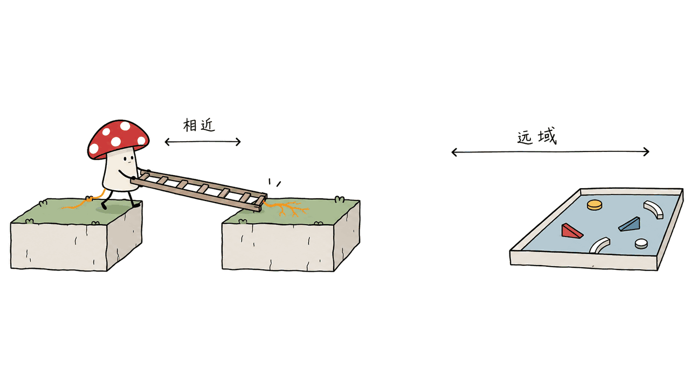
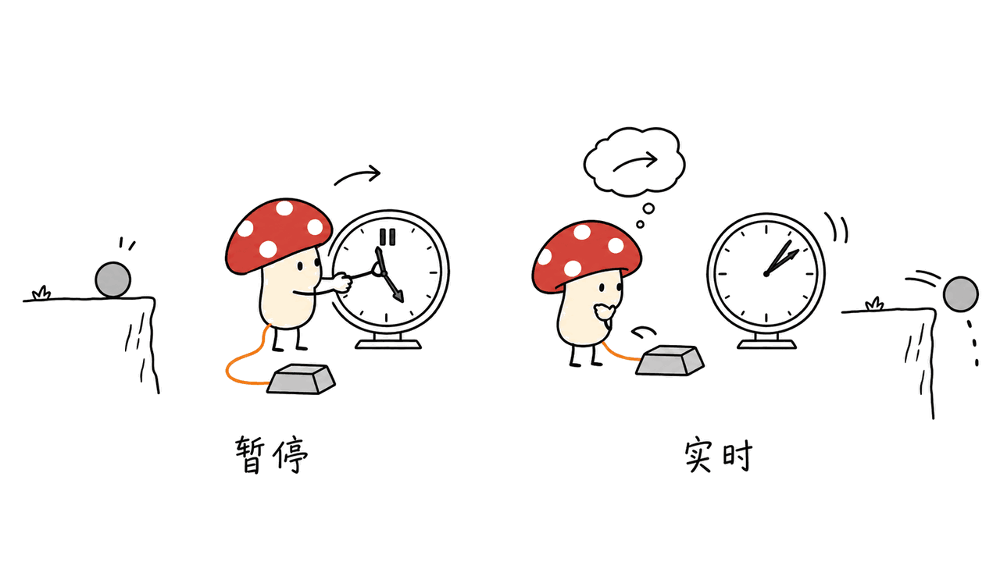

GameScaling 研究的是“让模型看游戏画面、操作键鼠”：增加游戏数据有用，但跨游戏泛化有边界，实时环境还会把推理延迟变成成绩的一部分。

> 资料核对：2026-10-23。本文运行了开源客户端的离线测试和参考动作解析，没有加载模型、运行游戏或复现论文分数。
> 项目：https://gamescaling.github.io/
> 代码：https://github.com/THUSI-Lab/GameScaling
> 模型入口：https://huggingface.co/THUSI-Lab/GameScaling
> 论文：https://arxiv.org/abs/2610.28698

## 它与本地编程模型 Flint 有什么关系？

这是两个独立项目。Flint做代码与工具使用；GameScaling由米哈游崩坏AI研发团队和多所高校研究者合作，基于Qwen3.5视觉语言模型开展游戏持续预训练（CPT）。不能把前者的MoE参数、Mac速度或训练系统移植到后者身上。

GameScaling论文发表于2026年10月20日。研究横跨120种配置：四个模型尺寸、50—1,600小时的六档数据预算、五种数据混合策略。项目页称语料覆盖80款游戏，研究重点是数据量、多样性与模型大小分别怎样影响迁移。

## 多玩游戏，真的会更通用吗？

论文把评测划分为不同距离：MCU/Minecraft和ViZDoom属于训练语料涉及的世界；OmniGameArena是未见过但相关的3D世界；GameWorld主要是更远的2D、2.5D环境。

作者观察到：更多数据主要改善训练分布内表现，多样性帮助相关世界迁移，对远距离世界改善有限。单世界训练下，更大的模型甚至可能更难泛化到远处。它不是“模型越大、游戏越多，就自然学会所有游戏”的证明。

作者进一步区分早期的接口学习阶段与后期的世界学习阶段：先学会键鼠操作方式，收益较广；继续学具体世界，提升集中到相近任务。这为后续研究指出一个问题：动作接口学会了，离通用策略还差什么？

来源：论文摘要及项目页。
https://arxiv.org/abs/2610.28698
https://gamescaling.github.io/



## 为什么必须同时看暂停与实时两种分数？

暂停评测会等模型想完再推进游戏；实时评测中，模型思考时世界照样运行。项目页报告前沿模型每步4—24秒，GameScaling为0.13—0.69秒，这是作者实验口径，不是任何电脑上的承诺。

这些数值跨模型、尺寸及评测设置，不能直接据此计算一个固定加速倍数。更不能把“下一段动作长200ms”当作“200ms内一定返回预测”。动作覆盖时间、服务延迟与游戏时钟是三件不同的事。

另一个公开结果很有启发：MCU最多动作步数从600提高到3,000，9B-S1成功率从50.9%到69.3%，0.8B-S1从42.3%到59.3%。这意味着更长试错预算可能提高成绩；横向比较时，不能把600步结果与3,000步结果混排。

我们的判断：如果你做的是实时游戏测试，除了任务成功率，还应记录画面到动作的总耗时、超时后如何处理，以及游戏是否暂停。对“慢慢想能成功”和“现场来得及做”应分开验收。



## 开放了哪些模型，显存怎样估算？

公开八个检查点：每个尺寸有S1、S3两版。S1仅Minecraft，S3为27% Minecraft加其他游戏的混合，两者公开权重均使用1,600小时预算。

| 模型尺寸 | 两个版本 | BF16权重体积 | 官方服务示例 |
|---|---|---:|---|
| 0.8B | S1 / S3 | 2.2GB | 单GPU |
| 2B | S1 / S3 | 5.4GB | 单GPU |
| 9B | S1 / S3 | 18.8GB | 单GPU |
| 27B | S1 / S3 | 54.7GB | 两卡张量并行 |

权重文件体积不是最低显存。视觉编码、KV缓存与服务并发还会增加占用。也不能从“0.8B小”直接推出官方支持Mac；当前参考服务是vLLM路线。

GitHub提供推理客户端、提示模板、示例和测试；没有训练代码，训练语料也未公开。代码和模型的Apache-2.0授权不附带游戏素材或游戏版权，项目页也明确区分了这两类权利。

## 从截图到动作，工程接口有哪些坑？

每次输入当前帧和短历史，输出一段200ms键鼠动作：六组约33ms子动作，再加整段的鼠标移动与滚轮量。模型可以先输出思考，再输出带标记的动作块。

我们在固定源码修订上读到三个值得保留的实现：

1. 解析器读取最后一个 `</think>` 之后的动作，避免把思考里引用的示例当成命令。
2. 对鼠标位移、滚轮与每步键数设置限幅，丢弃未知按键；无法解析时返回无操作。
3. 请求保留特殊动作token，并沿用训练时的chat template。换成普通聊天模板可能破坏历史格式。

无操作不等于策略成功，但比执行半截推理文本更可控。真实接入还要自己实现截图、输入注入、释放按键、超时与环境重置；示例输出动作不等于已经接管了你的游戏。

源码版本：`6764efabfbb4121d6e5d3cfcbc54dedf1469bf5a`。


## 怎样先做一个可复核的最小验证？

我们先执行了不依赖服务器的两条命令，均正常结束：

```bash
python tests/test_core.py
python examples/run_example.py --offline
```

离线测试覆盖动作解析、截断处理、请求格式、图像编码、提示模板等；参考示例把仓库自带回复解析为鼠标与按键结构。它们证明客户端基础逻辑通过，不能证明模型推理速度、游戏成绩或GPU兼容性。

准备好NVIDIA推理环境后，可以按上游脚本从小检查点开始。以下服务命令仅做源码核对，本文没有执行：

```bash
pip install 'vllm>=0.17'
bash scripts/serve_vllm.sh THUSI-Lab/GameScaling-0.8B-S3 8000
curl -s http://127.0.0.1:8000/v1/models
python examples/run_example.py --trials 1
```

脚本默认模型名为 `gamescaling`，上下文32,768，图像上限8。先验证单帧结果可解析，再实现游戏闭环，最后才考虑并发。我们建议先在可重置的离线测试场景使用，不把聊天模型客户端误当成完整游戏执行器。

## 常见问题

### 它可以复现完整训练吗？

不能仅靠当前GitHub仓库复现。现有开放物包括权重和推理工具，没有完整训练代码或训练语料。

### 200ms 是模型响应时间吗？

不是。它是每段预测动作覆盖的时间。推理、网络、截图与执行都有额外耗时。

### 小模型能替代所有游戏 Agent 吗？

论文恰恰展示了边界：相关3D世界的迁移更好，远距离世界仍有差距；暂停、实时和动作预算也会改变比较结论。

---

本文原文：https://blog.mushroom.cv/blog/gamescaling-game-agents-cpt/

> © 2026 Author: Mycelium Protocol. 本文采用 [CC BY 4.0](https://creativecommons.org/licenses/by/4.0/deed.zh) 授权——欢迎转载和引用，须注明作者姓名及原文链接，不得去除署名后以原创发布。

<!--EN-->

GameScaling turns game frames into keyboard-and-mouse actions. Its central result is qualified: gameplay pretraining helps, transfer has limits, and real-time evaluation makes inference latency part of agent performance.

Sources checked on October 23,2026. We ran offline client tests and parsed the reference action, but did not load model weights, play games or reproduce benchmark results.

Project: https://gamescaling.github.io/
Code: https://github.com/THUSI-Lab/GameScaling
Models: https://huggingface.co/THUSI-Lab/GameScaling
Paper: https://arxiv.org/abs/2610.28698

## Is this related to Flint?

They are separate projects. Flint is a coding model. GameScaling, from researchers at miHoYo and partner universities, continues pretraining Qwen 3.5 vision-language models on gameplay.

The October 20 paper studies 120 configurations: four model sizes, six data budgets from 50 to 1,600 hours and five mixtures. The project describes a corpus spanning 80 games. It asks which gains come from more data, more diverse worlds or greater model capacity.

## What transfers across games?

The evaluation separates in-corpus Minecraft/MCU and ViZDoom, related unseen 3D worlds in OmniGameArena, and more distant, mostly 2D/2.5D worlds in GameWorld.

More data helps in-corpus performance; diversity helps related-world transfer, with limited distant-world gains. Larger single-world models can generalize worse to distant settings. The paper distinguishes an early interface-learning phase with broader benefits from a later world-learning phase with narrower gains.

This is evidence against assuming that merely scaling a specialist automatically produces a universal player. An interface policy and a broadly transferable strategy remain different achievements.


## Why distinguish paused and real-time evaluations?

In paused evaluation, the world waits for a decision. In real time it continues while the model thinks. The project reports 4–24 seconds per step for frontier models versus 0.13–0.69 seconds for GameScaling in its experiments. These ranges are not a hardware-independent speed guarantee or a matched pair for calculating one speedup factor.

The project also reports that increasing the MCU cap from 600 to 3,000 steps raises 9B-S1 success from 50.9% to 69.3%, and 0.8B-S1 from 42.3% to 59.3%. Results with different action budgets should not share an unqualified leaderboard.

For engineering acceptance, log frame-to-action delay, timeout behavior, pause mode and total task success. A decision that eventually works may arrive too late for a live game.


## Which artifacts are open?

Eight checkpoints pair four sizes with S1 and S3. S1 uses Minecraft only; S3 mixes 27% Minecraft with other games. Released checkpoints use 1,600 hours.

| Size | BF16 weight files | Documented serving example |
|---|---:|---|
|0.8B|2.2GB|One GPU|
|2B|5.4GB|One GPU|
|9B|18.8GB|One GPU|
|27B|54.7GB|Two GPUs, tensor parallel|

File size is not a minimum VRAM requirement: vision processing, KV cache and concurrency need additional memory. The reference serving path uses vLLM; small parameter count is not evidence of official Mac support.

The GitHub release contains inference code, prompts, examples and tests, not training code. The gameplay corpus is not released. Apache-2.0 covers the code and weights, not third-party game content.

## What can break the action interface?

A prediction covers 200ms: six approximately 33ms key groups and one mouse displacement/scroll for the chunk. That duration is not inference latency.

At revision `6764efabfbb 4121d 6e 5d 3cfcbc 54dedf 1469bf 5a`, we inspected safeguards that matter: parsing starts after the last closing reasoning tag, controls are bounded, unknown keys are dropped, and unparseable output becomes a no-op. Requests preserve action tokens and the checkpoint's training chat template.

A no-op is safer than executing a quoted example from reasoning, but does not imply task success. A live adapter still needs capture, input injection, key release, timeouts and resets.


## What did we actually verify?

Both offline commands completed successfully:

```bash
python tests/test_core.py
python examples/run_example.py --offline
```

They exercise parsing, truncation handling, request construction, image encoding and prompt logic, then parse a stored reference reply. They do not measure inference, gameplay quality or GPU compatibility.

For a prepared NVIDIA environment, the upstream serving path starts small:

```bash
pip install 'vllm>=0.17'
bash scripts/serve_vllm.sh THUSI-Lab/GameScaling-0.8B-S3 8000
curl -s http://127.0.0.1:8000/v 1/models
python examples/run_example.py --trials 1
```

These serving commands were inspected, not executed here. The script defaults to model alias `gamescaling`,32,768 context tokens and an eight-image allowance. Establish a valid single-frame reply before implementing the game loop or adding concurrency.

## FAQ

### Can the public repository reproduce training?

Not by itself. It lacks training code and the training corpus, although weights and inference utilities are available.

### Is 200ms the response-time promise?

No. It is the action horizon; capture, inference, transport and execution add latency.

### Can these small models replace every game agent?

The reported transfer boundaries argue against that. Related 3D worlds benefit more than distant worlds, and evaluation timing and step budgets change the comparison.

---

Original article: https://blog.mushroom.cv/blog/gamescaling-game-agents-cpt/

> © 2026 Author: Mycelium Protocol. Licensed under [CC BY 4.0](https://creativecommons.org/licenses/by/4.0/) — free to share and adapt with attribution. You must credit the author and link to the original; removing attribution and republishing as original is not permitted.
