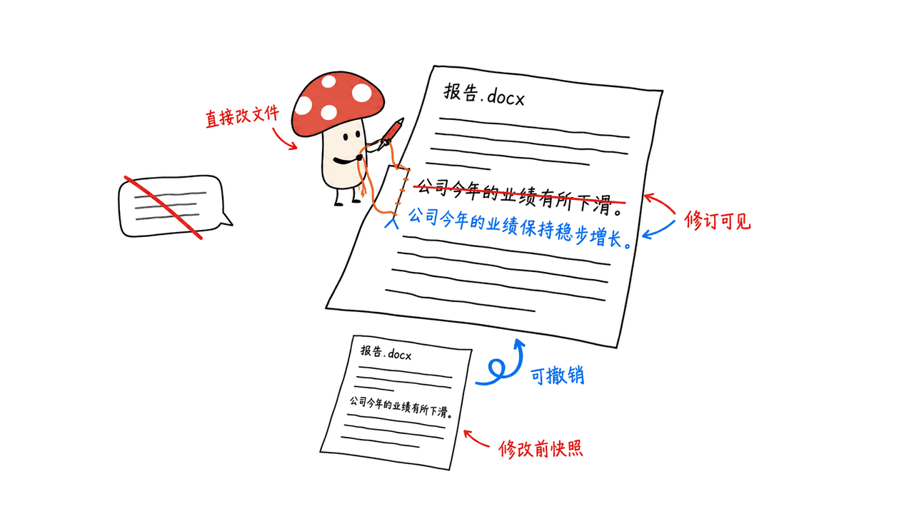
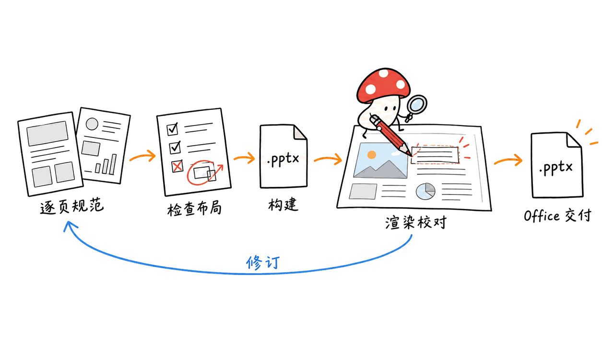

GenOffice 把 AI 放进文档、表格和演示编辑器，让它直接修改文件，用户可以查看修改并撤销。它是一套独立的桌面办公软件，适合希望减少“聊天窗口生成内容，再复制进 Office”这一步的人。

项目来自 `genspark-ai/genoffice`，核心代码采用 Apache 2.0，提供 macOS、Windows 和 Linux 版本。本文基于官方 README、隐私说明与许可证，核对到 2026-10-14 的提交 `5eab98adc8d0ebf6ecea687e42400a791ef58d64`；未安装桌面应用，也未实测复杂文档的兼容性。

封面采用官方 README 的 Sheets 演示截图，并非本次实测画面。

官方仓库：https://github.com/genspark-ai/genoffice
官网：https://genoffice.ai/
下载：https://github.com/genspark-ai/genoffice/releases/latest

## GenOffice 的六种编辑器分别做什么？

| 入口 | 格式与官方展示能力 | 实际工作中的用途 |
|---|---|---|
| Docs | `.docx`，文本、表格、批注与修订；AI 改写指定内容 | 编辑报告，而后交付 Word 文件 |
| Sheets | `.xlsx`，公式、图表、数据透视表等 | 从明细生成会继续计算的汇总表 |
| Slides | `.pptx`，可编辑对象、布局与 AI 生成演示 | 用提示词生成初稿，再调整页面 |
| PDF | 页面内文字编辑、问答、转 Word/Excel/PowerPoint | 处理已有材料，转换后继续编辑 |
| Markdown | `.md`，块编辑器、表格与 Mermaid | 整理笔记、说明文档并导出 Word |
| HTML | 单文件页面生成、预览、源码编辑与换风格 | 制作报告网页、落地页或界面原型 |

这些是官方文档和演示覆盖的能力，不代表我们验证过每个功能。GenOffice 打开和保存原生 Office 格式；它并不需要接管一套已安装的 Microsoft Office 才能工作。

官方表格演示中，AI 新增汇总工作表，写入 `SUMIF` 公式并插入柱状图。这里值得关注的是公式留下来：源数据变化时，汇总有机会继续正确计算，而不是把模型算出的数字贴成静态结果。

HTML 编辑器也不只是代码聊天框。官方流程先确定设计简报，再生成页面；换风格通过调整配色、字体等设计要素完成。导出后是否仍保留交互和布局，应按目标格式分别检查。

## AI 修改内容，怎样让人看得清？

GenOffice 的官方设计包含每轮 AI 修改的快照、差异展示和回退。Docs 开启 Track changes 后，编辑可以作为 Word 风格修订进入文件；Sheets 演示把一批操作作为可撤销的修改提交。

这比只收到一段“建议你这样改”的文字更接近实际办公。比如“把年度报告的概述缩短，再补三条结论”，理想交付物应是修改后的段落和插入位置，同时让人核对它有没有改错事实。

**可撤销减少恢复成本，但不会自动证明修改正确。** 表格的公式引用、文档中的人名数字、演示中的数据来源，仍需要检查。官方截图展示了 43 项表格修改，这只是该次演示的操作数，不是稳定成功率或效率评测。

README 还宣称未修改的文件部分按字节保留。它能降低导入导出时丢失内容的风险，但不能据此保证任意复杂 Word 排版、Excel 功能和 PowerPoint 对象都完全一致。复杂文件仍需要在目标软件中重新打开确认。

我们还审阅了保存实现和仓库测试源码：`zip-splice.ts` 包含不解压、不重新压缩地复制存档条目的路径，`roundtrip.test.ts` 检查无编辑时返回原始文件，以及只改一个段落时保留其他条目和 XML 片段。这里只确认实现与测试存在，没有运行它们；它们也不等于全格式兼容性证明。

保存实现：https://github.com/genspark-ai/genoffice/blob/main/packages/docx-engine/src/zip-splice.ts
测试源码：https://github.com/genspark-ai/genoffice/blob/main/packages/docx-engine/tests/roundtrip.test.ts

图中的虚构改写把“业绩下滑”改成了“稳步增长”，已经改变事实方向。修订记录与快照让错误可见、可恢复，仍需要人指出错误；这张示意图不是业务数据或实测截图。

## 能接自己的模型吗？

可以。官方提供两条入口：登录 Genspark，由其代理提供模型能力；或者在 Settings → AI 填自己的模型服务密钥。Claude、OpenAI、Gemini、DeepSeek 等都有配置入口，也支持自定义 OpenAI-compatible base URL，包括本地模型服务器。

搜索、图片生成和媒体理解另有提供商设置。换了聊天模型，不意味着这些附加能力也随之可用；应分别核对接口、密钥与费用。

免费办公软件也不等于免费模型调用。使用第三方 API 时，计算成本及数据政策由所选提供商决定。接入本地端点则还需要确认模型能正确调用编辑工具，不能仅以接口格式兼容推断所有操作都能完成。

随附 skill 还给出一个具体限制：本地引擎无法求值的部分 Excel 函数，如 `FILTER`、`SORT`、`UNIQUE` 和 `LET`，可写入文件但不提供缓存值，留给 Excel 打开时计算。因此，在 GenOffice 中生成公式、在本地得到完整计算结果、在 Excel 中正常计算，是三件需要分别确认的事。

随附使用说明：https://github.com/genspark-ai/genoffice/blob/main/skills/genoffice/SKILL.md
CLI 文档：https://github.com/genspark-ai/genoffice/blob/main/packages/cli/README.md

## “本地优先”意味着完全不联网吗？

官方说明，普通文件编辑、保存和格式转换在设备上完成。启用 AI 时，请求会发送到选定提供商；模型读取的文档片段可能因此离开设备。

还有两个单独的设置：可选 Jev 搜索重排默认关闭，开启后会把本地检索前 20 个结果的摘录发送去评分；官方打包版本的匿名使用统计则默认开启，可以在 Settings → General → Send anonymous usage statistics 关闭。

隐私文档称统计不上传文档正文、文件名和路径，但会报告应用版本、平台、语言、文件扩展名等事件信息。自己从源码构建且没有官方打包统计元数据的版本使用空统计器。

因此，选型时要分别判断文件操作、AI 上下文、可选搜索重排和使用统计。对于内部材料，先确定哪些模型服务可以接收内容，再决定启用哪些能力，比只看到“文件保存在本地”更准确。

隐私说明：https://github.com/genspark-ai/genoffice/blob/main/PRIVACY.md

## CLI 和 MCP 给办公自动化增加了什么？

除了桌面面板，项目还提供 `genoffice` 命令行和随附的 agent skill。编码智能体可以通过命令检查、生成、读取和修改真实 Office 文件，不必模拟鼠标点击每个按钮。

README 展示的演示文稿流程是：先写提纲和单页规范，检查溢出或重叠，再构建 `.pptx`，渲染各页并检查，必要时替换某页。这让“生成一个漂亮 PPT”变成有中间产物、能逐页纠正的工作。

MCP 有三种连接方式，范围并不相同：

| 方式 | 官方描述的范围 |
|---|---|
| `genoffice mcp` | stdio，无需打开窗口，提供文件与生成工具 |
| 应用内 HTTP MCP | 默认关闭，驱动可见 Word 编辑页，边操作边查看 |
| `genoffice mcp --http` | 面向其他机器或沙盒，可通过请求上传与下载文件 |

普通本地连接与跨机器传文件是不同部署。选择后者时要按文档配置监听地址和访问令牌。搜索、图像等联网能力也不能因为挂在 CLI/MCP 下，就被理解成全部离线。

Skill 与命令行说明：https://github.com/genspark-ai/genoffice#command-line-and-agent-skill
MCP 说明：https://github.com/genspark-ai/genoffice#mcp-server

## 它适合替换什么，又有哪些边界？

Mycelium 的判断是，GenOffice 更值得从“可编辑交付物”看待：AI 生成后还能继续改，能保存为对方接收的格式，出错时能回退。报告初稿、订单汇总、演示提纲和独立 HTML 页面，是比较清晰的起点。

它的机会在于把理解内容、执行修改和检查结果放在同一条工作流里。实际能否替换现有办公工具，要看格式保真、公式正确性、字体与分页、团队协作需求，而不只是提示词生成效果。

许可也要按目录区分：仓库根部是 Apache 2.0；`ee/` 为未来企业模块保留，采用独立企业许可证，不能把核心代码许可扩展成企业目录的生产使用权。目前的保留目录不证明单点登录、审计等企业功能已经交付。

核心许可：https://github.com/genspark-ai/genoffice/blob/main/LICENSE
企业目录许可：https://github.com/genspark-ai/genoffice/blob/main/ee/LICENSE

## 常见问题

### GenOffice 是 Microsoft Office 插件吗？

不是。它提供自己的桌面编辑器，读取和保存 `.docx`、`.xlsx`、`.pptx` 等文件；能与 Office 文件交换，不代表 Microsoft 提供或认证了它。

### 不配置 AI，还能编辑文件吗？

按官方说明，普通编辑、保存和转换可以本地完成。AI 面板及相关联网能力需要对应的服务配置或登录；第三方调用费用另算。

### 它能保证所有复杂文件无损吗？

本文没有验证这一点。官方提出未修改部分的字节保留机制，但复杂排版、特殊对象和公式行为还需针对真实文件检查，不能从示例截图推断完全兼容。

---

> © 2026 Author: Mycelium Protocol. 本文采用 [CC BY 4.0](https://creativecommons.org/licenses/by/4.0/deed.zh) 授权——欢迎转载和引用，须注明作者姓名及原文链接，不得去除署名后以原创发布。

<!--EN-->

GenOffice puts an AI agent inside document, spreadsheet and presentation editors so it can change files directly, with changes users can inspect and undo. It reduces the step of copying generated content from a chat window into an Office application.

The `genspark-ai/genoffice` project provides macOS, Windows and Linux applications. Its core uses Apache 2.0, with a separately licensed enterprise directory. This article reviews official documentation at commit `5eab98adc8d0ebf6ecea687e42400a791ef58d64` on October 14, 2026; we did not install the desktop app or test complex-file compatibility.

The cover uses the official Sheets demonstration screenshot, not a screenshot from our testing.

Repository: https://github.com/genspark-ai/genoffice
Website: https://genoffice.ai/
Downloads: https://github.com/genspark-ai/genoffice/releases/latest

## What do its six editors cover?

| Editor | Documented formats and functions | Practical output |
|---|---|---|
| Docs | `.docx`, text, tables, comments and tracked changes | An editable Word report |
| Sheets | `.xlsx`, formulas, charts and pivot tables | A workbook that keeps calculating |
| Slides | `.pptx`, editable objects, layouts and AI generation | A presentation draft that can be revised |
| PDF | In-page text editing, questions and Office conversion | Material that can be edited further |
| Markdown | `.md`, block editing, tables and Mermaid | Notes and documentation, with Word export |
| HTML | Self-contained pages, preview, source editing and restyling | Report pages, landing pages or UI prototypes |

These functions come from official descriptions and demonstrations, rather than our validation of every feature. GenOffice is an independent application that opens native Office files; it does not need to control an installed Microsoft Office suite.

The spreadsheet demonstration creates a summary sheet with live `SUMIF` formulas and a chart. Keeping formulas can let a summary update when source records change, instead of leaving model-generated values as static text. The HTML workflow establishes a design brief before generation and changes visual tokens for restyling; export behavior must be checked separately for each destination format.

## How can users review AI edits?

The documented workflow uses per-turn snapshots, differences and rollback. With Track changes enabled, Docs can record edits as Word-style revisions. The Sheets example groups operations into an undoable batch.

For a request such as shortening a report overview and adding conclusions, the useful result is a changed document with visible locations to inspect. Rollback reduces recovery cost; it does not prove the facts, references or formulas are correct. The 43 spreadsheet changes in the screenshot describe one demonstration, not a measured success rate.

The developers also claim byte preservation for untouched file parts. That may reduce round-trip loss, but it does not establish perfect rendering or behavior for every complex Office file. Reopen important outputs in the recipient's application and check the relevant features.

We also reviewed source and test definitions: `zip-splice.ts` contains a raw-entry copy path without decompression/recompression, and `roundtrip.test.ts` checks an unchanged original and preservation of other entries/XML when editing one paragraph. We did not run those tests; their presence does not establish universal fidelity.

Implementation: https://github.com/genspark-ai/genoffice/blob/main/packages/docx-engine/src/zip-splice.ts
Test definitions: https://github.com/genspark-ai/genoffice/blob/main/packages/docx-engine/tests/roundtrip.test.ts

The fictional edit in the illustration turns declining results into steady growth, changing the factual direction. Revision marks and snapshots make that error visible and reversible; a reviewer still has to catch it. This is an illustration, not business data or a test screenshot.

## Can it use a third-party model?

Yes. Users can sign in through Genspark or configure a provider key under Settings → AI. Documented options include Claude, OpenAI, Gemini and DeepSeek, plus a custom OpenAI-compatible base URL, including local servers.

Search, image generation and media understanding have separate provider settings. Replacing the chat model does not automatically configure those capabilities. A free application also does not make third-party inference free; costs and data policies follow the selected service. Local endpoint compatibility alone does not prove reliable tool execution.

The bundled skill documents a concrete formula limit: functions the local engine cannot evaluate, including FILTER, SORT, UNIQUE and LET, can be written without cached values for Excel to compute on open. Creating formulas, obtaining local results and recalculating correctly in Excel therefore require separate checks.

Usage reference: https://github.com/genspark-ai/genoffice/blob/main/skills/genoffice/SKILL.md
CLI documentation: https://github.com/genspark-ai/genoffice/blob/main/packages/cli/README.md

## Does local-first mean no network traffic?

Ordinary editing, saving and conversion run locally according to the documentation. AI requests go to the configured provider and may include document context.

Optional Jev reranking is off by default. Enabling it sends excerpts from the first 20 local search hits for scoring. Anonymous usage analytics is enabled by default in official packaged builds and can be disabled in Settings → General → Send anonymous usage statistics.

The privacy document says analytics excludes document content, filenames and paths, while reporting application, platform, language and file-extension events. Source builds without the official analytics metadata use a no-op tracker.

File storage, AI context, search reranking and analytics are separate data decisions. For internal documents, determine which providers can receive content before enabling the relevant functions.

Privacy: https://github.com/genspark-ai/genoffice/blob/main/PRIVACY.md

## What do CLI and MCP add?

The bundled `genoffice` command line and agent skill let coding assistants inspect, create, read and edit Office files without navigating every UI control.

The documented deck workflow produces an outline and individual page specifications, checks layout issues, builds a `.pptx`, renders pages and replaces ones that need correction. Its useful property is an inspectable sequence of artifacts rather than one unreviewed generation.

| Connection | Documented scope |
|---|---|
| `genoffice mcp` | Headless stdio file and generation tools |
| In-app HTTP MCP | A visible Word editor; disabled by default |
| `genoffice mcp --http` | Cross-machine or sandbox access with file upload/download |

Local stdio and cross-machine file transfer are different deployments. Follow the documented binding and token configuration for the latter. Search and image capabilities do not become offline merely because they are exposed through a CLI or MCP interface.

CLI and skill: https://github.com/genspark-ai/genoffice#command-line-and-agent-skill
MCP: https://github.com/genspark-ai/genoffice#mcp-server

## Where does it fit, and what still needs validation?

Mycelium sees GenOffice's main opportunity in editable deliverables: outputs can be revised, saved in a recipient's format and rolled back. Report drafts, order summaries, presentation outlines and standalone HTML pages offer concrete starting points.

Replacing an existing office workflow also depends on fidelity, formulas, fonts, pagination and collaboration needs. The integration of understanding, editing and checking matters more than a striking prompt demonstration alone.

The root license is Apache 2.0. The `ee/` directory is reserved for future enterprise modules under a separate enterprise license; its existence does not establish that SSO, auditing or other enterprise features are already available.

Core license: https://github.com/genspark-ai/genoffice/blob/main/LICENSE
Enterprise directory: https://github.com/genspark-ai/genoffice/blob/main/ee/LICENSE

## Frequently asked questions

### Is GenOffice a Microsoft Office plug-in?

No. It provides its own editors and exchanges native Office files. Format support does not imply Microsoft ownership or certification.

### Can it edit files without configuring AI?

According to the official documentation, ordinary editing, saving and conversion work locally. AI features need their provider settings or login, and third-party charges are separate.

### Is complex-file compatibility guaranteed here?

No. We did not test it. The documented preservation of untouched parts does not establish complete fidelity for layout, special objects or formula behavior in real files.

---

> © 2026 Author: Mycelium Protocol. Licensed under [CC BY 4.0](https://creativecommons.org/licenses/by/4.0/) — free to share and adapt with attribution. You must credit the author and link to the original; removing attribution and republishing as original is not permitted.
