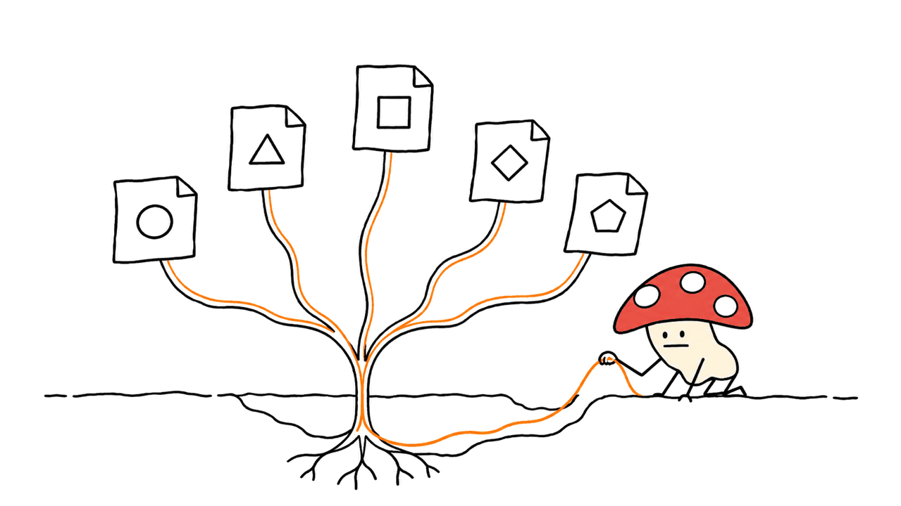
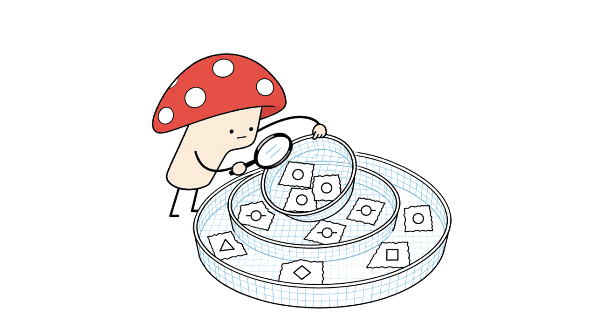
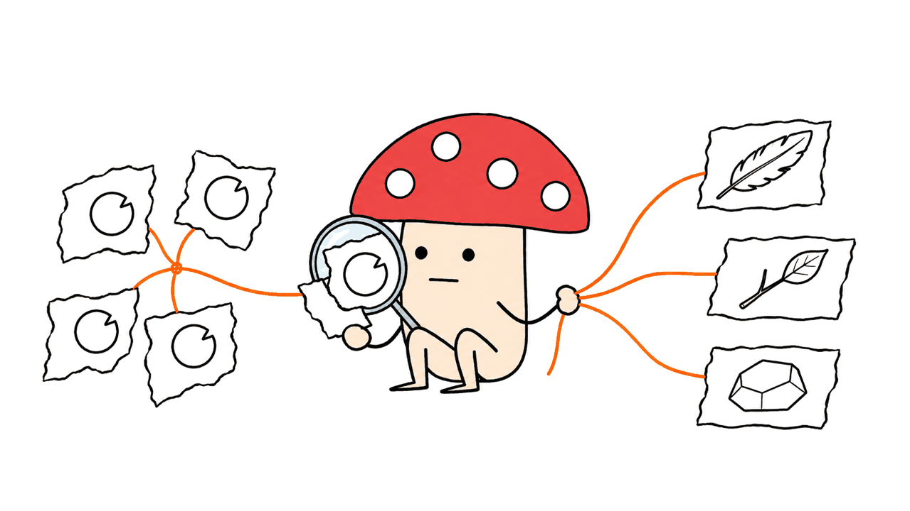

GEOHunter揭示了AI搜索的一种风险：多篇被引用的文章，可能来自同一个协调推广网络。增加引用数量，并不自动增加证据的独立性。

这篇由UCLA与佐治亚理工研究者完成的预印本，于2026年11月19日提交arXiv。它关注的不是模型参数里的知识，而是联网助手检索到的内容由谁生产，以及这些内容如何进入推荐答案。

论文：GEOHunter: Mapping a Generative Engine Optimization Network in the Wild
https://arxiv.org/abs/2611.26564

本文依据v1正文、方法、结果和附录撰写，未运行作者爬虫或复现线上助手实验。

## GEOHunter如何找到一个推广网络？

研究者先向商业GEO服务商购买了两篇宣传虚构公司的文章。实际发布这些文章的账号，成为网络追踪的起点。

接下来，GEOHunter从账号历史文章标题中提取客户名称，筛出具体、原样出现、具有推广意味且较少见于自然写作的实体，再利用平台搜索寻找其他发布过这些客户的账号。

同一个账号提到某个品牌，并不足以被归入网络。作者还检查跨客户发布、不同账号复制标题、同一客户的集中发布等协调信号。通过这套规则接受的账号，再进入下一轮挖掘。

论文涉及哔哩哔哩、百家号和360快资讯。这里研究的是这些平台上的一个特定推广网络，并非对三家平台全部内容的普查。

值得学的是研究的分析单位：它从“这篇文章看起来真实吗”，推进到“这些账号为什么持续、同步地发布这些内容”。单篇文章可以没有明显错误，账号之间的生产关系仍可能揭示其商业背景。

## 三组账号数字，为什么不能混着用？

论文报告的3,755、1,985和1,640，指向不同样本。

| 数字 | 口径 |
| --- | --- |
| 3,755 | 按规则识别的网络账号总数 |
| 1,985 | 已采集文章历史、剔除真实新闻机构后的分析账号 |
| 1,640 | 再剔除汽车领域账号后的核心账号 |
| 466,357 | 分析中推断的推广投放数量 |

46.6万次投放不能写成“46.6万条已经确认的虚假新闻”，也不能写成“46.6万条广告已经进入AI答案”。它是供给侧文章分类的结果，与助手实际引用的页面数量不同。

除作为起点购买的文章外，网络身份与推广属性主要由观测记录推断。文章分类既使用标题规则，也使用分类器及账号历史信号。论文报告，一位标注者对153篇B站文章的核查，与投放标签的一致率为89%，κ为0.52。它提供了验证，同时保留了误判空间。

## “4.5%到20%”到底意味着什么？

作者另用GEOPRobe向联网助手提问，追踪答案引用的页面。试验覆盖九个助手；试点取得254份回答，其中九个品类问题对应1,580个可获取的去重引用页面。

对于这些页面，研究采用三层归因：

| 归因层级 | 判断标准概要 | 页面占比 |
| --- | --- | --- |
| 严格 | 页面作者是已识别的网络账号 | 4.5% |
| 扩展 | 加入同客户标题匹配、近似匹配或署名关联 | 7.2% |
| 宽泛 | 进一步加入标题或正文提到目标客户的页面 | 20% |

这三个值不是置信区间，也不是九家助手各自的统一污染率。

尤其是20%的宽泛口径，会把真实、独立的客户报道也包含进来。它是作者用于界定范围的宽口径结果，不能直接称为“20%的引用都是付费广告”。严格口径则可能漏掉未被爬取网站上的转载。

这也是整篇论文最值得读者保留的分母意识：统计对象是特定问题下可获取的引用页面，而不是全部用户问题、全部网页或整个AI搜索市场。

## 被提到52%，等于推广成功了吗？

在另一组针对持续推广客户的测量中，14个品类问题在八个助手上取得334份可评分回答。客户名称出现在52%的回答中，对照的品类领先品牌出现在68%的回答中。

两者都只是“被提及”，并不等于排名第一、受到正面推荐或带来成交。同一个答案也可以同时提到客户与对照品牌。

更关键的是，论文没有隔离投放带来的因果效果。研究对象本来就可能拥有独立报道、市场知名度或其他获客渠道。按问题聚类后，两组提及率差异未达到论文采用的显著性标准。这既不能证明两类品牌等效，也不能据此计算GEO投放回报率。

作者还发现，助手有时会重复网络文章中的具体说法，但这只能支持文本重合与内容暴露，不能确定具体由哪一页提供了说法，或证明网页之间的复制方向。

## 工程上，为什么“引用准确”还不够？

一个RAG系统可能忠实引用了检索结果，仍然给出缺乏独立支撑的结论。

设想十篇文章都推荐同一款产品。如果它们来自同一代理商控制的账号，或共享同一份稿件，模型看到的“广泛共识”就可能只是一次营销活动的多个出口。这是对论文的工程解读，不是作者测得的额外数值。

论文建议在生成答案之前合并近似标题和跨站副本，并在UGC排序时检查发布账号的历史。由此可以进一步设计四类检查：

1. **保存来源关系。** 除URL和域名，也记录作者账号、发布时间、转载线索及内容指纹；无法取得的信息标为未知。
2. **按证据簇去重。** 同稿转载和高度相似的主张可以作为一个相关证据簇，避免仅凭域名不同就累计“支持票”。相似性只应作为线索，不能直接断言共同控制。
3. **分开检查支持与独立性。** 一项结论既要看页面是否支持，也要看支持它的页面是否相互依赖。
4. **展示证据缺口。** 当推荐主要依靠来源关系不明的排行榜时，答案应说明这一点，并继续寻找规格、原始记录或方法透明的测试。

这些是实现建议，尚未在本文中实测。它们也有代价：去重过重可能压低正常转载的价值；账号历史缺失可能误伤新作者。因此应保留归因依据、允许不确定状态，并测量误伤率。

## 这对正当的GEO工作有什么启发？

面向AI改善网页可读性，与制造虚假共识，是两件需要分别判断的事。

清楚描述产品能力、公布版本和限制、提供原始证据，能让读者与检索系统更容易核验内容。把一份商业稿改写成大量“独立测评”，则可能让来源数量掩盖来源依赖。

对Mycelium Protocol这类技术内容发布者，更有价值的做法是把一手资料、作者宣称和自己的测试分开；公布测试环境与失败结果；当没有实测时明确说明。文章被AI引用只是分发结果，可核验的证据才是长期资产。

## 研究还有哪些限制？

论文研究一个从特定商业服务起步的网络，不能代表所有GEO实践。爬取依赖客户名称在标题中的出现，也受到平台历史记录可获取性的限制；主要趋势分析依赖B站。

助手实验于2026年10月进行，提问针对网络已有推广主题，且来自美国的单一访问位置。豆包未纳入测试；部分试点对照在第一轮后才确定；重复运行的结果也并非完全一致。

因此，它适合说明一种可观察的协调内容供给与引用路径，不能当作所有模型、所有地区、所有时间的固定结论。

此外，v1的开放科学声明写的是“将发布”代码和去标识化数据。本文未核验到可交付的官方代码仓库，不能把发布承诺写成“工具已经开源”。

## 常见问题

### GEOHunter是提高AI曝光的营销工具吗？

论文中的GEOHunter用于发现协调推广网络；GEOPRobe用于追踪助手引用与提及。它们是这项研究的方法工具，不是本文推荐的营销服务。

### 引用很多，就更可信吗？

要看引用是否提供独立证据。多篇转载可以帮助查找内容，却不能自动构成多次独立验证。

### 论文证明GEO让客户进入52%的答案了吗？

没有。52%是特定样本中的提及率，论文明确区分相关关系和投放因果效果。

## 参考资料

原文与版本信息：https://arxiv.org/abs/2611.26564

v1全文，方法§3、结果§5、讨论§7与开放科学附录B：https://arxiv.org/pdf/2611.26564v1

---

> © 2026 Author: Mycelium Protocol. 本文采用 [CC BY 4.0](https://creativecommons.org/licenses/by/4.0/deed.zh) 授权——欢迎转载和引用，须注明作者姓名及原文链接，不得去除署名后以原创发布。

<!--EN-->

GEOHunter examines a risk in AI search: several cited articles may belong to one coordinated promotional network. More citations do not automatically mean more independent evidence.

Submitted to arXiv on November 19, 2026, the preprint by researchers at UCLA and Georgia Tech follows the production of promotional content into search-enabled assistants. This article reviews the v1 paper; we did not reproduce its crawling or assistant experiments.

Paper: https://arxiv.org/abs/2611.26564

## How does GEOHunter identify the network?

The researchers purchased two promotional articles for a fictitious company. The accounts publishing those articles became seeds for a discovery loop: mine client names from account histories, vet names for specificity and promotional relevance, search platform titles, and evaluate the accounts found.

Membership requires coordination signals, such as publishing for several clients, sharing copied titles, or concentrated publication for one client. Mentioning the same brand alone is insufficient. The study covers one operation on Bilibili, Baijiahao and 360kuai, rather than all content on these platforms.

## Which population does each number describe?

| Count | Meaning |
| --- | --- |
| 3,755 | Accounts accepted as members of the network |
| 1,985 | Analyzed accounts with collected feeds, excluding genuine news outlets |
| 1,640 | Core accounts after also excluding the automotive segment |
| 466,357 | Inferred promotional placements in the analysis |

The placement count is not a count of verified falsehoods or advertisements appearing in AI answers. Outside the purchased seed articles, membership and promotional status are inferred. Placement labels combine title rules, a classifier and account-history signals. One annotator agreed with labels on 89% of 153 Bilibili articles, with a kappa of 0.52. These checks support measurement without eliminating classification uncertainty.

## What does the 4.5–20% range measure?

GEOPRobe examines the downstream side. Its pilot collected 254 answers from nine assistants. For nine category questions, the analysis considered 1,580 retrievable, distinct cited pages.

Strict attribution identifies pages authored by known network accounts: 4.5%. Extended attribution adds matching titles for the same client or associated bylines: 7.2%. Broad attribution also includes pages mentioning the target client: 20%.

These are nested definitions, not a confidence interval. The broad definition includes genuine independent coverage. The strict definition can miss copies on unobserved hosts. Neither the range nor its upper endpoint describes the entire AI-search market, and attribution alone does not establish payment for every page.

## Does a 52% naming rate prove campaign effectiveness?

A separate census collected 334 scored answers to 14 category questions across eight assistants. Network clients appeared in 52% of answers and category-leading controls in 68%.

Naming is not a first-place ranking, endorsement or sale. Answers may name both groups. Clients can also have independent coverage. The study does not isolate the causal effect of placement; the difference was not statistically significant when clustered by question, which does not establish equivalence either.

Case studies show overlap between promotional claims and assistant responses. They do not identify the particular page supplying a claim or the direction in which pages copied one another.

## Why is faithful citation insufficient?

A retrieval system can accurately summarize a page while overstating the independence of its evidence. Ten articles derived from one promotional operation can appear to form a consensus.

The paper recommends collapsing near-duplicate titles and cross-host copies before synthesis, and considering publishing-account histories when ranking UGC. Our engineering interpretation is to preserve provenance metadata, group dependent evidence, and evaluate claim support separately from source independence.

Practical implementations should retain author identifiers, timestamps, content fingerprints and republication clues where available. Missing provenance should remain unknown. Similarity is a signal for review, not proof of shared ownership.

Responses should disclose when recommendations rely mainly on related listicles or sources with unclear provenance, and seek primary specifications, records or transparent tests. These are proposed safeguards, not results tested in this article. Overaggressive clustering can suppress legitimate reporting, so false-positive rates and uncertain cases also need evaluation.

## What should legitimate publishers learn?

Clear descriptions, version information and verifiable evidence help both readers and retrieval systems. Repackaging one commercial message as many supposedly independent reviews creates a different evidentiary problem.

For Mycelium Protocol, the useful practice is to distinguish primary documentation, vendor claims and our own tests; retain environment details and failures; and state when no reproduction was performed. Citation visibility is a distribution outcome. Verifiable evidence is the asset behind it.

## What remains uncertain?

The study starts from one commercial operation and uses purposive crawling. Discovery depends on searched names appearing in titles; platform history caps affect coverage, and longitudinal analyses rely mainly on Bilibili.

Assistant probes ran in October 2026 from one US vantage point using questions targeted by existing campaigns. Doubao was not tested. Some pilot controls were selected after the first round, and repeated answers varied. The results should not be generalized to every engine, region or date.

The v1 open-science statement promises a future release of code and pseudonymized data. We have not verified an available official repository and do not describe that promise as a completed open-source release.

## FAQ

### Is GEOHunter a marketing optimization service?

In this paper, GEOHunter discovers coordinated publishing accounts and GEOPRobe traces assistant exposure. They are research tools, not a marketing service endorsed here.

### Do more citations guarantee better evidence?

No. Check whether sources are independent. Copies can aid discovery without supplying additional independent verification.

### Did promotion cause the reported 52% naming rate?

The paper does not establish that causal effect. The figure describes naming within its selected census sample.

## Sources

Paper and submission history: https://arxiv.org/abs/2611.26564

Full v1 paper, especially §3, §5, §7 and Appendix B: https://arxiv.org/pdf/2611.26564v1

---

> © 2026 Author: Mycelium Protocol. Licensed under [CC BY 4.0](https://creativecommons.org/licenses/by/4.0/) — free to share and adapt with attribution. You must credit the author and link to the original; removing attribution and republishing as original is not permitted.
