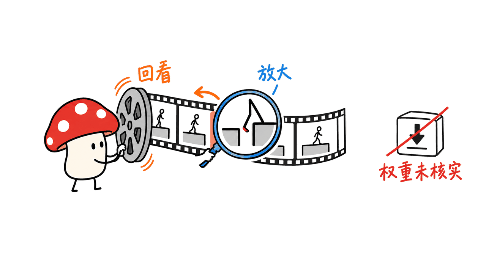
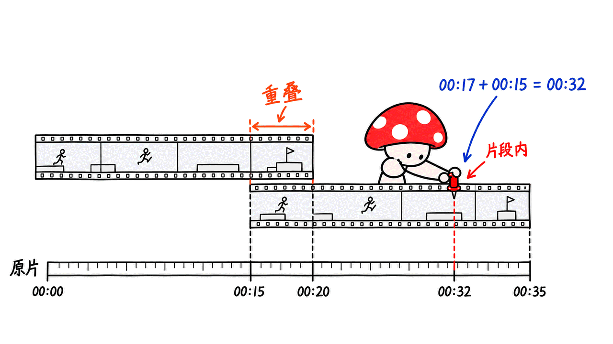

Glimpse 可以作为视频验收的视觉审阅助手，但模型指出疑似 Bug，仍需用画面和复现步骤确认。它适合帮助开发者找遗漏，暂不能据此承诺自动完成游戏质量保证。

本文核查的是 Elorian 于 2026-10-16 发布的研究预览，截至 2026-10-17。官方入口为 https://elorian.ai/blog/introducing-glimpse 。我们没有调用其付费 API，也没有进行游戏实测。

## Glimpse 开源了吗，应该去哪里找？

官方目前提供 API 与聊天界面。基于开放权重底座做后训练，不等于发布了自己的权重；本次没有找到可核验的官方模型下载和自部署说明。GitHub 上同名 GLIMPSE 视频基准及语音应用也不是这个模型。

其主要特点是回到视觉证据继续检查：例如重新观察短区间、放大局部，再修正判断。推出页标价为输入每百万 token 0.60 美元、输出 3 美元；这不是每分钟视频的固定费用，反复审阅会改变总用量。



## 公开结果能证明它最擅长找游戏 Bug 吗？

不能。推出页同时公布领先与落后的任务：UGC-VideoCap 得分 82.66，高于表中 Astra 的 80.32；HSS 为 46.36，低于 Astra 的 53.6。设置包括不同模型的推理强度及原生工具，不能当作统一裸模型测试，更不是游戏缺陷召回率。

用户提供的线索描述了开发者用游戏录屏找问题并返回时间戳。本次检索能找到相关转述，但没有拿到完整原始录像、标注和可复现报告，因此只作为待验证案例，不转写成“捕获绝大多数 Bug”的实测结论。

另有独立研究使用 41 小时游戏视频、19,738 个关键帧，简单 VLM 基线的 precision 为 0.50，accuracy 为 0.72；追加评审模型和历史报告只带来有限改善。它没有测试刚发布的 Glimpse，但说明“看起来会分析”与真实 QA 效果之间需要单独验收。

论文：https://arxiv.org/abs/2603.22706

## 怎样把录屏审阅变成工程流程？

以下是 Mycelium Protocol 提出的接入设计，不是声称已经跑过的产品功能。先把任务限定为“为人工提出疑似缺陷”，把录屏中的异常与源码修复分开。

第一步，留好可复现材料。录屏需附游戏 build、平台、分辨率、操作路径和时间基准；同时保留正常表现的规则说明。比如角色穿墙可能是碰撞错误，也可能是被允许的技能。没有预期规则，模型只能猜设计意图。

第二步，先粗查再复看。长录像分成有少量重叠的窗口，记录窗口起点；模型返回局部时间时换算成原始视频时间。对疑点补取前后连续片段，不要只截一张最像故障的静态图。采样间隔也要记录，否则短暂闪烁可能根本没进入输入。



第三步，把报告拆成观察与推断。下面是我们建议的中间记录，字段不代表已核实的官方 API schema。

```json
{
  "video_id": "run-017",
  "build": "candidate-42",
  "start_s": 12.4,
  "end_s": 13.1,
  "observation": "角色的脚短暂位于地板表面下方",
  "expected_rule": "该路段角色应站立于地板上",
  "hypothesis": "可能发生穿模，需排除动画效果",
  "status": "needs_review"
}
```

第四步，让审阅人一键跳到原片区间，标记确认、误报或证据不足。视觉模型生成的自然语言信心不能替代校准结果；与其要求给一个漂亮的概率，不如要求指明证据画面、规则和不确定原因。

第五步，确认后才建立缺陷单。记录复现率、严重性与负责模块；需要定位源码时，再结合日志、引擎对象、场景和碰撞信息。定位到时间戳和画面位置，只能告诉工程师“去哪里看”，不能自动证明“哪一行代码错”。


## 团队应该怎样评估是否值得接入？

先建立固定样本集：已知缺陷、正常片段，以及最容易被误判的技能、遮挡、镜头切换和画风特效。每次保留模型版本、提示词、采样方式和预算。相同片段重复送入的结果也应留档。

验收至少看四件事：确认缺陷占所有候选的比例；已知缺陷被找到的比例；定位区间是否足够短；审核每条候选花多少时间。报告中还应注明 API 成本、端到端耗时和失败请求，避免只展示最成功的一条录像。

最值得争取的收益，是减少人工扫片、反复拉进度条和整理证据的时间。若候选太多、误报难排查，即使示例很惊艳，也可能增加审核负担。没有验证之前，让它辅助找问题，发布阻断仍由现有规则和负责人决定。

## 常见问题

### 可以下载到本地运行吗？

截至本文核查，未找到可核验的官方 Glimpse 权重和本地部署文档；API 和聊天界面可用，不应写成本地开源模型教程。

### 时间戳就是 Bug 已被确认吗？

不是。时间戳是证据导航；是否违反规则、能否复现以及严重程度仍需确认。

### 本文进行了模型对跑吗？

没有。本文基于一手资料、独立论文和工程分析；所有公开模型分数均标明来源，不冒充我们的测试结果。

## 一手资料与关联阅读

官方发布：https://elorian.ai/blog/introducing-glimpse

使用入口：https://platform.elorian.ai/

HSS 说明：https://elorian.ai/blog/humanitys-sixth-sense

独立游戏 QA 研究：https://arxiv.org/abs/2603.22706

同名但不同项目的视频基准：https://github.com/aiming-lab/GLIMPSE

相关机器人接口分析：https://blog.mushroom.cv/blog/kinex-coding-agents-robot-harness/

封面及正文配图为原创流程示意，不是 Glimpse 的运行结果或游戏案例截图。

---

> © 2026 Author: Mycelium Protocol. 本文采用 [CC BY 4.0](https://creativecommons.org/licenses/by/4.0/deed.zh) 授权——欢迎转载和引用，须注明作者姓名及原文链接，不得去除署名后以原创发布。

<!--EN-->

Glimpse is worth examining as a visual reviewer that proposes suspicious moments in gameplay video. A candidate finding still needs evidence and reproduction before becoming a confirmed defect.

This review concerns Elorian's October 16, 2026 research preview, checked on October 17. We did not call its paid API or run a game evaluation.

## Is this an open model?

The official launch offers an API and chat UI. We found no verified official weight download or self-hosting instructions; using an open-weight base does not establish release of the resulting model. Unrelated GLIMPSE benchmarks and dictation apps should not be substituted.

The system revisits visual evidence while reasoning. Launch prices are $0.60 per million input tokens and $3 per million output tokens, rather than a fixed video-minute tariff.


## Do public results establish game-QA leadership?

No. The launch reports both wins and losses: UGC-VideoCap is 82.66 versus Astra's 80.32, while HSS is 46.36 versus 53.6. These publisher evaluations use differing native tools and reasoning settings. Neither measures gameplay defect recall.

The supplied developer anecdote could not be verified against complete original footage and labels, so we do not treat it as an independently reproduced result.

A separate study of 41 hours and 19,738 gameplay keyframes reports baseline precision 0.50 and accuracy 0.72, with limited gains from additional judging or retrieved reports. It did not test the newly launched Glimpse. Its relevance is methodological: practical QA requires a separate evaluation from impressive visual demonstrations.

Study: https://arxiv.org/abs/2603.22706

## How could a team turn footage review into a workflow?

The following is our proposed integration design, not a claim about tested product features. Scope the model's role to proposing candidates for human review.

First, preserve the game build, platform, resolution, action sequence and original video timebase. Supply expected behavior. Passing through a wall may indicate broken collision or an intended ability; appearance alone does not establish the design rule.

Second, inspect overlapping windows, retaining each window's original offset. Convert local timestamps back into source-video time. Revisit continuous footage around a candidate instead of selecting one dramatic still. Record sampling settings, since omitted frames cannot provide evidence for a brief flicker.


Third, separate observation from hypothesis. A useful intermediate record contains video ID, build, start/end times, visible observation, expected rule, possible explanation and review status. This proposed record is not an official API schema. Do not interpret a model's verbal confidence as calibrated correctness.

Fourth, make each candidate open the exact original interval for a reviewer. Allow confirmed, false-positive and insufficient-evidence outcomes. Ask for the relevant evidence and uncertainty rather than rewarding a persuasive explanation.

Fifth, create a defect ticket only after confirmation. Add reproduction rate, severity and ownership. Source-level diagnosis requires logs, scene objects, engine state and collision data where relevant. A video timestamp identifies where to inspect; it does not prove a specific line of code is wrong.


## What should the acceptance test measure?

Prepare a frozen set containing known defects, normal footage and confusing legitimate effects. Retain prompts, model versions, sampling settings, budgets and repeated-run outputs.

Measure candidate precision, known-defect recall, localization interval length and reviewer time per candidate. Include API expense, end-to-end duration and failed requests. A pipeline that floods reviewers with uncertain alerts can increase work despite an impressive showcase.

The practical opportunity is reducing manual scanning, scrubbing and evidence preparation. Until validated against your game, keep release-blocking decisions with established rules and accountable reviewers.

## FAQ

### Can I download Glimpse for local inference?

We found no verified official weights or local deployment instructions as of this review. API availability is not an open-model release.

### Does a timestamp confirm a bug?

No. It navigates to evidence; rule violation, reproducibility and severity still require confirmation.

### Did we benchmark the model?

No. This is source research and engineering analysis. Published results are attributed rather than presented as our measurements.

## Primary sources and related reading

Official launch: https://elorian.ai/blog/introducing-glimpse

Product access: https://platform.elorian.ai/

HSS explanation: https://elorian.ai/blog/humanitys-sixth-sense

Independent game-QA study: https://arxiv.org/abs/2603.22706

Unrelated benchmark with the same name: https://github.com/aiming-lab/GLIMPSE

Related robot-interface review: https://blog.mushroom.cv/blog/kinex-coding-agents-robot-harness/

All illustrations are original conceptual explanations, not model outputs or screenshots of the reported game case.

---

> © 2026 Author: Mycelium Protocol. Licensed under [CC BY 4.0](https://creativecommons.org/licenses/by/4.0/) — free to share and adapt with attribution. You must credit the author and link to the original; removing attribution and republishing as original is not permitted.
