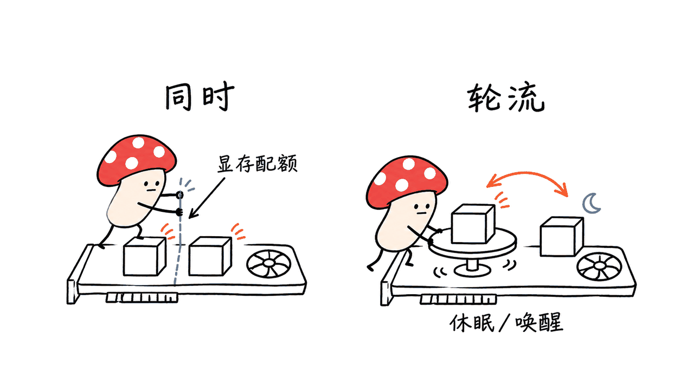
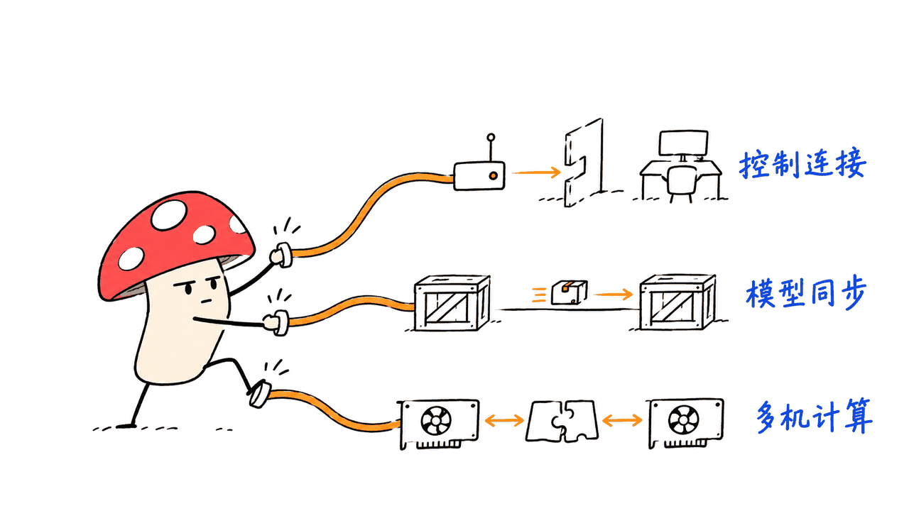

GPUWorks 把分散的机器接入一个管理与推理服务平台，帮助团队看清哪些资源可用、模型为什么能放上去，以及服务怎样暴露给应用。它要解决的是资源接入和使用方式的问题；同一个算力池不意味着任意显卡能拼成一张大卡。

项目来自 `flitai-io/gpuworks`，采用 Apache-2.0。本文固定提交 `696a369621c3b74264013472eae6d6c4f3b92756`，核对官方说明并运行部分原始 Go 测试，没有在本机安装控制面或接入实际 GPU 节点。

## 40MB 和“千台”分别在说什么？

官方 README 将约 40MB 描述为包含 Web UI 的控制面下载体积。Server 和 Agent 以静态二进制交付，普通控制面状态保存在 SQLite 中。这解释了为什么启动门槛比先搭一套 Kubernetes 集群低，但它不是整个推理环境的大小。

模型权重、推理引擎环境、容器镜像、缓存和运行内存仍然各有成本。Mac 教程里的一个示例，模型下载本身就约 11.3GiB，还需环境包和运行数据。因此不能从“40MB 下载”推导出“40MB 内存跑模型”。本次也没有独立下载发行包测量体积。

“千台”是作者报告的控制面规模演练：在阿里云七个地域接入 1,003 台租用的 GPU 机器，四分钟内放置并运行超过 500 个副本，网关承接 2,000 并发请求，Server 峰值约九个 CPU 核和 1.6GB 内存。这些是官方描述，不是我们的测试，更不是“1000 张卡组成同一模型”的证明。

## 一张卡怎样给多个模型用？

先纠正一个前提：一张 GPU 只能给一个模型用，并不是硬件的普遍规则。团队常见的障碍是独占分配、缺乏显存预算、引擎预分配和服务生命周期管理。GPUWorks 为这些问题提供了不同工具，不能混成一个“共享”按钮。

| 需求 | 对应方式 | 需要确认的边界 |
| --- | --- | --- |
| 多个小模型同时在线 | dGPU 显存配额 | 后端、设备和运行时是否支持，预算是否包含额外开销 |
| 多个模型轮流使用卡 | sleep/wake | 引擎是否支持，唤醒延迟和剩余显存如何处理 |
| 同一服务承接更多请求 | 多副本与网关路由 | 每个副本自己的资源、健康状态与请求策略 |
| 单模型放不进单机 | 多机推理 | 引擎、计算网络及并行配置是否匹配 |

官方将 dGPU 解释为向实例注入显存预算及相关运行库。NVIDIA 路线使用 HAMi-core；其他厂商采用不同后端，部分仍标为实验性。它不是给同一物理卡生成两个有独立故障域、固定带宽和固定算力的 PCIe 设备，也不能直接等同于硬件分区。

配额变化还受引擎限制。vLLM、SGLang 常在启动时按可见预算分配 KV cache，增加平台配额后仍可能需要重启才能使用；某些后端只在容器启动时读取限制。平台显示“已修改”不等于运行中的模型已经获得更多可用缓存。

我的判断是，资源池的价值首先在于让预算与占用可解释。服务是否适合共卡，需要结合峰值并发、上下文长度、缓存、唤醒等待和故障影响观察，不能只看模型权重能否塞进显存。

## NAT 后的机器和 Mac 能接入，意味着什么？

默认是 Agent 主动连 Server，控制和数据各走一条 WebSocket 通道，节点无需为这条控制面接入开放入站端口。网关转发的推理请求也可以沿平台通道到达实例。不能出站时，另有 Server 主动连接 Agent 的模式，但网络可达条件随之改变。

这不表示所有数据路径都无需规划。节点间模型或镜像同步使用直接连接；多机推理、RDMA 和 prefill/decode 分离还需要自己的计算网络。把跨地域节点列在同一控制台，并不会消除带宽、往返延迟和故障边界。

Mac 路线也有明确区别：官方支持矩阵列出 Apple Silicon、macOS 15+，引擎以原生进程运行，可使用相应的 vllm-metal、MLX 或 llama.cpp 环境，不要求 Docker Desktop。此路线的 dGPU、sleep/wake、多机和 PD 列仍标为不支持或未验证，不能照搬 NVIDIA 的能力清单。

“不依赖 Kubernetes”也不等于“拒绝 Kubernetes”。当前固定版本已经介绍与现有 Kubernetes、Slurm 资源连接的路径；旧介绍里的未来计划应以对应版本核对。把现有集群接进来之后，仍需确认原调度器与 GPUWorks 如何协调资源归属。

## 本次实际验证到哪一步？

Mycelium Protocol 使用 Go 1.27.1、ARM64 macOS，在固定提交运行三个包的原始测试，96 个顶层测试全部通过，子用例没有重复计数：

- `pkg/estimate`：2 项，检查数据类型字节大小、多模态编码器运行内存相关辅助逻辑。
- `internal/proto`：83 项，覆盖消息、状态、连接通道分类及数据格式契约。
- `internal/agent/dgpucache`：11 项，检查合成缓存和预制账本夹具的解析及错误处理。

这些测试使用配置对象、协议状态、临时文件与现成夹具。账本读对了，不等于显存配额已经在真实 GPU 上强制执行；通道分类正确，也不等于真实 NAT 环境已经连通。

我们没有启动 GPUWorks Server/Agent，没有下载模型或运行引擎，没有测千节点扩展、真实 GPU 共享、Mac 推理部署、跨云通信或吞吐。本地测试的执行记录与源码提交已保存；作者规模演练和厂商矩阵仍按作者证据呈现。

## 团队试用时，先验收什么？

建议先选两台受控机器、一个明确支持的模型组合和一条最简单的网络路线。先验证接入、整卡部署、鉴权和失败恢复，再比较共卡同时在线与休眠轮用，记录排队、首次响应、显存峰值及重启成本。

管理面的权限也值得提前核对。平台能运行实例和打开主机终端，持有节点与云服务相关凭证；HTTP 原生服务通常需要反向代理终止 TLS。管理权限、推理 API key、节点 token 与节点操作系统权限分别承担不同职责，接入统一控制台不会消除主机之间的信任问题。

官方还明确：体验改进计划默认启用，首次生产启动会发送报告。私有部署可在首次启动前设置 `usage_report: false` 或环境变量 `GPUWORKS_USAGE_REPORT=off`；若连更新检查携带的安装标识与版本也不希望发送，还需单独关闭自动更新检查。这是部署选择，不应等到接入生产数据后才发现。

## 常见问题

### 40MB 包含模型和推理引擎吗？

不是。官方数字指控制面下载，权重、环境、镜像、缓存和运行内存需要另算。本次未独立测量发行包体积。

### dGPU 能保证固定算力份额和故障隔离吗？

不能由显存配额直接推出这些保证。官方明确区分软件预算与独立硬件设备，具体能力还取决于后端和运行时。

### Mac 加入后能和 NVIDIA 一起做张量并行吗？

同一管理集群不等于同一并行执行组。当前 Apple 路线没有给出这类能力的验证，应依据设备、引擎和功能矩阵选用。

## 来源与延伸阅读

官方仓库：https://github.com/flitai-io/gpuworks

dGPU 解释：https://github.com/flitai-io/gpuworks/blob/696a369621c3b74264013472eae6d6c4f3b92756/docs-en/explanation/dgpu.md

网络拓扑：https://github.com/flitai-io/gpuworks/blob/696a369621c3b74264013472eae6d6c4f3b92756/docs-en/explanation/topologies.md

Mac 教程：https://github.com/flitai-io/gpuworks/blob/696a369621c3b74264013472eae6d6c4f3b92756/docs-en/tutorials/mac-local-model.md

体验改进计划：https://github.com/flitai-io/gpuworks/blob/696a369621c3b74264013472eae6d6c4f3b92756/docs-en/reference/usage-report.md

相关部署边界：https://blog.mushroom.cv/blog/openvino-inference-deployment-device-boundaries-guide/

---

> © 2026 Author: Mycelium Protocol. 本文采用 [CC BY 4.0](https://creativecommons.org/licenses/by/4.0/deed.zh) 授权——欢迎转载和引用，须注明作者姓名及原文链接，不得去除署名后以原创发布。

<!--EN-->

GPUWorks brings dispersed machines into a shared management and inference-service platform. It helps teams inspect available capacity, placement decisions and application endpoints. A common resource pool does not turn arbitrary GPUs into one larger accelerator.

The flitai-io/gpuworks project uses Apache-2.0. We pinned commit 696a369621c3b74264013472eae6d6c4f3b92756, reviewed official documentation and ran selected original Go tests. We did not install a control plane or attach real GPU nodes.

## What do 40MB and a thousand machines mean?

The README describes roughly 40 MB as the control-plane download, including the web UI. Server and Agent are delivered as static binaries, with ordinary control-plane state stored in SQLite. This reduces initial infrastructure requirements relative to setting up Kubernetes first; it does not describe the complete inference environment.

Weights, engine environments, images, caches and runtime memory remain separate. One official Mac tutorial downloads about 11.3 GiB of model data before accounting for its environment package and runtime state. A 40 MB download is not 40 MB of model-serving RAM. We did not independently measure a release archive.

The author reports a scale drill involving 1,003 rented GPU machines across seven Alibaba Cloud regions, over 500 replicas placed and running within four minutes, 2,000 concurrent gateway requests and server peaks around nine CPU cores and 1.6 GB RAM. These are author-reported observations, not our benchmark or evidence that a single model spans a thousand cards.

## How do multiple models share a GPU?

One GPU per model is not a universal hardware rule. Practical barriers include exclusive allocation, missing memory budgets, engine preallocation and service lifecycle management. GPUWorks offers several distinct approaches.

| Requirement | Mechanism | Acceptance question |
| --- | --- | --- |
| Several small models online together | dGPU memory budgets | Backend readiness and overhead accounting |
| Models take turns | Sleep/wake | Engine support, wake delay and residual memory |
| More capacity for one service | Replicas and routing | Per-replica resources, health and request policy |
| One model exceeds a machine | Multi-node inference | Engine, compute network and parallel configuration |

The documentation describes dGPU as injecting memory budgets and required runtime libraries. NVIDIA uses HAMi-core; other vendors use different backends, some experimental. This is not equivalent to creating independently isolated PCIe devices with fixed bandwidth and compute capacity, or to a hardware partitioning guarantee.

Quota updates also depend on the engine. vLLM and SGLang commonly allocate KV cache at startup, so a larger platform limit may require an instance restart before it becomes usable. Some backends read limits only when a container starts. A changed quota in the console is not proof that a running model has gained cache capacity.

Our assessment is that explainable budgets and occupancy are the useful starting point. Co-location decisions should include peak concurrency, context length, cache, wake waits and failure impact, not just whether model weights fit.

## What does NAT and Mac connectivity establish?

By default, agents dial the server over separate control and data WebSocket connections. Nodes need no inbound port for this control-plane connection, and gateway-forwarded requests can use platform channels. Server-initiated connection is another mode for nodes unable to dial out, with different reachability requirements.

Other paths still need planning. Peer model/image synchronization uses direct connections; distributed inference, RDMA and prefill/decode separation require suitable compute networks. A shared cross-region console does not remove latency, bandwidth or failure boundaries.

The Apple route differs materially. The matrix lists Apple Silicon on macOS 15+, running native engine processes through compatible vllm-metal, MLX or llama.cpp environments without Docker Desktop. Its dGPU, sleep/wake, multi-node and PD columns remain unsupported or unvalidated. NVIDIA feature coverage cannot be transferred to Macs merely because they share a cluster.

Kubernetes-free also does not mean Kubernetes-incompatible. The pinned version describes connection paths for existing Kubernetes and Slurm resources. Earlier roadmap statements should be checked against the version being evaluated, including coordination with an existing scheduler.

## What did we actually verify?

Using Go 1.27.1 on ARM64 macOS, Mycelium Protocol ran original tests in three packages. All 96 top-level tests passed, without double-counting subtests:

- pkg/estimate: 2 tests of dtype sizes and multimodal-encoder memory helpers.
- internal/proto: 83 tests covering messages, states, channel classification and wire contracts.
- internal/agent/dgpucache: 11 tests of synthetic cache and prebuilt ledger fixtures, parsing and error handling.

Inputs include configuration objects, protocol states, temporary files and fixtures. Correct ledger parsing does not prove real GPU quota enforcement. Correct channel classification does not prove NAT connectivity.

We did not start Server/Agent, download models, run engines or test thousand-node scale, actual GPU sharing, Mac deployment, cross-cloud communication or throughput. Logs and source pins are retained. Vendor validation and the scale drill remain author-provided evidence.

## What should a team accept first?

Start with two controlled machines, one explicitly supported model combination and the simplest network path. Verify joining, whole-GPU deployment, authentication and recovery before comparing simultaneous co-location with sleep/wake. Record queueing, first response, peak memory and restart cost.

The control plane can run workloads and open host terminals and holds infrastructure credentials. Its native HTTP service normally needs a reverse proxy for TLS. Management permissions, inference keys, node tokens and operating-system privileges have different roles; central management does not remove host trust boundaries.

The documented experience-improvement program is enabled by default and sends a report at the first production startup. Private deployments can set usage_report:false before first startup or use GPUWORKS_USAGE_REPORT=off. Disabling daily reporting does not disable installation-identifier/version reporting in update checks; those checks must be disabled separately if required.

## FAQ

### Does 40 MB include models and inference engines?

No. The official figure describes the control-plane download. Weights, environments, images, caches and runtime memory are separate; we did not measure a release archive.

### Does dGPU guarantee fixed compute and failure isolation?

Memory budgets alone establish neither. The documentation distinguishes software quotas from independent hardware devices, with backend-specific boundaries.

### Can a Mac and NVIDIA node automatically form one tensor-parallel model?

A shared management cluster is not a shared parallel execution group. The current Apple route does not validate that capability; select by the device, engine and feature matrix.

## Sources and related reading

Official repository: https://github.com/flitai-io/gpuworks

dGPU boundaries: https://github.com/flitai-io/gpuworks/blob/696a369621c3b74264013472eae6d6c4f3b92756/docs-en/explanation/dgpu.md

Network topologies: https://github.com/flitai-io/gpuworks/blob/696a369621c3b74264013472eae6d6c4f3b92756/docs-en/explanation/topologies.md

Mac tutorial: https://github.com/flitai-io/gpuworks/blob/696a369621c3b74264013472eae6d6c4f3b92756/docs-en/tutorials/mac-local-model.md

Experience reporting: https://github.com/flitai-io/gpuworks/blob/696a369621c3b74264013472eae6d6c4f3b92756/docs-en/reference/usage-report.md

Related deployment boundaries: https://blog.mushroom.cv/blog/openvino-inference-deployment-device-boundaries-guide/

---

> © 2026 Author: Mycelium Protocol. Licensed under [CC BY 4.0](https://creativecommons.org/licenses/by/4.0/) — free to share and adapt with attribution. You must credit the author and link to the original; removing attribution and republishing as original is not permitted.
