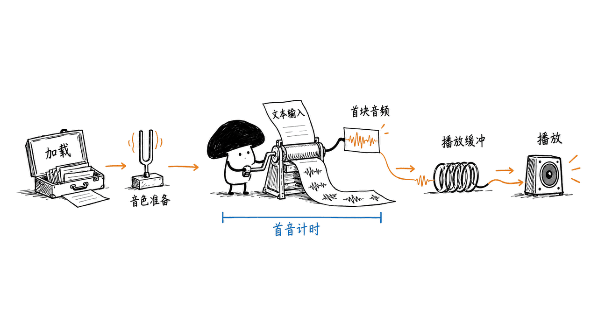
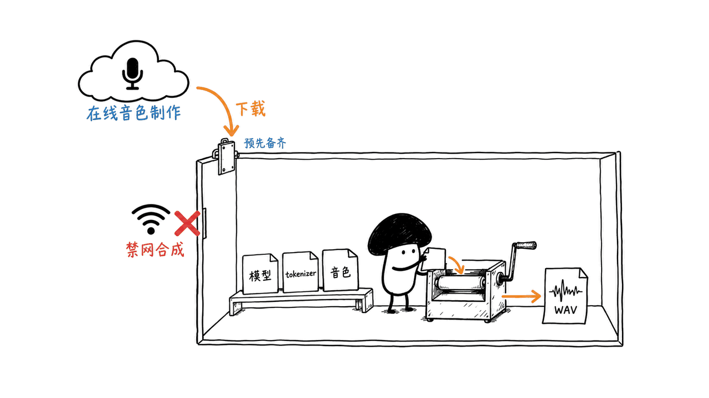

Gradium Phonon是一套面向设备端的语音合成模型和Rust运行时。31M英文版的q8权重约64.5MB，能走CPU路线；但7ms是有测试条件的首音指标，40M权重也不能沿用31M的Apache商用许可。

本文核对于2026年10月24日。我们已在M4、16GB Mac上实际生成英文WAV，运行时使用本地文件并由进程沙箱禁止联网；这是功能验证，不是复现官方音质、词错率或延迟评测。它与本站此前介绍的Phonon-2 Parakeet语音识别项目不是同一产品。

## 官方仓库与权重在哪里？

运行时与接入文档：
https://github.com/gradium-ai/xn-ptts

31M英文模型：
https://huggingface.co/gradium/phonon-31m-en

40M多语言模型：
https://huggingface.co/gradium/phonon-40m-multilingual

发布说明：
https://gradium.ai/blog/release-phonon-open-weight

Phonon以连续音频表示生成语音，建立在Pocket TTS与Mimi音频编解码器相关工作之上。模型逐帧预测音频潜变量，再解码为24kHz单声道音频，支持流式返回。它不是先生成完整句子、最后才把声音交给播放端的唯一一种批处理路线。

## 31M、40M与64.5MB分别指什么？

| 发布权重 | 语言 | 官方q8权重文件大小 | 模型许可 |
|---|---|---:|---|
| phonon-31m-en | 英文 | 64.5MB | Apache-2.0 |
| phonon-40m-en/fr/de/es/pt | 每个模型对应一种语言 | 每个约74.6MB | CC BY-NC 4.0 |
| phonon-40m-multilingual | 英、法、德、西、葡共五种 | 约74.6MB | CC BY-NC 4.0 |

素材漏掉了一个细节：**40M的单语言版本同样不是Apache许可**。商业产品不能因为底层运行时代码采用宽松许可，就忽略所装载权重的非商用限制；需要商用40M时，应向权利方确认另行授权。

31M的参数口径不包含音频tokenizer。64.5MB则是q8 GGUF文件大小，不是安装包总量或峰值内存。本次下载文件还包含配置、文本tokenizer和默认音色；运行程序及其工作缓冲也需要空间。

HF同时提供q4k与其他权重格式，不应把某一种压缩文件的大小推广到全部客户端。例如Ollama封装、Core ML模型包或浏览器分发，存储开销和运行行为都应单独核对。


## 7ms首音，包含了哪些时间？

发布页的详细表格使用MacBook Air M5、macOS 26.7.1，区分CPU线程数以及KleidiAI、Apple Accelerate等优化配置。以下是其中31M的几条官方结果，不是我们的实测：

| M5 CPU设置 | 首音频时间 | 吞吐：音频秒/计算秒 |
|---|---:|---:|
| 无KleidiAI，单核心 | 13.6ms | 11.6倍实时 |
| 无KleidiAI，4线程 | 6.9ms | 29.9倍实时 |
| 启用KleidiAI，单核心 | 5.8ms | 20.5倍实时 |

约7ms因此不是“任意普通CPU、任意安装方式都能做到”的保证。官方采用一条约5秒的英文句子，预热两次后取10次运行中位数；首音包含文本提示处理，不包含一次性音色条件处理，也不是从下载模型到扬声器出声的完整耗时。

应用还要面对模型加载、音频设备缓冲和播放调度。若接语音Agent，识别、推理、断句和网络等步骤也会增加延迟。把TTS首块音频时间直接写成整个助手响应时间，会失去工程意义。

对照Kokoro时也要保留输出方式差异：官方基线的首音是整句生成结束后的输出，而Phonon能够边生成边返回。这对实际交互有价值，但不应把它解释成所有计算阶段都按同一比例加速。

官方详细测试条件：
https://gradium.ai/blog/release-phonon-open-weight



## 1.7%词错率是否等于所有文本都更准？

不是。Gradium构建了每种语言500句的困难文本集合，侧重电话号码、日期、邮箱、代码等结构化表达。英文表报告31M为1.70%、40M多语言为2.11%、40M英文为2.22%，Kokoro为3.50%。这些是厂商公布的任务结果，不是本文重跑的数据。

评估链也值得留意：发布页说明先用qwen3.8-omni-flash转写，再用gemma-4-31b-it计算其标注的LLM WER。不能不加说明地把它与另一套ASR、参考文本及传统计分脚本的分数直接拼成排名。测试集已公开，便于后续按自己的评估流程复核。

困难集入口：
https://huggingface.co/datasets/gradium/tts-hard-sentences-202610

文本归一化是这套方案的一部分：数字、金额和符号先变成适合朗读的形式。`--lang`决定归一化语言，不会把英文模型变成中文或任意语言模型。当前公开家族列出五种语言，没有中文。

词错率、主观自然度和音色相似性也是不同问题。即使电话号码念对了，停顿、语气与角色感仍需用真实稿件听测；不能从1.70%推出“任意音色、任意长文本都更好”。

## 本机到底验证了什么？

我们下载官方`ptts 0.4.1`的macOS arm64独立程序，核对GitHub发布资产给出的SHA256，再下载固定HF修订的31M q8权重、配置、tokenizer与默认音色。没有安装到系统PATH，也没有下载受限40M权重。

| 项目 | 本次功能验证 |
|---|---|
| 机器 | Apple M4，16GiB统一内存 |
| 后端 | CPU，1线程，q8，seed=123 |
| 输入 | The meeting starts at nine. Please send the report tomorrow. |
| 网络约束 | `sandbox-exec`对该合成进程设置`deny network*` |
| 模型与音色 | 全部使用明确的本地路径 |
| 结果 | 程序退出码0，生成96,000帧、24kHz、单声道PCM16 WAV，时长4秒，样本非全零 |

这个结果支持“该M4配置可用本地文件完成一次英文音频生成”。我们没有组织人工听测、重跑500句评测、验证中文、测量最低内存或给出可泛化的速度结论。CLI自行输出的单次计时与RSS保存在日志中，没有将它们当作正式性能基准。

这次还遇到过磁盘写入失败：清理此前可重建的临时模型缓存后，重新执行才完成。这个失败属于运行环境，不是模型的音质或速度结果；下载体积再小，也仍需可写存储。

## Mac用户怎样开始？

官方提供Apple Silicon与Intel Mac独立程序包，也有Homebrew和Python入口。这里的M4测试不构成所有Mac或特定最低内存的认证；先选与架构匹配的程序，准备本地可写空间。

按官方默认路线，可先运行：

```bash
uvx ptts --lang en --quant q8 "Hello from Phonon." -o speech.wav
```

首次执行需要下载程序、模型或所用音色。正式离线分发时，应固定版本并把文件准备齐，而不是在无网络环境首次使用`hf://`地址。

我们的本地文件调用方式如下；其中路径需要替换成你自己的模型与默认音色位置：

```bash
ptts --model /path/to/phonon-31m-en \
  --voice /path/to/phonon-31m-en/default-voice.safetensors \
  --device cpu --threads 1 --lang en --quant q8 --seed 123 \
  "The meeting starts at nine. Please send the report tomorrow." \
  -o speech.wav
```

选择CPU是本次验证设置，不代表Metal、Core ML或其他后端都使用同一模型包。Swift/Core ML接入有独立模型导出或下载说明；先把CLI文件生成跑通，再处理应用内流式播放和打断，会更容易定位问题。

## “纯离线”与音色克隆需要分开讲

使用已准备好的模型和音色合成，可以不经过云端推理API。它消除的是云端逐次合成调用的依赖和计费，不是CPU、电力、存储或维护成本，也不是说模型内部完全没有序列与帧。

但官方音色设计、克隆和下载流程可以使用Gradium Studio或API。运行时也可能按音色名访问独立的HF音色目录。因此，“本地合成”不能推广成“首次下载、音色制作、所有应用功能都不联网”。敏感录音是否进入在线音色制作服务，必须按所选流程单独判断。



更适合先验证的用途是英文提示音、离线助手、设备通知和可分段配音。产品需要中文时，应另选有公开中文能力的模型；需要40M的五语能力时，先处理其权重许可。可以结合本站Ming分析比较另一种多语言方案：https://blog.mushroom.cv/blog/ming-3-tts-small-model-evaluation/

## 常见问题

### 31M英文版能用于商业产品吗？

其模型卡采用Apache-2.0，可按许可条件商用；还需保留所需声明，并分别确认所用音色、素材和第三方组件的权利。

### 免费接受40M的HF访问条款，是否就能商用？

不是。访问许可与商业使用权不同，40M的单语言和多语言权重都标注CC BY-NC 4.0。

### M4本地验证是否复现了7ms和1.7%？

没有。本次只验证一次禁网生成和WAV格式，未重跑官方预热延迟测试或困难文本集。

---

本文原文：https://blog.mushroom.cv/blog/gradium-phonon-local-tts/

> © 2026 Author: Mycelium Protocol. 本文采用 [CC BY 4.0](https://creativecommons.org/licenses/by/4.0/deed.zh) 授权——欢迎转载和引用，须注明作者姓名及原文链接，不得去除署名后以原创发布。

<!--EN-->

Gradium Phonon provides small on-device TTS models and a Rust runtime. The 31M English q8 release is about64.5MB, but its headline latency is conditional and its Apache license does not apply to the 40M weights.

Checked October 24, 2026. We generated a short English WAV on an M4/16GiB Mac with networking denied for the synthesis process. This is functional evidence, not a reproduction of the developer's quality, WER or latency benchmarks. It is unrelated to the previously covered Phonon-2 Parakeet ASR project.

## Where are the original releases?

Runtime: https://github.com/gradium-ai/xn-ptts
English 31M weights: https://huggingface.co/gradium/phonon-31m-en
Multilingual 40M: https://huggingface.co/gradium/phonon-40m-multilingual
Announcement: https://gradium.ai/blog/release-phonon-open-weight

Phonon builds on Pocket TTS and Mimi-related work. It predicts continuous audio latents frame by frame and decodes 24kHz mono audio, allowing streaming before the complete sentence is ready.

## Which license applies to each checkpoint?

| Release | Language | Official q8 file size | Weight license |
|---|---|---:|---|
|phonon-31m-en|English|64.5MB|Apache-2.0|
|phonon-40m-en/fr/de/es/pt|One language per model|74.6MB each|CC BY-NC 4.0|
|phonon-40m-multilingual|English,French,German,Spanish,Portuguese|74.6MB|CC BY-NC 4.0|

The40M single-language variants are also noncommercial. A permissive runtime license does not override the checkpoint's terms; commercial40M use needs appropriate permission from its rights holder.

The 31M count excludes the audio tokenizer. The64.5MB label describes one q8 GGUF file, not the entire installation or peak RAM. Configuration, tokenizer, voice files, the executable and working buffers also matter. Other quantizations, Ollama packages and Core ML bundles have different footprints.


## What does 7ms actually measure?

The detailed launch table uses a MacBook Air M5 running macOS 26.7.1. For 31M it reports 13.6ms/11.6× real time on one CPU core without KleidiAI;6.9ms/29.9× with four threads; and5.8ms/20.5× with KleidiAI on one core. These are developer results, not measurements from our M4.

The test uses one approximately five-second English utterance, two warm-ups and the median of ten runs. First audio includes text prompting but excludes one-time voice conditioning. It is not download-to-speaker latency. Model loading, playback buffers and the surrounding agent pipeline add other costs.

Kokoro's baseline returns a complete sentence, whereas Phonon streams chunks. That distinction matters for interaction, but does not prove the same speedup for every compute stage.

Benchmark conditions: https://gradium.ai/blog/release-phonon-open-weight


## How should the 1.70% error result be interpreted?

Gradium's difficult-text collection has 500 sentences per language, covering structured expressions such as numbers, addresses and codes. Its English table reports 1.70% for 31M,2.11% for multilingual 40M,2.22% for English 40M and3.50% for Kokoro.

The page describes transcription by qwen3.8-omni-flash and an LLM-WER calculation using gemma-4-31b-it. Do not merge that result unqualified with scores from a different recognizer, reference or conventional scoring script. We did not rerun this evaluation.

Dataset: https://huggingface.co/datasets/gradium/tts-hard-sentences-202610

Normalization is part of the product path. Selecting`--lang` changes text normalization; it does not teach an English checkpoint another language. The public family lists five languages and no Chinese. Pronunciation accuracy, naturalness and speaker similarity also need separate evaluation.

## What ran on our Mac?

We verified the official macOS arm64`ptts 0.4.1`archive against its GitHub asset SHA256 and downloaded a pinned 31M q8 model, tokenizer, config and default voice. No system-wide installation or gated 40M download was needed.

The run used Apple M4, 16GiB memory, CPU, one thread and seed123, with local model/voice paths. macOS`sandbox-exec`applied`deny network*`to the synthesis process. Input was: “The meeting starts at nine. Please send the report tomorrow.”

The process exited 0 and produced 96,000 frames of 24kHz mono PCM16 audio: four seconds, with nonzero samples. That supports one local synthesis path, not a human judgment of pronunciation or sound quality. We did not establish minimum RAM, benchmark speed or reproduce the 500-sentence WER. CLI timing/RSS remains in the evidence log without being promoted to a formal benchmark.

An initial disk-write failure was resolved by removing reproducible temporary model cache before retrying. It was an environment failure, not a quality or performance result.

## How should Mac users start?

The release supplies Apple Silicon and Intel desktop archives, alongside Homebrew and Python entry points. Our M4 result does not certify every Mac or establish a minimum-memory requirement.

The documented default route is:

```bash
uvx ptts --lang en --quant q8 "Hello from Phonon." -o speech.wav
```

First use needs connectivity for missing runtime, model or voice files. For offline distribution, pin versions and prepare those files in advance. Our explicit local-file call was:

```bash
ptts --model /path/to/phonon-31m-en \
  --voice /path/to/phonon-31m-en/default-voice.safetensors \
  --device cpu --threads 1 --lang en --quant q8 --seed 123 \
  "The meeting starts at nine. Please send the report tomorrow." \
  -o speech.wav
```

Replace paths with your actual files. CPU is the tested route here, not a claim that Metal or Core ML uses the same artifact. Application streaming and interruption are additional integration work.

## Does offline synthesis make voice creation offline too?

No. Prepared weights and voices can synthesize without a cloud inference call, but compute, storage and maintenance still have costs. Gradium's documented voice-design, cloning and download flows can use Studio or APIs. Named voices may also trigger a download from a separate HF catalog.

Choose the voice-creation path separately, particularly before uploading a sensitive recording. License and network boundaries belong to each component and workflow.


English notifications, local assistants and segmented narration are bounded starting points. Chinese requires another publicly supported model; commercial use of 40M requires resolving its license. Compare our multilingual Ming review: https://blog.mushroom.cv/blog/ming-3-tts-small-model-evaluation/

## FAQ

### May the 31M English model be used commercially?

Its card specifies Apache-2.0, subject to the license conditions and retained notices. Voice and third-party asset rights need their own checks.

### Does accepting 40M access terms authorize commercial use?

No. Both single-language and multilingual 40M weights carry CC BY-NC 4.0; download access is not a commercial license.

### Did the M4 check reproduce 7ms or 1.70%?

No. It validated one network-denied WAV generation, without the official warmed timing protocol or hard-text evaluation.

---

Original article: https://blog.mushroom.cv/blog/gradium-phonon-local-tts/

> © 2026 Author: Mycelium Protocol. Licensed under [CC BY 4.0](https://creativecommons.org/licenses/by/4.0/) — free to share and adapt with attribution. You must credit the author and link to the original; removing attribution and republishing as original is not permitted.
