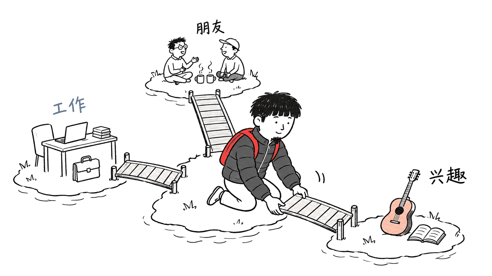
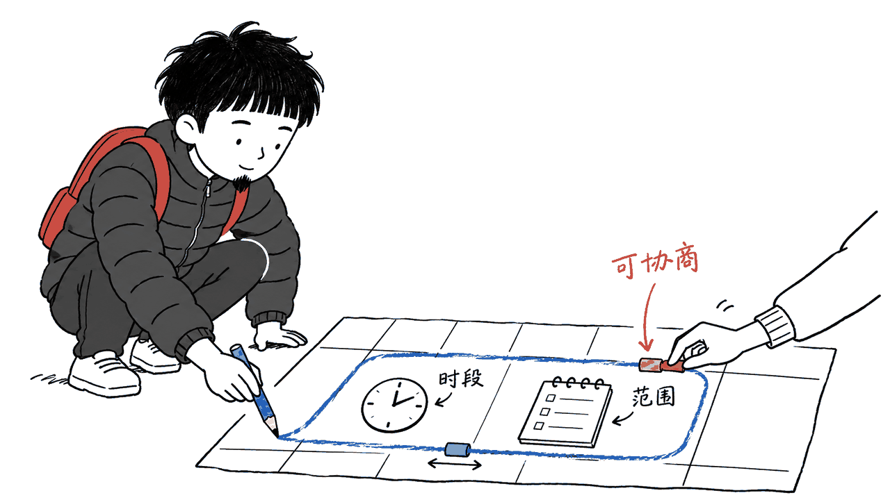
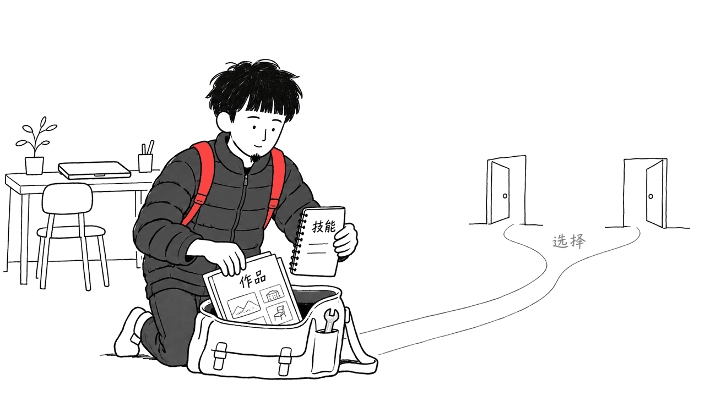

图片中的书可核对为 Lewis A. Coser 的 *Greedy Institutions: Patterns of Undivided Commitment*，Free Press，1974，ISBN 9780029067505。中文书名沿用图片译法，未核实正式中译本；图片大字是配文，不是已核实的作者原话。

以下是基于书目与学术文献的短评，未通读原书；正文连同建议少于1000字。

## 怎样投入，又不交出整个人生？

这本书最值得追问的，是一个组织究竟希望你贡献工作，还是希望你只属于它。

科塞所谓“贪婪的制度”，指向对成员忠诚和投入的独占要求。它未必把人关起来，也可能借归属感、荣誉和使命，让人主动缩小外部生活。因此，图片把问题概括成“资本剥夺自由意志”，范围反而窄了：组织、群体乃至亲密关系，都可能出现类似的排他要求。

我在意的是，一个人能否在认真负责的同时，仍然拥有别的身份。努力并不可疑，归属也值得珍惜；需要警觉的是，当休息被解释为不忠，质疑被解释为背叛，朋友和兴趣都必须为同一种身份让路。

也别把这个概念变成万能标签。一次忙碌、一次妥协，并不能证明组织“贪婪”。更有用的判断是：要求有没有边界，能不能协商，拒绝之后会发生什么，退出是否现实。

## 给年轻人的几条建议

以下是我的延伸思考，不是书中原话。

保留组织之外的人。 至少有几位朋友，不因你的职位高低而决定怎样对待你。外部关系能帮助你判断，眼前的规则是不是唯一可能。

把边界说具体。 少说笼统的“我要平衡”，试着约定响应时段、工作范围和休息安排。能落实的规则，比一次情绪化宣言更有用。

积累带得走的能力。 让作品、技能和判断力留在自己身上。区分“离开这里就失去的身份”与“换个地方仍能创造的价值”。

别把暂时留下当成认同一切。 现实依赖会限制选择。不必为了证明独立立刻离开，可以先记录问题、寻找支持，再逐步增加选择。

我愿意把这本书带来的提醒写成一句话：值得投入的关系，应当容得下一个不完全属于它的你。

核对来源：
https://books.google.com/books/about/Greedy_Institutions_Patterns_of_Undivide.html?id=FxhBAAAAIAAJ
https://doi.org/10.13060/00380288.2013.49.6.05

---

> © 2026 Author: Mycelium Protocol. 本文采用 [CC BY 4.0](https://creativecommons.org/licenses/by/4.0/deed.zh) 授权——欢迎转载和引用，须注明作者姓名及原文链接，不得去除署名后以原创发布。

<!--EN-->

The images identify Lewis A. Coser’s *Greedy Institutions: Patterns of Undivided Commitment*, published by Free Press in 1974, ISBN 9780029067505. The Chinese title follows the image; an official Chinese edition has not been verified. Its large headline about capital and free will is poster commentary, not a verified quotation from Coser.

This reflection draws on bibliographic records and scholarly discussion, not a completed reading of the original book. The Chinese reflection and advice stay below the requested 1,000-character limit.

## How can we commit without surrendering an entire life?

The question worth carrying away is whether an organization wants your contribution or wants you to belong exclusively to it.

Coser’s concept concerns demands for undivided allegiance. Physical confinement is not essential: belonging, prestige, and a sense of mission can encourage people to narrow their lives voluntarily. Reducing the idea to capital taking away free will therefore makes its scope too narrow. Organizations, groups, and even intimate relationships can make similarly exclusive demands.

What matters to me is whether someone can be responsible while retaining other identities. Effort is not suspicious, and belonging can be valuable. The warning sign is a pattern in which rest becomes disloyalty, disagreement becomes betrayal, and friendships and interests must yield to a single identity.

The concept should not become a universal label. One busy period or compromise does not establish that an organization is greedy. More useful questions concern limits: can demands be negotiated, what happens after refusal, and is leaving a realistic option?

## A few suggestions for young people

These are my extensions of the idea, not quotations from the book.

Keep people outside the organization. Maintain friendships in which your title does not determine how you are treated. Those relationships can show that the rules around you are not the only possible rules.

Make boundaries specific. Instead of a broad declaration about balance, negotiate response hours, responsibilities, and rest arrangements. A workable agreement is more useful than an emotional announcement.

Build abilities you can take elsewhere. Keep developing work samples, skills, and judgment. Distinguish a position you would lose on leaving from value you could still create in another setting.

Do not confuse staying temporarily with endorsing everything. Material dependence limits choice. You need not leave immediately to prove independence. Document problems, seek support, and gradually create alternatives.

The reminder I would keep is this: a relationship worth committing to should have room for a person who does not belong entirely to it.

Sources:
https://books.google.com/books/about/Greedy_Institutions_Patterns_of_Undivide.html?id=FxhBAAAAIAAJ
https://doi.org/10.13060/00380288.2013.49.6.05

---

> © 2026 Author: Mycelium Protocol. Licensed under [CC BY 4.0](https://creativecommons.org/licenses/by/4.0/) — free to share and adapt with attribution. You must credit the author and link to the original; removing attribution and republishing as original is not permitted.
