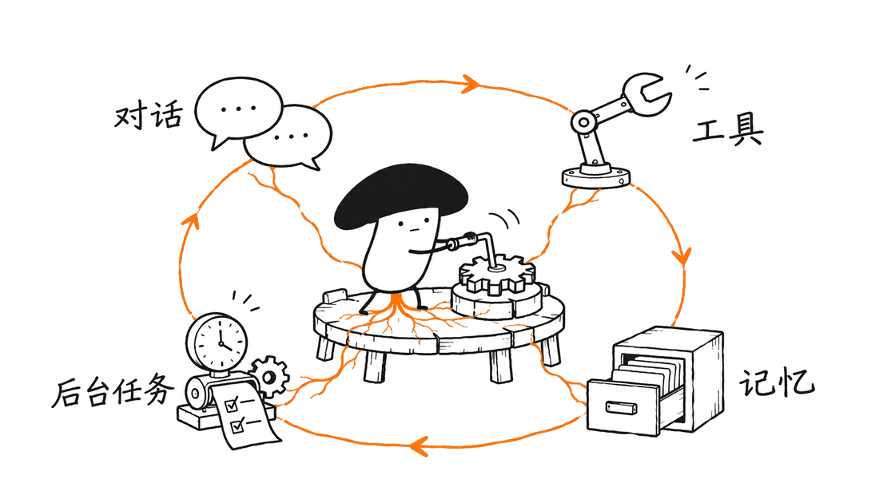
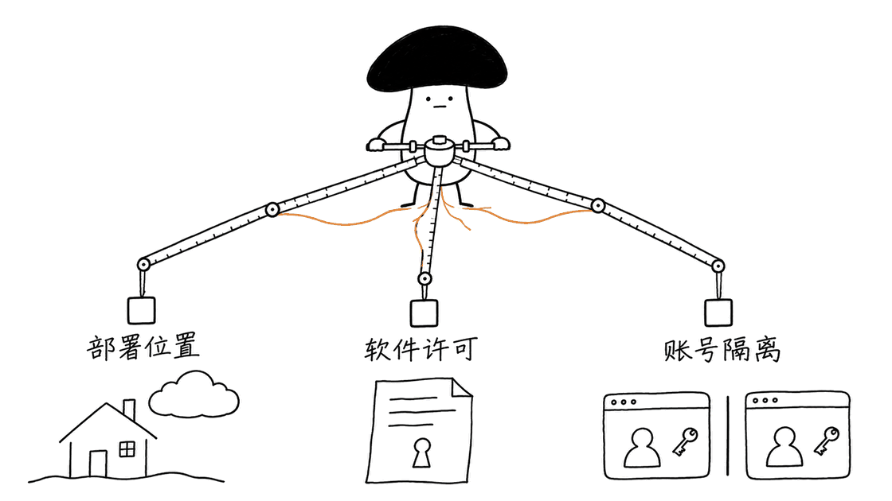
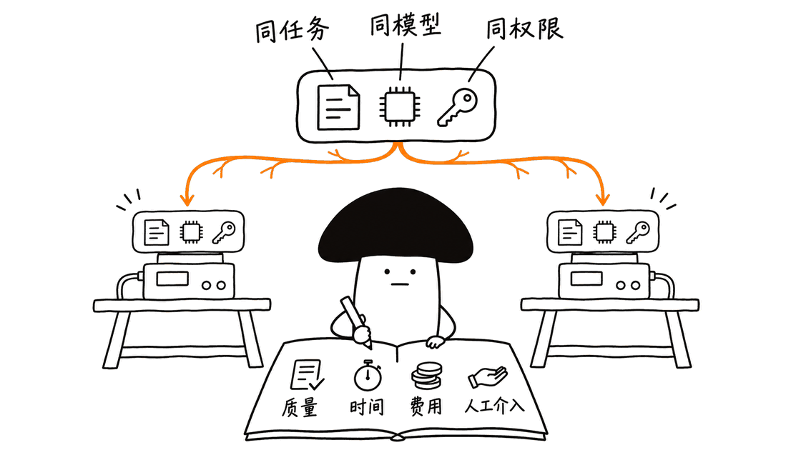

如果想把 Grok Bot 的“长期 AI 队友”体验搬到自己控制的环境，优先试 Rakazo 的多端持久 Bot，或 OpenMausBot 的桌面 CLI 整合；有企业治理需求，再评估 CopilotKit OpenBot 的运行时授权。Suparagent 适合围绕现有编码 CLI 组织小团队，OpenTeam 则提供一个值得实验的常驻团队工作台。它们的区别远不止界面和 Star 数。

核查日期：2026年11月10日。本文读取六个仓库的固定提交、许可证与部署文档，并执行部分局部测试，没有部署全部产品或调用真实模型进行横向跑分。Star 为当天 GitHub API 快照，后续会变化。

## 先辨清：你说的 OpenBot 是哪一个？

用户素材中的“6.6k OpenBot”与 Nightly Labs 的项目量级接近。它当前采用 PolyForm Noncommercial 1.0.0，公开源码不等于商业用途自由，本文将它作为额外参照。另一个 CopilotKit OpenBot 是 MIT 应用模板，但依赖单独授权的 Intelligence 运行时。两者不是同一个项目。

为了给出五个可研究的开源应用候选，我们加入 Suparagent 和 OpenTeam。这里的“开源应用”不保证整个部署依赖都采用同一种开源许可证。Suparagent 仓库由原来的 Anil-matcha/open-duet 更名而来，也不要与 CopilotKit 的同名 OpenDuet 混淆。

| 候选与仓库 | Star快照 | 许可边界 |
| --- | --- | --- |
| OpenMausBot：milind-soni/OpenMausBot | 19,716 | 核心 Apache-2.0；enterprise/ 另有企业许可 |
| Rakazo：elie222/rakazo | 7,705 | Apache-2.0；外部模型与沙箱另计 |
| OpenBot：CopilotKit/OpenBot | 10,573 | 应用 MIT；Intelligence 运行时独立授权 |
| Suparagent：Anil-matcha/suparagent | 6,941 | Apache-2.0；模型、CLI 服务另计 |
| OpenTeam：raghavpillai/openteam | 30 | GPL-3.0；再分发需遵守相应义务 |
| 额外参照 Nightly：nightly-labs/openbot | 6,714 | PolyForm Noncommercial；不能当作宽松商业开源 |

仓库入口分别是：
https://github.com/milind-soni/OpenMausBot
https://github.com/elie222/rakazo
https://github.com/CopilotKit/OpenBot
https://github.com/Anil-matcha/suparagent
https://github.com/raghavpillai/openteam
https://github.com/nightly-labs/openbot

## 对标 Grok Bot，究竟在对标什么？

Grok Bot 官方文档描述的是云端持续运行的电脑，以及围绕它工作的 Bot、对话、文件和应用。不同 Bot 可以有自己的职责，却共享电脑；关闭笔记本并不会关闭云端工作。不能先假定官方每个 Bot 都有独立虚拟机，再据此比较替代品。

真正值得对标的是一个闭环：任务能否跨会话继续，工具执行是否受控，失败能否恢复，定时任务是否真有服务接管，以及用户能否追溯“谁在什么时候改了什么”。单纯给聊天框加终端按钮，只覆盖其中一部分。

官方基线：
https://docs.x.ai/grok-bot/bots
https://docs.x.ai/grok-bot/computer-and-apps
https://docs.x.ai/grok-bot/security

## 五个项目的技术栈，决定了哪些工程取舍？

| 项目 | 界面与服务 | 关键实现方向 |
| --- | --- | --- |
| OpenMausBot | Electron、React、TypeScript；Node 服务、SQLite | 整合既有 CLI 驱动，事件流与权限代理连接桌面和执行层 |
| Rakazo | React、Electron、Expo；Hono/oRPC、PostgreSQL/Prisma、Graphile Worker | Pi Agent 运行时，持久 Bot、多端与后台任务服务 |
| CopilotKit OpenBot | React、Tauri/Rust；Bun/Hono、PostgreSQL/Drizzle | AG-UI 接入 Agent，Intelligence 承担持久运行与治理 |
| Suparagent | Next.js、Electron；Python/FastAPI、SQLAlchemy、APScheduler | 包装既有 CLI，以队长与专长 Agent 组织工作 |
| OpenTeam | React、Electron、iOS；Bun/TypeScript、PostgreSQL、pg-boss | Pi 运行时，Docker 电脑与队列工作进程支撑团队协作 |

React 或 Electron 相同，不代表内部行为相同。一个方案把模型循环交给外部 CLI，另一个在服务中管理 Agent；这会影响可观察性、升级兼容、权限传递，以及出错时应该排查哪一层。

### OpenMausBot：适合把已有 CLI 变成长期桌面工作流

它通过驱动注册表衔接 Claude、Codex、Grok 等本地 CLI，使用类型化 HTTP 命令与 SSE 事件流维护界面和执行状态。SQLite 与线程日志承担部分持久化。对已经配置编码工具的人，这比另搭完整模型接入层更直接。

代价是必须跟踪不同 CLI 的登录、版本、事件格式和审批语义。界面显示“已批准”还不够，批准必须传到正确驱动和工具。核心 Apache 许可与 enterprise/ 的独立许可也应分别审阅，不能把企业目录当作同样开放的能力包。

### Rakazo：适合希望手机、网页和桌面共享 AI 队友的人

它的中心是持久 Bot：各自的对话、记忆、例行任务与协作关系，由服务端和数据库维护。Pi 提供 Agent 基础，Graphile Worker 接管后台工作。相比单机桌面包装，部署者要同时承担数据库迁移、队列、备份和服务更新。

电脑可以配置为团队共享或私有，也支持不同沙箱提供方。这个选择需要连同浏览器登录、挂载目录和连接账户一起检查；“私有电脑”标签不自动证明网络、凭据和所有集成都完全隔离。发布镜像路线需要 Docker Engine 与 Compose，源码开发环境则还有 Node 等要求，二者不要混用。

### CopilotKit OpenBot：治理能力需要连同运行时许可一起评估

这是一个可定制应用模板，Agent 适配、工具接入与审批治理比单纯桌面壳更突出。AG-UI 和 MCP 是接入边界，Intelligence 负责持久线程、记忆、自动学习与企业治理等能力。

当前官方文档支持将 Intelligence 放在本机或自己的集群运行，并非只能购买云端托管。但它采用独立许可：本机个人实验有免费本地许可，集群评估提供试用许可，生产部署需要对应生产授权。模型可选本地兼容服务，不意味着首次下载、登录和许可证续期都能完全离线。

因此评估时同时问两个问题：部署数据在哪里，以及必需运行时获得了什么使用权。应用仓库 MIT 无法单独回答第二个问题。

### Suparagent：围绕现有 CLI 组织小团队，电脑隔离可选

原 OpenDuet 更名后的 Suparagent 使用 Python 服务与网页、桌面入口，队长可以委派专长 Agent，保留可查阅的记忆与例行任务。数据库支持 SQLite 或 PostgreSQL，Docker 是隔离电脑的选项，普通聊天不要求先启动 Docker。

当前源码声明 Python 3.14 及以上，不要用旧教程里的 Python 版本直接推断兼容。它也提供不同审批模式，但定时触发不能视为任务自动获得一切权限。各 CLI 的工具与审批支持可能不同，需要逐个验收。

### OpenTeam：架构清楚，但成熟度与共享边界要接受现实

OpenTeam 用服务、队列工作进程和电脑执行层组织长期任务。每个 Bot 有独立屏幕，但 README 明确写出：工作区、网站登录与连接账户共享。独立画面有助于并行操作，并不等于不同用户身份隔离。

项目给出 Docker Compose 2.20 及以上，以及建议 8GB 内存、8GB 磁盘的部署条件。这是项目建议值，不是本文测得的常驻占用。它目前只有约30 Star，独立使用反馈很少，更适合作为可改造的实验项目，而非依据功能清单直接进入关键业务。

## Nightly OpenBot 为什么仍值得看，又为什么另列？

Nightly 的实现偏向本地桌面，把已有 CLI、持久工作区、队列与浏览器工作流连起来，也提供远程、移动等能力。对想研究本地 Agent 产品组织方式的人，它有参考价值。

但要同时看到两个限制。第一，PolyForm Noncommercial 对商业使用有限制，不能因源码可见就直接嵌入商业产品。第二，README 明确描述初次同意后的宽权限模式，包括 danger-full-access 和 approvalPolicy: never；不能假定它默认每次敏感操作都请求确认。工作流自己的审批环节与底层执行权限还是不同层次。

这也是本文没有把它直接塞进“五款宽松可商用开源”榜单的原因；事实上，主表中的 CopilotKit 运行时和 OpenTeam GPL 同样需要单独评估使用与分发方式。

## 性能、成本和安全，本次实际验证了什么？

没有同模型、同任务、同硬件的公开统一对照，本文不声称谁“最快”或“最强”。本次只运行了不需要真实模型和账户的局部检查：

| 项目 | 本次结果 | 能说明与不能说明的范围 |
| --- | --- | --- |
| OpenMausBot | 31项已有 Electron 辅助测试通过 | 审批信任模式与剪贴板权限辅助逻辑；不是完整服务端安全审计 |
| Suparagent | 13项已有前端审批辅助测试通过 | 界面审批逻辑；不证明所有 CLI 正确执行权限 |
| CopilotKit OpenBot | 6项自编策略探针通过 | 调用真实纯函数 decideAction，核对询问规则优先级；未测试完整执行网关 |
| OpenTeam | 4项已有图形 shell 边界测试通过 | 命令边界判断；不是操作系统逃逸测试 |
| Rakazo | 源码、清单与文档核对 | 未执行运行时测试，不据此推断更好或更差 |

这些测试的数量与覆盖范围不同，不能相加变成项目评分。没有运行完整应用、模型质量评测、真人账号任务、真实浏览器压力测试，或端到端故障恢复测试。

一次任务的总耗时大致由排队、模型关键路径、工具操作、审批等待与失败重试构成。多 Bot 可缩短独立子任务的时间，也会增加模型调用、上下文传递和共享资源竞争。Python、Bun、Rust、Electron 的标签无法直接推出总任务速度。

账单也不只有模型 token：还包括数据库、常驻浏览器或桌面、沙箱、连接器、备份、运维，以及可能的运行时授权。已有 CLI 订阅不代表所有自动化场景都免费或无限使用。

## 公开用户反馈，更适合变成哪些验收用例？

本次查看各仓库最近更新的50条 issue/PR 条目，排除 PR 后选取与部署和可靠性相关的问题。这是定向抽样，不能推导故障率、满意度或用户规模。以下状态为核查时快照，报告未被本文独立复现。

| 项目与公开问题 | 报告或讨论内容 | 转成自己的验收用例 |
| --- | --- | --- |
| OpenMausBot #5161，开放 | 使用者报告中文记忆检索漏匹配 | 用真实中文偏好和项目名测试跨会话召回 |
| Rakazo #3683，已关闭 | 使用者报告忘记之前在电脑安装的扩展 | 操作完成后换会话，检查事实是否进入可检索记忆 |
| CopilotKit #1387，开放 | 使用者报告安装登录卡住且错误诊断不足 | 新机器从安装到第一条任务，记录失败时能否定位 |
| Suparagent #206，开放 | 原 OpenDuet 时期使用者质疑关窗后后台持续性 | 在当前版本关闭前端，验证定时服务仍实际运行 |
| OpenTeam #239，开放 | 维护者提出闲置对话与附件内存优化计划 | 做长时驻留观察；这不是独立用户口碑或已证实泄漏 |

原始记录：
https://github.com/milind-soni/OpenMausBot/issues/5161
https://github.com/elie222/rakazo/issues/3683
https://github.com/CopilotKit/OpenBot/issues/1387
https://github.com/Anil-matcha/suparagent/issues/206
https://github.com/raghavpillai/openteam/issues/239

补充两类边界问题值得查：OpenMausBot #5165 报告一个 Bot 的 MCP 故障影响其他 Bot；Rakazo #4052 报告错误出现的支付审批卡片阻断流程。前者提醒检查故障隔离，后者提醒审批机制也会制造可用性问题。关闭 issue 不等于当前版本已由我们验证修复。
https://github.com/milind-soni/OpenMausBot/issues/5165
https://github.com/elie222/rakazo/issues/4052

Nightly #6326 的审批卡片缺失报告由应用反馈机器人提交，应称为机器人转交的问题，而非当作一个独立评测者的结论：
https://github.com/nightly-labs/openbot/issues/6326

## 如何做一轮能决定是否采用的试用？

先选两个最符合自己部署条件的候选，用同一模型、同样任务、相同权限和独立测试账号做对照。不要一边给某项目更强模型，一边把结果归功于框架。

1. 做一个跨会话资料整理任务：读取指定文件，形成带出处的摘要，下一次会话继续使用，并允许纠正错误记忆。
2. 做一个有副作用的任务：起草邮件或修改测试文件，确认发送、删除和外部提交的审批点及可追溯记录。
3. 做一个后台任务：关闭客户端、重启服务，再检查计划、进度、附件和失败原因是否仍可恢复。
4. 做两个 Bot 并行：其中一个工具超时，检查另一个是否被拖住，是否意外共享登录或写入同一文件。
5. 记录完成率、人工介入次数、墙钟时间、模型账单、进程与容器总资源，以及无法恢复的失败。重复多次，保留固定版本和原始轨迹。

这里需要的是可解释的业务成功率，而不是选一个看起来最活跃的仓库。个人已有 CLI、愿意机器常开，可先试 OpenMausBot；希望多端统一、愿意管理服务，可先试 Rakazo；要做组织级可定制控制台，先把 CopilotKit 的运行时与许可评估清楚。想要 Python 服务和可选电脑隔离，可以评估 Suparagent；愿意接受早期项目成本，再研究 OpenTeam。

固定源码提交与复核记录随文章保存：
https://github.com/milind-soni/OpenMausBot/tree/542f8e55f3f9c5be5550aac0e99fcec050308d69
https://github.com/elie222/rakazo/tree/c76070c83a40f655fef2e298c43941f249407512
https://github.com/nightly-labs/openbot/tree/22cd028e7c99c41e49bbab434dbda63ff9e56304
https://github.com/CopilotKit/OpenBot/tree/d3b3ae83fe9068127c389aa2e557e2fe8fc558ac
https://github.com/Anil-matcha/suparagent/tree/32dd0edbc1f074e68727c82b39b77db1b4200eb9
https://github.com/raghavpillai/openteam/tree/be68ae0efbb28cd3742715622e99c664e1d0da95

## 常见问题

### 哪一个完全免费，部署后没有任何费用？

没有办法从开源许可证得到这个保证。模型、服务器和第三方集成可能收费，CopilotKit 的必需运行时还有独立授权条件。先区分代码使用权与服务账单。

### 用本地模型是否意味着所有数据不出机器？

不一定。模型推理、插件、遥测、远程沙箱、网页访问与许可证服务是不同的数据通路，需要分别检查。这里没有对全部项目进行网络抓包审计。

### 有独立 Bot 和 Docker，就能让不同客户安全共用吗？

不能直接得出这个结论。还要看挂载、凭据、网络、浏览器会话、连接器与管理权限。OpenTeam 明确共享账户，更应先按可信协作环境评估。

### 为什么没有直接宣布谁性能第一？

本文没有端到端统一跑分。局部测试只能证实对应函数或辅助逻辑的行为；在不同模型、硬件和任务上编一个排名，会误导采购和部署。

延伸阅读：Rakazo 的持久 Bot 与电脑能力拆解，以及 Appllama/OpenMausBot 工作流介绍：
https://blog.mushroom.cv/blog/rakazo-persistent-ai-teammate-sandbox-computer-use-teardown/
https://blog.mushroom.cv/blog/appllama-skills-openmausbot-mobile-design-agent-workflow/

> © 2026 Author: Mycelium Protocol. Licensed under [CC BY 4.0](https://creativecommons.org/licenses/by/4.0/) — free to share and adapt with attribution. You must credit the author and link to the original; removing attribution and republishing as original is not permitted.

<!--EN-->

For a self-hosted Grok Bot style teammate, start with Rakazo for persistent bots across devices, or OpenMausBot for a desktop built around existing coding CLIs. Evaluate CopilotKit OpenBot when governance and customization matter, including its separately licensed runtime. Suparagent offers a CLI-oriented small-team architecture; OpenTeam is an early project worth experimenting with, with explicitly shared accounts.

Research date: November 10, 2026. We inspected six pinned repositories, licenses and deployment documents and ran a limited set of offline checks. We did not deploy every product or benchmark real models. Stars are a dated GitHub API snapshot, not performance evidence.

## Which OpenBot are we comparing?

There are two relevant repositories. Nightly Labs OpenBot, at 6,714 stars, closely matches the name and scale in the supplied notes. It uses PolyForm Noncommercial 1.0.0 and belongs in a source-available reference category. CopilotKit OpenBot, at 10,573 stars, has an MIT application template but requires the separately licensed Intelligence runtime.

The five application candidates are OpenMausBot, Rakazo, CopilotKit OpenBot, Suparagent and OpenTeam. Calling their application code open source does not mean every required component shares that license. Suparagent was renamed from Anil-matcha/open-duet; CopilotKit has a different OpenDuet project.

| Candidate | Stars | Licensing boundary |
| --- | --- | --- |
| OpenMausBot | 19,716 | Apache-2.0 core; enterprise/ has separate terms |
| Rakazo | 7,705 | Apache-2.0; external services have their own terms |
| CopilotKit OpenBot | 10,573 | MIT application; separately licensed Intelligence runtime |
| Suparagent | 6,941 | Apache-2.0; model and CLI services remain separate |
| OpenTeam | 30 | GPL-3.0; redistribution carries corresponding obligations |
| Additional reference: Nightly OpenBot | 6,714 | PolyForm Noncommercial, not unrestricted commercial open source |

Repository links:
https://github.com/milind-soni/OpenMausBot
https://github.com/elie222/rakazo
https://github.com/CopilotKit/OpenBot
https://github.com/Anil-matcha/suparagent
https://github.com/raghavpillai/openteam
https://github.com/nightly-labs/openbot

## What does Grok Bot actually establish as the baseline?

The official product describes persistent cloud computers, bots, conversations, files and apps. Bots can have different responsibilities while sharing a computer. Closing a laptop does not stop cloud work. An alternative should therefore be assessed on continuity, controlled tool execution, recovery, scheduling and traceability, rather than on the presence of a chat box and terminal.

Official baseline:
https://docs.x.ai/grok-bot/bots
https://docs.x.ai/grok-bot/computer-and-apps
https://docs.x.ai/grok-bot/security

## How do the five architectures differ?

| Candidate | Interface and service stack | Engineering emphasis |
| --- | --- | --- |
| OpenMausBot | Electron, React, TypeScript; Node, SQLite | Existing CLI drivers, event streams and a permission broker |
| Rakazo | React, Electron, Expo; Hono/oRPC, PostgreSQL/Prisma, Graphile Worker | Pi agents, persistent bots and server-side background work |
| CopilotKit OpenBot | React, Tauri/Rust; Bun/Hono, PostgreSQL/Drizzle | AG-UI adapters and Intelligence persistence and governance |
| Suparagent | Next.js, Electron; Python/FastAPI, SQLAlchemy, APScheduler | Existing CLIs coordinated through a lead and specialists |
| OpenTeam | React, Electron, iOS; Bun/TypeScript, PostgreSQL, pg-boss | Pi agents, Docker computers and queue workers |

### OpenMausBot: reuse an existing CLI setup

The desktop coordinates drivers for existing Claude, Codex and Grok CLIs. Typed HTTP commands and SSE events connect execution with the interface. SQLite and thread logs support persistence. This is attractive when developers already maintain these tools and their authentication.

The tradeoff is dependency on each CLI's versions, event formats and approval semantics. A visible approval must reach the right execution path. Its Apache core and separately licensed enterprise directory also require separate review; enterprise code is not covered simply because the repository is public.

### Rakazo: persistent teammates across devices

Rakazo centers on bots with their own conversations, memory, routines and delegation. Pi supplies agent foundations while Graphile Worker handles background work. Web, Electron and Expo clients share the service. The operator takes responsibility for database migrations, queues, backups and upgrades.

Team-shared and private computers and several sandbox providers are supported. These choices still need an audit of browser sessions, mounted files and connected accounts. A private-computer setting does not alone prove complete credential or network isolation. The published-image installation requires Docker Engine and Compose; source-development requirements are a different path.

### CopilotKit OpenBot: assess the required runtime as well as the template

The MIT application provides a customizable surface for agent adapters, tools and governance. AG-UI and MCP are integration boundaries. Intelligence supplies durable threads, memory, automatic learning and enterprise governance features.

Current documentation supports local or on-premises Intelligence deployment. It is not limited to a hosted cloud service. However, Intelligence has separate licensing: a free local license for personal laptop experiments, a trial for cluster evaluation, and a production license for production use beyond that trial. A local model does not guarantee fully offline downloads, sign-in or license renewal.

Data location and software usage rights are separate questions. The application's MIT file answers only part of the procurement review.

### Suparagent: a Python service around existing CLIs

Suparagent, formerly Anil-matcha OpenDuet, coordinates a lead and specialist agents with memory and routines. SQLAlchemy supports SQLite or PostgreSQL. Docker is optional for an isolated computer; ordinary chat does not require it.

The inspected source declares Python 3.14 or newer, so older setup instructions may be inappropriate. Approval modes differ, and a scheduled routine does not automatically authorize every action. Tool and approval support must be checked for each underlying CLI engine.

### OpenTeam: a legible early architecture with shared account state

OpenTeam separates its service, queue workers and computer execution layer. Each bot has a screen, but the README explicitly says workspace files, website sign-ins and connected accounts are shared. Separate displays are not separate identities.

The project lists Docker Compose 2.20 or newer and recommends 8GB memory and 8GB disk. Those are author recommendations, not measured resident use. With roughly 30 stars and limited independent feedback, it is better treated as an adaptable experimental project than as an established critical-business platform.

## Why keep Nightly OpenBot as a separate reference?

Nightly combines a local desktop, existing provider CLIs, persistent workspaces, queues and browser workflows, with additional remote and mobile capabilities. It is useful to study as a product architecture.

Its noncommercial license limits commercial use. Its README also describes broad permissions after initial consent, including danger-full-access and approvalPolicy: never. Do not assume sensitive actions always require individual approval. Workflow-specific approval cards and underlying execution privileges are different layers.

This reference therefore cannot be silently counted as a permissively licensed commercial alternative. The main table also needs nuance: CopilotKit's runtime terms and OpenTeam's GPL obligations matter in different ways.

## What did we actually test, and what remains unmeasured?

We have no standardized, same-model, same-task comparison establishing an overall winner. The following local checks required no real model calls or user accounts:

| Candidate | Result | Scope |
| --- | --- | --- |
| OpenMausBot | 31 existing Electron helper checks passed | Trust-mode and clipboard permission helpers; not a server security audit |
| Suparagent | 13 existing frontend approval checks passed | Interface approval helpers, not every underlying CLI execution path |
| CopilotKit OpenBot | Six custom probes passed | Real decideAction pure function and ask-rule precedence, not full gateway enforcement |
| OpenTeam | Four existing graphical shell boundary checks passed | Command-boundary logic, not operating-system containment |
| Rakazo | Source and documentation inspection | No runtime test; no inference that it is better or worse |

Test counts cover different scopes and must not become comparative scores. We did not run complete applications, paid model evaluations, real browser account workflows, load tests or end-to-end recovery tests.

Task duration includes queueing, model critical paths, tool operations, approval waits and retries. More agents can parallelize independent work while adding model calls, context handoffs and contention. Python, Bun, Rust or Electron labels alone cannot establish total task speed.

Costs include model usage, databases, persistent browsers and desktops, sandboxes, connectors, backups, operations and possible runtime licenses. An existing CLI subscription does not guarantee free or unlimited automation.

## What can public issues teach us?

We inspected the 50 most recently updated issue/PR entries per repository, excluded pull requests, and selected relevant reliability reports. This is purposive sampling, not a defect rate, satisfaction survey or representative user population. Reports were not independently reproduced; states reflect the research snapshot.

| Source | Report | Useful acceptance test |
| --- | --- | --- |
| OpenMausBot #5161, open | A user reports missed Chinese memory matches | Recall real Chinese preferences and project names across sessions |
| Rakazo #3683, closed | A user reports forgetting an installed browser extension | Check whether computer actions become retrievable memory |
| CopilotKit #1387, open | A user reports setup/sign-in stalls and poor diagnostics | Start on a clean machine and inspect failure explanations |
| Suparagent #206, open | A user questioned background continuity in the older OpenDuet | Close the frontend and verify current scheduled work continues |
| OpenTeam #239, open | A maintainer proposes idle chat and attachment memory work | Observe long-running resource behavior; this is not independent user feedback or a proven leak |

Original discussions:
https://github.com/milind-soni/OpenMausBot/issues/5161
https://github.com/elie222/rakazo/issues/3683
https://github.com/CopilotKit/OpenBot/issues/1387
https://github.com/Anil-matcha/suparagent/issues/206
https://github.com/raghavpillai/openteam/issues/239

OpenMausBot #5165 additionally reports one bot's failing MCP connection affecting others. Rakazo #4052 reports misplaced payment-approval cards stalling work. Both make useful isolation and approval-usability tests. A closed issue does not prove a fix was verified by this review.
https://github.com/milind-soni/OpenMausBot/issues/5165
https://github.com/elie222/rakazo/issues/4052

Nightly #6326 was submitted through an application feedback bot. It should be identified as a bot-mediated report rather than an independent review:
https://github.com/nightly-labs/openbot/issues/6326

## How should a team run a useful trial?

Choose two candidates that fit the intended deployment. Hold model, task, permissions and test accounts constant. Use five checks:

1. Continue a sourced research task across sessions, retrieve previous facts and correct a mistaken memory.
2. Draft an email or modify a test file, then verify approvals before external sends, deletion or submission.
3. Close the client and restart the service; verify schedules, progress, attachments and failure details survive.
4. Run two bots while one tool times out. Check failure propagation, shared accounts and conflicting file writes.
5. Repeat tasks and record completion, human interventions, wall time, model charges, total process/container resources and unrecoverable failures, retaining pinned versions and traces.

For an individual already using coding CLIs, OpenMausBot is a reasonable first trial. For shared persistent bots across devices, begin with Rakazo. For an organization customizing a governed console, investigate CopilotKit's runtime and licensing early. Evaluate Suparagent for a Python service and optional computer isolation. Study OpenTeam when its early-stage maintenance costs and shared-account model are acceptable.

Pinned source revisions used for this review:
https://github.com/milind-soni/OpenMausBot/tree/542f8e55f3f9c5be5550aac0e99fcec050308d69
https://github.com/elie222/rakazo/tree/c76070c83a40f655fef2e298c43941f249407512
https://github.com/nightly-labs/openbot/tree/22cd028e7c99c41e49bbab434dbda63ff9e56304
https://github.com/CopilotKit/OpenBot/tree/d3b3ae83fe9068127c389aa2e557e2fe8fc558ac
https://github.com/Anil-matcha/suparagent/tree/32dd0edbc1f074e68727c82b39b77db1b4200eb9
https://github.com/raghavpillai/openteam/tree/be68ae0efbb28cd3742715622e99c664e1d0da95

## FAQ

### Does open source mean zero operating cost?

No. Model providers, infrastructure and integrations may charge separately. CopilotKit's required runtime also has distinct licensing conditions. Code rights and service bills are separate.

### Does choosing a local model keep every data flow on the machine?

Not necessarily. Inference, plugins, telemetry, remote sandboxes, web access and licensing services are separate paths. This review did not packet-audit every application.

### Do separate bots and Docker establish safe multi-customer isolation?

No. Mounts, credentials, networks, browser sessions, connectors and administrative access still matter. OpenTeam explicitly shares accounts and should first be assessed for trusted collaboration.

### Which candidate has the best performance?

This review has no comparable end-to-end benchmark. Scoped helper checks establish only the behavior they exercise. A useful answer requires repeated tests of the team's real workload under equal conditions.

Related background:
https://blog.mushroom.cv/blog/rakazo-persistent-ai-teammate-sandbox-computer-use-teardown/
https://blog.mushroom.cv/blog/appllama-skills-openmausbot-mobile-design-agent-workflow/

> © 2026 Author: Mycelium Protocol. Licensed under [CC BY 4.0](https://creativecommons.org/licenses/by/4.0/) — free to share and adapt with attribution. You must credit the author and link to the original; removing attribution and republishing as original is not permitted.
