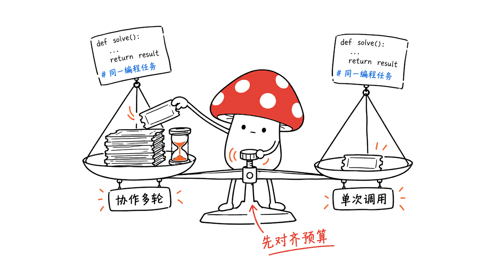
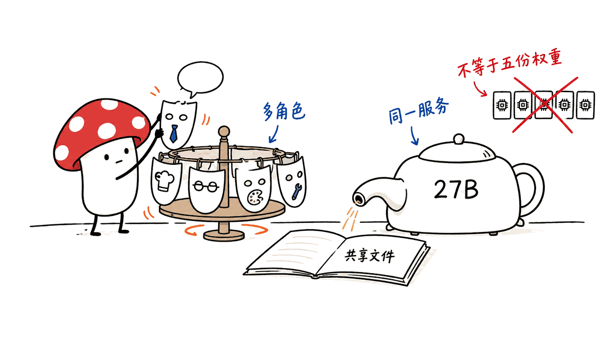
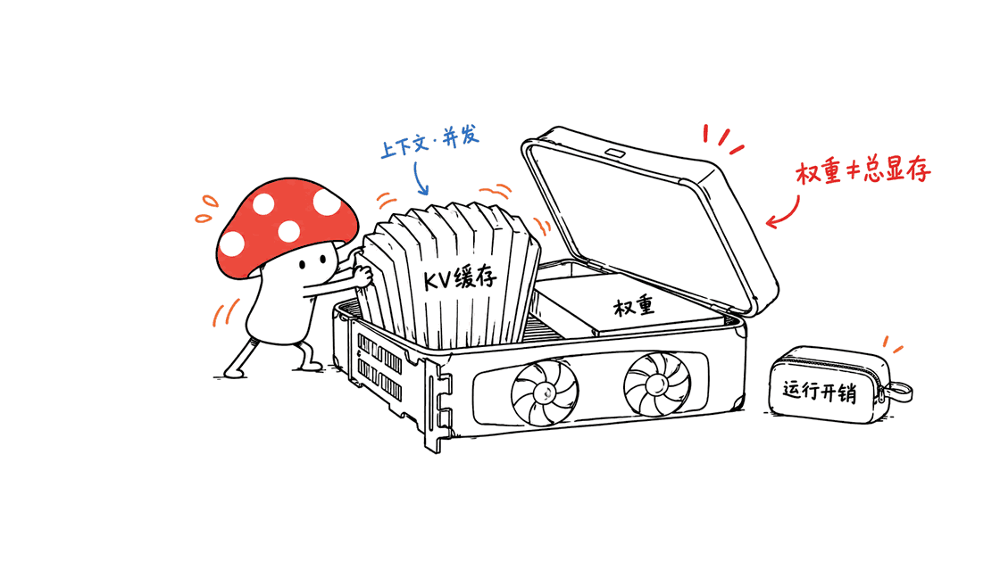

GVS5H与Memdoor说明编程任务可以从推理流程中获得收益，但现有结果没有证明本地小模型在同预算下全面超过旗舰。

官方仓库：https://github.com/guregodevo/memdoor

核查日期：2026年11月1日。以下区分官方资料与本文建议。

## 原始信息分别在哪里？

原方法仓库是slee-persis/GVS5H，报告入口为https://arxiv.org/abs/2608.26480；Memdoor复现位于guregodevo/memdoor的examples/workflows/team-solve。原方法HN讨论为https://news.ycombinator.com/item?id=50228167，复现讨论为https://news.ycombinator.com/item?id=50320995。10月25日是仓库标注的HN讨论时间，不能直接当成论文首次发表日期。arXiv页面显示首次提交为2026年8月27日，v2修订于9月21日。

## 92.4%究竟是什么成绩？

原作者README报告：在100道LiveCodeBench Hard题上，本地服务的Qwen3.8-27B由单次66.8%提升至协作92.4%，对照Fable 5单次90.4%。这是作者自报，不是本文复现。它比较的是模型加不同推理流程，不是同等计算预算下的裸模型能力。不能把pass@1理解为整个流程只调用一次模型。

## Memdoor复现是否验证了全部100题？

没有。复现只取原题单前10题，各跑5遍，49/50运行通过隐藏测试，均值9.8/10；原作者Harness对应均值9.6，Fable单次对应8.0。复现者明确把目标称作流程对齐，而不是证明9.8显著优于9.6。题目来自2025年春季，训练污染无法排除。

## 到底是五个模型还是一份模型的多个角色？

流程包括规划、两个并行构思、求解、测试、管理审阅、修复和最终验证。角色从新上下文读取共享文件，不代表需要同时驻留五份27B权重。是否共享服务、并发多少以及KV缓存大小，取决于具体部署。样例测试控制流程，最终隐藏测试用于评分，二者不能混淆。

## 硬件和费用说法能否照抄？

Memdoor运行使用OpenRouter，不是复现者的本地显卡。NOTES还记录了服务主机与精度条件的切换，不能视作固定本地环境的重复测量。其NOTES记录50次完整运行共35.79美元、1530万输出Token；包含16次被中断或调整的尝试则为38.77美元。单次运行中位模型时间40分钟，中位成本0.39美元，最长4小时。35.79除以50约0.72美元是平均值，不能与中位数混写。

## 24—32GB显卡就一定能跑吗？

不能保证。27B权重的理论4bit载荷约13.5GB、8bit约27GB，还未计量化元数据、KV缓存和运行开销；这是参数量估算，不是特定权重文件或显存实测。128K回复上限也不等于显存中总序列长度。必须指定量化、上下文、并发、服务引擎和GPU可用内存，再做真实装载测试。本文没有下载权重或测试显卡。

## 对大模型有冲击和打击吗？

有条件的竞争压力，主要冲击的是“遇到难题只能升级单次模型”的选型习惯。对可自动验证、允许较长等待的编程任务，增加搜索、分工和反馈可能提高小模型的系统表现。但旗舰模型同样可以使用这些方法；如果不给旗舰相同预算和工具，不能宣布规模优势已经失效。低延迟交互、多模态和缺乏可靠评分器的任务也没有在这些分数中得到验证。

## 为什么流程也会把正确答案改错？

复现记录显示，管理者曾编造错误反例，导致正确程序被改坏；另有正确程序被后续轮次覆盖，再花成本恢复。本文建议保留候选版本，验证反例，设置时间与成本上限，并用独立留出题进行同预算比较。这些是工程改进建议，未计入公开成绩。

## 常见问题

### 是否证明本地五开胜过旗舰？
没有。原作者与复现的运行条件不同，Memdoor用的是云API，旗舰对照也不是同一Harness。

### Memdoor是不是Apache 2.0？
已核对其LICENSE为Apache 2.0；GVS5H代码MIT，论文与运行数据另标CC BY 4.0，上游数据保留各自许可。

### 本文是否实际跑了题目？
没有。本文核对README、NOTES、许可和源入口，没有复跑隐藏测试或测量推理成本。

相关领域评测方法：https://blog.mushroom.cv/blog/hamel-domain-specific-agent-evals-guide/

补充一手来源：

https://github.com/slee-persis/GVS5H

https://github.com/guregodevo/memdoor/tree/main/examples/workflows/team-solve

https://github.com/guregodevo/memdoor/blob/main/examples/workflows/team-solve/NOTES.md

---

> © 2026 Author: Mycelium Protocol. 本文采用 [CC BY 4.0](https://creativecommons.org/licenses/by/4.0/deed.zh) 授权——欢迎转载和引用，须注明作者姓名及原文链接，不得去除署名后以原创发布。

<!--EN-->

GVS5H and the Memdoor replication provide evidence about inference-time organization, not proof that small models universally defeat frontier models. The arXiv record was first submitted on August 27, 2026 and revised on September 21; the October 25 HN discussion is not the initial paper publication. The original repository is https://github.com/slee-persis/GVS5H and its report is https://arxiv.org/abs/2608.26480 . The replication lives under examples/workflows/team-solve in Memdoor.

## What was reported?

The original authors report Qwen3.8-27B rising from 66.8% single-call to 92.4% orchestrated accuracy on 100 hard LiveCodeBench tasks, compared with a 90.4% single-call Fable 5 baseline. These are author claims, not this article’s measurements. System pass@1 does not imply one underlying model call or equal inference budgets.

## What did the replication cover?

Memdoor used the first ten tasks, five passes each: 49/50 solved, mean 9.8/10 versus 9.6 for the authors’ harness and 8.0 for the inherited frontier baseline. It claims parity, not meaningful superiority on such a small sample. The spring-2025 tasks may have appeared in training. Agents see public examples while hidden tests determine the reported score.

## What did it cost?

The replication used OpenRouter, not a local GPU. Its notes also record provider and precision differences, so this is not a fixed local-backend measurement. Its notes report $35.79 for 50 completed runs and 15.3 million output tokens; including 16 interrupted or adjusted attempts gives $38.77. Median model time was 40 minutes, median cost $0.39, and the longest run four hours. The completed-run mean is about $0.72, distinct from the median.

## Is a 24–32GB GPU enough?

That cannot be guaranteed. Raw 4-bit storage for 27 billion parameters is approximately 13.5GB, or 27GB at 8-bit, before metadata, KV cache and runtime overhead. These are arithmetic estimates, not measured checkpoint or VRAM sizes. Specify quantization, total context, concurrency and engine before testing. Multiple roles need not imply five simultaneously loaded weight copies.

## Does it threaten large models?

It creates conditional competition for verifiable, latency-tolerant coding tasks and challenges the habit of solving every failure with a larger single call. Frontier models can use orchestration too. Equalize budgets, tools and task conditions before claiming a model-scale advantage disappeared. Low-latency, multimodal and weakly verifiable workloads remain outside these results.

The replication also records a manager inventing a wrong counterexample and overwriting a correct program. Preserve candidates, validate proposed counterexamples and cap cost/time. Those are proposed improvements, not included in the reported results.

## FAQ

### Was the replication local?
No; it used OpenRouter, and the frontier baseline was not run in the same harness.

### What are the licenses?
Memdoor is Apache 2.0; GVS5H labels code MIT and paper/run data CC BY 4.0, with upstream exceptions.

### Was the benchmark independently rerun here?
No. This article reviewed primary records and did not execute model inference or hidden tests.

Primary repository: https://github.com/guregodevo/memdoor

---

> © 2026 Author: Mycelium Protocol. Licensed under [CC BY 4.0](https://creativecommons.org/licenses/by/4.0/) — free to share and adapt with attribution. You must credit the author and link to the original; removing attribution and republishing as original is not permitted.
