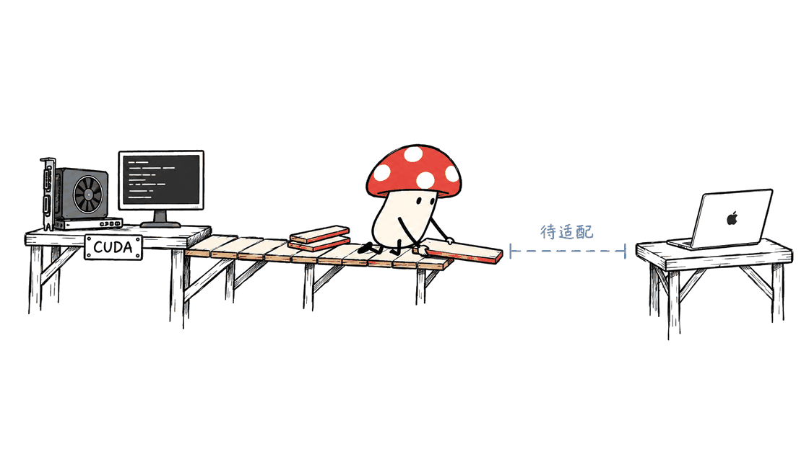

Halcyon证明，在这组受控实验中，文生图可以跳过文本大模型预训练。传播中的“省275倍算力”，指完整系统的总预训练计算量比较，不能换算成出图速度、显存降幅或Mac运行保证。

这项工作由斯坦福大学与Radical Numerics研究者合作完成，第一作者是Keshigeyan Chandrasegaran，李飞飞是共同作者。论文题为《Text-to-Image Generative Modeling Without Language Pretraining》，arXiv于2026年10月19日收录，当前核对版本为10月20日的v2；官方研究博客标注10月15日，推理代码则在10月30日发布。几个时间对应不同发布入口，不宜统称“今天刚公布”。

论文：https://arxiv.org/abs/2610.26863
项目页：https://keshik6.github.io/halcyon/
研究团队解读：https://www.radicalnumerics.ai/blog/halcyon
官方代码：https://github.com/keshik6/halcyon
模型集合：https://huggingface.co/collections/radicalnumerics/halcyon

封面采用Radical Numerics官方文章的翠鸟主题图，是研究宣传视觉，并非本文在本地生成的Halcyon测试样张。以下分数均来自作者报告；Mycelium Protocol做了源码、访问条件和计算口径核查，没有重训模型或复现出图基准。

## 275倍的分母，为什么必须讲清楚？

论文把语言模型、图像分词器与图像生成器的预训练计算量一起记账。以附录表15为准，JiT-T2I-XXL/8++总量约为3.68×10²³ FLOPs，Halcyon-1.6B约为1.34×10²¹ FLOPs，两者相除为274.63，四舍五入就是275倍。

分母最关键的一项，是对照系统所用Qwen3文本编码器的既有预训练成本。研究者把这笔上游投入也算进“造出整个系统需要多少计算”，而不是只算当前项目训练图像生成器的新增支出。

这是一种有意义的科研核算方式：研究可以问，是否值得先建一个通用语言模型，再把它接到图像生成器上。但对已经拿到现成编码器的团队来说，那笔历史成本并不等于今天要付的GPU租赁费。

**因此，275倍回答的是完整预训练路线的计算效率，不能直接作为业务项目预算压缩比例。** 同理，下载权重后的一次生成也不会“重新支付”语言模型的预训练成本，训练FLOPs与推理延迟必须分别测量。


## 不用语言预训练，模型怎么理解提示词？

Halcyon仍然使用Transformer，也仍然读文本。改变的是学习顺序与监督来源：不先加载一个在海量纯文本上训练好的语言模型，而是让随机初始化的生成模型，直接从配对的图片与描述中学习对应关系。

可以把它理解为：先读一整座文字图书馆，再学画图，是一种路线；拿着图片与描述一起学，是另一种路线。这篇工作把第二条路线系统地放到了受控实验里比较。

它采用Qwen3架构，但没有继承Qwen3预训练权重。“采用架构”和“使用已经学好的语言能力”是两件事。文本被BPE分词，图片被离散图像分词器编码，二者进入同一个词表与自回归序列。

公开的`vocab.py`给出了可直接检查的接口：16,384个文本词元、64,000个图像码，以及256个特殊位置，共80,640个词表位置。一张256×256图像表示为32×32网格，即1,024个图像词元。生成时，描述后接图像起始标记，模型逐个预测图像词元，再由图像解码器还原像素。

```text
描述 → 文本分词 → 联合自回归模型 → 1,024个图像词元 → 图像解码器
```

这也纠正了“视觉潜空间直接对齐文本”的模糊说法：这里有具体的序列建模、离散图像表示与解码流程，并非删掉文本塔之后就自动获得一张图。

还需保留一个细节：文本分词器的训练使用了GPIC描述和OpenWebText。学习分词规则不等于给神经网络做纯文本语言预训练；“无语言预训练”也不等于“完全没有文本来源”。

官方博客还介绍了一个有趣的监督重排：原本为无条件生成而丢弃的部分描述，被放到图像词元后面，变成看图写描述的学习目标。它增加的是同一训练预算中的监督利用率，不代表凭空获得通用视觉助手的全部能力。


## 画质和提示词遵循，到底测了什么？

研究把各图像生成器放到相同的GPIC图文数据和256×256分辨率下训练，减少训练数据不一致带来的干扰。下面保留两组核心对照，不把它们包装成跨所有商业模型的排行榜。

| 作者报告的配置 | gFD，越低越好 | GenEval，越高越好 | DPG-Bench，越高越好 |
|---|---:|---:|---:|
| LlamaGen-XL/8 | 63.3 | 30.48 | 67.08 |
| Halcyon-0.52B | 48.0 | 44.91 | 76.84 |
| JiT-T2I-XXL/8++ | 41.0 | 43.17 | 76.85 |
| Halcyon-1.6B | 35.3 | 53.48 | 77.90 |

数据来源：官方项目页“Halcyon vs. late fusion”。gFD衡量生成图像与真实图像分布的距离，不能单独证明提示词遵循。后两项分别补充组合属性、数量位置和较详细描述的考察，也不能覆盖真实客户所有需求。

这些结果值得重视，因为它们支持“配对图文监督可以承担更多任务”的方向。它们没有证明多语言长提示、中文排版、高分辨率产品图、风格一致性和编辑能力都已经达到成熟生产工具水平。

公开仓库还提醒，推理移植版与内部论文实现存在轻微数值差异。例如README的1.6B `baseline` gFD为35.28，`main`为36.00。比较结果时要同时固定模型、分支与代码版本，而不能把论文表格和当前运行结果随意拼接。

“文生图必须先有庞大LLM”本来也不是一条技术定律。论文自己回顾了早期DALL-E、CogView和GLIDE等配对训练路线。Halcyon的贡献更适合理解为：在现代架构和控制变量下，重新检验语言预训练的收益，而不是首次发现文本与图像能够一起学习。

## 代码和权重开放到哪一步？

截至2026年10月31日，官方GitHub已经有可读的推理实现与演示Notebook，不再只是“Code coming soon”。本文核对提交为`52931e3a2d34207f5f54da64a7d71c3e582ea966`。

仓库采用MIT许可；但它公开的是推理代码移植版，不能据此声称内部完整训练系统已经全部公开。五种规模为0.1B、0.25B、0.52B、1.6B和4B，每个模型仓库提供`baseline`与`main`两种训练配置，合计十种模型/分支组合，并非十种独立参数规模。

`baseline`保留描述丢弃训练，主要对应文生图；`main`加入图生文监督。当前文生图脚本默认`baseline`，看图描述脚本默认`main`，二者默认规模均为1.6B。图像与文本分词器则单独发布。

权重访问还有实际门槛。核查时，模型仓库与分词器仓库API均标记为自动审批式受限访问；匿名获取模型文件返回401，网页要求登录并接受条件、分享Hugging Face账户信息。本文没有代替读者接受条款，也没有下载权重。

公开模型元数据未给出明确的许可证字段，受限访问条件尚未在本文中完成核验。因此只能确认“代码MIT、权重有官方发布入口”，不能把代码许可扩展成“所有权重无条件MIT商用”。准备商业使用时，应先查看获准访问后展示的完整条款。

最小模型入口：https://huggingface.co/radicalnumerics/Halcyon-0.1B
分词器入口：https://huggingface.co/radicalnumerics/Halcyon-Tokenizers

## 普通开发者、尤其Mac用户，现在能怎么试？

目前官方环境是Python 3.12、vLLM 0.24.0、PyTorch 2.11.0与Transformers 5.10.1；README说明使用CUDA 13.0运行时，需要匹配的NVIDIA驱动。代码直接调用CUDA，官方4B演示使用单张H100。

H100是已展示的运行配置，不是论文证明的最低显存要求。仓库没有给出各规模在消费级显卡上的完整最低显存表；生成并发、KV Cache、引导分支和图像解码器都会占用额外空间，不能只把参数量乘两字节就当成显存需求。

| 环境 | 当前可以确认的结论 |
|---|---|
| Linux与兼容CUDA环境的NVIDIA GPU | 官方推理路线；先完成权重访问，再按依赖安装与小批量验证 |
| 单张H100 | 官方4B Notebook展示的配置；不表示所有任务性能已独立验证 |
| Apple Silicon Mac | 未发现官方MPS或MLX运行路径，现有CUDA脚本不能按原样直接跑 |
| CPU或其他端侧设备 | 小参数量提供研究空间，但本文没有可用性或性能实测证据 |

有合适NVIDIA环境的读者，可以先按官方步骤建环境，再选择0.52B做功能验证。下面是部署参考，本文没有执行模型生成：

```bash
git clone https://github.com/keshik6/halcyon.git
cd halcyon
conda env create -f environment.yml
conda activate halcyon

CUDA_VISIBLE_DEVICES=0 python generate_images.py \
  --model radicalnumerics/Halcyon-0.52B \
  --revision baseline \
  --pairs-per-wave 1 \
  --caption "A red boat on a calm lake at sunrise."
```

先保存PNG、原始图像码和包含提示词与种子的manifest，再记录峰值显存、端到端耗时、失败样例与所用版本。不要把论文的多卡批量吞吐搬来当作单张显卡或Mac速度。

Mycelium Protocol在本机完成了Python源码语法解析、联合词表与默认配置的轻量核查，并复算了总FLOPs比值。由于本机是Apple Silicon，且没有下载受限权重，本次没有跑图像生成、Mac移植或显存基准。文章中的安装命令是官方路线的起步示例，不是本机运行成功证明。



## 对产品团队，更有价值的下一步是什么？

如果目标是立刻替换成熟的高分辨率设计工具，现阶段应先验证质量与工作流缺口。如果目标是研究小规模领域生成器，Halcyon更有启发：把预算用在相关的图文配对数据、表示学习与监督安排上，可能比先堆一个通用文本底座更值得实验。

实际立项可以分三步。第一，建立业务提示词集，包含品牌颜色、数量、空间关系和失败成本较高的需求。第二，在相同输入、种子与分辨率下比较现有方案和Halcyon，分别统计画面质量、遵循度、推理延迟与显存。第三，再决定是否投入领域数据、后训练、推理后端或更高分辨率适配。

训练预算也应拆成两本账：一份记录上游全部投入，回答技术路线的系统效率；另一份记录团队真实新增支出，回答项目是否划算。这项研究最有用的启发，是让两本账都可检查，而不是把一个大倍率直接写进采购计划。

相关阅读：文生图之外，本地模型如何进入工具链，还可以对照本站的模型服务调研：
https://blog.mushroom.cv/blog/corespeed-tie-mac-studio-guide/

## 常见问题

### Halcyon完全不使用语言模型吗？

它使用Qwen3式Transformer架构，但从随机权重开始学习，主路线不继承纯文本预训练模型。它仍然处理文本描述，核心变化是无需先做海量纯文本语言预训练。

### 275倍可以理解为每张图便宜275倍吗？

不能。它是完整预训练FLOPs的特定对照比值，含对照语言编码器的历史训练成本。单次推理价格、耗时与显存需要独立测试。

### 16GB或32GB的Mac可以直接安装吗？

目前不能依据官方CUDA实现给出这种保证。统一内存容量不是唯一条件，还需要可用的MPS或MLX后端、图像分词器适配、引导采样实现和实际验证；本文未完成这些移植。

---

> © 2026 Author: Mycelium Protocol. 本文采用 [CC BY 4.0](https://creativecommons.org/licenses/by/4.0/deed.zh) 授权——欢迎转载和引用，须注明作者姓名及原文链接，不得去除署名后以原创发布。

<!--EN-->

Halcyon shows that strong text-to-image generation can be learned without first pretraining a language model in the authors' controlled setting. Its headline 275× advantage concerns total pretraining compute. It is not a claim about per-image latency, peak memory, or ready-to-use Mac support.

The work comes from Stanford University and Radical Numerics. Keshigeyan Chandrasegaran is the first author, and Li Fei-Fei is a coauthor. The arXiv submission dates to October 19, 2026, with v2 dated October 20. The team blog is dated October 15; inference code arrived October 30. Those are different publication milestones.

Paper: https://arxiv.org/abs/2610.26863
Project: https://keshik6.github.io/halcyon/
Team blog: https://www.radicalnumerics.ai/blog/halcyon
Code: https://github.com/keshik6/halcyon
Models: https://huggingface.co/collections/radicalnumerics/halcyon

The cover is the team's official kingfisher artwork, not a sample generated during this review. Scores below are author-reported. Mycelium Protocol checked source code, access conditions and compute accounting; it did not retrain or benchmark the models.

## What does the 275× denominator include?

Appendix Table 15 counts pretraining for the language model, image tokenizer and image generator. JiT-T2I-XXL/8++ totals roughly 3.68×10²³ FLOPs, versus 1.34×10²¹ for Halcyon-1.6B. Dividing gives 274.63.

Crucially, the baseline includes the historical cost of pretraining its Qwen3 text encoder. This answers a system-building research question: how much computation was needed to create every component? It does not directly answer how much a team will spend when it downloads an existing encoder today.

A product team should keep both accounts: total upstream investment and its own incremental expenditure. Neither pretraining FLOPs nor their ratio can be substituted for measured inference latency, GPU rental cost or peak memory.


## How does Halcyon learn text conditioning?

The model still reads text and still uses a Transformer. It adopts the Qwen3 architecture with random initialization, learning from paired images and captions rather than inheriting a pretrained text network.

The public vocabulary implementation contains 16,384 text tokens, 64,000 image codes and 256 special-token slots. A 256×256 image becomes a 32×32 grid of 1,024 discrete tokens. During generation, a caption and image-start marker precede autoregressive prediction of image tokens; an image decoder reconstructs pixels.

```text
Caption → text tokenizer → joint autoregressive model → image codes → decoder
```

The text BPE tokenizer was trained using GPIC captions and OpenWebText. Learning tokenization rules is distinct from neural language-model pretraining. “Without language pretraining” therefore does not mean “without text” or “without a text tokenizer.”

The team also explores recovering supervision otherwise lost through caption dropout. Moving those captions after image tokens provides image-to-text examples within the same budget. This is a targeted training design, not evidence that the base model gains every capability of a general visual assistant.


## What did the evaluation actually establish?

The comparison trains image generators on the same GPIC paired data at 256×256 resolution. This controls an important source of variation, while remaining a specific experimental setting.

| Author-reported configuration | gFD ↓ | GenEval ↑ | DPG-Bench ↑ |
|---|---:|---:|---:|
| LlamaGen-XL/8 | 63.3 | 30.48 | 67.08 |
| Halcyon-0.52B | 48.0 | 44.91 | 76.84 |
| JiT-T2I-XXL/8++ | 41.0 | 43.17 | 76.85 |
| Halcyon-1.6B | 35.3 | 53.48 | 77.90 |

Source: the official project page's late-fusion comparison. gFD measures distribution similarity, not prompt adherence by itself. GenEval and DPG-Bench provide complementary evidence about compositional and detailed prompts. These results do not establish production readiness for multilingual typography, high-resolution assets, editing or persistent style.

The public inference port can also differ slightly from the internal paper implementation. Its README reports 35.28 gFD for the 1.6B `baseline` branch and 36.00 for `main`. Reproducible comparisons must pin both model revision and code commit.

The broader premise also needs restraint. Early systems including DALL-E, CogView and GLIDE already learned from paired supervision without separate language pretraining. Halcyon's contribution is a controlled modern investigation of the trade-off, not the first demonstration that text and images can be learned together.

## What is publicly available?

The audited GitHub commit is `52931e3a2d34207f5f54da64a7d71c3e582ea966`. It provides MIT-licensed inference code and a demonstration notebook, rather than the complete internal training stack.

There are five sizes: 0.1B, 0.25B, 0.52B, 1.6B and 4B. Each model repository has `baseline` and `main` branches, giving ten size/recipe combinations. Text-to-image generation defaults to `baseline`; captioning defaults to the I2T-enabled `main`. Both scripts default to 1.6B. Tokenizers are published separately.

At inspection, the model and tokenizer repositories were automatically gated. Anonymous file access returned HTTP 401, while the web page requested sign-in and acceptance of conditions involving account information. No terms were accepted and no weights were downloaded for this review.

The inspected public model metadata did not expose a license field. The code's MIT license cannot establish unrestricted commercial rights to every checkpoint. Check the complete access terms before deployment.

Smallest model: https://huggingface.co/radicalnumerics/Halcyon-0.1B
Tokenizers: https://huggingface.co/radicalnumerics/Halcyon-Tokenizers

## Can a Mac run the official implementation?

The documented environment uses Python 3.12, vLLM 0.24.0, PyTorch 2.11.0 and Transformers 5.10.1, with a CUDA 13.0 runtime and a compatible NVIDIA driver. Source code explicitly calls CUDA. The official 4B notebook uses one H100; that is a demonstrated configuration, not a minimum-memory specification.

| Environment | What the evidence supports |
|---|---|
| NVIDIA GPU with compatible CUDA environment | The documented inference route; obtain model access and validate a small workload first |
| One H100 | The official 4B notebook configuration |
| Apple Silicon | No official MPS or MLX path found; CUDA scripts do not run unchanged |
| CPU or edge hardware | Potential research targets, without verified support or performance here |

Parameter storage is only part of memory use. KV cache, guidance branches, image decoding and batch size all matter. A 16GB or 32GB Mac recommendation cannot be inferred from parameter count alone.

For a compatible NVIDIA environment, the earlier Chinese section provides an official-route setup example selecting 0.52B, `baseline`, and one sample pair per wave. It is a deployment starting point, not a command sequence executed successfully during this review.

The local checks covered Python syntax, vocabulary invariants, default configurations and compute arithmetic. No generated images, VRAM measurements or Mac backend port were produced. The paper's multi-H100 batch throughput must not be presented as single-device or Mac performance.


## How should a product team evaluate it?

Start with actual customer prompts: required colors, counts, spatial relations, typography and costly failure cases. Compare methods at fixed resolution and recorded seeds, then measure quality, adherence, latency and memory separately.

If the goal is a small domain-specific generator, this work motivates experiments with paired data and supervision allocation. If the goal is immediate replacement of a mature high-resolution design product, first establish the missing quality and workflow capabilities. The paper supports an investigation, not a procurement shortcut.

Related infrastructure review:
https://blog.mushroom.cv/blog/corespeed-tie-mac-studio-guide/

## FAQ

### Does Halcyon avoid all language-model architecture?

No. It uses a Qwen3-style Transformer initialized from scratch. The key change is avoiding inherited text-only pretraining, while retaining caption conditioning.

### Does 275× mean each image is 275× cheaper?

No. It is a particular total-pretraining FLOPs comparison including historical encoder training. Inference cost, latency and memory require separate measurements.

### Is a 16GB or 32GB Mac enough?

There is no verified official installation guarantee for either. A working backend, tokenizer adaptation, guidance implementation and real measurements are needed in addition to sufficient memory.

---

> © 2026 Author: Mycelium Protocol. Licensed under [CC BY 4.0](https://creativecommons.org/licenses/by/4.0/) — free to share and adapt with attribution. You must credit the author and link to the original; removing attribution and republishing as original is not permitted.
