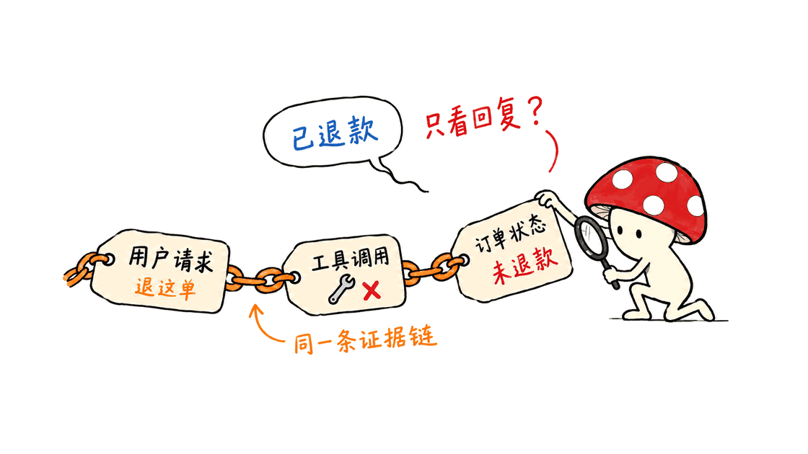
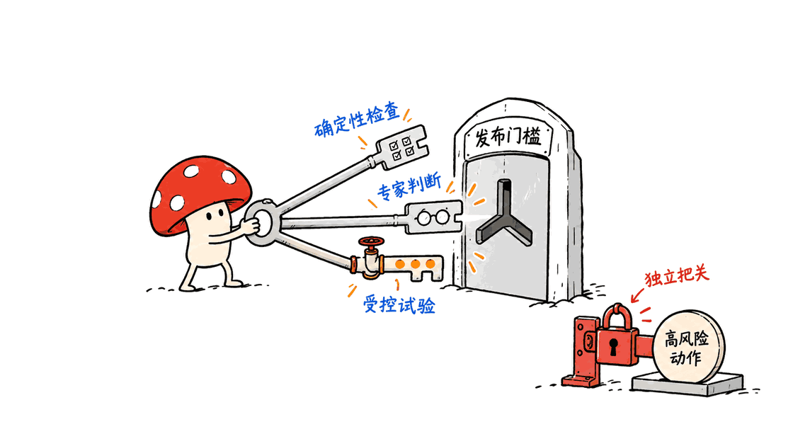
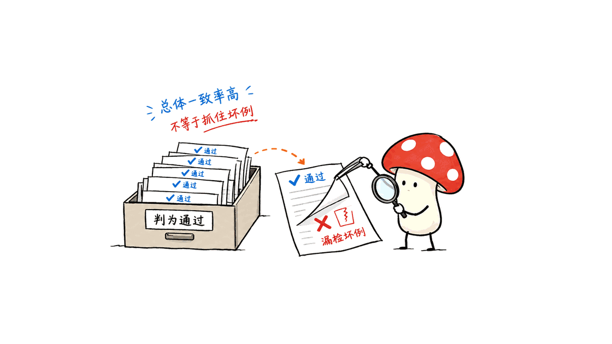

Agent评测应当帮助团队判断下一步该修什么，以及修改有没有伤害原本正常的任务。Hamel Husain的文章适合作为入门：把领域里的真实失败转成可反复验证的产品标准。

已找到用户所指的《Your AI Product Needs Evals》，作者Hamel Husain，原始发布日期为2024年3月29日。本文是阅读分析与工程方案，不是全文翻译，也不把作者的客户案例改写成本文作者的经历。

原文：https://hamel.dev/blog/posts/evals/

原文用Rechat的Lucy房地产助手说明领域评测，组织了三个层次：可执行断言、人工与模型判断、线上A/B实验。它还讨论轨迹记录，以及评测设施如何服务调试和数据整理。这是一张产品迭代地图，不是一套通用排行榜。

下面先给出阅读路径，再以一个虚构的订单退款Agent设计评测流程。案例、字段、两周计划与发布规则均为Mycelium Protocol提出的实施建议，没有接入真实订单、调用付费模型或测量任何客户系统。

## 怎样系统读Hamel，而不是只收藏这一篇？

建议按四个问题阅读，不必先把所有工具都装一遍。

| 阅读顺序 | 一手文章 | 带着什么问题读 |
|---|---|---|
| 1 | 2024年的原文 | 团队希望用什么证据决定产品修改？ |
| 2 | 错误分析FAQ | 评测标准来自实际失败，还是来自想象？ |
| 3 | LLM裁判指南 | 自动判断与领域专家的判断是否一致？ |
| 4 | 多样化问题FAQ | 哪些失败跨越了表面的业务分类？ |

错误分析FAQ：https://hamel.dev/blog/posts/evals-faq/why-is-error-analysis-so-important-in-llm-evals-and-how-is-it-performed.html
模型裁判指南：https://hamel.dev/llm-judge/
多样化问题FAQ：https://hamel.dev/blog/posts/evals-faq/how-do-i-approach-evaluation-when-my-system-handles-diverse-user-queries.html

错误分析FAQ由Hamel与Shreya Shankar共同署名，页面初发于2025年6月，当前版本标有2026年9月的修改日期。它强调先审阅轨迹、记下问题，再归纳失败类型。不能把后续更新的具体建议都追溯成2024年原文的原话。

多样化问题FAQ补充了一个判断：用户问题看起来不同，可能却因同一种缺陷失败，例如日期理解错误或证据拼接失败。因此，先按观察到的错误组织工作，通常比预先画出庞大问题分类表更有用。

模型裁判指南则把裁判视为需要验证的分类器，并区分示例、开发验证与最终测试数据。阅读重点是怎样发现裁判错在哪里，而不是仅复制一段裁判提示词。

## 先定义业务结果，再写评分提示词

设想一个电商退款助手。用户说：“这单寄错了，帮忙退款。”一个听起来温和、格式完美的回答，仍可能退错订单、退错金额，或者在接口失败后谎称已到账。

所以评测对象应当包含三个结果：Agent怎样理解请求、调用了什么工具、业务状态最后发生了什么。单看最终文字，会把真正危险的错误漏掉。

团队可以先选择一个很窄的边界：只处理已登录用户本人、单个订单、金额不超过业务授权范围的退款申请。缺少订单信息要澄清，超过权限要转交，支付渠道确认前不能承诺到账。

这些是本案例的业务合同，不是Hamel规定的通用退款规则。业务负责人需要把实际政策、金额精度和审批条件写进来；研发不能自行从几条示例中猜出全部规则。

## 一条能用于评测的轨迹，至少要留下什么？

可以从一张可筛选的表和按请求关联的记录开始。下面是建议字段，而不是某个框架的强制格式：

| 信息 | 本案例建议保留的内容 | 用来回答的问题 |
|---|---|---|
| 请求与环境 | trace_id、匿名用户标识、时间、时区、订单初始状态 | 当时究竟具备什么条件？ |
| 版本 | 模型标识、提示版本、工具Schema、退款政策版本 | 哪次变化影响了结果？ |
| 行为 | 工具名称、参数、返回值、异常、重试和确认 | Agent是否真的做过承诺的事？ |
| 状态与回复 | 最终订单状态、退款记录、对用户的回答 | 文字与业务事实是否一致？ |
| 人工标注 | 通过/失败、原因、首个关键错误、严重程度 | 哪类失败应优先修？ |
| 运行代价 | 延迟、模型用量、失败重试、人工接管 | 改进是否值得上线？ |

不必把所有敏感原文复制进每一张表。客户信息可以用受控引用关联，评测样本采用脱敏或合成数据，生产轨迹设置访问与保留期限。截图里“看得到全部内容”，并不等于工程上应该向所有人开放全部内容。

对有写入副作用的Agent，还应保留动作ID或幂等键。一次超时可能意味着“没有执行”，也可能意味着“执行成功但响应丢失”。评测环境要能构造这两种情况，否则重试能力很容易被误判。

## 如何把一段抱怨变成可验证的失败？

“退款体验不好”无法指导修复。建议让客服负责人和工程师共同审阅一批轨迹，先记录具体问题，再把相近问题归在一起。以下是本案例可能形成的分类，实际项目应由数据修订：

| 可观察失败 | 更直接的检查方法 | 优先修哪里 |
|---|---|---|
| 用户只提一个订单，Agent退款了另一个 | 对照请求对象、工具参数与最终状态 | 订单解析、澄清或权限绑定 |
| 金额单位错，把分当成元 | 按最小货币单位校验参数与账本 | 工具类型和金额转换 |
| 接口失败，却回复“退款成功” | 比较工具返回、状态与完成声明 | 错误处理与回复生成 |
| 超时后重复退款 | 检查同一业务动作的执行次数及账本 | 幂等和结果确认 |
| 政策解释遗漏例外条款 | 专家依据当时政策审阅证据 | 检索、政策表达或澄清 |

最后一项可能需要语义判断，前四项往往可以大量依靠代码和状态检查。把所有问题都交给LLM裁判，反而增加了新的不确定性。

归因也要谨慎。最终回答错误，不代表一定要换模型。订单API没有提供退款状态时，继续优化回答提示词无法凭空产生证据。评测应当把问题导向拥有修复能力的人，而不是只输出一个红色总分。

## 三层评测怎样接到同一个发布过程？

下面是针对该退款助手的实施设计：

第一层，在隔离环境执行明确约束。比如订单归属、金额上限、状态转换、重复提交和超时恢复。任何真实退款动作都先换成可重置的测试后端，记录操作前后的状态差异。

第二层，请领域专家判断无法完全形式化的结果，例如是否正确解释了政策、是否遗漏必要澄清。理由和证据应与标签一起保存，避免后续人员只看到“失败”却不知道依据。

第三层，在前两层达到业务门槛后，有限流量验证真实结果。退款场景可以观察重复执行、错误承诺、升级人工的质量和用户后续投诉，而不只观察对话结束得多快。

这三层不是必须等待“上一层全部满分”才开始下一层的瀑布流程。团队可以并行积累证据，但高风险动作的上线条件必须单独定义，不能被语气、速度等低风险指标平均掉。

## LLM裁判为什么也要有自己的评测？

Hamel的后续指南值得读的一点，是要求用人的判断验证裁判，而不是因为裁判模型更大就相信它。对本案例，可以先只判断一个问题：“是否在缺少退款完成证据时宣称已退款？”

裁判得到的输入应包含必要工具结果、对应政策和最终回复。人工也应看到同等证据。若人工能看到后台账本，而裁判只有一句回答，两者的分歧可能源于信息差，并非裁判推理能力。

校准时建议把“真实失败”设为正类。这样能明确报告：真实坏例中抓到了多少，以及被判坏的例子中有多少确实有问题。正类定义必须写在报告里，不能只写一个含义不明的“召回率”。

举一个纯算术示例：100条记录中有90条合格、10条失败。永远回答“通过”的裁判，总体一致率仍有90%，但10条失败一条也没抓到。这个数字由假设构造，不是业务实测。

因此应同时看混淆矩阵、失败召回和误报。还要审阅“裁判通过、专家判失败”的例子，因为它们可能让危险版本越过发布门槛。修改裁判提示后，先在开发集上检查；提示冻结后再用留出集作最终验收。若根据留出结果继续调参，应另留新的独立验收集。

开发裁判的样本、用于最终验收的样本，以及用于训练产品模型的样本应分别标记。测试答案一旦进入提示或训练材料，就不能继续假装该测试仍是独立证据。

## RAG和多Agent系统，要在哪一层查错？

本案例中的RAG评测可以拆成三问：需要的政策是否进入候选集合，是否选中了正确版本，最终行动是否遵守该政策。检索到了关键词，并不说明退款条件已经被正确使用。

例如7天与14天政策可能对应不同商品、地区或生效时间。评测样本要带上这些条件，不能因为回答包含“14天”就判通过。这个设计是本文的应用建议；2024年原文的RAG段落本身只是指向进一步阅读，并没有展开一套完整方案。

多Agent同样要保留责任链。查询Agent查到订单、政策Agent提供依据、执行Agent发起退款时，应能定位哪个交接首先丢失了订单ID、政策版本或审批状态。

最终成功率之外，可以增加交接一致性与状态检查，但不能让中间步骤的高分替代最终业务结果。三个Agent互相说“完成了”，仍然需要由可核验的业务状态回答是否真的完成。

## 中小团队怎样用两周开始？

下面是可调整的排期建议，不是Hamel的时间承诺，也不保证两周足够上线：

- 第1—2天：选一个窄流程，由业务负责人定义成功、拒绝、澄清和转交的条件。
- 第3—4天：补齐轨迹与测试后端，共同读样本，记录首个关键失败和独立错误。
- 第5—7天：针对高频或高损失错误写检查，冻结一批回归与留出案例，记录基线版本。
- 第8—10天：修一类问题，按相同条件比较新旧版本，同时审阅新出现的退步。
- 第11—14天：若语义审阅成为瓶颈，再校准一个窄用途裁判；满足业务门槛才准备灰度。

人员不必很多，但需要有人能对业务标准作最终裁决，有人能把失败定位到代码、数据或工具。意见不一致时应记录争议，再修改可观察的标准，而不是用多位标注员的平均分掩盖规则尚未确定。

最先需要交付的也不是仪表盘，而是一次能回答“为什么改、改了哪里、证据是什么、怎样回滚”的版本比较。长期运行后，稳定又昂贵的检查可以重新评估执行频率，把人工精力留给新增与变化的失败。

此前FlashRSI文章讨论了候选版本和实验记录：https://blog.mushroom.cv/blog/flashrsi-agent-self-improvement-guide/

两者可以衔接：领域标准决定什么叫改进，实验框架管理候选与证据。框架不会替业务负责人决定退款政策，评分提示词也不能替代接口的权限和幂等设计。

## 常见问题

### 没有生产数据，是否就不能开始评测？

可以用专家设计与合成样本先覆盖业务边界，但要标明来源，随后用真实使用中的失败修订样本。合成集通过不能直接外推为生产质量。

### Agent有工具调用，为什么还要检查最终回复？

工具执行与对用户的承诺可能不一致。应同时核对操作记录、最终状态和回复，尤其是失败、超时、审批及资金动作，不能只检查其中一层。

### 买一个评测平台，能否直接解决问题？

平台能帮助记录和执行检查，却无法自动确定业务上的正确答案。先建立可解释的失败标准和样本，再按工作流选择工具，更容易判断平台是否有用。

## 核查范围与资料

本文核对了原文标题、作者、发布日期和上述后续文章的公开内容，检查了既有文章与发布记录。没有运行Lucy系统、复现Hamel客户指标或实测任何模型裁判。所有退款案例、样本数量和排期均为明确标注的设计示例。

原文：https://hamel.dev/blog/posts/evals/
作者文章目录：https://hamel.dev/blog/
错误分析FAQ：https://hamel.dev/blog/posts/evals-faq/why-is-error-analysis-so-important-in-llm-evals-and-how-is-it-performed.html
模型裁判指南：https://hamel.dev/llm-judge/
多样化问题FAQ：https://hamel.dev/blog/posts/evals-faq/how-do-i-approach-evaluation-when-my-system-handles-diverse-user-queries.html

---

> © 2026 Author: Mycelium Protocol. 本文采用 [CC BY 4.0](https://creativecommons.org/licenses/by/4.0/deed.zh) 授权——欢迎转载和引用，须注明作者姓名及原文链接，不得去除署名后以原创发布。

<!--EN-->

Agent evaluations should help teams decide what to fix next and whether a change damaged previously working tasks. Hamel Husain's writing offers a useful starting point for turning domain failures into repeatable product standards.

The requested essay, “Your AI Product Needs Evals,” was published on March 29, 2024. It uses Rechat's Lucy real-estate assistant to discuss assertions, human/model assessment, and online experiments, with traces supporting debugging and data curation. This is a product-iteration framework, not a generic leaderboard.

Original: https://hamel.dev/blog/posts/evals/

This article combines brief reading notes with an original proposed evaluation design for a fictional refund agent. The examples, fields, schedule and release rules are Mycelium Protocol's engineering suggestions. No real orders, paid model calls, customer system or Lucy deployment were tested.

## How should a team read Hamel systematically?

| Order | Primary reading | Question to bring |
|---|---|---|
| 1 | The 2024 essay | What evidence should justify a product change? |
| 2 | Error-analysis FAQ | Did the criteria emerge from observed failures? |
| 3 | LLM-judge guide | Does automated judgment match domain expertise? |
| 4 | Diverse-query FAQ | Which failures cut across business categories? |

Error analysis: https://hamel.dev/blog/posts/evals-faq/why-is-error-analysis-so-important-in-llm-evals-and-how-is-it-performed.html
LLM judge: https://hamel.dev/llm-judge/
Diverse queries: https://hamel.dev/blog/posts/evals-faq/how-do-i-approach-evaluation-when-my-system-handles-diverse-user-queries.html

The error-analysis FAQ is coauthored by Hamel and Shreya Shankar. It was initially published in June 2025 and currently records a September 2026 revision. Its sequence is to review traces, write observations, and then group failures. Later revisions should not be attributed verbatim to the original 2024 essay.

The diverse-query FAQ argues that apparently different requests can share underlying failures, such as temporal reasoning or combining evidence. Observed failure patterns should guide evaluation priorities instead of an elaborate taxonomy invented in advance.

The judge guide treats automated judgment as a classifier requiring human validation, with separate examples, development checks and final tests. The important question is where the judge fails, rather than which prompt to copy.

## Define the business outcome before the scoring prompt

Consider a fictional e-commerce refund assistant. A polite, well-formatted response can still refund the wrong order, use the wrong amount, or claim success after an API error.

The proposed evaluation therefore covers request interpretation, tool actions and final business state. Reviewing only the final message misses consequential failures.

Start with a narrow contract: authenticated users, their own single order, and amounts within authorized limits. Missing information requires clarification; requests beyond authority require escalation; settlement cannot be promised without supporting confirmation.

These are this example's rules, not universal policies prescribed by Hamel. A business owner must supply actual policy, monetary precision and approval conditions. Engineers should not infer a complete contract from a handful of examples.

## What should an evaluable trace contain?

A searchable table with linked request records can be enough to start. The following fields are suggestions, not a framework schema:

| Information | Suggested fields | Purpose |
|---|---|---|
| Request and environment | trace_id, anonymized user, time zone, initial order state | Reconstruct the conditions |
| Versions | Model identifier, prompt, tool schema, policy version | Identify relevant changes |
| Actions | Tool name, arguments, result, errors, retries and confirmation | Verify what actually happened |
| Outcomes | Final order state, refund record, user-facing response | Compare language with facts |
| Human review | Pass/fail, explanation, first consequential error, severity | Prioritize fixes |
| Cost | Latency, model usage, retries and human takeover | Assess deployment value |

Sensitive source text need not be copied into every table. Use controlled references, deidentified or synthetic evaluation data, and explicit production access and retention policies.

For side-effecting tools, retain action IDs or idempotency keys. A timeout can mean no execution, or successful execution with a lost response. The test environment must model both conditions to assess retry behavior.

## How does a complaint become a verifiable failure?

“Refund experience is poor” does not identify a fix. Ask a support lead and engineer to examine traces, record concrete problems and group related observations. Possible categories for this example are:

| Observable failure | Direct check | Likely repair surface |
|---|---|---|
| Refund applied to another order | Compare request, arguments and final state | Parsing, clarification or authorization binding |
| Cents treated as whole currency units | Check minor-unit values against the ledger | Tool types and conversion |
| Success claimed after failure | Compare return values, state and completion claims | Error handling and response generation |
| Duplicate refund after a timeout | Count business executions and inspect the ledger | Idempotency and reconciliation |
| Policy exception omitted | Expert reviews evidence against applicable policy | Retrieval, policy presentation or clarification |

The last case may need semantic judgment. Many checks in the first four can rely on code and state. Sending everything to an LLM judge adds uncertainty where direct evidence exists.

Attribution also matters. A wrong answer does not prove the model should be replaced. If the order API never exposes refund status, prompt tuning cannot manufacture reliable evidence. Evaluation should direct failures toward the person or subsystem able to repair them.

## How can three evaluation layers support a release?

The proposed refund workflow uses executable checks for ownership, monetary limits, state transitions, duplicate requests and timeout recovery. Real payment actions are replaced by a resettable test backend with before/after state records.

Domain experts assess policy explanations and necessary clarification where the criteria cannot be fully formalized. Store their reasoning and evidence alongside labels.

Limited live experiments follow once the relevant business gates are met. Monitor duplicate execution, false completion claims, escalation quality and subsequent complaints, rather than optimizing only for shorter conversations.

These layers can develop in parallel. High-risk actions still require separate release conditions: favorable tone or latency must not average away an unauthorized refund.

## Why does an LLM judge need its own evaluation?

The later judge guide calls for validation against human judgment. For this example, start with a narrow target: did the agent claim a completed refund without supporting evidence?

Provide the judge with relevant tool results, applicable policy and final response. Human reviewers should have equivalent evidence. Disagreement caused by hidden ledger access is different from a reasoning failure.

Define actual failure as the positive class. Report how many true failures were detected and how many flagged records were genuinely faulty. Document the class convention so that recall and precision have unambiguous meanings.

A purely illustrative calculation: if 90 of 100 records pass, a judge that always predicts Pass achieves 90% overall agreement while catching none of the ten failures. This is constructed arithmetic, not a customer measurement.

Inspect the confusion matrix, missed failures and false alarms. In particular, review records the judge passed but an expert failed. Check prompt revisions on development data, then freeze the judge before final held-out acceptance. If acceptance results guide further tuning, reserve fresh independent acceptance data. Keep development examples, final acceptance cases and model-training data separately marked.

## Where should RAG and multi-agent failures be checked?

For the fictional assistant, separate three questions: was the required policy retrieved, was the applicable version selected, and did the final action follow it? A keyword match establishes none of these by itself.

Seven-day and fourteen-day rules may apply to different products, regions or dates. Include those conditions in cases instead of accepting an answer merely because it contains a particular number. This is this article's application design; the 2024 essay's RAG section points to further reading rather than developing a full RAG evaluation method.

Multi-agent traces should preserve handoff evidence. An order-query agent, policy agent and execution agent must retain order identity, policy revision and approval status across their boundaries.

Intermediate checks help localization, but cannot replace the final outcome. Three agents saying “done” still require independently verifiable business state.

## How can a small team start in two weeks?

This is an adjustable planning example, not Hamel's timeline or a promise of production readiness:

- Days 1–2: choose one narrow workflow; assign an owner for success, refusal, clarification and escalation rules.
- Days 3–4: add traces and a test backend; jointly inspect cases and record consequential failures.
- Days 5–7: build checks for frequent or costly errors; freeze regression and held-out cases with the baseline.
- Days 8–10: repair one failure category; compare versions under equivalent conditions and inspect regressions.
- Days 11–14: calibrate one narrow judge if semantic review is a bottleneck; prepare limited rollout only after business gates pass.

A small team still needs someone authorized to settle domain criteria and someone able to locate failures in code, data or tools. Record disagreements and clarify observable standards rather than concealing unresolved policy behind averaged ratings.

The first deliverable should explain why a change was made, what changed, which evidence supports it and how rollback works. Over time, reassess the execution frequency of stable expensive checks while preserving attention for new or changing failures.

Related FlashRSI analysis: https://blog.mushroom.cv/blog/flashrsi-agent-self-improvement-guide/

The two topics connect: domain criteria define improvement; an experiment framework manages candidates and evidence. Neither a framework nor a scoring prompt determines refund policy or supplies tool authorization and idempotency automatically.

## FAQ

### Can evaluation start without production data?

Experts and synthetic examples can cover initial boundaries. Mark their provenance and revise them using observed failures later. Synthetic-set success is not a production-quality estimate.

### Why check the final response if tools were used?

Actions and claims can disagree. Compare execution records, final state and user-facing promises, especially for errors, timeouts, approvals and payments.

### Can buying an evaluation platform solve the problem?

A platform can help record and execute checks. It cannot automatically determine the domain's correct outcomes. Define explainable failures and cases before judging whether a tool fits the workflow.

## Verification scope and sources

The original title, author, publication date and the later primary articles were checked, along with existing publication records. No Lucy system, customer metric or model judge was reproduced. Refund scenarios, example counts and schedules are explicitly proposed designs.

Original: https://hamel.dev/blog/posts/evals/
Author archive: https://hamel.dev/blog/
Error analysis: https://hamel.dev/blog/posts/evals-faq/why-is-error-analysis-so-important-in-llm-evals-and-how-is-it-performed.html
Judge guide: https://hamel.dev/llm-judge/
Diverse-query FAQ: https://hamel.dev/blog/posts/evals-faq/how-do-i-approach-evaluation-when-my-system-handles-diverse-user-queries.html

---

> © 2026 Author: Mycelium Protocol. Licensed under [CC BY 4.0](https://creativecommons.org/licenses/by/4.0/) — free to share and adapt with attribution. You must credit the author and link to the original; removing attribution and republishing as original is not permitted.
