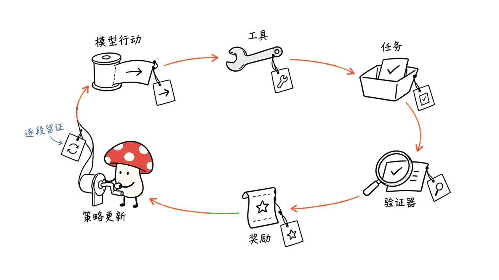
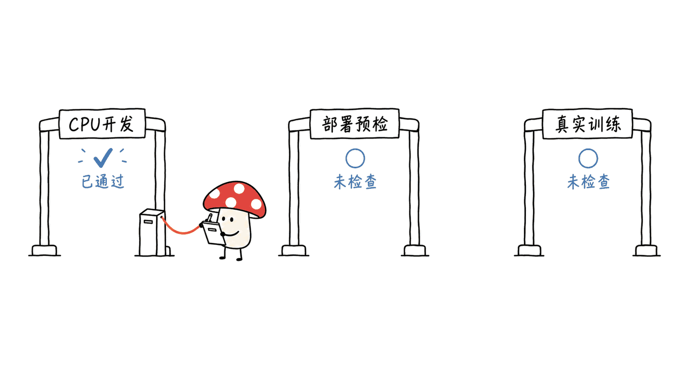

HarborRL把Agent执行任务的过程连接到强化学习训练：模型生成行动，Harness调用工具，隔离环境执行任务，验证器给出奖励，再把轨迹整理成策略更新所需的数据。它的价值是让这些环节共享配置和可追溯证据，减少重复搭建训练基础设施。项目由datamllab开源，当前版本0.1.0，代码采用MIT许可。

但“轻量级”和“MATH自由组合”需要分层理解。我们核对的原生CLI当前只登记GRPO，配置校验固定Claude Code与Harbor 0.23.0；README里的DAPO、40+ Harness不能直接等同当前所有训练组合都已跑通。CPU开发测试通过，也不代表GPU训练已复现。

仓库：https://github.com/datamllab/HarborRL

固定源码：`128d4d67916340db01e3a8ea828451e805ea154b`；核验日期：2026年10月16日。本次完成89项上游CPU测试、CLI边界检查和离线合成奖励烟测，没有启动GPU、Docker任务或模型服务。

## HarborRL把训练流水线接在什么地方？

可以把它看成Harbor任务执行与Slime训练之间的连接层。Harbor负责具有原生任务格式的环境和验证流程，训练侧使用固定版本的Slime、Megatron-LM与SGLang。中间需要保留的不是一段好看的聊天记录，而是能进入训练的数据与证据：策略版本、任务内容、采样参数、token、原始logprob、工具执行结果和奖励来源。

| 阶段 | 需要对齐的内容 | 错配的后果 |
| --- | --- | --- |
| 模型服务与网关 | tokenizer、模板、策略版本、原始logprob | 记录的概率与实际生成策略不一致 |
| Harness执行 | 客户端版本、工具行为、轮次与输出预算 | 换了壳就换了实验条件 |
| Harbor任务与验证 | 任务版本、镜像、完成产物与奖励文件 | 无法区分任务失败和基础设施故障 |
| 训练导出 | 组内样本、优势、loss mask与token权重 | 错把工具文本训练进去或重复归一化 |

源码为每次attempt记录任务、Harness、奖励与采样等摘要，并在导出完整组时检查身份一致性和重复项。导出器对提示词位置设零loss mask，训练输出token；优势与token权重也有约定，后端需要遵守，不能再随意做一遍whitening。

这套约束的意义，是让一次奖励能够对应回产生它的轨迹。它提高了可审计性，但不会仅凭YAML就保证所有硬件、容器和随机过程得到逐比特一致的结果。

源码入口：
https://github.com/datamllab/HarborRL/blob/128d4d67916340db01e3a8ea828451e805ea154b/harborrl/rollout/exporters/native.py

## MATH自由组合，当前哪些部分有代码约束？

MATH指Models、Algorithms、Tasks、Harnesses四个实验维度。这个抽象有用，但配置维度存在，不等于每个维度的所有选项已经形成可用的笛卡尔积。

| README介绍 | 当前固定版本看到的原生路径 | 实际接入建议 |
| --- | --- | --- |
| Qwen、GLM模型 | 模型参数文件由Slime预设选择，例子是Qwen3-8B | 准备对应actor/reference检查点，逐个验证模型与后端 |
| GRPO、DAPO | CLI的算法映射当前只有grpo | 不把DAPO当成已经可直接选择的原生训练入口 |
| 200+任务 | 使用Harbor原生任务与内容锁定catalog | 分别检查格式、运行、奖励和训练数据 |
| 40+ Harness | 原生校验要求claude_code／Harbor 0.23.0 | 生态兼容描述与本条训练路径分开核对 |

我们实际执行了带`--dry-run`的入口检查。选择`-alg dapo`返回退出码2，提示`unsupported algorithm: dapo; supported algorithms: grpo`；选择`-harness codex`也返回2，提示原生路径要求`harbor_job / claude_code / Harbor 0.23.0`。这些是当前版本的具体边界，不代表未来版本或Harbor生态没有扩展能力。

Claude Code在这里是执行壳。绑定代码将其模型请求指向自建的Anthropic兼容网关，使用明确的策略模型别名，同时固定CLI版本与若干客户端行为。研究时应区分“使用某个Agent壳”与“训练哪个模型的权重”。

CLI与配置校验：
https://github.com/datamllab/HarborRL/blob/128d4d67916340db01e3a8ea828451e805ea154b/harborrl/cli.py
https://github.com/datamllab/HarborRL/blob/128d4d67916340db01e3a8ea828451e805ea154b/harborrl/config/native.py

## 200+任务，应该怎样读它的验证清单？

仓库公开了一份2026年9月18日的Harbor Hub兼容性快照。它比单个“支持数量”更有用，因为列出了任务版本、内容摘要与检查等级。

| 官方快照字段 | 数量 | 含义 |
| --- | ---: | --- |
| 扫描数据集 | 303 | 当时可访问的数据集范围 |
| 至少一个静态兼容任务的数据集 | 183 | 有原生格式兼容证据 |
| 至少一个动态验证任务的数据集 | 50 | 有环境构建／物化及奖励输出验证 |
| 动态验证的数据集－任务配对 | 210 | 同一内容可能出现在不同数据集中 |
| 动态验证的独立内容摘要 | 203 | 按任务内容版本去重的另一种口径 |

这些数字都是项目公布的历史快照，不是我们的扫描或训练成绩。动态验证也不代表整个数据集、所有Harness、所有算法都完成RL，更不等于模型在Terminal-Bench或SWE-Bench上已经涨分。

本机对仓库自带的hello_world运行`hub inspect`，结果是`NEEDS_PROBE`，并明确标记`evaluable=false`、`trainable=false`。这并非任务已经判失败，而是静态格式检查还没有提供执行、奖励和训练证据。把这类状态保留下来，比一律改成“已支持”更接近可复现研究。

原生任务通常包括`task.toml`、`instruction.md`、环境Dockerfile与验证脚本。验证脚本产出`reward.json`或`reward.txt`；catalog再记录任务ID、来源修订、路径、内容摘要和奖励解析规则。更换任务后应重新检查，不能只沿用同名任务的旧结论。

兼容性清单：
https://github.com/datamllab/HarborRL/blob/128d4d67916340db01e3a8ea828451e805ea154b/configs/harbor_hub/public_compatibility_summary.md

## 为什么轻量安装不代表轻量训练？

CPU开发安装只有配置解析等基础依赖，不要求CUDA、Docker、模型权重或训练后端。真正的原生训练则使用固定的Slime与Megatron提交，以及SGLang镜像；Harbor任务worker还需要相应容器运行条件。

公开Qwen示例使用8张GPU的split布局：4张actor、4张rollout。这是示例拓扑，不是所有模型的最低要求，也不是在普通笔记本上完成同一训练的证据。可以将CPU任务worker、控制器与GPU训练分开部署，但网络、共享路径和端点可达性需要单独验收。

建议分三层推进：

1. CPU开发：CLI、配置、任务格式与测试能运行。
2. 部署预检：实际模型、worker、GPU后端、网关及路径检查通过，并生成dry-run计划。
3. 真实训练：按限定步数或rollout范围执行，检查轨迹、奖励、损失、检查点和后续评估。

这是仓库文档本身的验收分层。我们的证据只到CPU开发检查，且安装源做过调整；没有运行第二、三层。不要把`doctor`、`--dry-run`或合成轨迹成功写成完成策略更新。

示例与环境检查协议：
https://github.com/datamllab/HarborRL/blob/128d4d67916340db01e3a8ea828451e805ea154b/examples/native/train_qwen_native.yaml
https://github.com/datamllab/HarborRL/blob/128d4d67916340db01e3a8ea828451e805ea154b/docs/agents/environment-check.md

## 本机验证结果与安装中遇到的问题

M4／16GB／macOS 26.6.2上，`uv lock --check`通过，CPU同步dry-run能够解析锁定依赖。但原样`uv sync --extra dev`下载失败：锁文件中的包地址指向本机无法解析的镜像域名。我们没有改源码或锁文件，在独立Python 3.12环境中，以锁文件版本作为约束，从公开PyPI安装CPU依赖；因此不称原样安装一键成功。

替代环境的CLI帮助正常，上游测试89项全部通过。两条不支持选项的CLI检查得到预期拒绝；hello_world完成静态检查。仓库的离线`cpu_contract_smoke.py`也通过，用合成奖励0与1导出一正一负的组内优势，并检查训练数据转换和权重总和。

这个烟测使用合成轨迹与模拟对象，没有执行真实Agent、工具任务、Harbor验证器或梯度更新。我们没有安装Slime／Megatron／SGLang后端、拉取任务镜像、下载检查点、建立跨机服务或复测训练收敛。89个CPU测试也不是89个任务训练成功。

我的判断是，HarborRL当前更适合研究团队从一条明确的原生路径入手，逐步验证数据和训练接口。它最有价值的部分，是轨迹与奖励的证据合同；要兑现更广的MATH组合，仍需对具体模型、算法、任务和Harness逐项完成接入与训练验证。

项目代码采用MIT许可，模型、数据集、镜像、Harness及训练后端仍分别受各自条款约束。

延伸阅读：用独立证据核对训练与模型能力的另一种工程视角。
https://blog.mushroom.cv/blog/hy-memory-sdk-memhub-memory-writer/

## 常见问题

### 它会训练Claude Code或Codex的闭源模型吗？

这些名称在这里描述Agent壳或兼容生态。应以配置的策略端点、模型别名与检查点判断被训练的权重。

### README提到DAPO，当前CLI能直接选吗？

本次固定版本不能，实际dry-run入口明确拒绝DAPO，只列出GRPO。

### CPU测试或任务动态验证等于RL训练完成吗？

不等于。CPU合同、环境与奖励验证、真实GPU训练属于不同的证据层。

---

> © 2026 Author: Mycelium Protocol. 本文采用 [CC BY 4.0](https://creativecommons.org/licenses/by/4.0/deed.zh) 授权——欢迎转载和引用，须注明作者姓名及原文链接，不得去除署名后以原创发布。

<!--EN-->

HarborRL connects agent task execution to reinforcement learning: a model proposes actions, a harness invokes tools, an isolated task produces verifier rewards, and trajectories become policy-update data. The project packages configuration and traceable evidence around those steps. Datamllab releases version0.1.0 under MIT.

Its lightweight installation and MATH composition need separate interpretation. At our pinned revision, the native CLI registers only GRPO and configuration requires Claude Code with Harbor0.23.0. README references to DAPO and 40+ harnesses do not establish that every training combination is implemented. CPU tests are not GPU-training evidence.

Repository: https://github.com/datamllab/HarborRL

Source: `128d4d67916340db01e3a8ea828451e805ea154b`, checked October16,2026. We ran 89 upstream CPU tests, CLI boundary checks and a synthetic-reward smoke example. We started no GPU, Docker task or model service.

## Where does it fit in the pipeline?

HarborRL bridges Harbor-native task execution and Slime training. Native backends pin Slime, Megatron-LM and SGLang. The bridge needs more than readable chat: policy/task versions, sampling, original tokens/logprobs, tool outcomes and reward provenance.

| Stage | What must agree | Risk of mismatch |
| --- | --- | --- |
| Serving/gateway | Tokenizer, template, policy and raw logprobs | Logged probabilities differ from generation |
| Harness | CLI version, tool behavior and budgets | Changing the shell changes the experiment |
| Task/verifier | Task version, image, artifacts and reward | Task failure is confused with infrastructure failure |
| Export | Group identity, advantages, masks and weights | Tool text or duplicated normalization corrupts learning |

Attempts carry identity digests and export rejects incomplete/mixed groups or duplicates. Prompt positions receive zero loss mask; output tokens carry advantages and token weights. The backend must honor the reduction contract rather than whitening again. This supports auditability, not bit-identical behavior across hardware and random processes.

Exporter: https://github.com/datamllab/HarborRL/blob/128d4d67916340db01e3a8ea828451e805ea154b/harborrl/rollout/exporters/native.py

## Which MATH combinations does this revision expose?

Models, Algorithms, Tasks and Harnesses are useful experiment dimensions, but dimensions are not an implemented Cartesian product.

| README scope | Observed native contract | Practical implication |
| --- | --- | --- |
| Qwen and GLM | Slime argument preset; Qwen3-8B example | Validate each checkpoint/reference/backend |
| GRPO and DAPO | CLI map contains grpo only | DAPO is not a selectable native path here |
| 200+ tasks | Native Harbor tasks and locked catalog | Inspect format, execution, reward and data separately |
| 40+ harnesses | Requires claude_code/Harbor0.23.0 | Ecosystem scope differs from this training route |

Actual dry-run CLI checks returned exit2 for dapo with “unsupported algorithm”, listing grpo; selecting codex also returned2 with the native Harbor/Claude requirement. This is evidence about the pinned version, not a claim about future extensions or all of Harbor.

Claude Code is the execution shell. Binding code redirects requests to a self-hosted Anthropic-compatible gateway with an explicit policy alias and fixed CLI behavior. Identify trained weights from the endpoint and checkpoints rather than the shell's brand.

CLI/config:
https://github.com/datamllab/HarborRL/blob/128d4d67916340db01e3a8ea828451e805ea154b/harborrl/cli.py
https://github.com/datamllab/HarborRL/blob/128d4d67916340db01e3a8ea828451e805ea154b/harborrl/config/native.py

## What does task compatibility mean?

The published Harbor Hub snapshot is dated September18,2026:

| Scope | Count | Evidence |
| --- | ---: | --- |
| Datasets scanned | 303 | Accessible snapshot |
| Datasets with a statically compatible task | 183 | Native format screening |
| Datasets with a dynamically verified task | 50 | Environment materialization and reward output |
| Verified dataset/task pairs | 210 | A content version may occur in multiple datasets |
| Verified unique content digests | 203 | Content-version deduplication |

These are author-published counts, not our scan or training results. Dynamic verification proves neither all tasks in a dataset nor all algorithms/harnesses, and implies no benchmark score improvement.

Our bundled hello_world hub inspection returned NEEDS_PROBE with evaluable=false and trainable=false: static format evidence, not a failed task or completed execution. Task folders contain task.toml, instructions, a Dockerfile and verifier script. The catalog locks source revisions, content digests and reward parsing. Recheck changed content rather than inheriting a same-name task's old status.

Snapshot: https://github.com/datamllab/HarborRL/blob/128d4d67916340db01e3a8ea828451e805ea154b/configs/harbor_hub/public_compatibility_summary.md

## Is lightweight installation lightweight training?

CPU development needs configuration dependencies, not CUDA, Docker, weights or the native training stack. Native execution uses pinned Slime/Megatron commits and an SGLang image, plus Harbor worker container prerequisites.

The public Qwen example allocates eight GPUs in split mode: four actor and four rollout. That is an example, not a universal minimum or evidence for the same job on a laptop. Controller, CPU task workers and GPU serving/training can be separate, with network, storage and endpoint acceptance of their own.

Keep three levels distinct: CPU development; deployment preflight with actual resources and a resolved dry-run plan; real training with trajectories, rewards, losses, checkpoints and subsequent evaluation. We checked only the CPU layer with an alternate installation source. Doctor output, a dry run and synthetic trajectories are not completed updates.

Example/protocol:
https://github.com/datamllab/HarborRL/blob/128d4d67916340db01e3a8ea828451e805ea154b/examples/native/train_qwen_native.yaml
https://github.com/datamllab/HarborRL/blob/128d4d67916340db01e3a8ea828451e805ea154b/docs/agents/environment-check.md

## What passed locally?

On an M4/16GB/macOS26.6.2, uv lock --check passed and the CPU sync dry run resolved dependencies. The original uv sync failed downloading from a mirror hostname that could not resolve here. Without changing source or lockfile, we installed CPU dependencies from public PyPI into an isolated Python3.12 environment constrained to lockfile versions. This is not a pristine one-command-install claim.

CLI help worked and all89 upstream tests passed. Unsupported CLI selections were rejected, and hello_world inspection produced the static-only state above. The bundled offline contract smoke passed using synthetic0/1 rewards, opposite-sign group advantages and a unit total batch weight.

That smoke uses synthetic traces and mock objects, not live agents, task tools, Harbor verifiers or gradients. We installed no Slime/Megatron/SGLang backends, task images, checkpoints or distributed services, and measured no convergence. Eighty-nine tests are not eighty-nine successful training tasks.

The current value is a trace/reward contract around a concrete native route. Broader MATH combinations still require model-, algorithm-, task- and harness-specific integration evidence. MIT covers project code; other model/data/image/harness/backend terms remain separate.

Related memory-evidence review: https://blog.mushroom.cv/blog/hy-memory-sdk-memhub-memory-writer/

## Frequently asked questions

### Does a Claude Code or Codex shell identify the trained weights?

No. Check the policy endpoint, alias and checkpoints.

### Can this pinned CLI select DAPO?

No. Our dry-run check rejected it and listed GRPO only.

### Do CPU tests or dynamic task checks prove RL training?

No. Contracts, environment/reward verification and actual GPU updates are separate evidence levels.

---

> © 2026 Author: Mycelium Protocol. Licensed under [CC BY 4.0](https://creativecommons.org/licenses/by/4.0/) — free to share and adapt with attribution. You must credit the author and link to the original; removing attribution and republishing as original is not permitted.
