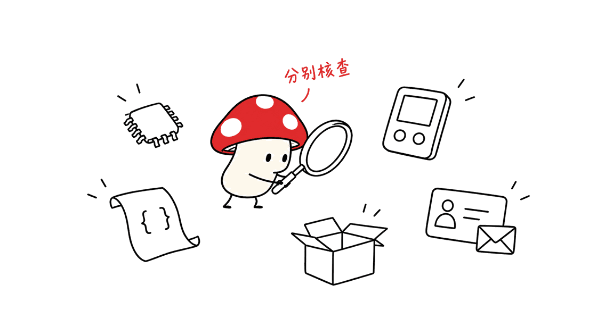
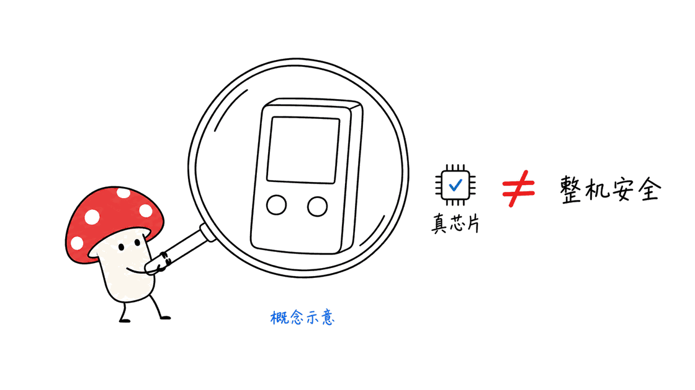
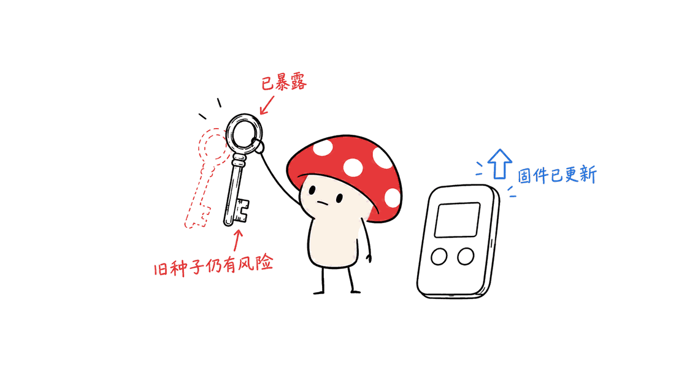

硬件钱包能隔离一部分电脑与手机风险，但安全边界远不止一颗芯片。公开事件已经涉及客户资料、种子生成、设备固件、分销渠道和真伪认证。判断危险程度，需要先知道攻击者得到了什么，以及用户应该采取哪种处置。

封面采用 Trezor Safe 7 官方产品图；正文分别核查七个品牌的不同事件。

这是一篇截至 **2026 年 10 月 29 日**的公开资料核查与评论，依据厂商公告、安全研究和新闻交叉比对；没有进行设备拆解、攻击复现或独立资金损失审计。厂商声称“未发现利用”与研究者演示“可以攻击”，均按原来的证据范围理解。

## 图片里有哪些品牌，哪些地方对不上？

用户提供的“2026 年硬件钱包安全事件汇总”出现了 Ledger、Trezor、COLDCARD、Tangem、BitBox、SafePal、Keystone。CryptoBilis 是经销商，CoinTracking 是资产跟踪与税务服务，不能一起计为硬件钱包厂商。

图片至少有四个需要纠正的问题：

- **产品归属错误**：Safe 7 是 Trezor 产品，图片却把相关芯片事件标成 SafePal。
- 时间混乱：Trezor 的 ShipMonk 公告在 8 月发布、9 月更新；Ledger 的 Global-e 客户数据事件在 1 月披露。图片的对应月份不准确。
- 未来事件：截至核查日，11 月、12 月尚未发生，不能作为已经完成的年度事件入账。
- 损失无法核账：图中明确列出的 4,300 万、1.11 亿、8,700 万美元相加为 2.41 亿美元，不能解释标题的“约 3.5 亿+”。这些金额本身也缺少统一的链上范围、估值日期和去重依据，不能重新加总后当成可靠统计。

以下按可以追溯的事件讨论，不采用图片的总损失，也不把“没有披露损失”写成“没有损失”。

## 七个品牌分别发生了什么？

### Ledger：客户数据泄露与设备植入是两回事

1 月的 Global-e 事件涉及订单与联系资料。Ledger 的电商合作方被攻破，不等于用户设备里的种子被读取；但姓名、地址及购买信息能让诈骗更有针对性。The Register 的 1 月 6 日报道引述了双方说明，受影响人数当时未公布。

来源：https://www.theregister.com/security/2026/01/06/ledger-confirms-customer-data-lifted-after-global-e-snafu/2443622

10 月的 CryptoBilis 相关事件严重得多。The Record 10 月 13 日报道：Ledger 确认调查中的设备存在未经授权的硬件植入，可在初始化时截取屏幕显示的恢复词并通过移动网络传出。原有安全芯片仍可是真的，因而通过 Genuine Check 不能证明整台设备没有加装部件。Ledger 当时没有确认总损失，报道特别提醒不要把外界估算当成定论。

来源：https://therecord.media/ledger-cryptocurrency-wallet-implant-theft

这是已披露的供应链篡改，不能凭此断言“厂商预装后门”，也不能把经销商自动判定为实施者。受影响渠道的未初始化设备应先停止设置，已使用设备则应独立进入官方支持渠道核对处置，避免通过陌生邮件“修复”。

官方更新入口：https://support.ledger.com/article/Ledger-s-Response-to-the-Hardware-Implant-Attack

### COLDCARD：坏种子不会因为升级变好

Coinkite 的现行安全页承认：部分固件生成的钱包存在熵不足问题，攻击者可以离线推导出相关密钥，已发生资金被盗。问题范围不能简单概括为“只有旧款设备”。

其公告列出的修复起点包括 Mk2/Mk3 的 4.2.0、Mk4/Mk5 标准版的 5.6.0，以及 Q 标准版的 1.5.0Q；另有 Edge 分支条件。版本这里只用于定位该事件，安装时应查当前官方指引。

最重要的处置区别是：**升级只能修复后续生成过程，不能补回旧种子缺失的随机性。** 是否需要迁移、是否符合独立骰子熵等例外，必须逐项对照公告。公开页面仍称完整事后报告在准备中，不应拿传播中的人数或金额替代完整受害者核算。

来源与迁移说明：https://coldcard.com/security/status

### Trezor：芯片漏洞与订单外泄分开看

6 月披露的是 Safe 7 使用的 TROPIC01 芯片问题。Trezor 表示，Ledger Donjon 的故障注入研究触及芯片保护机制，但这不等于已经取出整个钱包的种子；Safe 7 还有其他硬件层。结论应写成“存在芯片级漏洞，厂商称完整设备防护仍在”，不能写成“SafePal 被破解”，也不能据厂商声明证明绝对安全。

来源：https://trezor.io/blog/news/Trezor-response-TROPIC01-chip-disclosure-no-impact-to-your-funds

ShipMonk 则是另一条攻击面。Trezor 8 月 13 日公告、9 月 4 日更新后列出的受影响人数为 80,689，包含历史美国订单，泄露的是联系及配送资料。曾承诺删除的历史记录仍被发现，是数据生命周期治理问题，不是芯片漏洞。

来源：https://trezor.io/blog/news/recent-customer-data-exposed-in-shipping-provider-incident

### Tangem：实体攻击不能只写成“部分数据读取”

Ledger Donjon 7 月 9 日公开的研究演示了针对 Tangem 卡片的激光故障注入，可绕过密码保护并获得使用卡片的能力。攻击要求拿到实体卡片和专门实验条件，不是隔空攻击；但对卡片丢失、被盗或遭定向攻击的用户，这仍有实际意义。

研究者指出其所分析的在售卡片没有固件更新路径。Tangem 的回应强调实验成本、物理接触条件及未发现相关现实盗币。双方立场应并列：实验成功不能直接推导为普遍失窃，设备昂贵也不能证明攻击永远不值得做。Donjon 隶属竞争厂商 Ledger，引用时也应说明这一点。

研究：https://donjon.ledger.com/blog/bypassing-tangem-card-security-with-laser-attack/

厂商回应：https://tangem.com/en-GB/blog/post/lfi-response/

### BitBox：必须核对型号、版本和操作条件

BitBox 8 月 17 日的 Dixence 更新说明中，不同问题有不同范围：较早的引导程序问题、恶意主机针对尚未初始化的多币版设备的问题，以及 Silent Payments 的资金锁定风险，不能合并成“所有设备都泄露私钥”。部分路径不影响 Nova，另一些涉及 Nova；Bitcoin-only 版也有不同边界。

9.26.5 是该批修复对应的版本，不代表今天的最新版。厂商明确说明既有种子不受这些问题影响，并称未收到被利用报告。因此，这里的升级建议不能照抄成 COLDCARD 式的旧种子迁移建议。

来源：https://blog.bitbox.swiss/en/bitbox-08-2026-dixence-update/

### SafePal：订单查询插件不是钱包浏览器扩展

SafePal 8 月公告确认，订单追踪组件的授权缺陷暴露 39,798 名客户的订单及联系信息，涉及 2025 年 3 月至 2026 年 4 月的购买记录。公告称不包括恢复词、私钥和钱包密码。

把这里的 order-tracking plug-in 翻译成“钱包浏览器插件被攻破”，会改变事件性质。客户资料泄露仍然危险，但不能据此声称硬件签名隔离已被绕过。

来源：https://safepal.com/es/blog/security-update

### Keystone：认证密钥泄露，不能只归类为邮箱事件

Keystone 10 月 26 日声明称，10 月 20 日发现官网异常，25,964 条仍含个人资料的买家记录暴露，另涉及未付款结账记录，后者不能直接累加成独立受害人数。

更关键的是 WebAuth 设备真伪认证密钥泄露。它不是用户的种子或交易签名私钥，却可能让假设备通过相关真伪检查。厂商要求对 10 月 20 日以后收到的旧认证密钥设备进一步核对，并宣布处理旧密钥库存；这些是公司声明和处置计划，不能写成已经独立验证完成。

来源：https://x.com/KeystoneWallet/status/2114719318722404578

## 邮件看起来是真的，为什么仍然可能是钓鱼？

9 月 Brevo 事件同时涉及 Trezor、BitBox 和 CoinTracking。Trezor 公告列出 347,149 个被导出的订阅邮箱；这是邮箱名单数量，不能当成被盗钱包数量。

Brevo 的事后说明解释了关键原因：攻击者利用 SAML SSO 处理缺陷进入客户账户，部分钓鱼邮件通过合法基础设施发送，因此可以通过通常的邮件认证检查。检查发件人和邮件认证有用，却不能证明邮件内容值得执行。

来源：https://trezor.io/blog/news/security-incident-at-brevo-our-third-party-email-provider

事件复盘：https://status.brevo.com/incidents/01M266V1CZKJQNGZRNEGFD5CQE/write-up

没有进入芯片的攻击，同样可能通过“紧急安全升级”诱导用户交出恢复词。客户资料与资产密钥是不同数据，但前者可能成为接近后者的工具。

## “后门”应该怎么判定？

漏洞、加装的窃密部件和公开的恢复功能，不能统称为厂商后门。指控蓄意隐蔽访问，需要可核验的代码、硬件或实施证据；本次资料核查不足以证明上述七家厂商都故意保留盗取用户资金的后门。

Ledger Recover 是有必要讨论的信任取舍。按官方说明，它是可选服务，需要用户在设备上同意，将加密恢复材料分片交给服务商，恢复时再经身份验证。它增加了对固件、服务商和恢复政策的依赖，值得审视；但公开可选的信任机制，不等同于已经证实的秘密植入。

说明：https://www.ledger.com/academy/what-is-ledger-recover

同样，“安全芯片没有被攻破”只回答了局部问题。窃密部件可以盯着显示路径，弱随机数可以在密钥出生时埋下风险，泄露的认证密钥可以影响验真，客服邮件则可能让用户主动放弃隔离。

## 普通持有人应该如何行动？

先确定事件是否涉及自己的型号、固件、购买渠道、收货日期或订单范围，再按官方公告操作。不要因一张汇总图就同时更新、重置、迁移所有钱包；错误处置本身也可能丢失资产。

| 发现的问题 | 优先行动 | 容易误判的地方 |
|---|---|---|
| 联系或订单资料泄露 | 警惕定向邮件、电话与邮寄诈骗，独立打开官网核对 | “没泄露私钥”不等于没有现实危害 |
| 固件存在条件性漏洞 | 对照型号与版本安装官方修复 | 不同问题不一定需要更换种子 |
| 已有种子被证实弱或暴露 | 遵循迁移公告，在可信环境建立新的安全边界 | 把旧种子恢复到新设备并不能消除其已知风险 |
| 设备渠道或真伪存疑 | 暂停初始化，联系官方支持，保留凭证和证据 | 验真通过并非完整物理无篡改证明 |

实际操作时，不把恢复词提交给邮件链接、网页表单或陌生“客服修复程序”。发生可疑事件后，先核对官方的具体设备恢复流程；不要随意拆机、寄回陌生地址或销毁可能需要调查的证据。

高价值资产还需要考虑备份恢复演练、交易核对和不同失效域的分散。多签可以降低单个密钥失陷的影响，但只有在签名者、备份和恢复流程确实独立且能够正确操作时才有帮助；同一台感染的电脑、同一套被复制的备份，不会因为买了几只钱包就自动独立。

## 如何评价一个品牌，而不是数它上过几次新闻？

可以追问五件事：是否清楚公布受影响范围，能否独立验证修复，是否承认既有密钥风险，客户资料是否真正按期删除，以及更新、验真与恢复机制把信任交给了谁。

披露次数并不等于失窃概率。销量、设备年代、研究投入和披露透明度都可能改变新闻数量。本次核查没有足够的分母、统一损失核算或独立硬件测试，不能给七个品牌排“最安全榜”。

更有用的判断是看厂商能否把安全承诺变成可检查的边界。硬件钱包依然能承担密钥隔离的价值，但整套自托管流程还包括购买、初始化、签名、备份、恢复与售后。任何一环的失败，都值得与芯片规格同样认真地评估。

### FAQ：图片可以作为选购黑名单吗？

不能直接使用。它有品牌、日期和统计口径问题，可以作为检索线索，不能替代事件证据。

相关的密码学迁移讨论可参阅本站文章：https://blog.mushroom.cv/blog/ethereum-post-quantum-roadmap-poseidon-exit-hash-friendly-snark/

### FAQ：开源、离线和安全认证能保证安全吗？

这些都是可以评估的属性。源码是否对应安装的二进制、认证覆盖什么范围、离线设备如何接收交易，以及用户是否能辨认签名内容，仍要分别验证。没有一个标签能覆盖整套流程。

> © 2026 Author: Mycelium Protocol. 本文采用 [CC BY 4.0](https://creativecommons.org/licenses/by/4.0/deed.zh) 授权——欢迎转载和引用，须注明作者姓名及原文链接，不得去除署名后以原创发布。

<!--EN-->

Hardware wallets can isolate keys from some computer and phone threats. That protection depends on more than a secure chip: seed generation, firmware, distribution, authenticity checks and customer information all matter.

The cover uses official Trezor Safe 7 product imagery; the review covers seven brands.

This documentary review is current to **October 29, 2026**. It compares vendor disclosures, security research and reporting. No devices were physically tested, and no independent loss audit was performed. A vendor reporting no known exploitation is not proof that exploitation never occurred.

## What does the supplied infographic get wrong?

The image names Ledger, Trezor, COLDCARD, Tangem, BitBox, SafePal and Keystone. CryptoBilis is a reseller; CoinTracking provides portfolio and tax services.

Safe 7 belongs to Trezor, not SafePal. The ShipMonk disclosure dates to August with a September update, while the Global-e disclosure dates to January. November and December rows cannot be completed incidents as of this review date.

Its explicit loss figures—$43 million, $111 million and $87 million—sum to $241 million, which does not reconcile the headline's $350 million-plus claim. The individual amounts also lack consistent attribution, valuation dates and deduplication. This article adopts neither total. Unreported losses are not established zero losses.

## What happened across the seven brands?

### Ledger: order data and physical implants

January's Global-e incident concerned customer order and contact information. That supports targeted scams without establishing access to wallet seeds.

Reporting: https://www.theregister.com/security/2026/01/06/ledger-confirms-customer-data-lifted-after-global-e-snafu/2443622

October's CryptoBilis-linked incident involved physical implants. The Record reported that Ledger confirmed unauthorized components intercepting recovery words during setup and transmitting them over mobile networks. A genuine secure chip can remain intact inside a modified device, limiting what Genuine Check establishes. Ledger had not confirmed aggregate losses in that report.

This establishes supply-chain tampering, not manufacturer intent or reseller culpability. Affected-channel users should consult official guidance independently before initializing devices or responding to messages.

Reporting: https://therecord.media/ledger-cryptocurrency-wallet-implant-theft

Official updates: https://support.ledger.com/article/Ledger-s-Response-to-the-Hardware-Implant-Attack

### COLDCARD: updating does not repair an existing weak seed

Coinkite acknowledges deficient seed entropy in affected firmware and actual theft through offline key reconstruction. The scope is broader than a blanket claim about old models alone.

Its advisory identifies fixed release thresholds for different models and branches. Crucially, patching generation cannot restore missing entropy to an existing seed. Users must follow its migration guidance and exact exceptions, rather than assume an update resolves their exposure. The living advisory is not a complete victim or loss ledger.

Source: https://coldcard.com/security/status

### Trezor: distinguish the chip finding from customer records

Trezor's June response describes a TROPIC01 finding and argues that Safe 7's additional hardware layers prevent the demonstrated chip issue from becoming a full seed compromise. That is a bounded vendor response, not independent certification that the complete device is invulnerable. The product is not SafePal's.

Source: https://trezor.io/blog/news/Trezor-response-TROPIC01-chip-disclosure-no-impact-to-your-funds

Its separate ShipMonk notice, updated September 4, puts affected customers at 80,689. Contact and shipping records included historical orders. The survival of records expected to have been deleted exposes a data-retention failure, not a broken signing chip.

Source: https://trezor.io/blog/news/recent-customer-data-exposed-in-shipping-provider-incident

### Tangem: a physical laboratory attack still matters

Ledger Donjon's July research demonstrated laser fault injection bypassing card password protection. It requires physical possession and specialized conditions. That restricts exposure, but remains relevant to lost or stolen cards and targeted attackers.

The researchers identify the absence of firmware updates for analyzed cards. Tangem emphasizes practical barriers and reports no known related theft. Neither a laboratory demonstration nor an expensive setup establishes the frequency of real-world exploitation. Donjon is operated by competitor Ledger; that affiliation should remain visible.

Research: https://donjon.ledger.com/blog/bypassing-tangem-card-security-with-laser-attack/

Response: https://tangem.com/en-GB/blog/post/lfi-response/

### BitBox: models and prerequisites change the advice

The August Dixence notice separates bootloader, uninitialized multi-edition device and Silent Payments issues. Their affected models and consequences differ; they cannot be summarized as universal private-key extraction. Bitcoin-only and Nova applicability depends on the specific path.

Firmware 9.26.5 addresses that batch of issues, rather than being asserted here as today's latest release. The vendor states that existing seeds are unaffected and reports no known exploitation. Its response is therefore different from the COLDCARD seed incident.

Source: https://blog.bitbox.swiss/en/bitbox-08-2026-dixence-update/

### SafePal: an order component is not a wallet extension

SafePal disclosed an authorization flaw in its order-tracking component exposing 39,798 customers' contact and purchase records. Its notice excludes recovery phrases, private keys and wallet passwords. Translating that component into a compromised wallet browser extension changes the claim. Personal information remains consequential without demonstrating a signing failure.

Source: https://safepal.com/es/blog/security-update

### Keystone: authenticity keys are a separate security boundary

The October 26 statement identifies 25,964 buyer records retaining personal information, plus unpaid checkout records that should not simply be counted as additional unique people.

It also discloses a leaked WebAuth device-authentication key. This is distinct from users' seed and signing keys, but can undermine the relevant authenticity check. The company calls for additional verification of old-key devices received after October 20 and announces inventory measures. These are disclosed actions and plans, not independently verified completion.

Source: https://x.com/KeystoneWallet/status/2114719318722404578

## Why can an authentic-looking email still be malicious?

September's Brevo incident involved Trezor, BitBox and CoinTracking. Trezor reports 347,149 exported subscriber email addresses, not that many compromised wallets.

Brevo's postmortem describes an SAML SSO flaw and phishing sent through legitimate infrastructure. Normal email authentication could therefore pass. Sender checks help but cannot make the requested action trustworthy. Customer information can become a route toward convincing someone to surrender a secret that the chip protected successfully.

Sources: https://trezor.io/blog/news/security-incident-at-brevo-our-third-party-email-provider

https://status.brevo.com/incidents/01M266V1CZKJQNGZRNEGFD5CQE/write-up

## Does this establish deliberate backdoors?

A vulnerability, an unauthorized implant and a disclosed recovery service are different findings. Intentional covert access requires attributable evidence; this review does not establish that all seven manufacturers deliberately retained theft capabilities.

Ledger Recover illustrates a real trust trade-off. Official documentation describes an optional, device-approved encrypted backup-fragment service with identity-based recovery. It adds dependencies on firmware, providers and recovery policy. That deserves scrutiny without presenting the service as proof of a secret implant.

Documentation: https://www.ledger.com/academy/what-is-ledger-recover

Chip security cannot by itself establish sound entropy, untouched display paths, trustworthy authenticity credentials or honest support messages.

## What should holders do?

Match the advisory to the exact device, firmware, purchase channel and relevant dates before acting. A frightening infographic is insufficient reason to reset or migrate every wallet.

| Exposure | Priority | Important distinction |
|---|---|---|
| Contact or order data | Independently verify messages; expect targeted scams | No seed breach does not mean no harm |
| Conditional firmware flaw | Install the applicable official fix | Seed replacement is not always required |
| Demonstrably weak or exposed seed | Follow the incident-specific migration guidance | Restoring the same seed to new hardware preserves its exposure |
| Suspect device or channel | Pause initialization; retain evidence and contact official support | Authenticity checks have bounded coverage |

Do not submit recovery phrases to unsolicited forms, email links or supposed repair utilities. Check the vendor's exact recovery instructions independently. Avoid casually opening devices, returning them to addresses in messages or destroying evidence.

For high-value holdings, recovery rehearsals and genuinely independent failure domains matter. Multisignature can limit a single-key compromise, but requires separately controlled signers, backups and an operable recovery process. Several devices do not create independence when they share the same compromised host or copied backup.

## How should a brand be evaluated?

Ask whether affected scope is clearly disclosed, fixes can be checked, existing-key exposure is acknowledged, customer information is actually deleted, and recovery and authenticity mechanisms expose their trust assumptions.

Headline counts do not establish failure rates. Sales, device age, research intensity and transparency affect the number of disclosures. Without comparable denominators, independently reconciled losses and hardware tests, this review cannot rank the seven brands by safety.

Hardware wallets retain value as key-isolation tools. Evaluating that value requires checking purchase, setup, signing, backup, recovery and support alongside the chip specification.

### FAQ: Can the infographic serve as a purchasing blacklist?

It is a set of research leads, with material naming, dating and accounting problems. It is not sufficient evidence for a blacklist.

Related cryptographic migration discussion: https://blog.mushroom.cv/blog/ethereum-post-quantum-roadmap-poseidon-exit-hash-friendly-snark/

### FAQ: Do open source, offline operation or certifications guarantee safety?

Each describes a property with a scope. Binary correspondence, certification coverage, transaction import and clear signing still require verification. No single label covers the full custody process.

> © 2026 Author: Mycelium Protocol. Licensed under [CC BY 4.0](https://creativecommons.org/licenses/by/4.0/) — free to share and adapt with attribution. You must credit the author and link to the original; removing attribution and republishing as original is not permitted.
