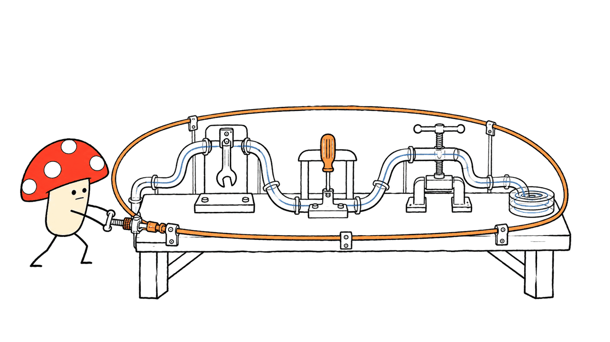
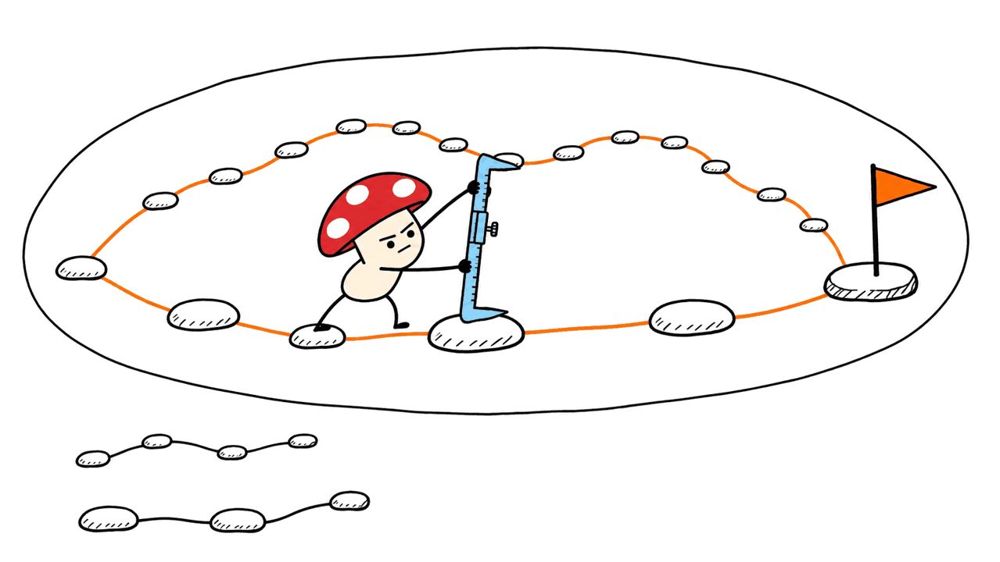
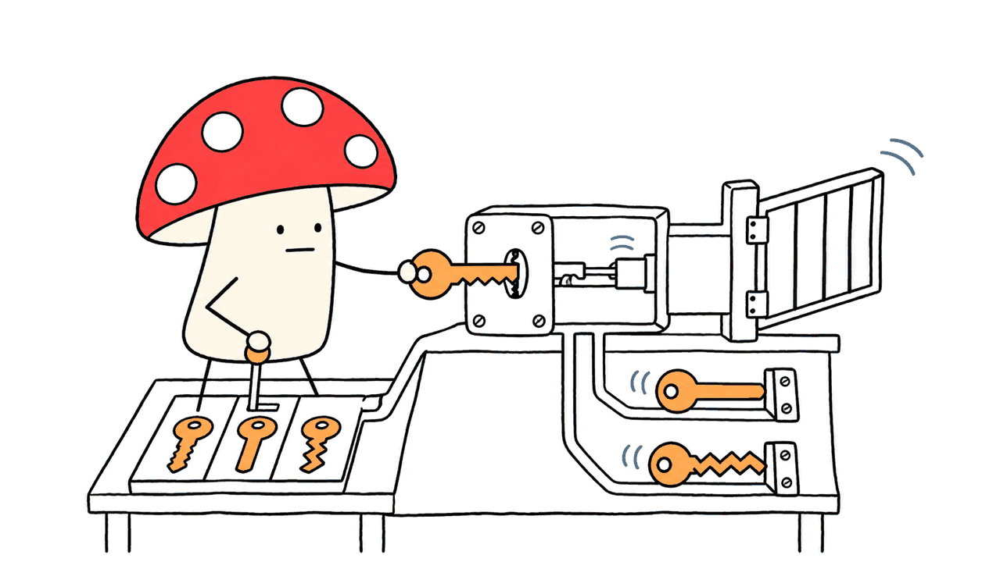

Harness adapters把强化学习搬进实际使用的Agent运行时，让模型学习在熟悉的工具和上下文规则里完成任务。它最有价值的信号，是模型与运行时的配合可以训练；但效率提升、迁移和安全性都有明确的适用范围。

Hugging Face于2026年11月20日介绍了这组实验：冻结Qwen3.8-27B，分别在Pi、OpenCode和Hermes Agent中训练LoRA，并发布适配器、任务和工具治理插件。本文核对官方正文与固定版本模型卡，没有复现27B模型训练或GPU评测。

官方原文：https://huggingface.co/blog/harness-adapters-at-scale

发布集合：https://huggingface.co/collections/harness-hub/qwen38-27b-harness-adapters

## 为什么要在真实harness里训练？

harness是包住模型的执行系统：它组织提示、提供工具、处理结果、保留或压缩上下文，并决定什么时候停止。相同模型进入不同harness，实际上会面对不同的工作条件。

传统训练框架可能重写一个简化版agent loop。这里保留发布版harness，用代理记录它与vLLM之间实际往来的token，再交给TRL的`AsyncGRPOTrainer`训练；任务环境和评分由OpenEnv与Harbor承接。

关键是轨迹忠实度。若训练端重建提示时改变了模板、工具返回或截断方式，优化的策略可能和部署时执行的策略不同。记录真实token有助于减少这类错位，但并不自动证明整个训练系统没有偏差。

原文列出的运行时版本为Pi 1.5.2、OpenCode 2.2.7和Hermes Agent v0.22.6。版本、上下文保留策略和工具协议，都应随模型适配器一起进入实验记录。

## 成功率升了多少，分母是什么？

官方在SWE-bench Pro最难的51题和Terminal-Bench 2.1的89题上评估，每题一次尝试、温度0.8，最多100个agent步骤，token预算为131,072。SWE任务时限两小时，Terminal任务一小时。

| 专用适配器，在各自harness中、关闭thinking | SWE-bench Pro hard 51基座 | 适配后 |
| --- | ---: | ---: |
| Pi | 39.2% | 64.7% |
| Hermes Agent | 29.4% | 43.1% |
| OpenCode | 35.3% | 51.0% |

Pi这一行对应约20题到33题，净增13题。原文的配对分析是15题新解出、2题原先能解而适配后失败。它说明提升包含得失，不能写成“所有任务都变好了”。

不同harness也不能按表格横向排名：Pi不保留之前轮次的推理文本，另外两者保留，长轨迹可能因此更早填满上下文。应在同一个harness、同样预算下比较基座与适配器。

原文合并适配器的对照表还会出现Pi 40.0%到64.0%。那张表使用各次运行都成功评分的共同任务集，SWE分母为50—51题，与上面专用适配器完整评测的分母不同，不应混成一次结果。

## 工具调用减少，不等于总成本下降同样比例

专用适配器在SWE-bench Pro上少用56%—72%的工具调用，在Terminal-Bench上少用53%—70%。这些降幅的比较对象，是基座和适配器双方都解出的任务。

这个条件有用：它避免把“提前失败、不再干活”误算成效率提升。但它也限定了结论，不能直接推出全部请求的平均成本、尾延迟或总账单下降相同比例。

训练奖励由验收器正确性和较小的工具效率奖励组成，后者系数为0.1。落地时要一起看完成率、失败轨迹、token、工具开销和时间；不能只奖励短轨迹，否则模型可能学到少做事，而不是更有效地做成事。

## 真正值得借鉴的，是先验证训练任务

RL依赖验收器给奖励。如果错误答案也能拿高分，模型就会朝错误目标优化。

官方任务筛选不只检查参考解能通过，还检查不做事时分数更低、已知错误的canary解不能超过空操作，以及参考解回放是否稳定。它还排除了目标评测题和来自目标评测仓库的训练候选，减少污染风险。

难度筛选同样重要。对于同题多次尝试的GRPO，如果基座每次全对或全错，组内奖励缺少区分。文中442个已评分任务里，有171个处在“有时能解、有时不能解”的区间。

不要把中间数据集与最终训练混合物混为一谈：文中发布的任务数据视图有871项，而最终训练段落说明采用750项RL环境任务加300项Termgrade任务。这些是不同处理阶段和来源口径。

对企业工程师而言，第一笔投入更适合用在真实任务、可重放环境和错误答案对照，而不是立即搭大规模训练集群。验收器是否能区分“真的修好”和“绕过测试”，往往比训练器名称更影响结果。

## 三个LoRA合并，为什么不是直接取平均？

三个专用LoRA的rank各为32。作者用PEFT的`combination_type="cat"`沿rank维拼接，得到rank 96的super adapter；最终每个权重更新乘0.5，相当于半强度地相加三份更新。

沿rank维拼接不同于把三份LoRA的A、B矩阵分别平均后相乘。后者会引入额外的交叉项，不能自动得到所需的权重增量之和。

合并实验比较了三分之一、二分之一和完整相加。完整相加使轨迹很短，却会损失某些组合的准确率；二分之一在作者使用的验证设置里取得更好的平衡。这不是所有模型都应固定采用的系数。

还要注意选择偏差：合并权重在Terminal-Bench 2.1的step-120适配器上选择，所以作者承认该基准结果可能稍乐观。关闭thinking时，单harness通常更适合自己的专用适配器；开启thinking时，super adapter在六个harness—benchmark组合中五个胜过基座、一个持平。

模型卡与固定版本：https://huggingface.co/harness-hub/Qwen3.8-27B-super-adapter/tree/3358a71529ce56aba0095addd6a60a66d7c4228b

## 迁移出了编码场景，收益还在吗？

作者在300项AutomationBench业务自动化任务上，换用该基准自己的agent loop。基座pass@1为23.0%，Pi适配器27.0%，OpenCode 25.3%，super adapter 23.7%，Hermes 17.7%。

作者认为差异总体处于噪声范围，但对Hermes的下降保留例外。因此更稳妥的表述是：没有看到明确的跨场景普遍收益，不能声称所有适配器都无损迁移。

这项实验同时改变了任务分布和agent loop，不能把结果单独归因于“离开原harness”。要拆清原因，需要固定任务只换loop、固定loop只换任务，分别进行对照。这是本文提出的进一步实验设计，不是已经跑出的结果。

## thinking关闭，为什么仍出现推理文本？

作者观察到，模型会在工具调用前生成类似“等等”“让我看看”的短文本，称为reasoning leakage。这里指推理式表达出现在非thinking模式的输出里，并非报告用户隐私泄露。

它提醒我们：关闭模板中的thinking开关，不一定等于模型不再生成推理式内容。固定token预算下的评测成绩仍然有效，但生产端必须实际统计这些文本，检查延迟、日志可见范围和工具前置输出格式。

## safeagents拦截647次，能证明更安全吗？

三个训练运行中，safeagents检查约130万次工具调用，拦截647次。约0.05%的拦截比例，只能描述当时规则命中的频率，不能解释为其余99.95%都安全，更不是检测召回率。

官方插件是针对Harbor任务的规则包，保留内置检查，同时放行两类曾误拦的正常工作。插件会作为代码在safeagents进程中执行，因此不仅模型，治理插件本身也应固定版本并经过审查。

本文核对了固定版本插件，提取其原样正则常量做8项CPU字符串检查，覆盖任务交付路径、隐藏验收路径和调试异常钩子的区分，全部通过。这没有运行safeagents服务、组合检测器或Allowance规则，也没有执行真实工具调用，不能作为端到端安全验证。

安全插件：https://huggingface.co/harness-hub/qwen-safeagents-plugin/tree/d39145c491b854d104272bd4bac501be7f01deea

## 怎样把这套思路带进自己的系统？

Mycelium Protocol的判断是，应先把任务、验收器、真实轨迹和发布准入串起来，再决定训练规模。

先挑一个损失可控的任务族，固定harness与工具版本；用参考解、空操作和错误解检验评分，再筛选有学习空间的任务。训练后同时观察成功率、退化案例、双方成功时的效率，以及全体请求的失败成本。

工具治理必须在训练与部署中持续存在。更低的规则命中率，不能取代权限隔离、可审计记录和对未见任务的评估；训练时引入治理，也不意味着模型本身获得了不可绕过的安全属性。

官方每个适配器训练使用两张B200，一张提供vLLM服务，一张训练。冻结基座与LoRA减少了更新参数量，但不等于27B训练可以低成本搬到普通电脑。先复用数据验证与评估方法，通常比直接复刻硬件更现实。

## 常见问题

### 这是一个完整的新Agent框架吗？

不是。它是一套在既有harness中训练模型适配器的配方，依赖TRL、OpenEnv、Harbor及相关运行时。

### super adapter总比专用适配器强吗？

不是。关闭thinking、只用单个harness时，官方更推荐相应专用适配器；合并方案的优势取决于运行设置。

### 本文复现了训练和安全结果吗？

没有。成功率、效率和拦截总数来自官方实验；本地只核对资料、算术及8项正则常量行为，不包含权重加载或RL运行。

## 来源与核验范围

原文：https://huggingface.co/blog/harness-adapters-at-scale

模型集合：https://huggingface.co/collections/harness-hub/qwen38-27b-harness-adapters

TRL与OpenEnv接入：https://huggingface.co/docs/trl/openenv

环境生成代码：https://github.com/huggingface/Repo2RLEnv

工具治理代码：https://github.com/huggingface/safeagents

适配器与插件模型卡均标注Apache-2.0；基座、任务数据、环境依赖和各harness仍需分别核对对应条款。

---

> © 2026 Author: Mycelium Protocol. 本文采用 [CC BY 4.0](https://creativecommons.org/licenses/by/4.0/deed.zh) 授权——欢迎转载和引用，须注明作者姓名及原文链接，不得去除署名后以原创发布。

<!--EN-->

Harness adapters train a model inside the agent runtime used for deployment. The experiment suggests that model–harness coordination can improve with reinforcement learning, while efficiency, transfer and governance results remain conditional on the evaluation setup.

Hugging Face's November 20, 2026 release freezes Qwen3.8-27B and trains separate LoRA adapters inside Pi, OpenCode and Hermes Agent. We reviewed the official article and pinned artifact cards. We did not reproduce 27B training or GPU benchmarks.

Source: https://huggingface.co/blog/harness-adapters-at-scale

## Why keep the real harness in training?

A harness defines tools, prompts, context handling and stopping behavior. Reimplementing its loop inside a training framework can change the policy's actual inputs.

Here a proxy records the real token exchanges between the shipped harness and vLLM. TRL's AsyncGRPOTrainer consumes those trajectories, with OpenEnv and Harbor providing the task environment and grading stack. This reduces one source of training–deployment mismatch; it does not prove every component is bias-free.

The reported versions are Pi 1.5.2, OpenCode 2.2.7 and Hermes Agent v0.22.6. Runtime versions and context policies belong in experiment records alongside adapter weights.

## What improved, and on which denominator?

The specialist evaluations use 51 hard SWE-bench Pro tasks and all 89 Terminal-Bench 2.1 tasks, one attempt per task at temperature 0.8, a 100-step cap and a 131,072-token budget. SWE tasks have two hours; Terminal tasks have one hour.

| Specialist in its own harness, thinking off | SWE base | Adapted |
| --- | ---: | ---: |
| Pi | 39.2% | 64.7% |
| Hermes Agent | 29.4% | 43.1% |
| OpenCode | 35.3% | 51.0% |

Pi's row corresponds to 20 versus 33 of 51 tasks. Paired results show 15 newly solved tasks and two lost: improvement includes regressions.

Do not rank harnesses horizontally using these figures. Their defaults differ, including retention of previous reasoning turns. Compare base and adapter under the same harness and budget.

The merge comparison reports Pi at 40.0% versus 64.0% because it uses tasks graded by every compared run: 50–51 SWE tasks. This is a different denominator from the specialist evaluation above.

## Does fewer tool calls mean proportionally lower total cost?

Specialists reduce calls by 56–72% on SWE and 53–70% on Terminal, measured on tasks both the base and adapter solve. That condition avoids rewarding early failure as efficiency, but it does not establish equivalent reductions across all requests, total bills or tail latency.

The reward combines verifier correctness with a small tool-efficiency bonus of 0.1. Production evaluation should retain failures, regressions, token usage, time and tool costs rather than optimizing trajectory length alone.

## Why validate the tasks before training?

A faulty verifier rewards faulty behavior. The pipeline checks that reference solutions earn maximum reward, doing nothing scores lower, known-wrong canaries do not outperform doing nothing, and replayed references receive stable rewards. It also excludes target benchmark tasks and repositories from training candidates.

Difficulty filtering matters for relative rewards. Among 442 scored tasks, 171 were sometimes solved by the base model. Always-pass and always-fail groups provide little reward discrimination.

Different stages have different counts: the published task view contains 871 tasks, while the final training mixture is described as 750 RL-environment tasks plus 300 Termgrade tasks. They should not be presented as the same population.

An engineering team can adopt these verification and replay principles before committing to large training infrastructure.

## Why is the super adapter not a simple average?

The three rank-32 adapters are concatenated along the rank dimension using PEFT's `cat`, producing rank 96. Each update receives weight 0.5. Averaging A and B factors separately would introduce cross terms and is not equivalent to summing weight updates.

The authors compared one-third, one-half and full-sum weights. Full strength shortened trajectories but hurt some accuracy results; one-half offered the best tested balance. This is not a universal coefficient.

Weight selection used Terminal-Bench 2.1 with step-120 adapters, so the authors acknowledge some optimism on that benchmark. With thinking off in one harness, the corresponding specialist is generally preferable. With thinking on, the super adapter beats the thinking base on five of six harness–benchmark pairs and ties the sixth.

Pinned card: https://huggingface.co/harness-hub/Qwen3.8-27B-super-adapter/tree/3358a71529ce56aba0095addd6a60a66d7c4228b

## Does the gain generalize beyond coding?

On 300 AutomationBench tasks using its own loop, pass@1 is 23.0% for the base, 27.0% for Pi, 25.3% for OpenCode, 23.7% for the merged adapter and 17.7% for Hermes. The authors describe most differences as noise, with a possible exception for Hermes.

This does not establish broad transfer. It changes both task distribution and runtime, so their individual effects remain confounded. Holding tasks fixed while changing the loop, and vice versa, would be a useful additional experiment; we did not run it.

## What does reasoning leakage mean here?

The authors observed short reasoning-like text before tool calls despite thinking being disabled. This concerns output behavior, not a report of user-data leakage.

The fixed-budget evaluation remains meaningful, but a template switch is insufficient evidence that such text disappears. Count it in tokens and latency, and inspect its visibility in logs and tool-facing output.

## What do 647 blocked calls prove?

Safeagents checked approximately 1.3 million calls and blocked 647. Roughly 0.05% is a rule-hit fraction, not a safety success rate or detector recall.

The Harbor plugin retains built-in checks while excusing two observed classes of legitimate work. It executes as code inside the safeagents process, making the plugin version itself a governance dependency.

We extracted the pinned plugin's unmodified regex constants and ran eight CPU string checks concerning deliverable paths, hidden grading paths and exception-hook behavior. They passed. This does not execute safeagents, detector composition, Allowance rules or real tool calls, and is not an end-to-end security assessment.

Plugin: https://huggingface.co/harness-hub/qwen-safeagents-plugin/tree/d39145c491b854d104272bd4bac501be7f01deea

## How should engineers apply the findings?

Mycelium Protocol's recommendation is to connect tasks, verifiers, faithful trajectories and release criteria before scaling training. Start with a bounded task family, pin the harness and tools, validate reference and negative controls, and evaluate success, regressions, jointly-solved efficiency and all-request failure costs separately.

Keep tool governance in both training and deployment. Fewer detected violations do not replace permissions, isolation, audit trails or evaluation on unseen tasks.

Each specialist training run used two B200 GPUs, one for vLLM and one for training. Freezing base weights reduces trainable parameters, but does not make 27B RL a proven consumer-computer workflow. The evaluation discipline is more accessible than the full hardware setup.

## FAQ

### Is this a complete new agent framework?

No. It is a training recipe that connects existing harnesses with TRL, OpenEnv and Harbor.

### Is the super adapter always better?

No. The publisher recommends specialists for single-harness, thinking-off use. Merge benefits depend on settings.

### Did we reproduce model and security results?

No. Reported success, efficiency and interception counts are publisher results. Our checks cover source review, arithmetic and eight regex-constant cases without model weights or RL.

## Sources and scope

Release: https://huggingface.co/blog/harness-adapters-at-scale

Collection: https://huggingface.co/collections/harness-hub/qwen38-27b-harness-adapters

Integration guide: https://huggingface.co/docs/trl/openenv

Environment generation: https://github.com/huggingface/Repo2RLEnv

Tool governance: https://github.com/huggingface/safeagents

The adapter and plugin cards declare Apache-2.0. Base models, datasets, dependencies and harnesses retain their respective terms.

---

> © 2026 Author: Mycelium Protocol. Licensed under [CC BY 4.0](https://creativecommons.org/licenses/by/4.0/) — free to share and adapt with attribution. You must credit the author and link to the original; removing attribution and republishing as original is not permitted.
