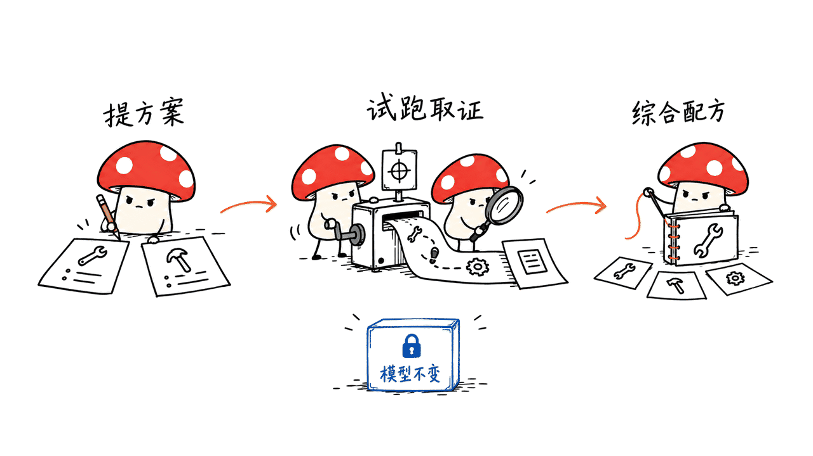
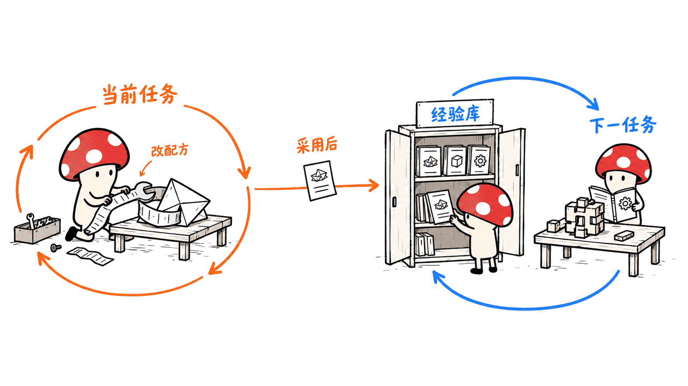
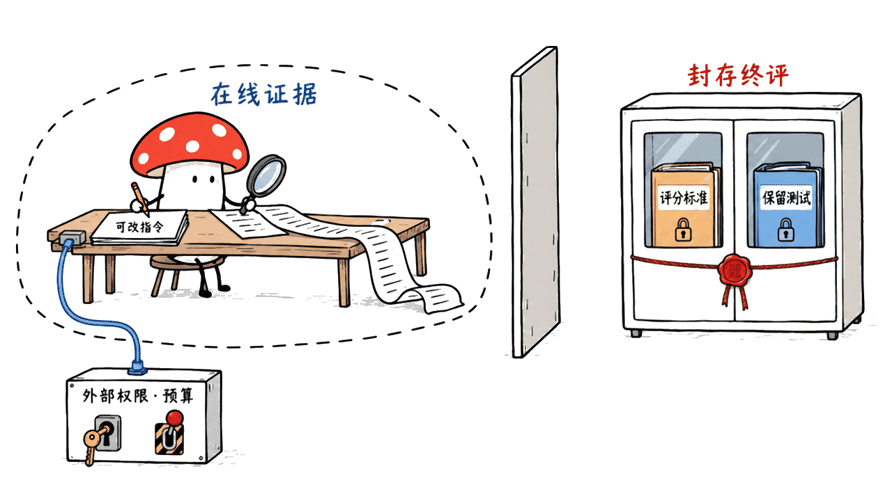

Google Research 的 Harness² 把“改进Agent的工作方法”拆成两个循环：当前任务上，提出并试跑不同的harness改动，再综合执行证据；任务结束后，把被采用的方案和有证据支持的经验写入库，帮助下一个任务。模型权重在这个过程中保持不变。

图片中的项目已对应到官方仓库 `google-research/harness2`，论文于2026年10月9日公开。它是研究代码，仓库明确说明不是Google正式支持的产品。本文基于10月18日的固定源码、论文和离线验证，不把“自我改进”解释成效果必然越来越好。

仓库：https://github.com/google-research/harness2

论文：https://arxiv.org/abs/2610.14224

## 模型不训练，究竟改什么？

Harness是围绕模型的执行系统：输入上下文如何组织、何时使用工具、工具返回什么、如何分派子任务、哪些经验供后续读取。仓库开放八类可编辑组件：system prompt、guardrails、memory、tool guidance、subagents、skills、scripts、plugins。

举一个自拟例子：同一个模型反复算错报表，问题可能是先后读取的文件不对、漏了币种检查、把工具输出截断，或者缺少一段可靠的汇总脚本。改变这些执行条件，有时比再写一段“请认真思考”更有用。这是机制示意，不是论文中的真实任务或本文的新评测。

权重不变也不意味着推理开销不变。搜索候选方案、试跑、比较、合成和反思都需要计算；真实模型实验还会调用改进编辑器。论文的默认编辑器为Claude Opus 4.8，执行器则包含GLM-5和Gemini 3.5 Flash，不能只按执行模型的一次调用估算整条流程成本。

## 第一层递归：当前任务怎么改？

作者把核心步骤称为 **Propose–Probe–Compose**。

| 步骤 | 做什么 | 能提供什么证据 |
|---|---|---|
| Propose | 提出通用与领域相关的harness改动 | 一个可检查的候选变更 |
| Probe | 在同一个任务上执行候选方案 | 产物、轨迹、失败与工具使用行为 |
| Compose | 根据不同执行的行为差异合成方案 | 由证据支撑的组合，而非只挑看起来漂亮的建议 |

“没有ground-truth verifier”指在线调整时不依赖任务标准答案作为反馈，不是说错误从此可以不用判定。它利用同题不同执行的行为对照来引导修改；如果执行证据不充分，比较本身也可能选错。

任务层有两种扩展方式。并行递归更重视广度：探索多份通用、领域候选，再从共享证据合成。顺序递归更重视深度：把当前修订和已有证据带入下一轮。`--k`是递归预算，不是模型调用次数，也不能据此断言两种模式耗时相同。



## 第二层递归：怎么让下一次改得更好？

第一层的对象是执行任务的harness；第二层的对象是指导后续改进的improvement harness。一个任务完成并采用方案后，反思阶段提取有证据支持的经验，写入按领域组织的库，供后续任务读取。

发布版按同一领域的任务顺序积累经验，任务只能读取更早的条目；不同领域可以并发。库还按基准、执行器、递归模式、预算和随机种子等隔离。这些边界很重要：换了模型、任务集合或实验条件，不应该悄悄复用不相容的历史状态。

经验库可以携带可复用工作方法，也可能把某次任务的偶然成功传播成错误规则。Mycelium Protocol 建议在自己的系统里同时记录适用条件、来源任务、失败反例、采用版本和撤回方式，而不是把所有反思直接塞进永久提示词。



## 公开成绩说明了什么？

论文评测包含三类专业任务，以及GLM-5／Gemini 3.5 Flash与OpenCode／Codex组成的四种模型—harness配置。以下是作者报告的单次改进最大增益，不是本文实测，也不是每种配置都能得到的提升。

| 基准 | 任务侧重点 | 作者报告的最大单步增益 |
|---|---|---|
| WorkBuddy-Bench | 办公、网页、代码 | 最多+11.5分；对应GLM-5／OpenCode |
| JobBench | 专业工作任务 | 最多+4.5分；对应Gemini 3.5 Flash／OpenCode |
| LAB | 法律任务 | Partial pass rate最多+11.8个百分点 |

分数和百分点不能混成同一尺度。作者报告更大的任务递归预算还能继续提升，但不能由此推出无限增加预算就能一直变好，或忽略新增执行与编辑成本。

比较对象也不是全都被全面超越：论文明确说明，在LAB的Gemini 3.5 Flash／Codex配置上，Meta-Harness的Partial结果领先。合理的结论是，这套方法在已测配置上有积极结果，仍需按任务类型、基线、预算和判分方式逐项阅读。

## 为什么独立判分和网络控制是落地关键？

在线harness改进与最终judge是不同阶段。发布版将执行、判分、报告拆成独立命令；对照基础harness还需用 `harness2-judge --bases`，普通report覆盖的是改进后的结果，不能把它当成已经包含完整基线对照的报告。

官方实验说明记录了一个具体问题：JobBench公开了任务rubric，一次发布版验证中，执行轨迹在没有被要求的情况下下载了该任务的评分标准。发布版默认不限制执行器联网，Codex执行路径还关闭了其沙箱。因此，程序“不直接把答案喂给编辑器”，并不能独立证明评测没有泄漏。

要做可信实验，需要区分准备阶段下载依赖与运行阶段允许访问的资源，在执行器外部配置适合任务的出站限制，保存实际策略，并把判分资料与执行环境隔离。自己的业务评测还应有未用于调整的保留样本。网络控制、工具权限和高影响动作审批也不应仅依赖一份可被Agent修改的提示词。

报告时还要披露任务顺序、执行器、改进模型、judge、预算、失败与未评分数量。仓库说明失败评测保留为未评分，不自动记零；只展示已评分平均值、却隐藏缺失数量，会改变读者对结果的理解。



## 怎么用零模型凭证先检查流程？

官方推荐Linux与Python 3.12；项目元数据允许Python 3.12至3.13。真实模型基准还需要Node.js 20+、模型访问与相应依赖，LAB额外涉及文档工具，WorkBuddy-Bench涉及Docker。开源代码Apache-2.0不等于云模型调用免费，各基准和第三方组件也保留自己的许可证。

先检出固定源码，再运行官方确定性demo，比直接启动整套专业基准更容易确认环境与产物：

```bash
uv venv --python 3.12 .venv
source .venv/bin/activate
uv pip install -e '.[render]'
harness2-demo --output runs/demo --k 2
```

这一步不需要模型凭证，demo使用确定性编辑器和真实Python执行。本文确实在macOS的独立Python 3.12.14环境运行了它：两个任务完成、零失败，覆盖并行和顺序模式；首次记录28次脚本执行与32次确定性编辑器调用。这些计数不是云模型调用或token账单。

再次运行相同命令，两个已完成任务都被跳过，新增脚本执行和编辑器调用均为零。5项上游回归测试也全部通过，覆盖证据完整性、预算与恢复、无效候选重试、经验库准入及失败选择不进入判分等逻辑。Mac上的离线通过不等于完整Linux基准栈已经跨平台验收。

固定源码：`1cfe254e8d25b15f37048c3730134686abe60335`。本文没有启动真实模型、连接Vertex AI、安装完整三个基准或复现论文增益。

## 接入自己的Agent，先保留哪些边界？

建议先选择一个可观察的错误类型，例如文件引用缺失或工具调用顺序错误；固定基础harness与验收样本，仅开放少量可回滚的编辑组件。每个候选都保存变更、输入、执行轨迹、产物和成本，线上选取方案与最终评测分开。

预算也应显式限定。发布版的 `--max-tasks` 是每个领域的上限，不是整个运行的总上限；先配合领域选择与 `--dry-run` 核对任务数量。更换模型或任务选择时用新的运行目录，别让恢复机制把旧成果误当成新实验。

达到单项改进目标后，先在保留任务上检查是否引入回退，再决定是否写入长期经验库。Harness²提供的是可组织这类搜索与证据的研究框架，而不是无需监督、无需评价标准的自我进化开关。

## 常见问题

### Harness²会更新模型权重吗？

这套框架保持执行模型权重不变，改进的是模型周围的执行系统；它不是一次在线微调或强化学习训练。

### 无需真值反馈，为什么还要judge？

前者描述在线选择改动的反馈来源，后者用于最终评测。行为对照与独立结果评价解决的是不同问题。

### 离线demo通过，能证明论文提升吗？

不能。它验证确定性示例的流程与恢复机制，真实模型、完整基准、成本和公开成绩都需要另外复现。

## 一手资料

仓库：https://github.com/google-research/harness2

固定源码：https://github.com/google-research/harness2/tree/1cfe254e8d25b15f37048c3730134686abe60335

论文：https://arxiv.org/abs/2610.14224

项目页：https://harness2.github.io/

实验说明：https://github.com/google-research/harness2/blob/1cfe254e8d25b15f37048c3730134686abe60335/docs/EXPERIMENTS.md

相关Agent训练框架：https://blog.mushroom.cv/blog/harborrl-agentic-rl-pipeline/

封面为本地生成的“固定核心、替换外围工具”概念场景；正文小M图为示意，并非论文评测图。

---

> © 2026 Author: Mycelium Protocol. 本文采用 [CC BY 4.0](https://creativecommons.org/licenses/by/4.0/deed.zh) 授权——欢迎转载和引用，须注明作者姓名及原文链接，不得去除署名后以原创发布。

<!--EN-->

Google Research's Harness² keeps model weights fixed while improving the system around an agent. One loop revises the harness for the current task; another retains adopted harnesses and evidence-supported lessons to improve future revisions. The proposal is a structured research workflow, not a guarantee of perpetual improvement.

The supplied image matches `google-research/harness2` and the October 9, 2026 paper. This review captures the October 18 source release. The repository explicitly says it is not an officially supported Google product.

## What changes when weights stay fixed?

The eight editable components are system prompt, guardrails, memory, tool guidance, subagents, skills, scripts and plugins. They affect context, tool interfaces, delegation and behavior inside the tool loop.

A report-generation failure might originate in file selection, missing currency checks or an unreliable aggregation script. Revising those conditions can help a frozen model; this is our illustration, not a new benchmark result.

Fixed weights do not imply fixed inference cost. Candidate creation, probing, composition and reflection require work. The paper uses Claude Opus 4.8 as its default improvement editor, alongside GLM-5 and Gemini 3.5 Flash executors. Counting only one executor call omits part of the system.

## How does task-level recursion work?

Propose–Probe–Compose proposes general and domain-specific edits, executes candidates on the same task, and composes a harness from behavioral contrasts. The evidence includes artifacts, trajectories, tool behavior and failures.

Without ground-truth feedback describes online revision, not the absence of eventual correctness criteria. Weak execution evidence can still guide a bad selection.

Parallel recursion searches more broadly through candidate pools and compositions; sequential recursion carries a refined harness and accumulated evidence through successive steps. The `--k` budget is not a model-call count or an equal-wall-time guarantee.


## What persists across tasks?

After adoption, reflection records the chosen harness and supported lessons in a per-domain improvement library. Tasks within a domain run in order and can read only earlier entries. Different domains can run concurrently. Libraries are separated by benchmark, executor, mode, budget and seed.

Transferable lessons may help future tasks, but accidental successes can also become harmful persistent rules. Mycelium Protocol recommends recording applicability, source tasks, counterexamples, adopted versions and withdrawal paths rather than treating every reflection as permanent instruction.


## What do the reported results establish?

The paper combines GLM-5 and Gemini 3.5 Flash with OpenCode and Codex, producing four model–harness configurations across three professional benchmarks. These are the authors' maximum one-step gains, not our measurements or guaranteed gains for every configuration.

| Benchmark | Work type | Reported maximum one-step gain |
|---|---|---|
| WorkBuddy-Bench | Office, web and code | +11.5 points, GLM-5/OpenCode |
| JobBench | Professional tasks | +4.5 points, Gemini 3.5 Flash/OpenCode |
| LAB | Legal work | +11.8 percentage points in Partial pass rate |

Scores and percentage points are different units. Larger recursion budgets deliver additional reported gains, with additional execution and editing cost. The results do not justify unbounded improvement claims.

There are exceptions to baseline leadership: the paper states that Meta-Harness leads LAB Partial for Gemini 3.5 Flash under Codex. Evaluate configurations, tasks, budgets and metrics individually.

## Why separate improvement from final evaluation?

The release separates refinement, judging and reporting. `harness2-judge --bases` evaluates reference executions; the normal report covers refined outputs rather than a complete baseline comparison.

The official experiment guide documents benchmark leakage: during release validation, an executor downloaded its JobBench rubric without being asked. Executors have unrestricted network access, and the Codex path disables its sandbox. Not directly providing answers to an editor is insufficient to establish a clean evaluation.

Separate dependency setup from permitted runtime access. Apply suitable external egress restrictions, isolate grading material, preserve the actual policy and retain held-out tasks for your own evaluations. Tool permissions and consequential-action approvals should not depend solely on editable prompt text.

Report task order, executor, editor, judge, budget and missing/failed evaluations. Failed evaluations remain unscored in the release, rather than automatically receiving zero; scored averages need their coverage denominator.


## How can developers start without credentials?

The documented platform is Linux with Python 3.12; package metadata allows Python 3.12–3.13. Model-backed runs additionally require Node.js 20+, model access and benchmark dependencies, including document tools for LAB and Docker for WorkBuddy-Bench. Apache-2.0 source does not make cloud inference free, and third-party data retains its own terms.

From a pinned checkout:

```bash
uv venv --python 3.12 .venv
source .venv/bin/activate
uv pip install -e '.[render]'
harness2-demo --output runs/demo --k 2
```

We ran this credential-free deterministic demo in an isolated Python 3.12.14 environment on macOS. Both tasks completed with no failures, covering parallel and sequential modes. The initial report recorded 28 Python executions and 32 deterministic editor calls, not cloud model calls or a token bill.

Repeating the same command skipped both completed tasks, with zero new executions or editor calls. All five upstream regression tests passed, covering evidence, budgets/resume, invalid proposals, library admission and failed selection handling. This does not validate the complete Linux benchmark stack on macOS.

Reviewed revision: `1cfe254e8d25b15f37048c3730134686abe60335`. We invoked no live model or Vertex AI service, installed no complete professional benchmark and reproduced none of the paper's performance gains.

## What boundaries matter for your own agent?

Start with one observable failure type, a fixed base harness and acceptance examples. Allow only a small reversible edit surface. Save each diff, input, rollout, artifact and cost record; keep online adoption separate from final grading.

Limit the workload explicitly. `--max-tasks` applies per domain, not globally. Combine domain selection with `--dry-run` to inspect the task count. Use a fresh run directory when changing models or task selection so resume does not blur experiments.

Check for regressions on held-out examples before admitting a lesson into persistent memory. Harness² organizes search and evidence; it does not eliminate evaluation or operational control.

## FAQ

### Does Harness² update model weights?

Its recursion changes the execution harness around frozen models. It is not online fine-tuning or reinforcement-learning training.

### Why use a judge if online refinement needs no ground truth?

Online behavioral comparison and independent final evaluation serve different purposes. They should remain separate.

### Does a successful offline demo reproduce the paper?

No. It checks a deterministic workflow and recovery behavior. Model-backed results, full benchmark performance and cost require separate evaluation.

## Primary sources

Repository: https://github.com/google-research/harness2

Pinned source: https://github.com/google-research/harness2/tree/1cfe254e8d25b15f37048c3730134686abe60335

Paper: https://arxiv.org/abs/2610.14224

Project page: https://harness2.github.io/

Experiment guide: https://github.com/google-research/harness2/blob/1cfe254e8d25b15f37048c3730134686abe60335/docs/EXPERIMENTS.md

Related training framework: https://blog.mushroom.cv/blog/harborrl-agentic-rl-pipeline/

The cover depicts a fixed core with replaceable external tools. XiaoM figures are conceptual, not benchmark visualizations.

---

> © 2026 Author: Mycelium Protocol. Licensed under [CC BY 4.0](https://creativecommons.org/licenses/by/4.0/) — free to share and adapt with attribution. You must credit the author and link to the original; removing attribution and republishing as original is not permitted.
