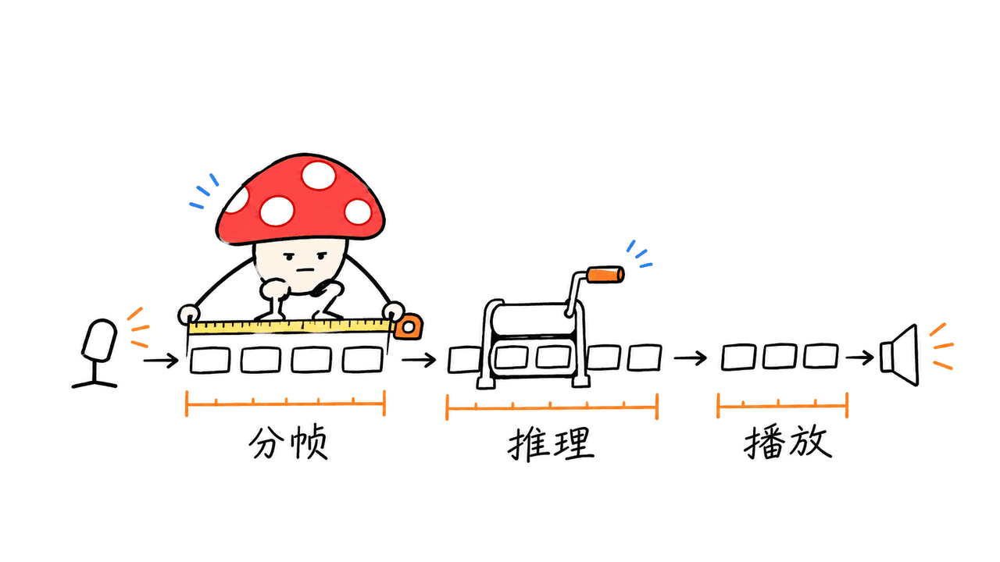

Haru 4B 是能同时听和说的开源语音基座。它值得研究的，是把插话、附和和轮流说话放进同一条连续音频链路；开发者仍要自己补上业务控制与可靠性验证。

higurashi 于 2026 年 11 月 13 日发布 Haru，代码与权重采用 Apache 2.0。官方称预训练使用超过 4,000 万小时真实语音；这是团队披露的数据规模，我们没有取得训练集或复现训练。它也不是“最宽松协议”的绝对排名：商用使用仍须遵守许可证及第三方声明。

代码：https://github.com/higurashi-ai/Haru
模型：https://huggingface.co/higurashi-ai/Haru-4B

## 全双工到底改变了什么？

传统语音助手常按“检测说完 → 识别 → 生成文字 → 合成语音”推进。Haru 在每个位置合并用户音频、模型音频和模型文字三个流，让输入与输出同步向前。模型能说话时继续接收声音，应用不必先把整句用户语音收齐。

音频使用 24 kHz 采样率，每帧 3,200 个样本，即约 133 毫秒，帧率 7.5 Hz。声音被表示成 64 维连续向量；轻量 MLP 音频头以单步 MeanFlow 生成下一帧，不再额外运行一套声学 Transformer。语言骨干来自 Qwen3.5-4B。

这里的工程收益是减少串行步骤；“能同时收发”并不能自动证明它在每次抢话时都判断正确。将全双工接入语音 Agent，还要分别评估接话、让话、噪声下的误插话和持续对话一致性。


## 65 毫秒，为什么不能直接当用户等待时间？

官方技术博客的约 65 ms，来自 M1 Max、原生 Swift 客户端、自定义 Metal 内核、int8 权重和有线音频设备。这个数字包含模型与音频 I/O，明确排除了分帧等待：7.5 Hz 的处理节奏还可能增加最多约 133 ms。

因此，不能把它写成“用户一开口，65 ms 就得到回答”。设备缓冲、蓝牙、网络、播放队列和模型决定何时开口，都影响实际体验。分帧上限加官方测量值只能帮助理解延迟预算，也不是我们测得的最坏情况保证。

我们的建议是把日志拆成三类：采集与分帧等待、每帧推理耗时、播放排队与欠载。实时链路首先要持续跟上每帧时限；平均推理很快但偶尔停顿，仍会听到卡顿。



## Mac 与 NVIDIA 各从哪里开始？

先固定源码版本，再选择实现。本文核对的 Git 提交为 `7fe6b7665f8bf035998f401f8cb779fbe53f2751`，模型修订见文末验证说明。

NVIDIA 的官方快速入口如下，README 给出的显存参考是约 12 GB；这不是所有长度与并发配置的容量承诺。

```bash
git clone https://github.com/higurashi-ai/Haru
cd Haru
git checkout 7fe6b7665f8bf035998f401f8cb779fbe53f2751
python3 -m venv .venv
source .venv/bin/activate
pip install -e ./haru
python -m haru.server --hf-repo higurashi-ai/Haru-4B
```

浏览器打开 `http://localhost:8998`。远程网页需要 HTTPS 才能正常申请麦克风权限。`--share` 会建立公共入口并经过 Gradio 分享服务器，适合了解其暴露范围后再用，不能把它当纯本地私密链路。

Apple Silicon 可选 `haru_mlx` 与原生客户端：

```bash
cd haru_mlx
python3 -m venv .venv
source .venv/bin/activate
pip install -e .
cd swift
./build_app.sh
open build/Haru.app
```

官方要求 macOS 13+、Python 3.10+ 与 Command Line Tools，16 GB 内存是实用下限。原生应用默认 BF16，可切换到 int8；量化覆盖骨干权重与嵌入表，音频编解码器和音频头等仍保留原精度。不要将“int8”理解成整个进程内存直接减半。

本次模型发布文件 `model.safetensors` 为 10,540,113,510 字节，约 10.54 GB，另需运行时、缓存和音频缓冲。命名中的 4B 指向骨干规模，不能拿它直接估计整个语音系统的资源占用。

## 接入时最容易漏掉哪几件事？

第一，音色参考要自己准备。仓库不附带可直接使用的声音片段；官方建议单一说话人、干净录音、长度 3 秒至 3 分钟。使用自己或已获授权的声音，避免把开放模型许可误解成任意复制他人声音的授权。

第二，角色提示词有固定卡片结构。使用仓库的 `render_card` 与语言模板描述人设、对方名字、关系及情境，比随手塞一句通用 system prompt 更贴近官方用法。

第三，连接协议有时序。`session.start()` 先给出模型第 0 帧；随后输入用户第 k 帧的 `step()` 返回模型第 k+1 帧。上层要维护连续麦克风采集和播放队列，不能把这个接口当成一次请求返回完整音频的普通 TTS。

第四，把“自然聊天”和“任务执行”分开验收。模型卡明确指出它是预训练基座，事实回答与指令遵循不可靠。接客服或工具调用时，建议由独立业务层管理工具权限、确认和结果，先用小范围任务测试，不直接让自然对话输出驱动业务动作。


## 我们实际检查了什么？

本次在 Apple M4 本机运行了不加载检查点的上游测试：42 项通过、2 项跳过、11 项检查点测试未执行。覆盖音频预处理、提示词、采样及实时队列等代码路径，服务测试使用替身引擎。日志保存在 source 目录。

我们没有下载完整权重、运行真实麦克风通话、复现 65 ms、验证中文对话质量或进行训练。测试通过说明这些代码契约在本机可运行，不能代替生成语音的听感评估。首次部署建议自己保存几段固定录音：正常轮流说、半句打断、长时间沉默、环境噪声，再逐项记录反应与队列情况。

Mycelium Protocol 的判断是：Haru 把全双工语音的模型、推理实现和本地客户端一起交给了工程师。先用它验证对话节奏和音频时序，再决定是否投入业务微调，比直接拿发布演示替代产品验收更有效。

## 常见问题

**能商用吗？** 代码与模型权重声明为 Apache 2.0。分发时保留所需许可证和声明；参考声音的授权另行确认。

**4,000 万小时训练数据也开源了吗？** 本次公开入口提供权重、推理代码和相关实现，不能据此声称完整训练语料与训练流程已经开放。

**现在就能做稳定电话客服吗？** 发布的是语音基座。电话接入、可靠知识、工具控制、业务验收和运行保障仍需要工程建设。

官方技术博客：https://blog.higurashi.ai/melte/haru4b/
Mac 客户端说明：https://github.com/higurashi-ai/Haru/blob/main/haru_mlx/swift/README.md
相关工程阅读：https://blog.mushroom.cv/blog/jev-interaction-full-duplex-voice-decisions/

---

> © 2026 Author: Mycelium Protocol. 本文采用 [CC BY 4.0](https://creativecommons.org/licenses/by/4.0/deed.zh) 授权——欢迎转载和引用，须注明作者姓名及原文链接，不得去除署名后以原创发布。

<!--EN-->

Haru 4B is an open speech foundation model that listens while speaking. Its practical contribution is a continuous dialogue loop that can represent backchannels and interruptions. Developers still need to establish whether that interaction is reliable enough for a particular application.

higurashi released the model on November 13, 2026. The code and weights carry Apache 2.0 licenses. The team reports pretraining on over 40 million hours of real speech; we did not inspect that corpus or reproduce training. A permissive model license does not grant rights to every possible reference voice.

Code: https://github.com/higurashi-ai/Haru
Weights: https://huggingface.co/higurashi-ai/Haru-4B

## How does the full-duplex loop work?

The model combines incoming speech, outgoing speech and text at each language-model position. Its Qwen3.5-4B backbone processes synchronized streams rather than waiting for a complete utterance. A 24 kHz audio frame contains 3,200 samples, giving 7.5 frames per second. Audio is represented as 64-dimensional continuous latents; a small MeanFlow head predicts each latent in one sampling step.

That architecture reduces serial work. It does not, by itself, establish appropriate turn-taking in every noisy or ambiguous conversation. Test interruptions, yielding, overlap and long-session consistency separately.


## What does the 65 ms claim measure?

The official measurement uses an M1 Max, the native Swift client, custom Metal kernels, int8 weights and wired audio devices. It includes processing and audio I/O but excludes framing, which can add up to roughly 133 ms. It is not a promise that every user utterance receives a meaningful answer after 65 ms.

Track capture and framing, model computation, and playback queues independently. Headphones, network buffers, scheduling stalls and the model's decision to begin speaking all affect perceived responsiveness. A low average compute time can still hide audible underruns.


## Which implementation should an engineer start with?

Use the pinned Git revision `7fe6b7665f8bf035998f401f8cb779fbe53f2751` for this article's snapshot. The NVIDIA quick start is:

```bash
pip install -e ./haru
python -m haru.server --hf-repo higurashi-ai/Haru-4B
```

Run those commands from the cloned repository inside a Python environment. The README suggests approximately 12 GB GPU memory, without promising capacity for every context or concurrency setting. Open `http://localhost:8998`; remote microphone access requires HTTPS. The optional share tunnel exposes a public entry point through Gradio infrastructure.

On Apple Silicon, create `.venv` inside `haru_mlx`, install that directory, then run `swift/build_app.sh` and open the resulting app. macOS 13+, Python 3.10+ and Command Line Tools are required. The native app documentation calls 16 GB RAM a practical minimum. It defaults to BF16 and offers int8 for backbone matrices and embeddings, while retaining other components at checkpoint precision.

The released weights file is 10,540,113,510 bytes, about 10.54 GB. Budget for runtime state and audio buffers as well. The 4B name should not be used as a complete system-memory estimate.

## What belongs in the integration layer?

Provide a clean, authorized reference voice: one speaker, three seconds to three minutes. No voice clips ship with the model. Construct the character card with the repository's `render_card` and language templates.

Maintain the audio clock explicitly. `start()` returns model frame zero; `step()` with user frame k returns model frame k+1. Continuous capture and playback queues are required. This is a streaming conversation interface rather than a single request returning a complete TTS file.

Keep task execution separately accountable. The model card identifies Haru as a pretrained base with unreliable factual responses and assistant-style instruction following. An application can place tool permissions, confirmation and result handling in a separate business layer; that is our integration recommendation, not a capability we tested in Haru.


## What did we actually verify?

On our Apple M4 we ran the upstream non-checkpoint suite: 42 passed, two skipped and 11 checkpoint tests were deselected. Coverage includes preprocessing, prompt handling, sampling and real-time buffers; server tests use a stand-in engine. We retained the full report.

We did not download the complete weights, run a microphone conversation, reproduce latency, test Chinese speech quality or train the model. Code-contract checks cannot establish listening quality. Before deploying, save fixed cases for normal turns, interruptions, silence and noise, then inspect both behavior and queue measurements.

Mycelium Protocol recommends using this release to learn continuous speech integration first. Decide on business adaptation after measuring the interaction you need.

## FAQ

**Is commercial use allowed?** The code and weights declare Apache 2.0. Preserve required notices and verify rights to the reference voice independently.

**Is the complete training corpus public?** The release provides model weights and inference implementations. That does not establish that the complete corpus or training pipeline has been released.

**Is it a turnkey phone support agent?** No turnkey reliability was established here. Telephony, knowledge, tool control and operational evaluation require additional work.

Technical report: https://blog.higurashi.ai/melte/haru4b/
Mac client: https://github.com/higurashi-ai/Haru/blob/main/haru_mlx/swift/README.md
Related engineering article: https://blog.mushroom.cv/blog/jev-interaction-full-duplex-voice-decisions/

---

> © 2026 Author: Mycelium Protocol. Licensed under [CC BY 4.0](https://creativecommons.org/licenses/by/4.0/) — free to share and adapt with attribution. You must credit the author and link to the original; removing attribution and republishing as original is not permitted.
