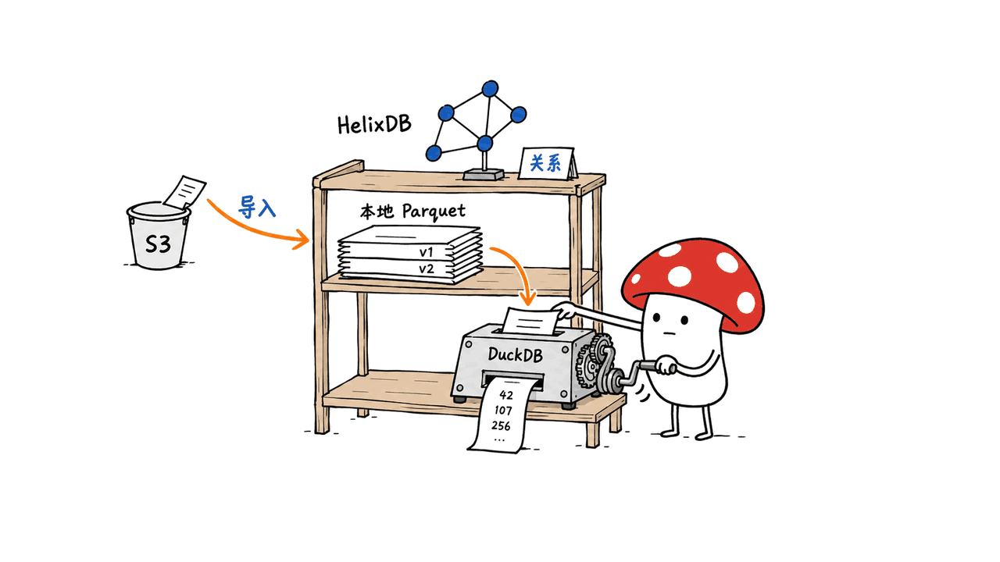
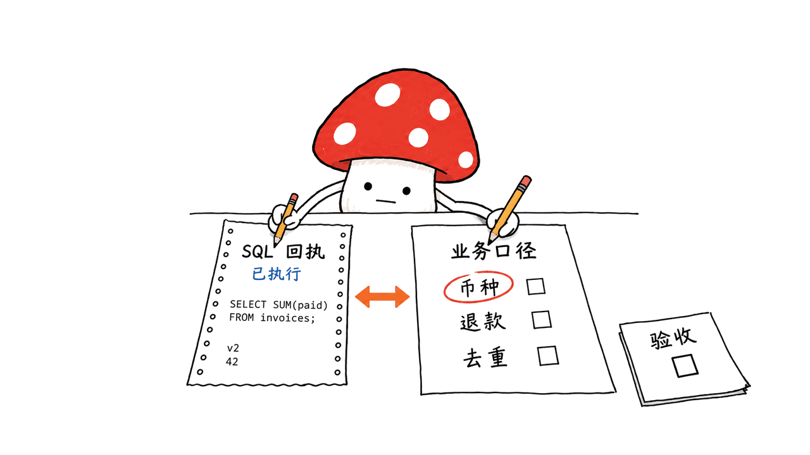

Helix Foundry 是一个把分散的公司数据连成业务关系图、再用 SQL 回答问题的本地工作台。它值得关注的地方，是把“这些数据属于哪个客户”和“这个答案怎么算出来”放进同一个工作流。

官方仓库是 **HelixDB/helix-foundry**，根目录采用 Apache 2.0 许可。本文核对 2026 年 10 月 15 日的提交 `00d7927d7c08e16c58316e006959f052427e7fa1`；后续版本可能变化。

仓库：https://github.com/HelixDB/helix-foundry

## Company ontology 到底解决什么问题？

想象一家订阅软件公司：客户账户在业务数据库里，付款和订阅在 Stripe，登录身份在 WorkOS，使用事件在 PostHog，支持工单又放在 CSV。每个系统都能查自己的表，回答“高付费但使用下降、近期还有未处理工单的客户是谁”却要跨系统对账。

Company ontology 可以理解为统一的业务实体与关系定义：哪些记录是 Account，哪些是 User、Invoice、Subscription；用户属于哪个账户，发票对应哪位客户。Explorer 把这些实体及其邻居展示成图或表，而不只显示数据源之间的一条连线。

图形界面降低理解成本，真正决定结果质量的是身份匹配规则。账单邮箱可能不同于登录邮箱，两个系统同名的 customer_id 也未必属于同一命名空间。不能因为画出连线，就认为跨系统身份已经核实。


官方示例 Loopwell 是虚构 SaaS 数据，共 11 组关联数据，刻意保留错别字、未匹配工单和邮箱差异。这有助于练习审阅映射；示例跑通仍不能代表真实客户数据已经治理完毕。

## HelixDB、DuckDB 和 S3 分别做什么？

原素材提到的存储分工需要补全。按官方 Guide 和 Compose 配置，默认部署的核心职责如下：

| 层次 | 组件 | 实际职责 |
| --- | --- | --- |
| 业务关系与控制状态 | HelixDB | 本体对象、原生关系、工作区元数据、任务、提案、API token 和加密凭据 |
| 数据版本 | 本地数据卷中的 Parquet | 不可变数据快照、导入产物与暂存文件 |
| 分析执行 | 隔离的 DuckDB executor | 对获准快照执行查询、聚合及流水线 SQL |
| 数据入口 | 数据库、SaaS、REST、S3 兼容服务、上传 | 将外部记录导入并生成快照 |
| 模型 | 默认 Ollama，也可显式选择托管服务 | 描述、分析查询与可审阅的定义建议 |

**S3-compatible storage 在这里首先是导入来源，默认部署的快照保存在本地数据卷。** 不应把它写成“所有数据原生存放在 S3 的云端湖仓”，也不应把 HelixDB 写成承担全部 SQL 扫描的数据库。



这种分工的好处是关系探索与列式分析各有合适的执行层；代价是需要同时管理图状态、快照版本与发布代际的一致性。仓库包含发布前暂存、版本检查和代际切换逻辑，这些机制比一张漂亮关系图更值得工程团队细看。

架构说明：https://github.com/HelixDB/helix-foundry/blob/main/docs/GUIDE.md#architecture

## AI 参与了哪些步骤？答案为什么能追溯？

首次引导分为 AI、Data、Ontology。一个容易误读的细节是：初始本体建议通过确定性逻辑计算，按匹配键合并实体；模型就绪后主要润色摘要、描述和关系名称。用户可以重命名、排除实体，确认后由代码完成构建，不需要让模型逐条决定每个对象的归属。

后续 AI 可以提出流水线 SQL、映射、关系和指标定义。这些提案经过结构检查与数据上的执行验证，再等待审阅；旧快照或旧代际上的提案会被标记为过期。引导流程则发布用户确认且验证通过的构建。

Analyst 的只读问答返回执行结果及快照引用，用户可以回看计算依据。DuckDB executor 与连接器凭据分离，限制外部访问和扩展安装，并将生成查询限定为单个 SELECT。这里改善的是可复核性和执行边界。

不过 SQL 成功执行，只能说明这个程序在这些数据上算出了结果。它不能证明收入采用了正确币种、退款口径一致，或者客户去重没有误连。部署时最有价值的审阅问题是：“这条指标按什么定义、读取哪个版本、排除了哪些记录？”



官方审阅机制：https://github.com/HelixDB/helix-foundry/blob/main/docs/GUIDE.md#ai-and-review

## 怎样从一个业务问题开始落地？

建议先选一个边界明确的问题，例如“按账户列出本月已支付发票及未解决工单”。先导入脱敏的账户、发票和工单样本，人工确认账户 ID 的映射，再核对数个已知案例。通过后才接自动同步，避免一开始把所有系统都接进来。

官方提供 PostgreSQL、MySQL、Neo4j、Stripe、WorkOS、PostHog、REST 与文件等入口。PostgreSQL/MySQL 在权限和数据库条件允许时使用原生变更捕获，其余情况采用定时快照刷新；不能把所有连接器都理解为实时 CDC。

以下是官方安装路径，本文提供操作指南，没有替读者启动完整 Docker 栈：

```bash
git clone https://github.com/HelixDB/helix-foundry.git
cd helix-foundry
./scripts/setup.sh --compose
curl -fsS http://localhost:3001/api/health
```

需要 Docker Compose v2、git、bash 和 openssl。首次构建及模型下载需要数 GB 空间；默认本地模型为 Ollama 的 `qwen3:4b`。打开本机页面后，可先选择示例数据，再验证自己的映射与指标。模型尚未就绪时，也能继续不依赖 AI 的引导步骤。

Apple Silicon 用户可按 README 让容器连接原生 Ollama，以使用 Metal。端口冲突时同时调整 `PUBLIC_PORT` 和 `PUBLIC_ORIGIN`，否则页面可能能打开，保存却被来源校验拒绝。备份应另行保存加密密钥；官方明确指出，普通备份不会自动带上该密钥。

操作说明：https://github.com/HelixDB/helix-foundry/blob/main/docs/OPERATIONS.md

## 本地优先是否等于可以直接给全公司使用？

当前 README 明确把产品定位为个人本机使用：没有账号与登录，能访问应用的人就能控制所有工作区。默认只发布到 127.0.0.1，官方要求不要经反向代理、隧道或端口转发对外暴露。工作区 scoped API token 有助于程序访问控制，但不等于完整的员工身份、多租户与部门权限体系。

本地 AI 是默认选项，Claude、OpenAI、Azure OpenAI、Bedrock 和自定义服务需要主动选择。选择托管模型后，受限的 schema、profile 和样本上下文会送往服务方；敏感列检测与遮蔽属于启发式保护，不能据此承诺“任何情况下数据都不出本机”。

我们的判断是：它适合个人分析者、创始人或工程师先验证跨系统业务模型。若计划让销售、财务和支持团队共同操作，应先设计身份认证、细粒度权限、网络部署与数据政策，并验证真实连接器和备份恢复流程。这些是上线条件，不能由“开源”和“可本地运行”两个标签替代。

## 本文核验范围与常见问题

本文核对固定提交的文档、许可和代码，并运行了上游原有的引导本体、分析结果追踪两组测试：39 项全部通过。测试使用真实本地 DuckDB、内存元数据和模型/传输替身，覆盖无模型构建、对象图与结果展示等行为。官方 Validation 的测试记录是作者报告；本文没有运行真实 Stripe、生产数据库、HelixDB 持久化或模型推理，也不提供性能排名。

### 开源许可是什么？

当前仓库根 LICENSE 为 Apache 2.0。部署时仍需分别遵循所选模型、外部服务与依赖的条款。

### 能否直接修改源系统里的客户资料？

官方 Guide 说明工作区对象编辑作为覆盖层保存，不会改写导入快照、Home 指标或源系统。不要把图上的对象编辑理解成自动回写 CRM、Stripe 或生产库。

### 它与一般聊天式 BI 的区别是什么？

除自然语言转 SQL，它还维护可探索的业务对象、关系、快照历史与提案发布流程。是否值得引入，取决于你是否需要持续维护这些跨源身份与业务定义。

### SQL 有结果，为什么还需要人工审核？

运行验证不判断业务口径是否正确。匹配键、币种、时间范围与未关联记录，仍需要领域负责人确认。

相关工程阅读：https://blog.mushroom.cv/blog/raven-multi-agent-harness/

固定源码：https://github.com/HelixDB/helix-foundry/tree/00d7927d7c08e16c58316e006959f052427e7fa1

官方验证记录：https://github.com/HelixDB/helix-foundry/blob/main/docs/VALIDATION.md

---

> © 2026 Author: Mycelium Protocol. 本文采用 [CC BY 4.0](https://creativecommons.org/licenses/by/4.0/deed.zh) 授权——欢迎转载和引用，须注明作者姓名及原文链接，不得去除署名后以原创发布。

<!--EN-->

Helix Foundry connects scattered company records into an explorable business graph and answers questions through SQL. Its useful promise is a shared workflow for identifying which records belong together and checking how an answer was calculated.

The official repository is HelixDB/helix-foundry, licensed under Apache 2.0. This review pins commit `00d7927d7c08e16c58316e006959f052427e7fa1`, inspected on October 15, 2026.

Repository: https://github.com/HelixDB/helix-foundry

## What does a company ontology solve?

A subscription business may keep accounts in its application database, payments in Stripe, identities in WorkOS, events in PostHog and support tickets in CSV files. Asking which high-paying customers have declining usage and unresolved tickets requires joining those systems around a consistent customer identity.

An ontology defines business object types and relationships: accounts, users, invoices and subscriptions, and the links between their records. Foundry's Explorer exposes them as a graph or table, with related records and source history.

The hard part remains identity resolution. Billing and login emails can differ; similarly named customer IDs can belong to different namespaces. A visible edge is evidence of an applied mapping rule, not proof that the rule identifies the right customer.


The fictional Loopwell sample contains 11 linked datasets, including intentionally imperfect records. It offers a useful rehearsal for reviewing mappings, without establishing correctness on production data.

## How do HelixDB, DuckDB and S3 fit together?

| Layer | Component | Responsibility |
| --- | --- | --- |
| Relationships and control state | HelixDB | Ontology objects and edges, workspace metadata, jobs, proposals, tokens and encrypted credentials |
| Versioned input | Local Parquet artifacts | Immutable snapshots, imported artifacts and staged files |
| Computation | Isolated DuckDB executor | Queries, aggregations and pipeline SQL over declared snapshots |
| Sources | Databases, SaaS, REST, S3-compatible services, uploads | Import external records into snapshots |
| AI | Ollama by default; explicit hosted choices | Descriptions, analytical queries and reviewable definition proposals |

S3-compatible storage is a supported import source. The default Compose deployment stores snapshots on a local data volume. It would be inaccurate to describe the architecture as an S3-native cloud lakehouse, or to say HelixDB performs every analytical SQL scan.


Separating the graph from columnar analysis makes the responsibilities clear, while introducing consistency work across graph state, snapshot versions and published generations. The repository documents staged publication and version checks to manage that boundary.

Architecture: https://github.com/HelixDB/helix-foundry/blob/main/docs/GUIDE.md#architecture

## Which decisions involve AI, and what makes answers traceable?

Initial onboarding computes a deterministic ontology suggestion using matching keys. When available, AI improves summaries, descriptions and relationship names. The user can rename or exclude entities; the confirmed build runs in code without model calls.

Later assistance can propose pipelines, mappings, relationships and metrics. Definitions undergo structural validation and execution checks, with reviewable assumptions and stale-proposal detection. Guided setup publishes the validated build of the ontology the user confirmed.

Read-only Analyst answers include executed results and snapshot citations. The DuckDB executor is separated from connector credentials, disables external access and extension installation, and limits generated SQL to a single SELECT.

These mechanisms support inspection. They do not establish that revenue uses the correct currency, refunds follow the intended accounting policy, or a join avoids duplicate customers. A reviewer still needs to check the metric definition, input version and excluded records.


Review workflow: https://github.com/HelixDB/helix-foundry/blob/main/docs/GUIDE.md#ai-and-review

## How should an engineering team evaluate it?

Start with one bounded question, such as paid invoices and unresolved tickets by account. Import redacted account, invoice and ticket samples, confirm the identifier mapping, and compare several known cases. Introduce synchronization after the semantics are understood.

Supported sources include PostgreSQL, MySQL, Neo4j, Stripe, WorkOS, PostHog, REST and files. Native PostgreSQL/MySQL change capture depends on database capabilities and permissions; scheduled snapshots cover other cases. A connector does not automatically imply real-time CDC.

The documented setup is:

```bash
git clone https://github.com/HelixDB/helix-foundry.git
cd helix-foundry
./scripts/setup.sh --compose
curl -fsS http://localhost:3001/api/health
```

Docker Compose v2, git, bash and openssl are required. The initial images and default Ollama `qwen3:4b` model consume several GB. The sample-data route helps evaluate mappings before connecting live systems; onboarding can continue without AI-dependent descriptions.

On Apple Silicon, the README describes connecting containers to native Ollama for Metal acceleration. When changing the public port, change the matching origin too. Keep the encryption key separately from ordinary backups: those backups do not include it by default.

Operations: https://github.com/HelixDB/helix-foundry/blob/main/docs/OPERATIONS.md

## Can the whole company use the default deployment?

The current product explicitly targets one person on their computer. It has no accounts or sign-in: anyone who reaches the application controls every workspace. It binds to loopback, and the official instructions prohibit exposing it through a reverse proxy, tunnel or port forwarding. Scoped API tokens are useful for integrations, but do not provide a complete employee identity and departmental authorization system.

Local inference is the default. Hosted providers receive bounded schema, profile and sample context when selected. Sensitive-column masking is heuristic, so local-first should not become a blanket promise that no information ever leaves the machine.

Our assessment: this is a useful starting point for an individual analyst or engineer validating cross-system business definitions. Shared enterprise use requires a deliberate identity, permissions, network and data-policy design, plus integration and recovery validation.

## Verification scope and FAQ

We cross-checked the pinned documentation, license and code, then ran two unmodified upstream suites for onboarding ontology and Analyst result tracing: all 39 tests passed. These use real local DuckDB, in-memory metadata and provider/transport fixtures; they cover model-free builds, record graphs and result presentation. Official Validation results are the maintainers' reports. We did not run the complete Docker stack, real Stripe connectors, production databases, HelixDB persistence or model inference, and make no performance ranking.

### What is the license?

The repository's root LICENSE is Apache 2.0. Selected models, hosted services and dependencies retain their own terms.

### Do object edits write back to source systems?

The Guide says workspace edits persist as overlays and do not change imported snapshots, Home metrics or source systems. Editing an ontology object should not be mistaken for updating Stripe or a production database.

### How does it differ from conversational BI?

Alongside natural-language SQL, it maintains explorable business objects, relationships, versioned snapshots and a proposal publication workflow. Its value depends on whether those cross-source definitions need ongoing maintenance.

### Why review SQL that already executes successfully?

Execution checks do not validate accounting policy or identity semantics. Matching keys, currencies, time windows and unmatched records require domain review.

Related engineering reading: https://blog.mushroom.cv/blog/raven-multi-agent-harness/

Pinned source: https://github.com/HelixDB/helix-foundry/tree/00d7927d7c08e16c58316e006959f052427e7fa1

Maintainer validation: https://github.com/HelixDB/helix-foundry/blob/main/docs/VALIDATION.md

---

> © 2026 Author: Mycelium Protocol. Licensed under [CC BY 4.0](https://creativecommons.org/licenses/by/4.0/) — free to share and adapt with attribution. You must credit the author and link to the original; removing attribution and republishing as original is not permitted.
