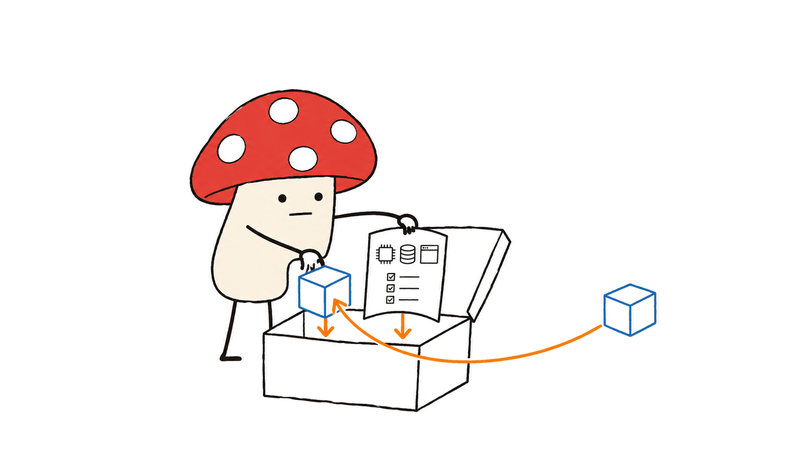

Heretic 让开发者在本机修改开放权重语言模型的行为，例如减少迎合和缩短回答；修改是否有益，仍要由独立任务验证。

项目地址是 https://github.com/p-e-w/heretic ，作者为 Philipp Emanuel Weidmann（p-e-w），代码许可为 AGPL-3.0-or-later。Mycelium Protocol 本次核对提交 `aecd4a845a23be3f96ddc03b37b53a9195ee2566`：源码版本写的是 `2.2.0.dev0`，下文描述这个开发快照，不能把它当成所有已发布安装包的行为。

## Heretic 改的是提示词，还是模型本身？

普通提示词只改变一次调用的上下文。Heretic 收集对照提示下的模型内部表示，使用修改器改变模型，再通过评分器挑选候选结果。导出的结果可以包含合并后的权重或适配器，具体受模型、修改器和导出配置限制。它需要能够访问模型权重，不是给一个云端聊天 API 地址就能修改服务商的模型。

仓库默认目标是压低拒答，但它现在并不只有这一个方向。官方提供 `config.nosyco.toml`、`config.terse.toml`、`config.noslop.toml` 等配置，分别探索减少迎合、缩短回答和减少某些套路表达。它们是不同的优化任务，不能把某一配置的结果推广到全部行为。

尤其要区分：少拒答不等于回答正确，少迎合不等于可靠推理，少废话也不等于有效信息更多。工具能改变行为倾向，不会凭空给模型补上它原先没有的事实知识。

## “无需训练”为什么仍然要计算和优化？

官方使用 training-free 描述它区别于昂贵的完整语言模型微调。工程上需要补一句：这不意味着没有梯度、参数拟合或搜索。

当前代码有两个修改器。默认 ARA，即 Arbitrary-Rank Ablation，利用对照样本的内部表示，寻找保持目标行为、改变另一类行为的变换；实现使用低秩适配器，并包含 L-BFGS 优化。另一条是传统方向消融，也称 abliteration。两者都服务于行为编辑，但并非同一套算法。

外层还用 Optuna 的 TPE 搜索配置，并对多个评分目标进行优化。成本因此包括加载权重、收集表示、拟合候选变换、反复生成和打分；“不用完整微调”并不等于“在零成本下按一下按钮”。ARA 的正式预印本在此快照 README 中仍标为即将发布，当前实现和相关讨论是主要核对依据。

README 给出 RTX 3090 处理 Qwen3-4B-Instruct-2507 约 30–40 分钟的示例。这是作者对默认配置的报告，本次没有在该显卡复测，也没有把它推算成其他模型和电脑的耗时。可运行一个模型，也不能仅凭参数量断定一定能顺利完成全部编辑搜索。

## 评分器为什么比“解锁”更值得工程师研究？

Heretic 把评分器和修改器拆开。前者通过 `get_score` 返回分数，后者负责模型变化；插件可以按模块路径或文件路径加载。这样，修改机制可以复用，产品目标由具体测量决定。

以官方“更简洁”配置为例，它同时最小化回答长度、最大化基准分数。配置明确没有沿用默认 KL 目标，因为这项实验不存在一组预期完全保持原行为的提示。这个细节提醒我们：评估不是永远复制同一组指标，而要解释每个指标保护的是什么。

| 指标或目标 | 能回答什么 | 不能直接证明什么 |
|---|---|---|
| 回答长度 | 输出是否更短 | 是否遗漏必要条件或步骤 |
| 关键词命中率 | 是否出现指定表达 | 语义是否准确，行为是否真正消失 |
| KL 散度 | 在指定提示上分布偏移多大 | 未覆盖任务的能力完全不变 |
| 任务基准 | 特定测试集表现如何 | 所有业务场景都会受益 |

比较合理的入门实验，是对一组普通问答评估简洁度，同时检查正确率、信息完整性和格式遵循；再用未参与搜索的独立题集复查。对于确实需要长回答的任务，缩短输出可能只是把问题藏起来。

## 本次在本机验证了什么？

我们在隔离的既有 Python 环境运行了上游 `test_ara_lowrank_equivalence.py`：四项测试全部通过，程序报告测试用时 0.026 秒。测试使用 CPU 上的合成 float64 张量，比较稠密矩阵计算与低秩重写计算，在是否保留行范数、是否含偏置的四种组合下满足 `1e-9` 容差。

这是小规模代数等价检查，测试自身使用参考公式，并未启动完整 ARA 修改流程。它不能证明训练后模型质量、拒答率、GPU 显存占用或官方 30–40 分钟耗时。本次未下载预训练权重，也未执行模型去拒答实验。

我们还尝试运行上游配置测试，但现有环境缺少 `pydantic_settings`，在导入阶段失败；没有为此改动共享环境，也不把这一项记作通过。源码审阅与可执行验证应分开记录。

## 工程师可以借鉴什么？

第一，把“变得更好”拆成可测目标。先证明系统提示和推理参数不能满足需求，再考虑权重修改。对简洁度或语气实验，原模型、提示词版本和编辑版本应使用相同题集、生成预算和采样设置。

第二，把搜索集与验收集分开。优化器会寻找评分器的薄弱处；一次关键词减少，也可能只是换了一种说法。人工抽查、独立任务、中文和长上下文场景都需要单独评估，不能仅看候选排名。

第三，把复现材料当成交付物。Heretic 可选择导出 `reproduce.json`、环境信息和权重哈希。README 说清了字节一致依赖相同硬件、驱动和软件栈。约 9KB 的清单是重建说明，不是把模型压缩成了 9KB；底座权重和相关依赖仍然需要取得。

第四，保留回退路径。记录底座 revision、数据版本、评分配置、候选选择理由和导出哈希，再做小范围验证。对于已经满足需求的模型，编辑后没有可复核收益，就没有必要只为“可修改”而修改。

## FAQ

### Heretic 能在本地运行吗？

它是本地开放权重模型处理工具，需要匹配的 Python、PyTorch、硬件后端及模型资源。下载依赖、数据和模型或主动上传结果时仍涉及网络；它不是无需权重的云端 API 包装器。

### 修改后的模型一定更强吗？

不一定。行为目标与知识、推理、可靠性是不同维度。作者及社区的部分基准不能替代你对目标配置、模型和业务的独立验证。

### 工具开源是否意味着模型可以任意使用？

不能这样推断。工具代码标注 AGPL-3.0-or-later，底座模型、数据与输出发布还需要分别核对各自条款。开源工具的许可证不会替换底座模型的许可证。

一手资料：

- 仓库与 README：https://github.com/p-e-w/heretic
- ARA 实现：https://github.com/p-e-w/heretic/blob/aecd4a845a23be3f96ddc03b37b53a9195ee2566/src/heretic/modifiers/ara.py
- 简洁度配置：https://github.com/p-e-w/heretic/blob/aecd4a845a23be3f96ddc03b37b53a9195ee2566/config.terse.toml
- 版本迁移说明：https://github.com/p-e-w/heretic/blob/aecd4a845a23be3f96ddc03b37b53a9195ee2566/docs/migration_v1_to_v2.md

---

> © 2026 Author: Mycelium Protocol. 本文采用 [CC BY 4.0](https://creativecommons.org/licenses/by/4.0/deed.zh) 授权——欢迎转载和引用，须注明作者姓名及原文链接，不得去除署名后以原创发布。

<!--EN-->

Heretic edits the behavior of open-weight language models locally, including verbosity and sycophancy. Whether an edit improves a useful product still requires independent evaluation.

The project is https://github.com/p-e-w/heretic by Philipp Emanuel Weidmann, published under AGPL-3.0-or-later. Mycelium Protocol inspected commit `aecd4a845a23be3f96ddc03b37b53a9195ee2566`, whose package metadata says `2.2.0.dev0`. This is a development snapshot, not a promise about every released package.

## What does Heretic actually change?

A system prompt changes the context supplied to a model. Heretic collects internal representations from contrasting prompts, applies a modifier, and evaluates candidate changes with scorers. Export can involve merged weights or an adapter, depending on the model, modifier and configuration. It requires access to model weights; a hosted chat API alone does not grant that access.

Refusal suppression is the repository's default target. However, it also supplies configurations for shorter responses, less sycophancy and fewer formulaic expressions. These are separate optimization problems. Results from one configuration do not establish benefits for all behaviors.

Fewer refusals do not establish correctness. Less agreement does not establish sound reasoning. Shorter answers do not necessarily contain more useful information. Behavioral editing does not add factual knowledge that the original model lacks.

## Why does training-free still involve optimization?

Training-free distinguishes this workflow from expensive full language-model fine-tuning. It does not mean that the implementation has no gradients, fitting or parameter search.

The current default is Arbitrary-Rank Ablation, or ARA. It uses contrasting internal representations to preserve one type of behavior while steering another. The implementation uses low-rank adapters and includes L-BFGS optimization. A second modifier implements traditional directional ablation, commonly called abliteration. They are distinct methods within the same framework.

Outside the modifier, Optuna's TPE optimizer searches parameters against configurable objectives. Loading weights, collecting representations, fitting changes, generating answers and evaluating candidates all cost compute. At this snapshot, the README still describes the ARA preprint as forthcoming; source and the linked implementation discussion are the available primary evidence.

The README reports approximately 30–40 minutes for Qwen3-4B-Instruct-2507 on an RTX 3090 using its default configuration. We did not reproduce that hardware run. The figure cannot establish runtime for another model, machine or scoring task. Model parameter count alone is insufficient to estimate all search resources.

## Why are scorers a useful engineering idea?

Modifiers and scorers are separate. A scorer supplies `get_score`; a modifier changes the model. Plugins can load through import paths or file paths, allowing a behavioral target to be expressed independently from the editing mechanism.

The supplied terse configuration minimizes response length while maximizing a benchmark score. It explicitly avoids the default KL objective because the experiment lacks a prompt set whose original behavior should be preserved. This is a useful reminder that metrics need a reason for being present.

| Measure | What it observes | What it does not establish |
|---|---|---|
| Response length | Whether output gets shorter | Completeness or correctness |
| Keyword rate | Presence of selected expressions | Semantic behavior or truth |
| KL divergence | Distribution shift on selected prompts | Preservation of every capability |
| Task benchmark | Performance on that evaluation | Benefits across every product |

A reasonable first experiment concerns ordinary question answering: measure concise output, correctness, completeness and format adherence together. Reserve an independent set of prompts that the search never sees. If a task requires a careful explanation, reducing its length may simply remove necessary information.

## What did we verify locally?

We ran the original upstream `test_ara_lowrank_equivalence.py` in an existing isolated Python environment. All four tests passed; the runner reported 0.026 seconds. Synthetic CPU float64 tensors compare dense computation with a low-rank reformulation, with and without row-norm preservation and bias, at a tolerance of `1e-9`.

This checks small-scale algebra using reference formulas in the test itself. It does not invoke a complete ARA editing run, demonstrate pretrained-model quality, reproduce refusal rates, measure GPU memory, or verify the reported 30–40-minute processing time. We downloaded no pretrained weights and performed no refusal-suppression experiment.

An attempted upstream configuration test failed during import because `pydantic_settings` was missing. We left the shared environment unchanged and did not count that test as passing. Source inspection and executable verification remain distinct evidence.

## What should engineers borrow?

First, define a measurable outcome. Compare the unchanged model, a prompt-only baseline and an edited model using identical tasks, generation budgets and sampling settings. Weight editing is justified only when it produces evidence of an advantage over a simpler change.

Second, separate search prompts from acceptance tests. Optimizers can exploit weaknesses in a score; fewer selected keywords may merely mean different wording. Human review, Chinese-language tasks, long contexts and product-specific requirements need their own checks.

Third, treat reproducibility as part of the deliverable. Heretic can optionally export a `reproduce.json` manifest, environment information and weight hashes. Byte-identical results depend on matching hardware, drivers and software. A manifest of roughly 9KB is a rebuilding recipe, not a 9KB compressed language model. Base weights and dependencies are still required.

Fourth, preserve rollback. Record the base revision, data versions, scorer settings, candidate-selection rationale and export hashes before a limited deployment. An editable model is not automatically a model worth editing.

## FAQ

### Does Heretic run locally?

It processes open-weight models on local compatible hardware with Python, PyTorch and the required dependencies. Downloads and optional uploads use the network. It is not a wrapper that can edit inaccessible models through a hosted inference API.

### Does editing necessarily improve a model?

No. Behavioral objectives differ from knowledge, reasoning and reliability. Selected author or community benchmarks cannot substitute for evaluating the exact model and configuration against your tasks.

### Does the tool's license cover every resulting model?

No. The code is labeled AGPL-3.0-or-later. Base models, datasets and redistribution have separate terms to inspect. The tool's license does not replace a model's license.

Primary sources:

- Repository: https://github.com/p-e-w/heretic
- ARA implementation: https://github.com/p-e-w/heretic/blob/aecd4a845a23be3f96ddc03b37b53a9195ee2566/src/heretic/modifiers/ara.py
- Terse configuration: https://github.com/p-e-w/heretic/blob/aecd4a845a23be3f96ddc03b37b53a9195ee2566/config.terse.toml
- Migration guide: https://github.com/p-e-w/heretic/blob/aecd4a845a23be3f96ddc03b37b53a9195ee2566/docs/migration_v1_to_v2.md

---

> © 2026 Author: Mycelium Protocol. Licensed under [CC BY 4.0](https://creativecommons.org/licenses/by/4.0/) — free to share and adapt with attribution. You must credit the author and link to the original; removing attribution and republishing as original is not permitted.
