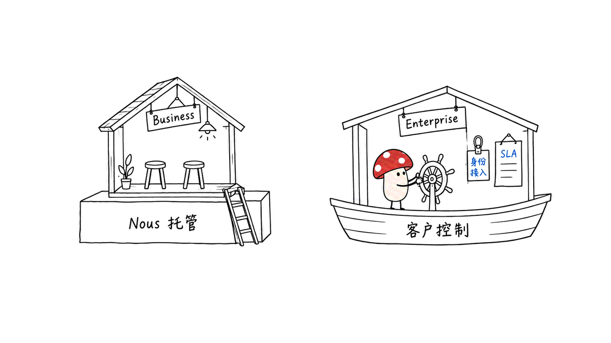
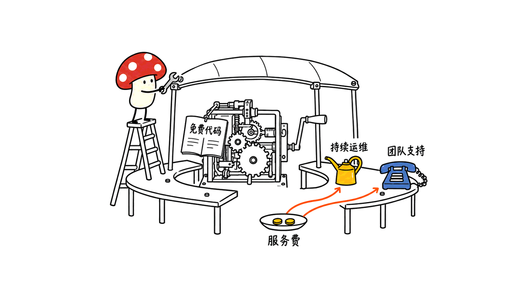
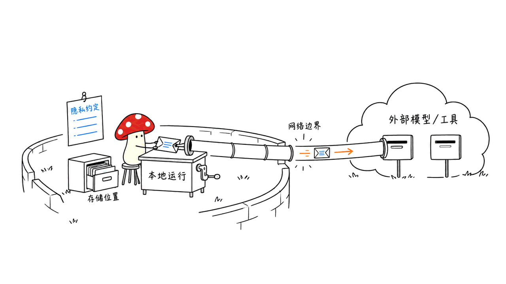

Hermes 把开源 Agent 做成托管、团队管理和企业交付服务，因此有了收费路径。企业是否愿意买单，取决于部署、成本、知识复用和责任分工；融资估值本身不能证明这些服务已经盈利。

这篇回答三个问题：代码免费，钱从哪里来？官网到底提供了哪些企业服务？“企业可用”与“通过安全评审”之间，还有哪些需要验证的环节？Mycelium Protocol 于 2026 年 10 月 13 日核对了一手产品页、隐私政策和固定版本仓库，没有购买付费租户，也没有测试其 SSO 或企业隔离实现。

## 先核对融资：是谁估值 15 亿美元？

被估值的是 Nous Research 公司，Hermes 是它的开源 Agent 项目。公司融资公告确认获得 9,000 万美元，列出的投资方包括 NVIDIA、微软 M12、三星和 Robot Ventures。WSJ 的可读取正文确认了 15 亿美元估值；这两个数字的来源层次不同。

公司自己的融资说明没有给出估值。其“克隆超过 2,400 万次、约占全球 token 用量 2.5%”也明确属于公司自述和内部估计。克隆次数不能直接换算成独立用户、活跃团队或付费客户，token 占比也不是营收份额。

媒体转述的年化收入约 3,600 万美元、年底目标超过 1 亿美元，应作为经营口径和预测看待，不是本文拿到的审计报表。后文讨论的是可观察的收费路径，不能据此倒推 Enterprise 已经贡献了多少收入。

融资公告：
https://nousresearch.com/a-note-on-our-fundraise

WSJ 原文：
https://www.wsj.com/pro/venture-capital/maker-of-open-source-ai-assistant-hermes-secures-90-million-a061c1d7

收入报道：
https://techcrunch.com/2026/10/07/nous-research-confirms-it-hit-1-5b-valuation-launches-ai-agents-for-business-users/

## Hermes 免费开放了什么？

Hermes Agent 仓库采用 MIT 许可。记忆、任务调度、工具执行、技能沉淀和自选模型连接都属于开源运行时的能力。开发者可以自建，也可以使用自己的服务商账户，并不必须购买 Nous 的托管套餐。

这里的“越用越会”主要指积累、改进技能及跨会话知识，不应自动理解成模型权重在后台持续训练。企业版的技能共享是在这套机制之上提供团队分发与运营，不是把一个原本没有的智能核心突然卖给企业。

开源降低了试用和迁移的门槛，也给客户保留了自建的选择。付费服务必须持续提供可感知的便利：少维护一组服务、少处理一批账号、少排查一次故障，或者更容易把一个人的经验交给整个团队。

MIT 许可中的软件按现状提供条款，也解释了商业服务的一个空间：能下载代码，不等于有人对部署验收、持续运维和故障处理承担合同责任。企业服务的价值就在于补上这些工作，而非让代码突然变得不可复制。

项目与许可：
https://github.com/NousResearch/hermes-agent
https://github.com/NousResearch/hermes-agent/blob/427d605d4985c2d49a795493ef6c5d66413057d1/LICENSE

本站此前已经拆过它的开源运行时，本文继续研究企业交付：
https://blog.mushroom.cv/blog/hermes-agent-nous-research-self-improving-skill-loop/

## 企业到底买了哪些服务？

截至核验日，官方 Business 页给出的产品分层如下。表中的“采购价值”是我们的解释，不是已实现的 ROI 测量。

| 层级 | 官网明确列出的内容 | 对企业的采购价值 |
|---|---|---|
| Business：资源与账单 | 共享余额、成员支出上限、费用可见 | 从员工各自充值，变成组织预算管理 |
| Business：管理 | 邮件邀请；owner/admin 管角色、额度和 API key | 让接入、变更和离职管理有统一入口 |
| Business：知识与工作流 | 每人托管 Agent、团队技能库、Team Gateway | 复用经验，减少重复配置和维护 |
| Business：部署 | Nous 基础设施上的团队隔离租户 | 由供应商运营；不等于客户内网部署 |
| Enterprise：交付 | 客户控制的基础设施、定制部署、SSO、SLA、协助上线 | 对接企业身份系统、运行环境和支持责任 |

Business 是自助式的托管团队产品；Enterprise 是联系销售的定制交付入口。我们没有拿到公开的 Enterprise 固定报价、已签客户合同或 SLA 指标，不能把官网列项写成经过实测的履约效果。

共享技能库尤其值得分析。它把个人解决问题的方法变成团队可取用的工作资产，这比给每个员工多装一个聊天窗口更有潜力。但技能自动分发也意味着变更会扩散：谁能发布、谁审核、怎样回滚、哪些部门可用，需要进入企业的管理流程。本次没有验证这些细粒度控制已经全部提供。

SSO 解决身份接入，SLA 明确服务责任，成员限额约束预算，它们处理的是不同问题。企业不需要抽象地买一个“合规标签”，而需要把自己的身份、财务、运维和知识管理流程接进产品。

官方产品及 FAQ：
https://portal.nousresearch.com/business

## 开源软件免费，Nous 的钱从哪里来？

从公开产品可观察到三层收费路径：模型与工具资源的统一计费，托管运行环境的费用，以及团队运营和企业交付。具体合同价格、收入拆分和毛利没有公开，以下是商业机制分析。

第一层是资源聚合。Nous Portal 把模型调用、搜索、浏览器等工具接到同一个账户和余额，减少多家供应商的注册、密钥和充值维护。客户付钱购买实际消耗的资源及接入便利；外部模型和工具本身也有供应成本，流水不能直接视为利润。

第二层是运维。Hermes Cloud 的实例费用与推理、工具费用分别计。核验日官方 Cloud 页列出的 Standard 运行价为每天 0.51 美元：连续运行 30 天，实例部分约 15.30 美元，尚未包含模型及工具消耗。停止时仍有存储费用，保持数据也需要成本。

第三层是组织交付。Business 统一团队用量、管理和技能分发；Enterprise 则把部署、身份接入和支持约定带进销售流程。客户可能为减少内部集成与运维工作付费，但官网没有证明一项独立的“合规附加费”，也不能用个人订阅价格推导企业席位报价。

例如一家企业有 50 名员工，自建方案的账单不只是服务器：还包括账号接入、升级、故障定位、密钥轮换和技能维护。托管服务能否赚钱，取决于能否以更低的交付成本提供这些服务；企业是否购买，则取决于节约的内部成本是否高于服务费用。

两边要分别算账。供应商看资源收入减去上游调用、基础设施和支持成本；客户看合格任务的总成本、失败返工和维护时间。便宜的 token、更多调用次数，都不能单独证明商业价值。

Portal 的集成机制：
https://hermes-agent.nousresearch.com/docs/integrations/nous-portal

Cloud 定价与计费说明：
https://portal.nousresearch.com/cloud

## 私有部署，是否意味着数据不出内网？

不一定。需要区分 Agent 运行位置、记忆和文件存储位置，以及模型和工具请求的目的地。Enterprise 运行在客户控制的基础设施上，如果仍调用外部模型 API、云端浏览器或第三方搜索，相关内容依然可能发送到外部服务。

Business 的团队隔离租户也不是客户自己的内网。隔离解决团队之间的边界，私有部署解决基础设施归属；“不用于训练”则是另一项数据处理约定。三个问题不能用同一个“安全”字样替代。

我们进一步读取了 2026 年 9 月 28 日更新的 Portal 隐私政策。它提供 Privacy Mode，对 Nous 保存和使用推理载荷作出限制，同时保留安全、运营等例外和必要元数据；第三方服务仍按各自条款处理数据。这不是默认承诺所有数据都不被保存或用于训练。

这份通用政策也不是某个客户签署的 Enterprise 数据处理协议。采购时应把保留、删除、训练用途、第三方流向和部署网络范围落实到具体配置及合同，不能只截取营销页上的一句“控制自己的数据”。

隐私政策：
https://portal.nousresearch.com/privacy

## “过安全评审”已经是它交付的商品吗？

Hermes 的公开产品确实围绕企业所需的管理、部署和支持建设。但当前材料不足以证明完整审计链、不可篡改日志、统一审批流、SOC 2/ISO 27001 等认证已经包含在交付中。这里是本次没有核验到的能力，不是判定公司绝对没有。

官方开源安全政策还有一个容易忽略的细节：它把 Agent 定义为单租户个人运行时，并把操作系统级隔离作为真正的安全边界。进程内审批、扫描和输出脱敏是辅助防护，不能当作对恶意模型输出的完整封闭环境。

因此，“有审批弹窗”“接上 SSO”“使用 Docker 终端后端”各自只回答一部分问题。终端后端约束 shell 和文件工具，不代表整个 Agent 的插件、MCP 或代码执行路径都被同样隔离。企业交付还要检查整个进程树和外部连接的权限。

对一个采购试点，我会把验收问题压缩成四项：撤销账号后，旧会话和密钥是否失效；高权限操作是否有明确授权及可复核记录；技能变更能否限制范围、撤回和回滚；失败任务是否能还原经过、费用和责任人。这些是建议的验收项，不是 Hermes 已通过的测试。

固定版本安全政策：
https://github.com/NousResearch/hermes-agent/blob/427d605d4985c2d49a795493ef6c5d66413057d1/SECURITY.md

## 高估值能证明这门生意走通了吗？

不能。开源分发可以带来试用，托管可以带来消费，企业交付可以带来合同；中间每一段都有转化和成本问题。免费用户很多，不代表高毛利企业客户很多，融资金额也不等于经营收入。

即使年底达到媒体所述的年化收入目标，还需要知道收入来自哪些产品、上游资源转售占比多大、客户是否续费、支持成本是否随规模下降。否则很难判断增长是在积累可复用产品，还是增加高成本的定制服务。

我更愿意把它概括为：开源负责降低采用门槛，托管和团队层负责日常便利，企业交付负责具体责任。这个路径有机会，但“合规当商品”过于简化；客户支付的是一套能持续运行、可接入现有组织、可验收的服务。

## 我们实际核验到哪一步？

公开 Business 页面返回 200；本机 Chromium 展开了五项 FAQ，确认托管归属、团队余额与限额、管理入口和企业产品区别，页面没有 JavaScript 错误。官方素材、页面正文、政策和仓库证据已保存在研究记录中。

仓库固定在 `427d605d4985c2d49a795493ef6c5d66413057d1`，读取了 README、MIT 许可、安全政策和 Portal 文档。我们还直接读取了 WSJ 可见正文，避免把融资报道的转载当作唯一依据。

这次没有登录付费团队、申请 Enterprise 合同、测试 SSO、进行租户隔离或负载测试，也没有验证实际 ROI、收入和利润。文中官网列项、公开政策和采购分析具有不同证据等级。

## 常见问题

### 企业必须付钱才能使用 Hermes 吗？

不必须。MIT 许可的 Agent 可以自建并接自己的供应商。托管、团队管理和企业交付是另外的服务，实际推理与运维仍有成本。

### Hermes Business 是私有化部署吗？

公开 FAQ 明确 Business 在 Nous 基础设施运行；Enterprise 才面向客户控制的基础设施。不能把两者的数据位置和责任范围混在一起。

### 审计、合规认证和 SLA 能否直接按官网验收？

官网列出 Enterprise SLA，但本次没有看到具体履约指标或认证证明。审计范围、日志导出、数据处理及支持责任，应拿到对应材料再验收。

### 如果自己也能搭，为什么仍可能购买？

自建意味着自己承担集成、升级、运维和支持。购买服务是否划算，要比较同等任务质量和控制要求下的总成本，而不是只比较开源许可价格。

> © 2026 Author: Mycelium Protocol. 本文采用 [CC BY 4.0](https://creativecommons.org/licenses/by/4.0/deed.zh) 授权——欢迎转载和引用，须注明作者姓名及原文链接，不得去除署名后以原创发布。

<!--EN-->

Hermes has a plausible paid business around hosted operation, team administration, and enterprise delivery while its agent remains open source. Buyers evaluate deployment, cost, reusable knowledge, and operational responsibility. A financing valuation does not establish profitability.

Mycelium Protocol checked primary product pages, the privacy policy, and a pinned repository on October 13, 2026. This article distinguishes advertised services, contractual questions, and our own analysis. We did not buy a paid tenant or test Enterprise SSO or isolation.

## Which business received the $1.5B valuation?

The valuation concerns Nous Research, the company behind Hermes. Its announcement confirms $90M and lists investors including NVIDIA, M12, Samsung, and Robot Ventures. The readable WSJ introduction confirms the $1.5B valuation; the company note does not disclose it.

The 24M-plus clone figure and estimated 2.5% global token share are company claims, not independently verified adoption measures. Clones do not establish unique users, paying teams, or recurring revenue.

Reported annualized revenue: $36M; year-end forecast: $100M-plus. These are not audited accounts. Public evidence does not show how much comes from Enterprise, so this article examines observable commercial mechanisms.

Company announcement:
https://nousresearch.com/a-note-on-our-fundraise

WSJ:
https://www.wsj.com/pro/venture-capital/maker-of-open-source-ai-assistant-hermes-secures-90-million-a061c1d7

Revenue coverage:
https://techcrunch.com/2026/10/07/nous-research-confirms-it-hit-1-5b-valuation-launches-ai-agents-for-business-users/

## What remains available without paying Nous?

The MIT-licensed runtime already provides memory, scheduling, tools, reusable skills, and provider choice. Users can operate it themselves and bring their own accounts. Accumulating skills and knowledge should not be confused with continuously retraining model weights.

That creates a demanding proposition for a paid service. It must reduce real work: integrating accounts, maintaining infrastructure, resolving failures, and transferring useful methods across a team. A downloadable codebase gives buyers an alternative; convenience and reliable delivery must keep earning their place.

The MIT license's as-is terms also help explain the service opportunity. Possession of source code does not establish an accountable deployment partner or a negotiated support obligation. Enterprises may pay someone to take responsibility for that work.

Repository and pinned license:
https://github.com/NousResearch/hermes-agent
https://github.com/NousResearch/hermes-agent/blob/427d605d4985c2d49a795493ef6c5d66413057d1/LICENSE

Our earlier runtime research:
https://blog.mushroom.cv/blog/hermes-agent-nous-research-self-improving-skill-loop/

## What enterprise services are actually listed?

The current official Business FAQ establishes the following product split. The buyer interpretation is ours, not measured ROI.

| Product layer | Publicly listed services | Buyer interpretation |
|---|---|---|
| Business billing | Shared balance, member caps, spend visibility | Organizational budget control |
| Business administration | Email invites, owner/admin management of roles and keys | A common administration entry point |
| Business knowledge | Hosted agents, shared skills, Team Gateway | Less repeated setup and knowledge duplication |
| Business hosting | Isolated team tenant on Nous infrastructure | Supplier-operated hosting |
| Enterprise delivery | Customer-controlled infrastructure, tailored deployment, SSO, SLA, onboarding | Identity integration and negotiated responsibility |

Business offers self-service hosting. Enterprise directs buyers to contact sales. We found no fixed public Enterprise quote, customer contract, or detailed SLA threshold, and did not verify implementation or fulfillment.

A shared skill library could be more valuable than another chat window: it distributes useful procedures across the organization. Distribution also amplifies changes. Publishing rights, review, rollback, and departmental scope need an operating process; we did not verify all these granular controls as shipped features.

SSO, a service agreement, and spending caps solve different problems. Buyers need an agent connected to identity, finance, operations, and knowledge processes. A general compliance label cannot substitute for those working connections.

Official product page:
https://portal.nousresearch.com/business

## Where can revenue come from if the software is free?

Public products reveal three commercial layers: resource billing, hosted infrastructure, and organizational delivery. Product revenue shares, contract prices, and gross margins are not public.

Resource aggregation consolidates models and hosted tools under one account. Customers purchase consumption and integration convenience. Upstream models and tools have costs, so billing volume cannot be treated as profit.

Hosting sells an operated environment. The current Cloud page lists Standard at $0.51 per running day: $15.30 for 30 continuous days before inference and tool usage. Stopped instances retain storage charges. Neither the quoted instance price nor an individual subscription establishes a Business seat price.

Organizational delivery packages team administration and reusable procedures; Enterprise adds deployment, identity integration, and support arrangements. This is an observable service proposition, not evidence of a separate published compliance surcharge.

Consider a hypothetical 50-person team. Self-hosting costs include account integration, upgrades, incident diagnosis, key rotation, and skill maintenance, as well as servers. A supplier can build a business by delivering these efficiently; the buyer benefits only when the saved internal work exceeds the service cost.

The two sides need separate accounts. The supplier compares receipts with upstream resource, infrastructure, and support costs. The customer compares accepted-task costs, failed attempts, and maintenance time. Cheap tokens and rising traffic alone establish neither profitability nor useful automation.

Portal integration:
https://hermes-agent.nousresearch.com/docs/integrations/nous-portal

Cloud billing:
https://portal.nousresearch.com/cloud

## Does private deployment mean data never leaves the network?

Not automatically. Agent execution, persistent storage, and inference or tool destinations are separate. An Enterprise deployment on customer infrastructure can still send content to an external model API or hosted tool.

A hosted isolated Business tenant likewise differs from a deployment inside the customer's network. Tenant separation, infrastructure ownership, and training-use restrictions answer different questions.

The Portal policy updated September 28, 2026 offers Privacy Mode. It limits Nous's storage and use of inference payloads, with operational and security exceptions; necessary metadata remains, and third-party processing follows separate terms. It does not establish a universal default promise of no storage or training.

This general policy is not a signed customer-specific Enterprise data-processing agreement. Retention, deletion, training purposes, external destinations, and network scope must be established for the actual deployment and contract.

Privacy policy:
https://portal.nousresearch.com/privacy

## Has passing security review already become the product?

The listed services address real enterprise needs, but our sources do not establish a complete immutable audit trail, centralized approval system, or specific compliance certifications as delivered features. This is an evidence gap, not a claim that Nous necessarily lacks them.

The pinned open-source security policy defines a single-tenant personal runtime and treats operating-system isolation as the containment boundary. In-process approvals, scanners, and redaction are supporting heuristics.

A terminal-backend sandbox constrains shell and file operations, not necessarily every plugin, MCP process, or code-execution path. Enterprise acceptance should inspect the whole process tree and external connections; SSO alone answers an identity question.

For a pilot, our acceptance questions would be: does account revocation invalidate existing sessions and keys; can privileged actions be authorized and reconstructed; can skill changes be scoped and rolled back; can failed tasks be traced to their actions, cost, and responsible owner? These are proposed checks, not tests Hermes passed in this research.

Pinned security policy:
https://github.com/NousResearch/hermes-agent/blob/427d605d4985c2d49a795493ef6c5d66413057d1/SECURITY.md

## Does the valuation prove this business works?

No. Open distribution can generate trials, hosting can generate consumption, and enterprise delivery can produce contracts. Each transition has conversion and cost questions. Numerous free users do not establish numerous high-margin customers.

Even reaching a reported year-end annualized revenue target would leave important questions: which products earn it, how much is upstream resource resale, whether customers renew, and whether support becomes cheaper at scale. Revenue growth may reflect reusable product delivery or expensive customization.

Our interpretation is that open source lowers adoption barriers, managed services reduce daily friction, and enterprise delivery allocates specific responsibilities. That is a plausible path. Calling compliance the entire commodity misses the operational work buyers actually need to receive and verify.

## What did we verify ourselves?

The public Business page returned 200. Local Chromium opened five FAQ items covering hosting, budget controls, administration, and the product split, with no page JavaScript errors. We preserved the public page and source evidence.

Repository revision `427d605d4985c2d49a795493ef6c5d66413057d1` pins the README, MIT license, security policy, and Portal documentation we read. We also read the accessible WSJ introduction directly.

We did not sign into a paid team, obtain an Enterprise contract, test SSO, perform isolation or load testing, or validate ROI, revenue, or profit. Public descriptions, contractual promises, and our procurement analysis have different evidence levels.

## Frequently asked questions

### Must a company pay Nous to use Hermes?

No. The MIT agent can be self-hosted with other providers. Hosting and enterprise services are separate, while inference and operations still have costs.

### Is Hermes Business an on-premises product?

The current FAQ places Business on Nous infrastructure. Enterprise addresses customer-controlled infrastructure. Their data locations and operating responsibilities should not be combined.

### Can audit and SLA requirements be accepted from the landing page alone?

Enterprise lists SLA, but we did not obtain performance thresholds or certification evidence. Buyers need the relevant audit, export, data-processing, and support materials.

### Why buy if internal engineers can build it?

Internal teams would own integration, upgrades, operations, and support. Compare total cost at equivalent task quality and control requirements, rather than the price of the open-source license.

> © 2026 Author: Mycelium Protocol. Licensed under [CC BY 4.0](https://creativecommons.org/licenses/by/4.0/) — free to share and adapt with attribution. You must credit the author and link to the original; removing attribution and republishing as original is not permitted.
