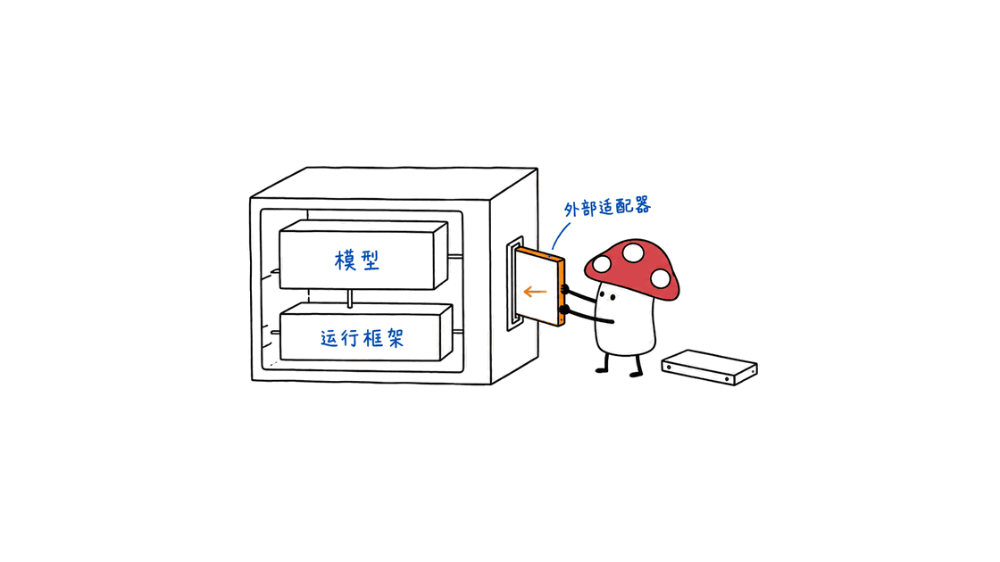

Hermit 根据任务反馈更新 Agent 的外部适配器，让指令、技能、记忆或工具随使用经验调整，同时保留原模型和原有运行框架。它提供的是一套可训练、可评测、可部署的工程流程。

项目由 Infini-AI-Lab 开源，采用 Apache-2.0。本文以 2026 年 10 月 29 日读取的源码提交 `2056e435d4be138358872208c3b233890cecf74c` 为准，源码版本为 `0.1.0`。同名软件包管理器 Hermit、其他同名 Agent 产品与本项目无关。

GitHub：https://github.com/Infini-AI-Lab/hermit

项目主页：https://infini-ai-lab.github.io/hermit/

## Hermit 学的是什么，和训练模型有什么区别？

可以把一个编程 Agent 分成模型、运行框架和外部适配器。模型负责推理，运行框架组织会话与工具执行；外部适配器则约定任务指令、技能、记忆、工具代码或协作方式。

Hermit 把最后这一层作为可更新对象。它的价值在于：团队可以利用现有宿主的扩展接口调整工作策略，而不必改模型权重，也不必直接改造原框架内部的复杂交互。



这里的训练不等于对基座模型做梯度更新。README 所说的 “RL-style training loop” 是按任务执行、收集反馈、提出更新、检查和保存版本的循环。它不意味着每种方法都使用同一种强化学习算法，更不意味着已证明通用的、无限递归的自我改进。

适配器也不是随便放一个提示词文件。它有规范，声明可学习内容、宿主如何加载、工具怎样暴露，以及更新如何检查。一个适配器能迁移到哪些模型或宿主，要看接口兼容性，不能仅凭“外置”就假定通用。

## 五种已支持方法该怎样选？

官方 README 当前列出五种已支持方法。方法文档进一步说明，它们的更新对象、额外开销和最终产物并不相同。

| 方法 | 主要用途 | 选择时最容易忽略的条件 |
|---|---|---|
| GEPA | 根据执行轨迹反思文本候选，并用验证集筛选 | 需要候选运行与验证预算，最佳验证候选未必是最新版本 |
| SkillOpt | 对技能文档做有边界的编辑，并支持验证门禁和元技能 | `use_gate: false` 不等于不做验证；慢更新还会增加调用 |
| MetaWorld Model | 从有顺序的环境经历中维护知识、程序与证据 | 需要任务侧提供证据存储和部署描述，不是任意提示词配置的一键替换 |
| Harness² | 针对每个任务改进候选 harness，并积累采用过的方案 | 当前接入保留初始适配器，主要成果在任务流及方案库，不能只看 `final` 目录差异 |
| Continual Harness | 按轨迹更新策略、子 Agent、技能与记忆 | 没有按性能分数做接受／拒绝筛选，结构检查仍然存在 |

GEPA、SkillOpt、Harness² 的上游依赖在源码依赖组中固定到 Git 提交。只安装 `hermit-harness` 核心包，不等于安装了所有算法依赖。当前从源码使用依赖组还要求 pip 25.1 以上。

方法总览：https://infini-ai-lab.github.io/hermit/docs/methods/

依赖配置：https://github.com/Infini-AI-Lab/hermit/blob/main/pyproject.toml

ACE 和 ReHarness 在当前 README 中仍列为 “Coming Soon”，不能写成已支持。ReHarness 链接指向论文《Recurrent Harness for Agentic Continual Learning》，仅凭这条链接不能确定完整代码是否开放。

素材提到未来与 Reef 对接训练后端。本次检索的仓库和文档没有找到可复现的 Reef 集成配方，因此这里只把它记录为素材中的合作计划，不把它计入当前可用能力。

ReHarness 论文：https://arxiv.org/abs/2610.12668

## 训练循环中，谁负责判断更新是否更好？

Trainer 负责批次、执行记录、规范检查、Git 版本、预算与恢复。任务 pipeline 决定 Agent 如何运行，judge 提供分数和反馈，Evolver 则决定如何产生更新、如何选择候选。


这个分工里最重要的一点是：**通过结构检查，不等于性能变好。** 文件完整、格式有效、修改路径符合规范，只能说明候选符合适配器约定。是否更准确、更省钱，仍要通过方法自身的筛选与独立评测判断。

训练日志中的连续两步也未必是公平对照。每步可能使用不同任务，而且该步得分描述的是更新前的输入适配器。直接把第 1 步和第 2 步分数连成“能力增长曲线”，容易把任务难度差异当成改进。

真正的比较应固定模型、工具、judge 和测试集，至少评测三种状态：不使用适配器 `none`、初始适配器 `root`、最终适配器 `final`。验证集可以参与选候选，测试集应留作最终评测。

Trainer 说明：https://infini-ai-lab.github.io/hermit/docs/framework/trainer.html

## 怎样在 Mac 上跑一次不调用模型的完整示例？

当前源码要求 Python 3.12+ 和 Git。PyPI 的 `hermit-harness==0.1.0` 元数据仍标 `>=3.11`，说明只看版本号不能区分全部源码变化。下面固定提交，用 Python 3.12；不要照旧的搜索摘要安装 Python 3.11 后期待当前源码可运行。

在独立目录执行：

```bash
git clone https://github.com/Infini-AI-Lab/hermit.git
cd hermit
git checkout 2056e435d4be138358872208c3b233890cecf74c
python3.12 -m venv .venv
source .venv/bin/activate
python -m pip install -e .
hermit --help
```

源码自带的 `first_training` 示例用一个教学 Agent 和脚本化 Evolver 演示反馈闭环，无需模型账户、GPU、外部数据集或 Codex CLI。依赖安装需要网络，安装后该示例本身不调用模型服务。

```bash
hermit check --config docs/_examples/first_training/run.yaml
hermit eval --config docs/_examples/first_training/run.yaml --adapter none
hermit train --config docs/_examples/first_training/run.yaml
hermit eval --config docs/_examples/first_training/run.yaml --adapter root
hermit eval --config docs/_examples/first_training/run.yaml --adapter final
```

`check` 中初始探测得分为 0 是这个示例的预期，不代表配置检查失败。测试任务要求大写输出，初始 Agent 只回显小写文本。脚本学习器读到 judge 的反馈后，把 `Output format: uppercase.` 写进 `ADAPTER.md`，后续执行便能读到这条规则。

Mycelium Protocol 在 Apple M4、16GB 内存、macOS 26.6.2、Python 3.12.14 环境中实跑了这套流程，结果如下：

| 适配器 | 测试任务数 | 平均得分 | 执行错误 |
|---|---:|---:|---:|
| none | 2 | 0.0 | 0 |
| root | 2 | 0.0 | 0 |
| final | 2 | 1.0 | 0 |

这不是大模型评测。Agent、学习器和格式规则都经过人为构造，结果只证明反馈、文件修改、版本保存、再次加载和评测能够连通。两道题的一次测试也不能说明泛化能力。

接着部署到这个独立测试工作空间：

```bash
hermit deploy \
  --adapter .demo/first-training/first-training/checkout \
  --workspace .demo/first-training/workspace \
  --host codex
cat .demo/first-training/workspace/AGENTS.md
```

实测生成的 `AGENTS.md` 包含学到的规则。在受管理区块外加一行测试说明后，再次部署仍保留该说明，并且只有一个适配器区块。这里的 `deploy` 只是生成宿主工作空间，没有启动真实 Codex 会话，也没有修改日常项目的配置。

完整示例：https://infini-ai-lab.github.io/hermit/docs/get-started/quickstart.html

## Mac 能跑到哪一步，什么时候需要 Linux？

本次 Mac 实测覆盖核心安装、离线教学训练、评测和上下文工作空间生成。16GB 是测试机器配置，不是官方最低内存；也不能据此推断任意本地模型都装得下。

| 工作 | 当前文档与实测边界 |
|---|---|
| 离线教学示例 | 本次 Mac 已验证，无 GPU 和模型账户 |
| 仅上下文的工作空间部署 | 文档支持 macOS、Linux；本次验证 Codex 格式文件生成 |
| 真实 API 模型任务 | 需要兼容模型端点、任务和 judge；本次未运行 |
| 带隔离的 learner program | 文档要求 Linux、bubblewrap 与可用 namespace |
| OfficeQA 等完整配方 | 还需数据、宿主 CLI、算法依赖和相应执行环境，不能套用离线示例配置 |

教学示例明确关闭 sandbox，执行的是随仓库提供的本地代码。把它用于学习契约可以，但不能把 `sandbox.network: none` 当成关闭 sandbox 时仍有网络隔离，也不应直接套到陌生的工具或学习程序上。

兼容文档还说明，隔离主要覆盖启动的 learner program，不覆盖整个 Python Trainer 进程；受限网络模式也不能当作不可绕过的安全边界。接真实业务前，要按实际执行路径核对权限。

兼容性：https://infini-ai-lab.github.io/hermit/docs/reference/compatibility.html

安全边界：https://github.com/Infini-AI-Lab/hermit/blob/main/SECURITY.md

## 怎样把它接进真实业务，而不只跑出一条漂亮曲线？

先选一种有重复失败、又能明确评分的任务，例如固定格式的工单分类、单据字段抽取或项目内代码修复。先把失败记录和评测标准整理好，再决定需要更新指令、技能还是工具代码。


1. 划分训练、验证与测试任务，保留真实的新案例，不让测试答案进入学习材料。
2. 用 `none` 和 `root` 建立基线，分清初始模板的作用与后续学习的作用。
3. 只开放必要的可学习路径，选择与更新对象相符的方法。短文档可以先试 GEPA 或 SkillOpt；有序环境知识再考虑 MWM。
4. 同时记录 acting、反思、候选执行和验证的调用成本。相同训练步数不代表相同开销，框架预算记录也可能受到在途调用或缺失用量影响。
5. 在固定测试集上复测 `final`，报告重复次数、错误与成本；保留可回退的 Git 版本，再决定是否部署。

Hermit 的实用价值是把这些实验步骤组织起来，让“改了一份提示词”变成能追查来源、评测与部署的适配器版本。是否值得上线，最终仍取决于团队自己的任务、反馈质量和测试结果。

相关阅读：Agent Relay 解决 Agent 之间如何通信和共享上下文；Hermit 解决外部适配器如何从经验中更新，两者是不同层面的基础设施。
https://blog.mushroom.cv/blog/agent-relay-coding-agent-collaboration/

## 常见问题

### Hermit 会训练或微调模型权重吗？

本文讨论的流程保留原模型与原运行框架，更新外部适配器。它不是安装后自动执行模型权重微调的工具。

### “支持算法”是否意味着所有依赖已装好？

不是。核心包与方法依赖分开安装，部分方法还需要模型账户、CLI、Linux 隔离环境或数据集。选定配方后应按对应文档准备。

### 示例从 0 到 1，能证明 RSI 成功了吗？

不能。它是脚本化格式任务，用来验证训练契约。真实的持续改进需要在未见任务上反复评测，还要计算更新的额外成本。

---

> © 2026 Author: Mycelium Protocol. 本文采用 [CC BY 4.0](https://creativecommons.org/licenses/by/4.0/deed.zh) 授权——欢迎转载和引用，须注明作者姓名及原文链接，不得去除署名后以原创发布。

<!--EN-->

Hermit updates an agent's external adapter from task feedback while keeping its model and original runtime unchanged. It provides a process for training, evaluating, versioning and deploying instructions, skills, memory or tools.

Infini-AI-Lab publishes the framework under Apache-2.0. This review uses commit `2056e435d4be138358872208c3b233890cecf74c`, inspected on October 29, 2026, with source version `0.1.0`. Unrelated package managers and agent products also use the name Hermit.

Repository: https://github.com/Infini-AI-Lab/hermit

Project: https://infini-ai-lab.github.io/hermit/

## What does Hermit learn?

A model performs inference. Its runtime organizes conversations and tool execution. An external adapter supplies task instructions, skills, memory, tool code or coordination behavior.

Hermit makes that external layer the update target. A team can use supported extension interfaces without changing model weights or editing the original runtime's internal interactions.


The README's RL-style loop runs tasks, collects feedback, proposes updates, checks them and saves versions. That description does not mean every method uses one reinforcement-learning algorithm. It also does not establish general, unbounded recursive self-improvement.

An adapter has a specification for learnable content, loading, tools and checks. Transfer across models or hosts depends on compatible interfaces.

## Which methods are available?

| Method | Purpose | Important condition |
|---|---|---|
| GEPA | Reflect on text candidates and select with validation | Candidate rollouts add cost; final selection can return an older candidate |
| SkillOpt | Bounded skill edits, validation gates and meta skills | Disabling its ordinary gate does not remove validation calls |
| MetaWorld Model | Maintain environmental knowledge, programs and evidence over time | Requires ordered episodes and task-owned evidence integration |
| Harness² | Refine harness candidates per task and retain adopted designs | This integration preserves the initial adapter; stream outputs and its library matter |
| Continual Harness | Update policy, subagents, skills and memory from trajectories | It has no performance-score acceptance gate, although structural checks remain |

The source dependency groups pin upstream GEPA, SkillOpt and Harness² packages to Git revisions. Installing the core package does not install every method. Source dependency groups require pip 25.1 or newer.

Methods: https://infini-ai-lab.github.io/hermit/docs/methods/

Dependencies: https://github.com/Infini-AI-Lab/hermit/blob/main/pyproject.toml

ACE and ReHarness remain marked Coming Soon. ReHarness links to *Recurrent Harness for Agentic Continual Learning*. That paper link alone does not establish the availability of complete source code.

The supplied material mentions future Reef training-backend integration. No reproducible Reef integration recipe was found in the inspected repository and documentation. It remains a reported plan, not a verified available feature.

Paper: https://arxiv.org/abs/2610.12668

## Who decides whether an update is better?

The Trainer manages batches, execution records, specification checks, Git versions, budgets and recovery. The pipeline runs the acting agent. The judge produces scores and feedback. The Evolver proposes updates and manages method-specific selection.


Passing a specification check establishes structural validity. It does not establish better performance or safe code. Accuracy and cost require method-specific selection and independent evaluation.

A training step's score describes its input adapter. Different steps can use different tasks. A rising sequence of step scores is therefore not a controlled comparison.

Hold the model, tools, judge and test set fixed. Compare no adapter (`none`), the initial adapter (`root`) and the selected result (`final`). Keep final test tasks separate from validation used for candidate selection.

Trainer: https://infini-ai-lab.github.io/hermit/docs/framework/trainer.html

## Run an offline training cycle on a Mac

The inspected source requires Python 3.12 and Git. PyPI metadata for `hermit-harness==0.1.0` still says Python 3.11 or newer. Version numbers alone do not identify every source change. This walkthrough pins the source commit and uses Python 3.12.

Use a separate directory:

```bash
git clone https://github.com/Infini-AI-Lab/hermit.git
cd hermit
git checkout 2056e435d4be138358872208c3b233890cecf74c
python3.12 -m venv .venv
source .venv/bin/activate
python -m pip install -e .
hermit --help
```

Dependencies need a network connection to install. The included `first_training` scenario then runs without a model account, GPU, external dataset or agent CLI. It uses a teaching agent and scripted Evolver.

```bash
hermit check --config docs/_examples/first_training/run.yaml
hermit eval --config docs/_examples/first_training/run.yaml --adapter none
hermit train --config docs/_examples/first_training/run.yaml
hermit eval --config docs/_examples/first_training/run.yaml --adapter root
hermit eval --config docs/_examples/first_training/run.yaml --adapter final
```

The initial probe score of zero in `check` is expected here, not an integration-check failure. The task requires uppercase output. The initial agent echoes lowercase text. After reading judge feedback, the scripted learner writes `Output format: uppercase.` into `ADAPTER.md`. Later executions load that rule.

Mycelium Protocol ran the scenario on an Apple M4 Mac with 16GB memory, macOS 26.6.2 and Python 3.12.14:

| Adapter | Test tasks | Mean score | Execution errors |
|---|---:|---:|---:|
| none | 2 | 0.0 | 0 |
| root | 2 | 0.0 | 0 |
| final | 2 | 1.0 | 0 |

These are constructed toy results, not an LLM benchmark. They verify feedback, editing, versioning, reloading and evaluation. One run on two test items does not establish generalization.

Deploy into the disposable workspace:

```bash
hermit deploy \
  --adapter .demo/first-training/first-training/checkout \
  --workspace .demo/first-training/workspace \
  --host codex
cat .demo/first-training/workspace/AGENTS.md
```

The generated file contained the learned rule. A second deployment preserved a test instruction outside the managed block and left exactly one adapter block. Deployment generated workspace files only. It did not start a real Codex session or alter everyday project settings.

Walkthrough: https://infini-ai-lab.github.io/hermit/docs/get-started/quickstart.html

## What can run on a Mac?

This Mac check covered core installation, deterministic training, evaluation and context-only workspace generation. Its 16GB memory is an observed configuration, not an official minimum or evidence that an arbitrary local model will fit.

| Work | Current boundary |
|---|---|
| Offline teaching example | Verified here on a Mac without a GPU or model account |
| Context-only workspace generation | Documented for macOS and Linux; Codex-format output verified here |
| Real API-model tasks | Require a compatible endpoint, task integration and judge; not tested here |
| Sandboxed learner programs | Require Linux, bubblewrap and permitted namespaces |
| Full OfficeQA recipes | Also require data, host CLI, method dependencies and the correct execution environment |

The teaching example explicitly disables the sandbox and executes included local code. Its `network: none` setting does not provide network isolation when the sandbox is disabled. Do not treat that setup as a template for unfamiliar executable tools or learners.

Compatibility documentation states that isolation covers launched learner programs rather than the complete Python Trainer process. Restricted-network behavior is also not an unbypassable boundary. Review actual execution paths before adding business data.

Compatibility: https://infini-ai-lab.github.io/hermit/docs/reference/compatibility.html

Security: https://github.com/Infini-AI-Lab/hermit/blob/main/SECURITY.md

## Move from the toy example to a business task

Choose a repeated task with identifiable failures and a usable scoring rule. Ticket classification, document-field extraction or repository-specific fixes are possible starting points. Decide whether the update target should be instructions, skills or tool code.


1. Separate training, validation and final tests. Keep test answers out of learning material.
2. Establish `none` and `root` baselines to distinguish template value from subsequent learning.
3. Allow only necessary learnable paths. Start with GEPA or SkillOpt for short documents; consider MWM for ordered environment knowledge.
4. Record acting, reflection, candidate and validation calls. Equal step counts do not imply equal costs. In-flight calls and missing usage can limit budget accounting.
5. Re-evaluate `final` on fixed tests with repeat counts, errors and costs. Retain a Git version to roll back before deployment.

Hermit organizes those experiments into traceable adapter versions. Production value still depends on the team's task, feedback quality and held-out results.

Related reading: Agent Relay handles communication and shared context between agents. Hermit handles updates to an external adapter from experience.
https://blog.mushroom.cv/blog/agent-relay-coding-agent-collaboration/

## Frequently asked questions

### Does Hermit fine-tune model weights?

The workflow reviewed here keeps the original model and runtime fixed. It updates an external adapter rather than automatically fine-tuning the base model.

### Does supported mean every dependency is installed?

No. Core and method dependencies are separate. Some recipes also require authenticated CLIs, models, Linux isolation or datasets.

### Does a score change from zero to one prove RSI?

No. This is a scripted formatting task that tests the framework contract. Real continual improvement needs repeated held-out evaluation and accounting for update costs.

---

> © 2026 Author: Mycelium Protocol. Licensed under [CC BY 4.0](https://creativecommons.org/licenses/by/4.0/) — free to share and adapt with attribution. You must credit the author and link to the original; removing attribution and republishing as original is not permitted.
