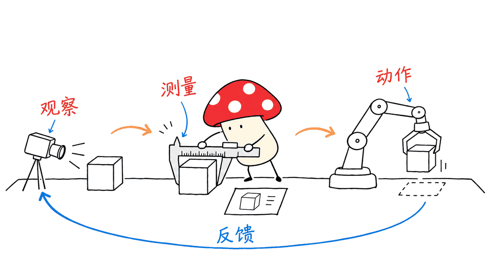
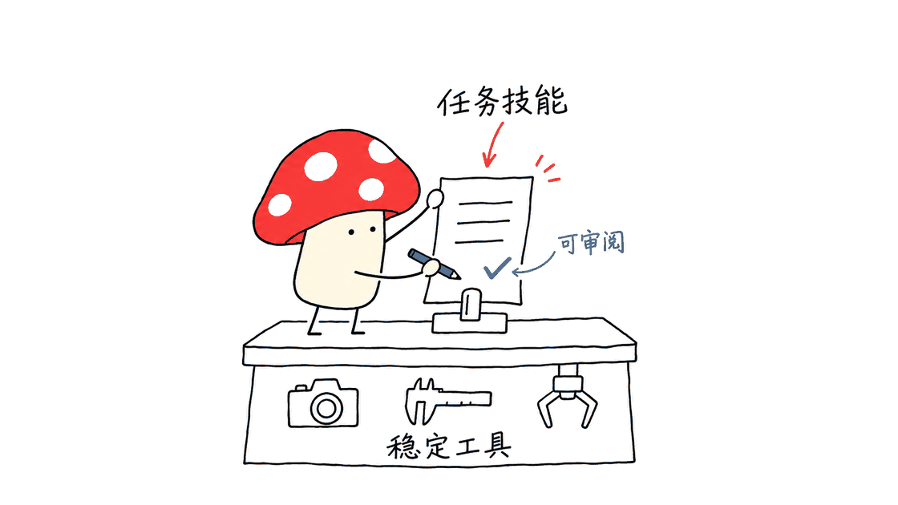
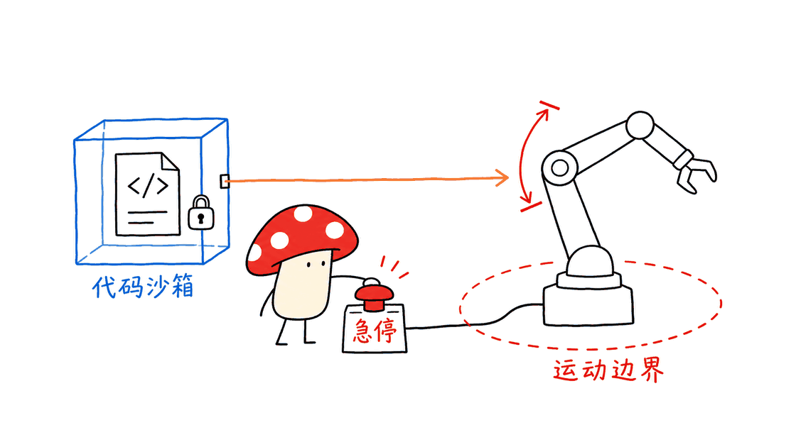

HexaShell把机器人操作变成编程智能体能反复调用的工具：看图、测量、移动，再检查结果。它的研究价值在于统一控制接口与反馈，而不是承诺接上任意机械臂就能自主完成一切工作。

官方仓库：https://github.com/HexaFuture/HexaShell

官方主页：https://hexafuture.ai

论文原文：https://github.com/HexaFuture/HexaShell/blob/main/hexashell_paper.pdf

当前分析固定在提交 `e0190ddb757955131578e9f9071f4ee8e7113f7a`。仓库主代码采用Apache-2.0，第三方仿真器、资产与SAM 3权重需要分别检查授权。2026年11月3日公布的当前方案，也需要与10月19日的HexaShell-Preview区分。

## HexaShell究竟开源了什么？

它提供机器人API、智能体循环、Python执行环境、运动与视觉模块，以及不同基准和真机的适配层、提示词、任务技能和评测脚本。项目公开的是可研究、可接入的工程框架，不是一个新下载即可运行的机器人策略权重。

“没有训练策略、没有示教数据”指这条控制路径不再训练专用动作策略。系统仍依赖已经预训练的视觉语言模型与分割模型，不能据此理解为不需要模型、不需要数据或推理零成本。

官方没有公开完整开发记录，包括早期回合轨迹、分析以及技能和提示词的演化版本。因此，代码可运行性与整个研究过程可从头复现，是两个不同层次的开放程度。

## 14个基础工具如何形成闭环？

工具分成三组，接口围绕模型需要判断的问题组织。

| 类型 | 数量 | 接口 | 作用 |
|---|---:|---|---|
| 运动 | 4 | goto、gripper、home、wait | 移动、开合夹爪、回位和等待 |
| 感知 | 5 | look、find、measure、to_world、to_pixel | 拍照、分割、测量与坐标转换 |
| 状态 | 5 | task、state、things、image、camera | 查询任务、机械臂状态与观察资源 |

每轮模型生成一个Python单元。执行输出与按需请求的图片回到上下文，模型再决定下一轮动作；不是把整段自然语言直接变成一串无法中途检查的关节命令。

`find`通过SAM 3按文字或点击分割对象；几何模块利用多视角轮廓或深度图估计三维位置、尺寸与抓取角度。这样，语言模型读取带误差估计的度量结果，而不是单靠看图片猜距离。

运动工具支持dry run，在消耗控制步之前检查动作。这里的“观察和思考不消耗步数”，说的是基准的控制步预算，不代表没有API账单、分割开销或墙钟延迟。



## 跨机器人复用，复用的究竟是哪一层？

官方覆盖RoboDojo、RoboCasa365、LIBERO-PRO和RoboTwin 2.0，底层涉及Isaac Sim、MuJoCo和SAPIEN。真实机器人路径则通过URAI服务连接双臂PiPER-X。不过，当前真机路径没有启用分割服务，缺少find、measure、things；它从图像读取像素，再用深度、已知平面或第二视角换算三维点。不能把仿真的完整14工具直接等同于真机现状。

复用对象主要是上层API、循环与沙箱。新增平台仍需要适配相机、本体感知、关节目标、坐标系、控制步与成功判定。官方称适配层约350至1450行，这个数字描述其已有移植案例，不能当作任意新设备的交付工作量。

URAI源码：https://github.com/HexaFuture/URAI

对团队而言，最值得先做的是设备契约：位置单位是什么、夹爪角度如何定义、运动何时算完成、失败是否能取消。相同函数名并不能消除相机标定和接触动力学差异。

## 技能为什么比大量专用工具更值得关注？

当前方案把任务知识写成约一页的指导，例如操作顺序、隐含成功条件或接触后才知道的参数。技能由分析智能体参考此前少量种子的记录起草，再由人审阅。

旧版TaskTools通过多轮修补生成327条任务命令，约7.8万行Python。新版改成通用工具加短技能，减少需要维护的任务代码；但两版同时改变了循环、感知、运动和提示词，不能把成绩差异全部归因于“文字技能优于代码”。

可迁移的工程判断是：把设备约束留在稳定工具层，把可审查的任务经验留在技能层。技能可以提议动作顺序，不能越过工具层的关节限制、急停条件或权限边界。



## 85.0%的成功率，应该怎样读？

下表均为官方报告，本次没有复跑这些完整评测。

| 场景 | 官方报告 | 阅读时的关键限制 |
|---|---|---|
| RoboDojo | 85.0%成功率、88.8进度得分 | 五个维度的宏平均，公开布局下自评 |
| RoboCasa365 | 85.6，1284/1500 | pretrain50中50任务，各30测试种子，并非官方完整协议 |
| LIBERO-PRO | 96.7%，1509/1560 | 指定扰动和状态；有技能与无技能主表不是同一组回合 |
| RoboTwin 2.0 | 96.8%，726/750 | 随机场景测试；无技能列使用不同种子及指令条件 |
| PiPER-X真机 | 76/90，约84.4% | 九种任务的报告结果，不代表任意家庭或工厂任务 |

真机76/90还需要额外限定：部分回合由另一个模型根据图片和反馈判定，而非逐回合人工复核；提示词和监督规则在回合间有调整。部分设备适配层与监督者未公开，PushT的8/10由成员报告且无逐回合记录。因此，这组数字不能视为一套完整、冻结、全部可复跑的公开真机测试。

RoboDojo有一个容易被传播丢掉的分母问题：有技能时总成功数1054、总回合1260，合并计算是83.65%；分别计算五个维度成功率，再让每个维度权重相同，结果才约为85.0%。两者都可以成立，但回答的是不同的统计问题。

无技能的857/1260约为68.0%，对应维度宏平均69.9%。文章不把这两种统计口径混在一起，也不把新版自评85.0与旧版官方评测46.9视作同条件提升。

更有解释力的是RoboDojo非Open部分的配对结果：同一批1020个回合中，成功数667变为864；其中234个只在有技能时成功，37个只在无技能时成功。技能整体带来帮助，也存在让原本成功的回合失败的情况。

**项目展示了有价值的工具与技能组合，但跨协议的高分并不构成独立确认的统一排名。** 论文附录还报告，RoboDojo非Open测试中，有技能的单回合平均27轮，累计约68.2万输入token，其中89%命中网关缓存，输出约7823token；平均墙钟591秒、中位407秒。缓存、任务和网关条件影响费用与耗时，这不是实时底层控制的延迟指标。

对生产使用者，还需要异常恢复、设备磨损与重复运行稳定性。

## 沙箱能隔离代码，能否保证机械臂安全？

官方实现把模型单元放入独立worker，模型API密钥留在驱动进程。Linux侧组合Landlock文件访问限制、seccomp和Python层的导入与文件检查；源码明确指出，Python包装用于友好报错，真正的隔离依赖系统机制。

Landlock与seccomp都有内核、架构和可用性条件。读取代码能确认设计，不能证明当前机器已启用相同强度的保护。上线时应检查实际初始化结果，并把缺失硬边界视为部署条件未满足。

即使代码无法访问网络，它仍可通过授权的运动API作用于现实。操作系统沙箱不会自动成为安全认证：速度、力矩、碰撞区域、看门狗和人工急停，需要留在控制系统及现场流程中。



## 如何入门，哪些部分已实际验证？

先克隆代码，在隔离Python环境中阅读API和运行无需设备的测试；之后再配置一种仿真器，接入SAM 3服务与模型接口，最后才讨论真机。不要第一步就把生成代码交给通电的机械臂。

```bash
git clone --recurse-submodules https://github.com/HexaFuture/HexaShell.git
cd HexaShell
# 官方策略环境为 Python 3.11
pip install -r requirements.txt
# 以下是本次选择的定向测试范围
python -m pytest -q tests/test_motion.py tests/test_vision.py tests/test_llm.py tests/test_benches.py tests/test_real_urai_sim.py
```

本次在Apple Silicon Mac的隔离Python 3.12.14环境中，按锁定requirements安装依赖，选择运动、视觉、模型协议、基准接口及URAI模拟集成共五个测试文件：134项通过、4项失败、1项跳过。URAI模拟集成因未安装URAI服务依赖而跳过；它不是一次真实URAI服务运行。

四个脚本回合测试最初停在凭据读取。使用明确的离线占位值后，测试仍保持假模型与假环境，随后暴露worker在设置RLIMIT_AS内存上限时抛出ValueError，主进程收到EOFError。未绕过限制、未修改源码，也未把这一macOS/Python环境失败推断为官方Linux栈必然失败。没有调用真实模型、SAM 3服务、GPU仿真器或机械臂。

完整路径要求带NVIDIA GPU的Linux、对应仿真环境、SAM 3权重访问权限和支持流式输出的模型接口。配置里的接口地址是占位符，需要自行填写。Mac可用于阅读与部分离线测试，不等于已支持完整本地仿真或Linux沙箱。

适合关注的是具身智能研究者、机器人软件工程师和希望研究Coding Agent控制路径的团队。最值得借鉴的不是排行榜口号，而是把观察、度量、动作、反馈与经验写成可检查的接口。

## 常见问题

### HexaShell能替代机器人底层控制器吗？

不能。它组织高层任务与工具调用，底层仍依赖运动模块、设备适配和仿真器或机器人控制服务。

### 开源是否等于所有依赖都能无条件商用？

不是。主仓库Apache-2.0不自动覆盖分割权重、仿真资产或外部服务，接入时需要逐项核对。

### 公开成绩是否已经被独立复现？

本文没有独立复现这些成功率。官方自己也标明协议差异；本次测试只能覆盖所选离线代码行为。

官方RoboCasa榜单已列出HexaShell 1.5的85.6条目，但列榜不改变仓库披露的协议差异：
https://robocasa.ai/leaderboard.html

相关工程阅读：https://blog.mushroom.cv/blog/dsh-go-android-harness-phone-agent-review/

---

> © 2026 Author: Mycelium Protocol. 本文采用 [CC BY 4.0](https://creativecommons.org/licenses/by/4.0/deed.zh) 授权——欢迎转载和引用，须注明作者姓名及原文链接，不得去除署名后以原创发布。

<!--EN-->

HexaShell gives a robot coding agent a small vocabulary for observing, measuring and moving. Its main contribution is an inspectable control loop shared across environments, with optional short task skills. It is a research framework, not evidence that arbitrary robots can autonomously handle arbitrary work.

Source: https://github.com/HexaFuture/HexaShell

Project: https://hexafuture.ai

Paper: https://github.com/HexaFuture/HexaShell/blob/main/hexashell_paper.pdf

This review fixes revision `e0190ddb757955131578e9f9071f4ee8e7113f7a`. The main code is Apache-2.0; dependencies, simulator assets and model weights have separate terms. The November 3 release differs from the October 19 Preview. Earlier development traces and intermediate skills are not included.

## What does the harness expose?

There are 14 basic tools: four motion tools (`goto`, `gripper`, `home`, `wait`), five perception tools (`look`, `find`, `measure`, `to_world`, `to_pixel`), and five state tools (`task`, `state`, `things`, `image`, `camera`). Each agent reply supplies a Python cell. Its output and requested images inform the next decision.

SAM 3 segments an object from words or a click. Geometry converts multiple views or depth into metric position, size and grasp orientation with error estimates. The model does not have to infer metric distance from appearance alone. Motion offers dry-run checks before consuming control steps.

“Thinking and looking cost no steps” concerns the simulator's action budget. It does not remove API billing, segmentation computation or elapsed time. Likewise, “no trained policy” does not mean no pretrained models: the framework uses a VLM and a segmentation model.


## What actually transfers across robots?

The shared API, agent loop and execution environment sit above benchmark adapters. The reported platforms include RoboDojo, RoboCasa365, LIBERO-PRO and RoboTwin 2.0, spanning Isaac Sim, MuJoCo and SAPIEN. A real dual-arm PiPER-X path uses URAI, but currently omits segmentation and the find, measure and things tools. It instead maps image pixels through depth, a known plane or another view. The complete simulated tool set should not be assumed on hardware.

URAI source: https://github.com/HexaFuture/URAI

Adapters still encode cameras, coordinate frames, proprioception, joint targets, action completion and evaluation contracts. The reported 350–1,450 lines describe existing adapters, not a universal integration estimate. Calibration, dynamics and contact behavior remain hardware concerns.

## Why separate tools from skills?

Short task skills carry ordering, implicit success conditions and contact-dependent hints. An analysis agent drafts them from earlier runs, followed by human review. Stable tools handle motion and perception; task knowledge remains readable guidance.

The earlier TaskTools version accumulated 327 task commands and roughly 78,000 lines of Python. Its comparison with the newer approach is suggestive, but several components changed together. It is not a clean ablation proving that prose alone caused the improvement. Skills should never override actuator constraints or emergency-stop rules.


## How should the reported scores be interpreted?

These are publisher-reported results, not benchmark reproductions performed for this article.

| Setting | Reported result | Scope |
|---|---|---|
| RoboDojo | 85.0% success; 88.8 progress | Five-dimension macro average; public-layout self-evaluation |
| RoboCasa365 | 85.6; 1,284/1,500 | 50 tasks and 30 seeds each, outside the full official protocol |
| LIBERO-PRO | 96.7%; 1,509/1,560 | Selected perturbations; main skill/no-skill columns use different episodes |
| RoboTwin 2.0 | 96.8%; 726/750 | Randomized tests; the no-skill column uses different seeds and instructions |
| Real PiPER-X | 76/90, about 84.4% | Nine tasks, not an open-ended deployment guarantee |

The 76/90 hardware result also needs qualification: a model supervisor judged some episodes rather than a complete per-episode human review, and prompts and supervision rules changed between runs. Some adapters and the supervisor are absent from the release; PushT includes a team-reported 8/10 without episode records. This is not a fully frozen, fully reproducible public hardware evaluation.

The RoboDojo denominator matters. Pooling all successful episodes yields 1,054/1,260, or 83.65%. Averaging the five dimension-specific rates yields about 85.0%, because dimensions have different task counts. Without skills, the corresponding figures are 857/1,260, about 68.0%, and 69.9% macro averaged.

A more informative paired comparison covers 1,020 non-Open episodes: 667 successes become 864, with 234 successes unique to the skill condition and 37 unique to the no-skill condition. Guidance helps overall but can also introduce regressions. The new self-evaluation and the old official Preview result are not directly interchangeable.

The paper reports an average skill-enabled non-Open RoboDojo episode at 27 turns, about 682,000 cumulative prompt tokens (89% cached), 7,823 output tokens and 591 seconds of elapsed time (407 seconds median). These are task- and gateway-dependent episode costs, not real-time low-level control latency. Operational acceptance also needs recovery behavior and repeatability. Comparing scores from different protocols does not establish an independently verified universal ranking.

## Does the sandbox guarantee physical safety?

The driver holds the model credential, while a separate worker executes generated cells. Linux confinement combines Landlock, seccomp and Python-level import/file checks. The latter are friendly error mechanisms rather than the primary security boundary. Kernel and architecture support affect the actual isolation available.

This is a design identified in source, not a completed security certification. Deployments must inspect initialization results and reject missing required boundaries. Even a network-isolated worker can move a robot through its allowed API. Speed limits, workspace exclusion zones, force limits, watchdogs and emergency stops belong to the physical control system.


## What was verified, and where should a team start?

Five selected files were tested on an Apple Silicon Mac with isolated Python 3.12.14 and the pinned requirements: 134 tests passed, four failed and one was skipped. The URAI simulator integration module skipped because URAI service dependencies were absent; no live URAI service ran.

The four scripted-episode tests first stopped at credential loading. Rechecking only those tests with an explicitly fake placeholder, still using their fake gateway and environment, reached worker startup and failed when RLIMIT_AS resource-limit setup raised ValueError; the parent observed EOFError. No confinement was bypassed and no source code was modified. This local macOS/Python failure does not establish failure on the documented Linux stack. No real model requests, SAM 3 service, GPU simulator or physical robot were exercised.

Start with an isolated Python environment and CPU tests. Then choose one simulator and configure its dependencies, the SAM 3 service and a streaming model endpoint. The official policy environment uses Python 3.11. The complete documented stack needs Linux and an NVIDIA GPU; some simulators require RTX. SAM 3 weights require access approval. Configuration files contain placeholder endpoint addresses.

Reading and selected offline tests on a Mac do not establish support for the complete GPU stack or Linux confinement. Move to hardware only after validating the adapter contract, action cancellation, calibration and operator controls.

## FAQ

### Is HexaShell a replacement for a low-level controller?

No. It coordinates high-level tools and relies on motion code, adapters and simulator or hardware services for execution.

### Does Apache-2.0 cover every dependency?

No. Check simulator assets, pretrained checkpoints and external services separately from the main repository license.

### Were the published success rates independently reproduced here?

No. The local evidence covers selected offline tests; all benchmark and real-robot success rates remain attributed to the project.

The RoboCasa leaderboard lists the 85.6 entry as HexaShell 1.5; this does not remove the protocol caveats disclosed by the repository:
https://robocasa.ai/leaderboard.html

Related engineering analysis: https://blog.mushroom.cv/blog/dsh-go-android-harness-phone-agent-review/

---

> © 2026 Author: Mycelium Protocol. Licensed under [CC BY 4.0](https://creativecommons.org/licenses/by/4.0/) — free to share and adapt with attribution. You must credit the author and link to the original; removing attribution and republishing as original is not permitted.
