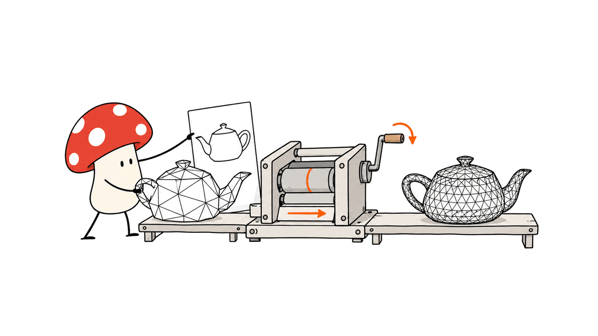
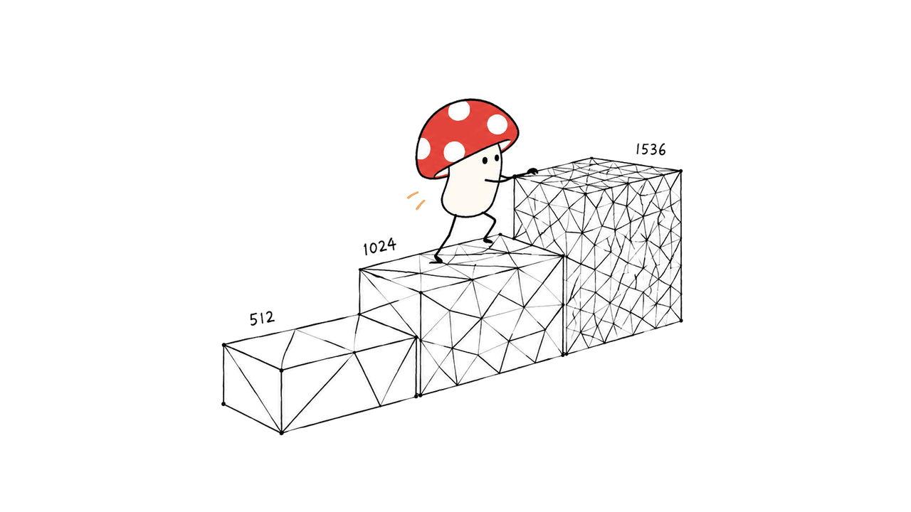
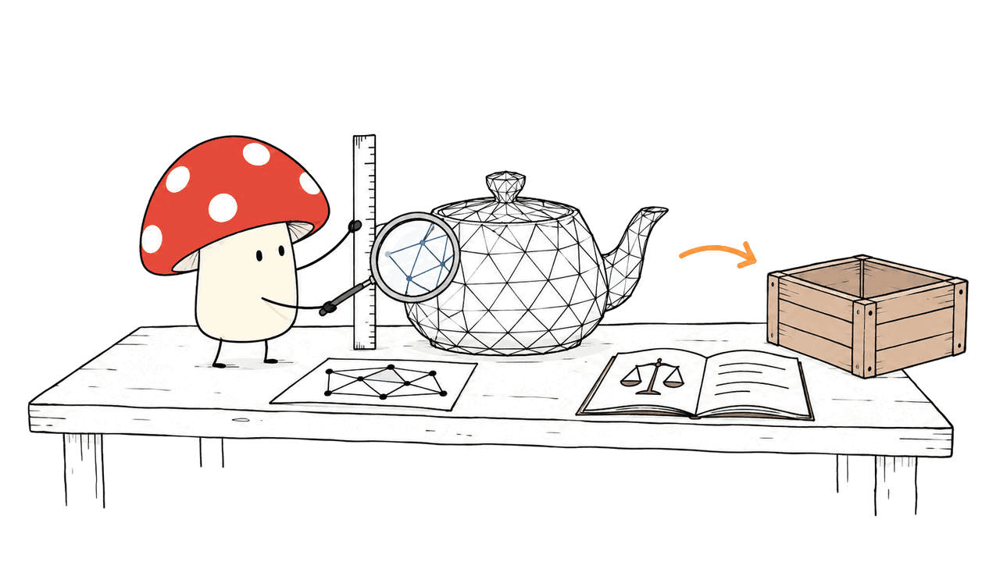

Hi3D v1.0可以把已有粗模细化成更精细的3D几何，但需要一张匹配的参考图，且当前公开推理依赖NVIDIA GPU。它值得已有3D生成流水线的团队测试；“生产验证”则是官方对自身部署经验的描述，不能替代你的资产验收。

官方于2026年10月23日发布代码与权重，核心实现沿用Sparc3D。Mycelium Protocol核对了README、9页技术报告、模型配置、权重文件头和许可；本次没有运行GPU推理，也没有复现论文横评。封面为主题示意图，不是该模型的生成结果。

本文原文：https://blog.mushroom.cv/blog/hi3d-v1-geometry-refinement/

## 仓库究竟开放了什么？

代码：https://github.com/hi3d-official/Hi3Dv1.0

权重：https://huggingface.co/hi3d-official/Hi3Dv1.0

官网：https://hi3d.ai/ · https://www.hi3d.cn/

此次释放的是第二阶段几何精修：输入同一物体的参考图和粗网格，输出高分辨率网格。Python包仍叫`sparc3d`，公共入口为`Sparc3DPipeline`。训练代码、论文评测流水线、测试划分和横评网格未随仓库提供。

仓库有可选的Hunyuan3D-2 mini粗模生成适配器，可以串成“图片→粗模→精修”。但Hunyuan代码和权重须另行获取、另守许可；它不是Hi3D这次自行开放的第一阶段模型。已有粗模时，直接使用`demo/refine_mesh.py`，不必安装Hunyuan。



这个分工决定了选型价值：若瓶颈是粗模主体已经正确、鳞片凹槽和薄片细节不足，Hi3D有明确接入位置；若粗模缺了一条腿、主体比例错误，精修不能保证把结构救回来。输出仅含几何，不生成纹理、材质或顶点色。

## 1536³意味着什么？

模型先从粗网格取得稀疏坐标，以参考图特征为条件采样潜变量，再经自裁剪稀疏VAE解码、抽取网格。继续升级分辨率时，会把上一轮网格重新体素化。

| 精修轮次 | 名义结构网格 | 稀疏表面提取网格 | 使用的Transformer |
| --- | --- | --- | --- |
| 第一轮 | 64³ | 512³ | transformer_512 |
| 第二轮 | 128³ | 1024³ | transformer_1024 |
| 第三轮 | 192³ | 1536³ | 复用transformer_1024 |

请求512跑一轮，1024跑两轮，1536跑三轮。1536³不是一个完整铺开的同尺寸稠密潜变量张量，也不代表固定三角面数。细节、活跃稀疏区域和解码特征都会影响资源占用，不能用下载体积直接推算显存。



官方报告称训练使用约200万精选3D资产，并增加高分辨率训练数据。报告明确不宣称新的生成目标、解码器或表面表示；主要贡献是现有Sparc3D体系中的数据规模、分辨率扩展和部署经验。不要与另一个项目Hi3DGen混为一谈。

## 官方横评应该怎样读？

以下均为官方技术报告的结果，不是我们的实测，也不是跨机构独立榜单：

| 指标 | Hi3D v1.0官方结果 | 应如何解释 |
| --- | --- | --- |
| 多视角保真MVF | 0.75 | 六个视角的结构一致性与伪影评分 |
| 细节丰富度DR | 0.841 | 浮雕、层次、小部件和不可见区域细节的综合评分 |
| 切片成功率SSR | 90% | 指定切片配置下通过的比例，不是实际打印成功率 |
| 人工偏好分 | 85.9% | 562次判断，平局计半分 |

人工研究有13名具3D算法专业经验的参与者，562次判断中Hi3D胜469次、平28次、负65次。85.9%的计算是`(469 + 28×0.5) / 562`，不是“562名用户中85.9%更喜欢它”。对Pixal3D的单独偏好分为56.9%，也不能用总体分掩盖不同对手间的差别。

它并非每个指标都第一。官方表中Hi3D的ULIP-2为48.07、Uni3D为42.14，均低于TRELLIS.2对应的49.32与44.18；SSR 90%也低于TripoSG的100%。这些结果支持“更重视几何细节和多视角”，不支持“所有方面全面碾压”。

SSR使用固定Bambu A1 0.4mm喷嘴、0.20mm层高与PLA配置，先把模型最长轴统一缩放到100mm；生成大于200字节的有效G-code是成功条件之一。切片通过不证明薄壁强度、装配公差或支撑可拆性，更不等于真实制造验收。

README展示的彩色图包含表面法线可视化，不是自动生成的彩色纹理；背面好看反映的是合理补全，而非从单张图恢复真实背面。仓库缺少完整评测材料，因此目前不能仅靠这份发布复现上述比较表。

## 普通电脑、Mac和消费显卡能跑吗？

官方支持路径是Linux、Python 3.10、计算能力至少8.0的NVIDIA GPU，以及匹配PyTorch的CUDA 12.0—12.5工具链。验证环境具体为Python 3.10.12、PyTorch 2.5.0+cu124、CUDA 12.4.131和H20 96GB。

1536³完整阶梯只在这一显卡环境中得到官方验证。仓库没有确立较小显存显卡的最低容量，因此不把“24GB一定能跑”写成结论。`flash-attn`没有后备注意力路径，也不存在已支持的CPU推理路线。

Mac目前适合做参考图准备、网格检查以及远程GPU任务提交。Apple Silicon的统一内存不能替代CUDA支持；即使是大内存Mac，也不能据此承诺本地MPS或MLX运行。

我们的可复核检查只读取了Hugging Face配置与Safetensors文件头：VAE文件376,629,712字节，两份Transformer文件各3,675,679,280字节，三份合计约7.73GB，尚不含DINOv2、CLIP等依赖。两份Transformer各约18.05亿张量元素，VAE约9415万个元素；这里是存储元数据统计，不是独立去重后的架构参数证明，更不是运行内存测试。

`sequential CPU offload`是把模型分段在CPU和GPU间搬运，并不让计算改为纯CPU，也不保证某个显存容量足够。启用时不要再与`.to("cuda")`混用。

## 怎样接入现有流水线？

先在官方匹配环境中完成一个低分辨率样例，再逐级增加分辨率。下面是官方安装路径的整理，未在本次Mac环境执行：

```bash
git clone https://github.com/hi3d-official/Hi3Dv1.0.git
cd Hi3Dv1.0
git checkout 13657ad09afaa92e350b461a1cd66399e44a59c4
# 在独立Python 3.10环境中执行
pip install torch==2.5.0+cu124 torchvision==0.20.0+cu124 \
  --extra-index-url https://download.pytorch.org/whl/cu124
pip install packaging ninja psutil
pip install --no-build-isolation flash-attn==2.7.4.post1
pip install -c docker/constraints.txt -e ".[inference]"
python demo/refine_mesh.py \
  --model hi3d-official/Hi3Dv1.0 \
  --image input.png --coarse-mesh coarse.glb --output refined.glb \
  --resolution 512 --num-inference-steps 25 --seed 0
```

第一次运行还要获取`facebook/dinov2-large`与`openai/clip-vit-large-patch14`，部分GPU内核首次编译也会增加启动时间。不能把首轮下载编译耗时与稳定推理耗时混报。

完全离线要准备Hi3D本地目录以及这两个编码器目录，通过`--model`、`--dino-model`、`--clip-model`指定，并加`--local-files-only`。若还串联Hunyuan粗生成，其离线配置要另外处理，不能以为精修端的参数覆盖了上游。

建议固定一批有代表性的输入：平滑曲面、薄翼、重复细纹、镂空结构各若干。保存参考图、粗模、最终网格、模型版本、种子、调度器和环境；相同种子不保证GPU稀疏计算逐位一致，用几何差异比较，而不是要求文件哈希相等。

## 到“能用的资产”还差哪些验收？

我的判断是，Hi3D最适合成为可替换的精修工位，而不是直接充当生产交付承诺。用同一批粗模对比512、1024、1536，记录用时、峰值显存、失败率与人工修复分钟数，比只看局部放大图更能判断是否省钱。



验收至少覆盖四件事：多视角检查缺件与漂浮碎片；检查退化面、自交和应用要求的水密性；按用途减面、重拓扑、UV和贴图；在实际引擎或切片器中复测。动画还需要检查绑骨变形，仿真需要碰撞和物理属性，尺寸件需要量测。

输出会重新居中并归一化到单位最大半径，不能保留输入的世界坐标和绝对尺度。若接入工业零件、机器人或已有场景，要显式恢复尺寸与坐标变换。几何细节增加本身也不会自动带来可用碰撞体或可信物理参数。

可结合我们对仿真资产结构的检查理解这层差距：https://blog.mushroom.cv/blog/nvidia-simready-assets-audit/

## 商用许可有哪些条件？

截至本次固定版本，Hi3D自有或获授权部分采用Hi3D Open License Agreement Version 1.0，并非统一MIT或Apache-2.0许可。原有第三方部分保留各自授权，样例媒体、外部模型等也不自动被该协议覆盖。

协议允许商业使用。集成进商业产品或服务时，需要按第7节展示`Powered by Hi3D 1.0`及相应官网链接；相关产品服务月活超过20万，或月收入达到100万美元时，须在60天内通知并申请另行书面授权，且适用关联服务合并与过渡条款。

仅销售、编辑或交付不含Hi3D代码、权重及模型衍生物的独立输出文件，不会仅因使用该模型而触发上述品牌、协议分发或规模授权义务。但输出中的第三方权利仍需单独处理。部署模型提供API，与把生成的网格卖给客户，是协议中不同的情况。

原始条款：https://github.com/hi3d-official/Hi3Dv1.0/blob/13657ad09afaa92e350b461a1cd66399e44a59c4/LICENSE

## 常见问题

### 能只给一张图片吗？

核心精修需要粗网格与参考图。仓库可选示例会另外调用Hunyuan生成粗模，但那是独立依赖，不代表Hi3D第一阶段模型也随本次发布开放。

### 能直接用于游戏或3D打印吗？

可以作为候选几何输入，但仍需按用途验收拓扑、尺寸、材质与可制造性。官方90%切片成功率是特定测试配置下的结果，不是任意资产的打印保证。

### “经过生产验证”是否得到独立证明？

报告称模型曾用于真实用户生产系统，并称线上系统已演进至v3.0；这是团队自述。本次公开推理材料与有限评测不足以证明你自己的吞吐、稳定性或生产成功率。

核对时间：2026-10-26。GitHub固定版本：13657ad09afaa92e350b461a1cd66399e44a59c4；权重固定版本：d502e938cbedc6e87aba8884614c5ca6d177a4b6。

技术报告：https://github.com/hi3d-official/Hi3Dv1.0/blob/13657ad09afaa92e350b461a1cd66399e44a59c4/docs/Hi3D_v1.0_Technical_Report.pdf

架构前作Sparc3D：https://arxiv.org/abs/2505.14521

复现范围说明：https://github.com/hi3d-official/Hi3Dv1.0/blob/13657ad09afaa92e350b461a1cd66399e44a59c4/docs/reproduction.md

---

> © 2026 Author: Mycelium Protocol. 本文采用 [CC BY 4.0](https://creativecommons.org/licenses/by/4.0/deed.zh) 授权——欢迎转载和引用，须注明作者姓名及原文链接，不得去除署名后以原创发布。

<!--EN-->

Hi3D v1.0 refines an existing coarse mesh using a matching reference image. Its released inference path requires NVIDIA GPUs. Teams with an established 3D generation pipeline have a concrete reason to evaluate it; the authors' production-deployment claim does not replace acceptance testing on your own assets.

Released on October 23, 2026, the system builds on Sparc3D. Mycelium Protocol reviewed its README, nine-page report, model configurations, weight headers and license. We did not run GPU inference or reproduce the comparison benchmarks. The cover is an illustrative image, not Hi3D output.

Original article: https://blog.mushroom.cv/blog/hi3d-v1-geometry-refinement/

## What exactly is available?

Code: https://github.com/hi3d-official/Hi3Dv1.0

Weights: https://huggingface.co/hi3d-official/Hi3Dv1.0

Website: https://hi3d.ai/ · https://www.hi3d.cn/

The release covers second-stage geometry refinement. It consumes a coarse mesh and reference image of the same object and produces refined geometry. The package and API retain their existing names, `sparc3d` and `Sparc3DPipeline`. Training code, benchmark splits, comparison meshes and the report's evaluation harness are not included.

An optional adapter uses Hunyuan3D-2 mini to generate the coarse mesh first. That implementation and its weights must be obtained separately under their own terms. If you already have a coarse mesh, `demo/refine_mesh.py` does not require Hunyuan.


This makes Hi3D relevant when the overall object is already correct but grooves, scales or thin features need improvement. Major structural mistakes can survive refinement. Outputs contain geometry only: no generated textures, materials or vertex colors.

## What does 1536³ actually describe?

Image features condition a sparse flow model on coordinates derived from the coarse geometry. A self-pruning sparse VAE decodes the features, a surface is extracted, and that mesh is revoxelized before the next pass.

| Pass | Structural grid | Sparse extraction grid | Transformer |
| --- | --- | --- | --- |
| 1 | 64³ | 512³ | transformer_512 |
| 2 | 128³ | 1024³ | transformer_1024 |
| 3 | 192³ | 1536³ | transformer_1024 reused |

A 512 request runs one pass; 1024 runs two; 1536 runs three. These are nominal sparse grid resolutions, not a dense 1536³ latent tensor or a guaranteed triangle count. Active support and decoded features also affect resource requirements.


The report describes approximately two million curated training assets and additional high-resolution training. It explicitly does not claim a new objective, decoder or surface representation. The contribution is scaling and deployment within the Sparc3D design. Hi3DGen is a separate project, despite the similar name.

## How strong is the evaluation evidence?

The following are author-reported results, not measurements from this review:

| Metric | Reported Hi3D result | Interpretation |
| --- | --- | --- |
| Multi-view fidelity | 0.75 | Consistency and artifact assessment across six views |
| Detail richness | 0.841 | Relief, layering, small parts and unseen-region detail |
| Slicing success | 90% | Success under one specified slicer configuration |
| Human preference score | 85.9% | 562 judgments, with half credit for ties |

Thirteen participants with professional 3D-algorithm experience supplied 562 judgments: 469 wins, 28 ties and 65 losses. Thus `(469 + 28/2) / 562` produces 85.9%. It does not mean 562 separate users participated. The preference score against Pixal3D alone was 56.9%, illustrating why the aggregate should not stand in for every comparison.

Hi3D did not lead every metric. Its ULIP-2 and Uni3D scores were 48.07 and 42.14, below TRELLIS.2's 49.32 and 44.18. Its 90% slicing success was below TripoSG's 100%. The report supports a particular balance of detail and multi-view quality, rather than universal dominance.

The slicing experiment normalized each object's longest dimension to 100mm and used fixed Bambu A1, 0.4mm nozzle, 0.20mm layer and PLA settings. A non-trivial G-code artifact above 200 bytes was part of the success criterion. This is not a physical print test, mechanical-strength test or tolerance guarantee.

Colored comparison renders include surface normals, not generated textures. Hidden views show plausible completion, not recovered ground truth. Missing evaluation materials prevent reproducing the full comparative tables from this release alone.

## Can a Mac or consumer GPU run it?

The documented path requires Linux, Python 3.10, NVIDIA compute capability at least 8.0 and a matching CUDA 12.0–12.5 toolkit. The authors validated Python 3.10.12, PyTorch 2.5.0+cu124 and CUDA 12.4.131 on an H20 96GB GPU. The full 1536 ladder was validated there; minimum memory requirements on smaller GPUs are not established.

There is no supported CPU inference path, and flash attention has no fallback. Apple unified memory does not provide CUDA compatibility. A Mac can prepare images, inspect meshes or operate a remote GPU, but native MPS or MLX inference is not established by the release.

Our independent HTTP Range inspection read configurations and Safetensors headers only. The VAE file is 376,629,712 bytes; each transformer file is 3,675,679,280 bytes. Together they total roughly 7.73GB before external encoders. Each transformer contains about 1.805 billion tensor elements and the VAE about 94.15 million. These are storage metadata counts, not deduplicated architectural parameter proof or runtime-memory measurements.

Sequential CPU offload transfers model components between CPU and GPU. It neither enables CPU-only inference nor guarantees fit on a particular GPU. Do not combine that mode with `.to("cuda")`.

## How should a team deploy and evaluate it?

Start in an isolated Python 3.10 environment on a supported Linux CUDA machine. The following adapts the documented installation; it was not executed on the Mac used for this audit:

```bash
git clone https://github.com/hi3d-official/Hi3Dv1.0.git
cd Hi3Dv1.0
git checkout 13657ad09afaa92e350b461a1cd66399e44a59c4
pip install torch==2.5.0+cu124 torchvision==0.20.0+cu124 \
  --extra-index-url https://download.pytorch.org/whl/cu124
pip install packaging ninja psutil
pip install --no-build-isolation flash-attn==2.7.4.post1
pip install -c docker/constraints.txt -e ".[inference]"
python demo/refine_mesh.py \
  --model hi3d-official/Hi3Dv1.0 \
  --image input.png --coarse-mesh coarse.glb --output refined.glb \
  --resolution 512 --num-inference-steps 25 --seed 0
```

First use also downloads `facebook/dinov2-large` and `openai/clip-vit-large-patch14`; GPU kernels may compile. Separate those costs from steady-state inference timing.

For offline refinement, provide local copies of the refinement artifacts and both encoders with `--model`, `--dino-model`, `--clip-model` and `--local-files-only`. The optional Hunyuan coarse stage needs separate offline configuration. Pin its dependencies too if using the complete chain.

Keep a representative test set covering smooth surfaces, thin wings, repeated relief and holes. Preserve the images, coarse and final meshes, artifact revisions, scheduler, seed and environment. Sparse GPU operations are not bitwise deterministic, so compare geometry rather than demanding identical file hashes.


Treat refinement as a replaceable pipeline stage. Measure latency, peak memory, failures and manual cleanup time at each resolution. Inspect multiple views, degenerate faces, self-intersections and application-specific watertightness. Game assets still need suitable topology, UVs, materials and deformation tests; simulation assets require collision and physical properties.

Outputs are recentered and normalized to unit maximum radius. Original world coordinates and absolute scale are not preserved. Explicitly restore the transformation when integrating with measured parts, robots or existing scenes.

Related asset-structure audit: https://blog.mushroom.cv/blog/nvidia-simready-assets-audit/

## What are the commercial-license conditions?

Hi3D-owned or authorized portions use the custom Hi3D Open License Agreement Version 1.0. Existing third-party Apache and MIT rights remain where applicable; external models and sample media are not automatically covered by the Hi3D agreement.

Commercial use is permitted subject to its conditions. Commercial integrations must display `Powered by Hi3D 1.0` with the specified website reference. Related services exceeding 200,000 monthly active users or reaching USD1,000,000 monthly revenue must notify the licensor and apply for a separate written license within 60 days, subject to aggregation and transition terms.

Merely editing, displaying or selling standalone outputs containing no Hi3D materials or model derivatives does not itself trigger these branding, distribution or scale-license duties. Third-party rights still apply. Selling mesh files and operating a model-backed API are therefore different cases under the agreement.

License: https://github.com/hi3d-official/Hi3Dv1.0/blob/13657ad09afaa92e350b461a1cd66399e44a59c4/LICENSE

## FAQ

### Is a reference image sufficient on its own?

No. Core refinement requires a coarse mesh too. The optional Hunyuan adapter supplies a separate first stage with its own installation and licensing requirements.

### Is the output immediately game-ready or printable?

It is candidate geometry. Validate topology, scale, materials and manufacturing requirements yourself. Reported slicing success is not a universal printing guarantee.

### Was production readiness independently verified here?

No. Production use and a later v3.0 system are author statements. We audited public source materials and artifact metadata, not deployment reliability, inference performance or production success rates.

Reviewed October26,2026. GitHub revision: 13657ad09afaa92e350b461a1cd66399e44a59c4. Weight revision: d502e938cbedc6e87aba8884614c5ca6d177a4b6.

Technical report: https://github.com/hi3d-official/Hi3Dv1.0/blob/13657ad09afaa92e350b461a1cd66399e44a59c4/docs/Hi3D_v1.0_Technical_Report.pdf

Sparc3D: https://arxiv.org/abs/2505.14521

Reproduction scope: https://github.com/hi3d-official/Hi3Dv1.0/blob/13657ad09afaa92e350b461a1cd66399e44a59c4/docs/reproduction.md

---

> © 2026 Author: Mycelium Protocol. Licensed under [CC BY 4.0](https://creativecommons.org/licenses/by/4.0/) — free to share and adapt with attribution. You must credit the author and link to the original; removing attribution and republishing as original is not permitted.
