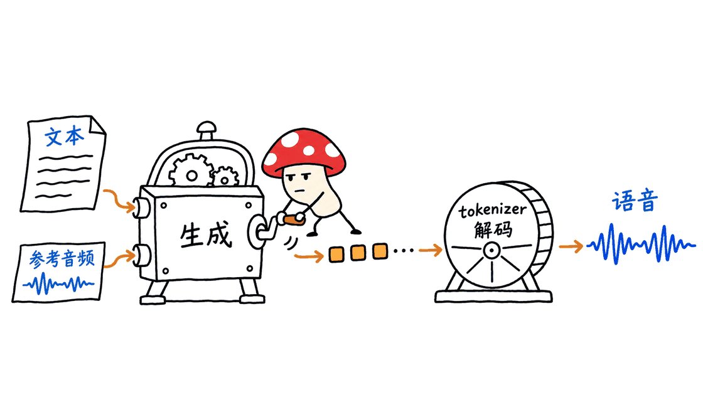
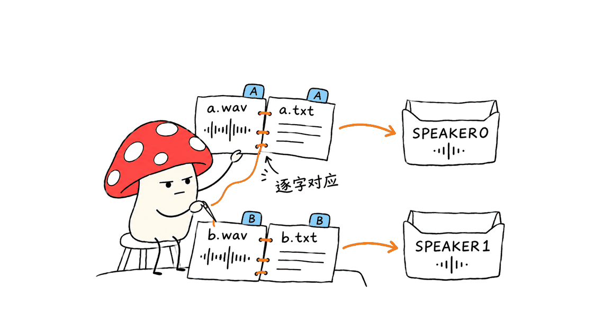
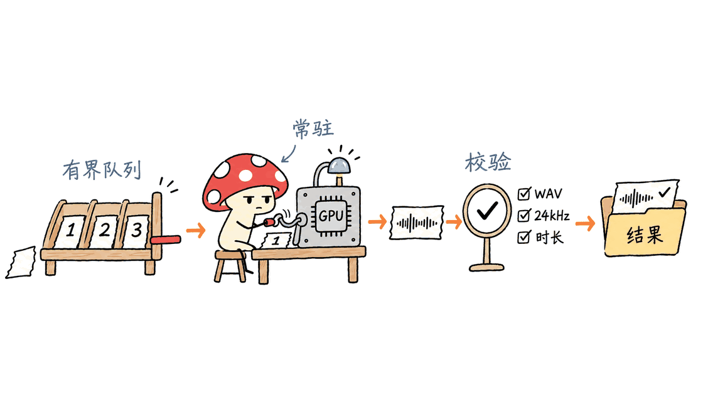

Higgs Audio v2 能把文本生成带音色和表现力的语音，适合自建旁白、角色对白和播客制作流程。它提供可下载权重与推理代码，但权重有独立许可；先用一段短文本跑通，再考虑服务化，比直接搭“实时全双工助手”更符合这个模型的能力边界。

Boson AI 的官方代码在 https://github.com/boson-ai/higgs-audio 。本次核查固定代码提交 `05a145bb490501b534563bf51bf2f7aa2326b271`。截至 2026 年 11 月 9 日，仓库首页主推 v3，v2/v2.5 的使用说明已移到 `README_V2.md`；模型卡也注明 Higgs Audio V2 已更名为 Higgs TTS 2。本次请求旧模型地址会解析为 `bosonai/higgs-tts-2-3b-base`，检查点 revision 为 `d80c511612b3040ff2877ce3d408747df1739f11`；tokenizer revision 为 `815a03f1b57dcb5ae918db415f22cd0c8a6f0f54`。下文使用转换前的兼容快照，而不是这个当前 revision。

## 先下载哪两个东西？

| 组成 | 官方地址 | 用途 |
| --- | --- | --- |
| 生成模型 | https://huggingface.co/bosonai/higgs-audio-v2-generation-3B-base | 根据文本和可选音色参考生成音频表示 |
| 音频 tokenizer | https://huggingface.co/bosonai/higgs-audio-v2-tokenizer | 参考音频编码、输出音频解码 |
| v2 使用说明 | https://github.com/boson-ai/higgs-audio/blob/main/README_V2.md | 安装、单人和多人生成 |
| 服务说明 | https://github.com/boson-ai/higgs-audio/tree/main/examples/vllm | 官方定制 vLLM 镜像及接口 |

`3B` 是检查点名称的一部分，不能当作整条音频流水线的精确参数量或显存预算。归档说明标注了约 3.6B 语言骨干与 2.2B 音频适配部分；权重之外，还要考虑 tokenizer、KV cache、激活和运行时。

结构上，它在 Llama-3.2-3B 骨干上加入 DualFFN 音频专家，使文本与声音表示有共享上下文、也有音频专用处理能力；多码本音频使用 delay pattern 组织生成。工程上因此不能只把一个文本模型接上普通 WAV 解码器，还需要匹配的模型实现、音频 tokenizer 和输入格式。

这条开放的生成路径不等于完整语音助手。输入语音识别、对话模型、工具调用、打断控制和前端播放，仍需由应用搭建。原生 Duplex 的边听边说架构是另一个产品主题，可对照我们此前的核查：
https://blog.mushroom.cv/blog/higgs-realtime-duplex-open-weights-pricing-engineering/



## 是不是开源？商业使用需要检查什么？

根目录推理代码采用 Apache-2.0；生成权重和音频 tokenizer 则采用 Boson Higgs Audio 2 Community License，并纳入 Llama 3 相关条款。不能把代码许可证自动套到模型上。

这份社区许可允许符合条件的使用，但包含署名、再分发、衍生模型命名，以及限制用材料或输出改进其他大语言模型等要求。若使用方及其关联方相关产品或服务在上一自然年的年活跃用户超过 10 万，需要向 Boson 申请扩展许可。判断时要读完整文本，不能把“下载免费”写成“无限制商用”。原文：
https://huggingface.co/bosonai/higgs-audio-v2-generation-3B-base/blob/main/LICENSE

自托管的成本主要是 GPU、存储和运维，并非按 Boson API 的 token 单价自动收费；模型授权仍另行适用。当前官网其他 TTS 或 Realtime 的收费，也不能当成 v2 本地部署的报价。

## 先解决一个当前的版本兼容问题

当前模型的 `config.json` 声明 `higgs_audio_v2` / `HiggsAudioV2ForConditionalGeneration`，而归档代码注册的是 `higgs_audio` / `HiggsAudioModel`。提交历史显示 2026 年 4 月发生 Transformers 格式转换，随后删除了旧分片。仅按 README 下载 main，会把两代实现混在一起。

本文选择转换前的模型 revision `10840182ca4ad5d9d9113b60b9bb3c1ef1ba3f84`：其配置仍为 `higgs_audio`，文件列表仍包含三个权重分片与索引。这是配置和文件层面的兼容核对，并非完成了权重加载。tokenizer 也要配套固定到 `9d4988fbd4ad07b4cac3a5fa462741a41810dbec`：旧加载器读取 `model.pth`，当前 main 已删除该文件并改用 safetensors。请勿手改 `model_type` 来冒充转换；最新原生 Transformers 路线需另按相应实现验证。

## 如何先跑通一个最小样例？

官方建议生成示例使用至少 24GB GPU 显存，并列出验证过的 NVIDIA PyTorch 25.01/25.02 容器。以下走 Linux + NVIDIA CUDA 路线；先确认驱动与容器 GPU 支持，再准备 Python 3.10 虚拟环境。这里给出经源码核对的命令，本文没有实际启动 GPU 推理。

```bash
git clone https://github.com/boson-ai/higgs-audio.git
cd higgs-audio
git checkout 05a145bb490501b534563bf51bf2f7aa2326b271
python3.10 -m venv .venv
source .venv/bin/activate
python -m pip install -r requirements.txt
python -m pip install -e .
python - <<'PYCODE'
from huggingface_hub import snapshot_download
snapshot_download(
    "bosonai/higgs-tts-2-3b-base",
    revision="10840182ca4ad5d9d9113b60b9bb3c1ef1ba3f84",
    local_dir="models/higgs-v2",
)
snapshot_download(
    "bosonai/higgs-audio-v2-tokenizer",
    revision="9d4988fbd4ad07b4cac3a5fa462741a41810dbec",
    local_dir="models/audio-tokenizer",
)
PYCODE
python examples/generation.py \
  --model_path models/higgs-v2 \
  --audio_tokenizer models/audio-tokenizer \
  --transcript "你好，这是一次本地语音生成测试。" \
  --temperature 0.3 --seed 12345 \
  --out_path hello.wav
```

首次运行涉及下载模型，tokenizer 的语义分支还可能拉取 HuBERT 等辅助依赖；离线部署要预热并核对整个依赖缓存，而不只是复制两个目录。复现环境应同时记录代码提交、两个模型仓库 revision、PyTorch/CUDA 和依赖锁定结果；只固定代码不能固定持续更新的模型别名。`requirements.txt` 把 Transformers 限制在 `>=4.45.1,<4.47.0`，不宜未经验证就升级到最新版。

先检查 WAV 能否解码、采样率和时长，再听是否漏读、重复或读错数字。随后才加入音色参考、长文和并发。低显存失败时先缩短文本、降低同时在途任务数量并检查 cache 配置，不要把 24GB 建议理解为任意上下文长度和批量都不会溢出。

当前脚本包含 `auto/cuda/mps/cpu` 设备分支，MPS 路线把音频 tokenizer 放在 CPU，并关闭静态 KV cache。源码存在适配分支不等于本文验证了 Mac 音质、速度和内存；Mac 也不应照搬 NVIDIA 容器命令。

## 声音克隆为什么需要“音频 + 转写”？

`--ref_audio` 常用形式是预设名称，不是随意传入一个绝对 WAV 路径。脚本会在 `examples/voice_prompts/` 查找同名 `.wav` 与 `.txt`，把参考文本与参考音频作为上下文。使用自己获授权的声音时，先准备这对文件：

```text
examples/voice_prompts/my_voice.wav
examples/voice_prompts/my_voice.txt
```

`.txt` 应是参考录音实际说出的内容，不是这次想生成的新台词。随后运行：

```bash
python examples/generation.py \
  --model_path models/higgs-v2 --audio_tokenizer models/audio-tokenizer \
  --transcript "欢迎收听今天的项目更新。" \
  --ref_audio my_voice \
  --temperature 0.3 --seed 12345 \
  --out_path cloned.wav
```

我的工程建议是保留干净、单人、无背景音乐的参考录音，并维护音色 ID、授权来源、转写、文件校验和与版本。参考更长不一定更好：它会增加上下文预算，噪声和错配转写也会把错误条件带入生成过程。具体最佳长度应在目标语种和设备上评测。

多人对白可用 `[SPEAKER0]`、`[SPEAKER1]` 标注台词，以逗号分隔参考名称，按顺序对应说话人。例如：

```bash
python examples/generation.py \
  --model_path models/higgs-v2 --audio_tokenizer models/audio-tokenizer \
  --transcript examples/transcript/multi_speaker/en_argument.txt \
  --ref_audio belinda,broom_salesman \
  --ref_audio_in_system_message \
  --chunk_method speaker --seed 12345 \
  --out_path dialogue.wav
```

这里沿用官方预设名称展示接线方式；实际产品应换成用途明确的授权音色，并逐轮检查角色是否串音、漏句或在长对话中漂移。



## 长文本、流式与吞吐应该怎样理解？

源码 `prepare_chunk_text` 提供不分块、按说话人和按词分块。`speaker` 把后续续行归入当前角色，可用 `--chunk_max_num_turns` 合并若干轮；`word` 对中文使用 jieba 分词，对其他语言按空格切分。参数名里的“word”不是跨语种恒定的字符数。

对于文章旁白，可以先尝试 `--chunk_method word --chunk_max_word_num 100`，再在实际文稿上比较断句、衔接和音色一致性。这是输入文本的分段策略，不能直接宣称它实现了浏览器低延迟流式播放。网络输出格式、解码节奏、播放缓冲和取消协议仍是独立问题。

音频 tokenizer 使用 24kHz 音频、25 帧/秒表示。25Hz 表示模型侧音频帧率，既不是播放器采样率，也不是“首包 40ms”的承诺。原理说明：
https://github.com/boson-ai/higgs-audio/blob/main/tech_blogs/TOKENIZER_BLOG.md

官方 vLLM 文档报告 A100 40GB 约 1500 token/s、RTX 4090 24GB 约 600 token/s，并换算为每秒生成 60/24 秒音频。这些是作者环境下的吞吐报告，不能当成我们测得的单请求延迟或任意部署保证。上线时应另测排队、首段可播放时间、完整任务耗时、并发与显存峰值。

## 如何变成应用可调用的服务？

官方提供专用 `bosonai/higgs-audio-vllm` 镜像，不应假定普通最新版 vLLM 直接支持相同参数。建议先在私有 GPU 主机完成官方示例，并把实际使用的镜像 digest 固定下来；`latest` 只适合发现入口。

```bash
docker run --gpus all --ipc=host --shm-size=20gb --network=host \
  -v "$(pwd)/models:/models:ro" \
  bosonai/higgs-audio-vllm:latest \
  --served-model-name higgs-audio-v2-generation-3B-base \
  --model /models/higgs-v2 \
  --audio-tokenizer-type /models/audio-tokenizer \
  --limit-mm-per-prompt audio=50 --max-model-len 8192 \
  --port 8000 --gpu-memory-utilization 0.8 \
  --disable-mm-preprocessor-cache
```

这段配置根据官方参数增加了本地模型目录挂载，以避免默认拉取新格式权重；镜像与本地 tokenizer 路径的实际兼容仍需 GPU 环境确认。本文没有拉取并运行该镜像；host 网络会使用主机网络，先在受控网络测试，不要把示例当成已经带鉴权的公网网关。随后可用官方语音接口：

```bash
curl --fail-with-body http://localhost:8000/v1/audio/speech \
  -H 'Content-Type: application/json' \
  -d '{"model":"higgs-audio-v2-generation-3B-base","voice":"en_woman","input":"A short deployment check.","response_format":"pcm"}' \
  -o speech.pcm
ffmpeg -f s16le -ar 24000 -ac 1 -i speech.pcm speech.wav
```

这里的 PCM 是无 WAV 文件头的 24kHz、单声道、16 位小端数据；直接给它改 `.wav` 后缀不会变成 WAV。自定义服务音色还需通过 `--voice-presets-dir` 加载目录，并将宿主目录挂载进容器；配置包含各音色的 `transcript` 和 `audio_file`。

应用层我建议采用“任务提交 → 有界队列 → 常驻 GPU worker → 结果存储”的结构，而不是每个 HTTP 请求重新加载模型。用文本、音色版本、检查点 revision 与生成参数共同组成缓存键；请求 ID 与任务状态持久化，客户端断线后才能可靠查询结果。

对互动助手还要加独立的播放 generation ID：用户打断时丢弃旧音频，决定是否取消后台生成。把 TTS 放进这个系统，并不会自动得到原生全双工模型。鉴权、文本上限、队列上限、超时、音频保留期与日志脱敏也应在网关和任务边界处理。



## 本文实际验证了什么？

Mycelium Protocol 核对了固定提交的 CLI、参考音色解析、设备分支和服务文档，并比较转换前后模型配置与文件清单，并在本机运行了从上游 AST 提取的真实文本预处理函数：覆盖默认完整输入、说话人续行、两轮合并、特殊 speaker 标签、非法分块方式和中文标点归一化，共 6 项检查。没有加载模型，也没有将这些检查算成语音效果测试。

本文没有下载完整权重、运行 CUDA/MPS 生成、启动 vLLM、试听本地产物，或复现作者速度与音质榜单。75.7% 情绪胜率来自作者的特定评测和基线；同一官方表中 Seed-TTS WER 为 2.44，高于 ElevenLabs 的 1.43，足以说明“表现力强”不代表每个准确性指标都领先。

对真正准备落地的团队，我会先做一个约 20 条的固定验收集：中文、英文、数字日期、专名、问句、多人换轮和长文衔接。记录错漏字、重复、角色一致性、首段时间与整段耗时，保留失败样本。通过后再扩容，才能知道改动是在改善可用性，还是仅让演示更好听。

## 常见问题

### Higgs Audio v2 和 Higgs TTS 2 是两个模型吗？
模型卡说明这是名称调整。复现时以模型 ID、revision 和推理代码提交识别版本，不凭营销名称猜兼容性；v2.5 和 v3 也不能直接混用本篇步骤。

### 只有 8GB 显卡可以照抄吗？
官方原版生成说明建议至少 24GB 显存。本篇没有验证量化、小显卡或 CPU 的可用速度；社区移植需要单独核对模型格式、许可、功能和实际显存。

### 想做语音 Agent，下一步是什么？
先把 v2 做成稳定的 TTS worker，再接 ASR、对话模型、工具编排和打断播放。需要原生同时听说时，另行评估全双工模型，不能用 TTS 吞吐替代整套交互体验。

---

> © 2026 Author: Mycelium Protocol. 本文采用 [CC BY 4.0](https://creativecommons.org/licenses/by/4.0/deed.zh) 授权——欢迎转载和引用，须注明作者姓名及原文链接，不得去除署名后以原创发布。

<!--EN-->

Higgs Audio v2 turns text into expressive speech for narration, character dialogue and podcast workflows. Boson AI publishes inference code and downloadable weights under different licenses. The practical starting point is a short, repeatable synthesis job, followed by voice conditioning and serving.

This review pins https://github.com/boson-ai/higgs-audio at `05a145bb490501b534563bf51bf2f7aa2326b271`. As checked on November 9, 2026, the front page covers v3; the v2/v2.5 guide lives in `README_V2.md`. The model card says Higgs Audio V2 was renamed Higgs TTS 2. The old URL currently resolves to `bosonai/higgs-tts-2-3b-base`, revision `d80c511612b3040ff2877ce3d408747df1739f11`; the tokenizer revision is `815a03f1b57dcb5ae918db415f22cd0c8a6f0f54`. Commands below use a historical compatible snapshot instead of the current revision.

## Which artifacts do you need?

Generation checkpoint:
https://huggingface.co/bosonai/higgs-audio-v2-generation-3B-base

Audio tokenizer:
https://huggingface.co/bosonai/higgs-audio-v2-tokenizer

Archived instructions:
https://github.com/boson-ai/higgs-audio/blob/main/README_V2.md

The checkpoint name is not a complete memory budget. The archived guide labels approximately 3.6B language-backbone parameters and 2.2B audio-adapter parameters. Runtime also needs the tokenizer, KV cache and activations.

The architecture adds DualFFN audio-specific processing to a Llama-3.2-3B backbone, with a delay pattern across audio codebooks. Deployment therefore requires compatible model code, an audio tokenizer and the expected conditioning format, rather than a text-only model plus a generic WAV decoder.

The released generation pipeline is a TTS component. An assistant still needs recognition, dialogue, tool execution, playback and interruption handling. Native Duplex is a separate architecture:
https://blog.mushroom.cv/blog/higgs-realtime-duplex-open-weights-pricing-engineering/


## What is open, and can it be used commercially?

The root code license is Apache-2.0. Both generation weights and the audio tokenizer use a Boson community license incorporating Llama 3 terms. It contains attribution and redistribution duties, derivative naming requirements and restrictions on improving other LLMs with the materials or outputs. Above 100,000 annual active users in the preceding calendar year, the specified licensee/affiliate scope requires an expanded license. Read the complete terms:
https://huggingface.co/bosonai/higgs-audio-v2-generation-3B-base/blob/main/LICENSE

Self-hosting incurs infrastructure and operating costs rather than automatically paying Boson API token rates. Download access does not remove model-license conditions. Prices for other current Boson services are not a quote for this local v2 deployment.

## Resolve the current format mismatch first

The current model configuration declares `higgs_audio_v2` and `HiggsAudioV2ForConditionalGeneration`. The archived package registers `higgs_audio` and `HiggsAudioModel`. Model history records a Transformers conversion in April 2026, followed by deletion of legacy shards. A code pin plus model main can therefore mix incompatible implementations.

We select the pre-conversion revision `10840182ca4ad5d9d9113b60b9bb3c1ef1ba3f84`, whose configuration declares the legacy type and whose file inventory retains three shards plus their index. This is configuration/file compatibility inspection, not a successful weight-loading test. Also pin the tokenizer to `9d4988fbd4ad07b4cac3a5fa462741a41810dbec`: the legacy loader reads `model.pth`, which current main deleted in favor of safetensors. Do not simply rename the model type; the newer native Transformers route needs its own implementation and validation.

## How do you generate the first file?

The official examples recommend at least 24GB of GPU memory and list NVIDIA PyTorch containers 25.01/25.02 as tested environments. These commands target a Linux NVIDIA CUDA environment with a working driver and Python 3.10. They were checked against source, not executed with a GPU here.

```bash
git clone https://github.com/boson-ai/higgs-audio.git
cd higgs-audio
git checkout 05a145bb490501b534563bf51bf2f7aa2326b271
python3.10 -m venv .venv
source .venv/bin/activate
python -m pip install -r requirements.txt
python -m pip install -e .
python - <<'PYCODE'
from huggingface_hub import snapshot_download
snapshot_download(
    "bosonai/higgs-tts-2-3b-base",
    revision="10840182ca4ad5d9d9113b60b9bb3c1ef1ba3f84",
    local_dir="models/higgs-v2",
)
snapshot_download(
    "bosonai/higgs-audio-v2-tokenizer",
    revision="9d4988fbd4ad07b4cac3a5fa462741a41810dbec",
    local_dir="models/audio-tokenizer",
)
PYCODE
python examples/generation.py \
  --model_path models/higgs-v2 \
  --audio_tokenizer models/audio-tokenizer \
  --transcript "A short local speech generation check." \
  --temperature 0.3 --seed 12345 --out_path hello.wav
```

The tokenizer semantic branch can also fetch an auxiliary HuBERT model; prewarm and inventory all dependency caches before claiming an offline deployment. Record both model revisions, dependency versions, CUDA/PyTorch and the code commit. A pinned code checkout does not pin a moving model alias. Requirements constrain Transformers to `>=4.45.1,<4.47.0`; upgrading blindly can break this older implementation.

Verify WAV decoding, sample rate and duration, then listen for missing words, repetition and number pronunciation. Add references, long text and concurrency only after this baseline. The 24GB recommendation does not guarantee every batch size and context length fits.

The current script has CUDA, MPS and CPU branches. Its MPS path moves the audio tokenizer to CPU and disables static KV cache. Source support is not a measured Mac performance claim; NVIDIA container instructions do not apply directly to Mac.

## How does reference-based voice cloning work?

For ordinary presets, `--ref_audio my_voice` looks for a pair of files in `examples/voice_prompts/`: `my_voice.wav` and `my_voice.txt`. The text must transcribe the reference recording, not contain the new target sentence. An arbitrary absolute WAV path is not equivalent to a preset name.

```bash
python examples/generation.py \
  --model_path models/higgs-v2 --audio_tokenizer models/audio-tokenizer \
  --transcript "Welcome to today's project update." \
  --ref_audio my_voice \
  --temperature 0.3 --seed 12345 --out_path cloned.wav
```

Use an authorized, clean, single-speaker reference and maintain its transcript, checksum, version and provenance. Longer references increase context use and are not automatically better. Determine a suitable duration with your language and hardware.

For dialogue, speaker tags such as `[SPEAKER0]` and `[SPEAKER1]` correspond to the order of comma-separated references:

```bash
python examples/generation.py \
  --model_path models/higgs-v2 --audio_tokenizer models/audio-tokenizer \
  --transcript examples/transcript/multi_speaker/en_argument.txt \
  --ref_audio belinda,broom_salesman \
  --ref_audio_in_system_message \
  --chunk_method speaker --seed 12345 --out_path dialogue.wav
```

This uses official presets to show wiring. A product needs appropriately authorized voices and per-turn checks for omissions, speaker swaps and voice drift.


## What do chunking and throughput actually mean?

`prepare_chunk_text` supports unchanged input, speaker-based chunks and word-based chunks. Speaker mode keeps continuation lines with the current speaker and can merge several turns. Word mode uses jieba segmentation for Chinese and space splitting for other languages. The chunk limit is not a universal character count.

For narration, try `--chunk_method word --chunk_max_word_num 100`, then inspect transitions and voice consistency. Text chunking alone does not establish low-latency browser streaming: output transport, decoding, buffering and cancellation require separate engineering.

The tokenizer uses 24kHz audio with a 25Hz representation. That frame rate is neither the playback sampling rate nor a promise of a 40ms first packet:
https://github.com/boson-ai/higgs-audio/blob/main/tech_blogs/TOKENIZER_BLOG.md

The vLLM README reports roughly 1500 tokens/s on A100 40GB and 600 on RTX 4090 24GB, expressed as 60 and 24 audio seconds per generation second. These are author-reported throughput figures. They do not establish our single-request latency or your production capacity. Measure queueing, time to first playable segment, completion time, concurrency and peak memory separately.

## How can an application call a service?

The official route uses a custom image, not an assumption that stock current vLLM accepts these arguments. Pin the resolved image digest for deployment; the following `latest` tag reproduces the documented entry point. The command adapts official arguments to mount pinned local snapshots and avoid fetching the converted model. Image compatibility with these local artifacts still needs a GPU check. We did not pull or run this image.

```bash
docker run --gpus all --ipc=host --shm-size=20gb --network=host \
  -v "$(pwd)/models:/models:ro" \
  bosonai/higgs-audio-vllm:latest \
  --served-model-name higgs-audio-v2-generation-3B-base \
  --model /models/higgs-v2 \
  --audio-tokenizer-type /models/audio-tokenizer \
  --limit-mm-per-prompt audio=50 --max-model-len 8192 \
  --port 8000 --gpu-memory-utilization 0.8 \
  --disable-mm-preprocessor-cache
```

Host networking uses the host network. Start on a controlled host and add a gateway; this example is not an authenticated public service. The documented speech request is:

```bash
curl --fail-with-body http://localhost:8000/v1/audio/speech \
  -H 'Content-Type: application/json' \
  -d '{"model":"higgs-audio-v2-generation-3B-base","voice":"en_woman","input":"A short deployment check.","response_format":"pcm"}' \
  -o speech.pcm
ffmpeg -f s16le -ar 24000 -ac 1 -i speech.pcm speech.wav
```

PCM here is raw 24kHz mono signed 16-bit little-endian audio. Renaming it `.wav` does not add a WAV header. Custom server presets require a mounted directory, `--voice-presets-dir` and a configuration mapping voices to `transcript` and `audio_file`.

My suggested service architecture is submission, a bounded queue, a resident GPU worker and result storage. Cache keys should include text, voice version, checkpoint revision and generation settings. Persist request IDs and task status so a disconnected client can retrieve the outcome.

For an interactive assistant, track playback generation IDs and discard stale audio on interruption. Decide explicitly whether interruption also cancels generation. Gateway authentication, text limits, queue limits, deadlines and audio retention belong at application boundaries. Adding TTS does not produce native full duplex.


## What did we actually verify?

Mycelium Protocol inspected CLI options, preset resolution, device handling and service instructions at the pinned commit, plus model configurations and file inventories before and after conversion. Six local checks executed the actual upstream text helpers extracted through Python AST: unchanged input, speaker continuation, two-turn grouping, special speaker tags, invalid chunking mode and Chinese punctuation normalization. This avoids importing or loading the model and does not test synthesis.

We did not download full weights, run CUDA/MPS generation, start vLLM, listen to generated output or reproduce quality and speed benchmarks. The reported 75.7% emotion preference rate uses a specific evaluation and baseline. The same official table lists Seed-TTS WER 2.44 versus ElevenLabs 1.43, showing that expressiveness does not imply universal accuracy leadership.

Before scaling, build a fixed acceptance set of roughly 20 cases covering both languages, numbers, names, questions, speaker transitions and long narration. Track omissions, repetitions, voice consistency, first-segment latency and completion time, and retain failures for comparison. This is a proposed engineering procedure, not a completed model evaluation.

## FAQ

### Is Higgs TTS 2 different from Higgs Audio v2?
The model card documents a rename. Identify the artifact with its model ID, revision and code commit. Do not assume v2.5 or v3 uses identical instructions.

### Can an 8GB GPU run these commands unchanged?
The original example recommends at least 24GB. This review does not establish smaller-GPU, quantized or CPU performance. Community ports need separate format, feature, license and memory checks.

### What comes next for a voice agent?
First stabilize a TTS worker. Then add ASR, dialogue, tool orchestration and interruption-aware playback. Evaluate native full-duplex models separately when simultaneous listening and speaking is a requirement.

---

> © 2026 Author: Mycelium Protocol. Licensed under [CC BY 4.0](https://creativecommons.org/licenses/by/4.0/) — free to share and adapt with attribution. You must credit the author and link to the original; removing attribution and republishing as original is not permitted.
