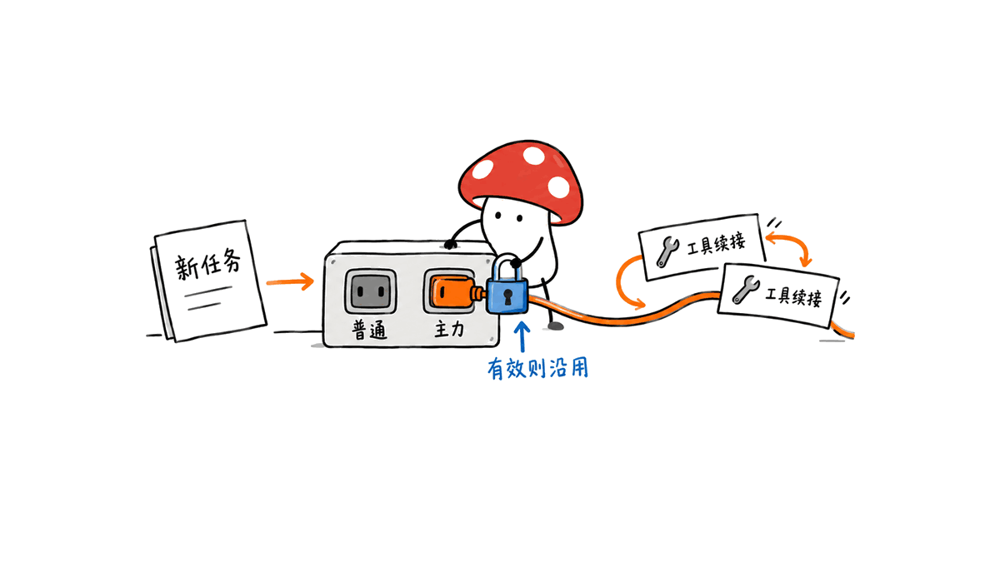
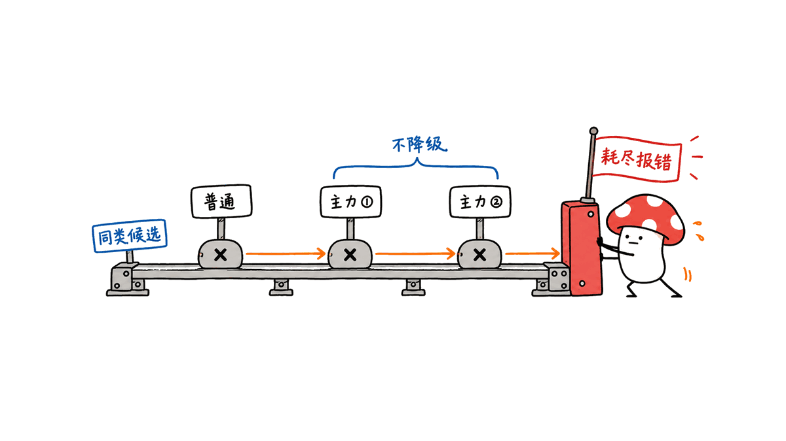
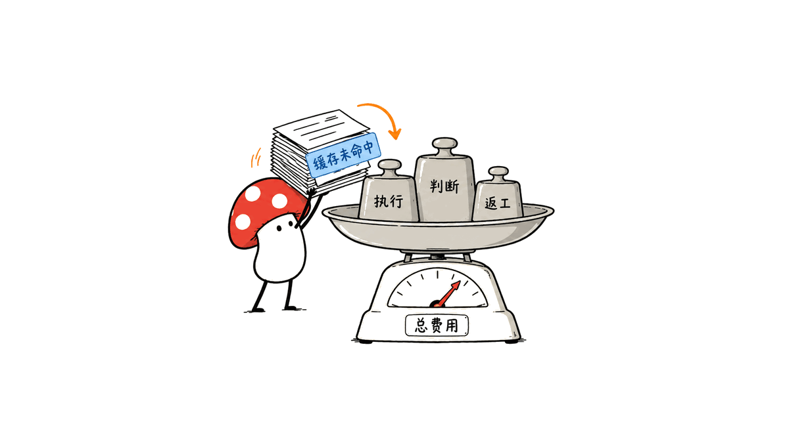

HiRoute 是一个在本地运行的模型路由器，让编程助手根据当前任务，在经济型模型和主力模型之间选择。它希望减少简单工作的高价模型开销，同时保留明确的故障处理和执行记录。

项目由 higress-group 开源，采用 Apache-2.0。本文以源码提交 e538dad8f6afde54e167f2e3be3d2394c8d2bb1f 为核查对象。它是请求调度与审计层，不提供免费的模型算力，也不保证接入后自动获得固定比例的成本下降。

仓库：https://github.com/higress-group/HiRoute
文档：https://hiroute.ai/en/docs/

## 一次长任务里，哪些步骤值得换模型？

修一个缺陷可能同时包含读目录、理解接口、设计修复和运行测试。整段任务始终使用最强模型，可能在机械操作上付出不必要成本；但每一次工具调用都换模型，也可能破坏上下文连续性并增加缓存费用。

HiRoute 的当前设计是在识别到可用的新任务输入时重新判断。一个回合内的工具续接通常沿用已经捕获的决定，前提是系统能够确认连续性和原决定有效。它不是简单地看见一条新 HTTP 消息就随机挑模型。



这一点比“大小模型混用”本身更重要。路由层必须知道哪一段是用户新要求，哪一段只是工具返回、辅助摘要或子任务，否则可能在错误的时刻重新分类。

## 难度、表现评分与执行模型怎样分工？

难度路由有普通与主力两组候选模型。决策模型给出任务判断，路由器结合阈值、适用的完整阶段评分和已发布规则选择组，再按候选顺序执行。缺失或部分评分应保持未评级，不能被当作高质量完成的证据。

自定义分支还可以区分起草、审查等任务类别。某个类别的低表现，不应无条件升级其他类别；旧规则下的评分也不能随意套到新版本配置上。项目为类别、发布修订和冻结评分标准设置关联条件。

决策模型负责判断，不等于它亲自完成用户任务。配置时至少要分清：判断服务、经济执行模型、主力执行模型。决策请求本身也可能需要费用、网络和额外延迟。

## 故障转移是否会偷偷降低能力？

官方规则是有边界的候选接力。普通组候选失败时，可以按同类别规则转向主力组；已经选择主力组时，接力留在主力组，耗尽后显式报错。故障本身不产生能力评分，也不改变任务类别。



因此，用户仍需认真配置候选顺序与能力条件。把一个能力不符的廉价接口塞进主力组，不能靠组名获得质量保障。会话记录应检查实际执行的候选，而非只看计划名称。

## 本地运行，是否等于数据全程不出电脑？

不是。路由器和会话界面运行在本地，但决策服务与执行模型可以来自远程供应商，也可以是本地兼容端点。数据是否离机，取决于连接方式和每条路由的实际目标。

当前文档支持通过内置连接使用 Bailian、OpenRouter Jev、TypeSafe 或兼容的决策端点；自定义扩展用于接管判断、评分和上下文裁剪等部分。仅为了使用内置决策连接，不一定需要自建 Jev 服务。

macOS 桌面版当前要求 macOS 15+，支持 Apple Silicon 和 Intel；Linux 提供 x86_64 与 ARM64 的 CLI/daemon。先连接模型，再发布路由计划，最后把 Agent 客户端接入；不应先覆盖已有编程助手配置再回头确认计划是否可用。

下载安装：https://hiroute.ai/download/

## 成本到底该怎样算？

模型切换可能失去原供应商的前缀缓存命中。经济模型的 Token 单价更低，不代表某次切换一定更便宜：还要算重新读取长上下文、决策调用、重试、失败后的返工与总耗时。

一个可落地的比较方式是固定任务集，对照固定主力模型和路由策略，比较“每个验收通过任务的总费用”，并同时记录失败率与人工修正。供应商返回的用量、按价目表推算的费用和最终账单，也应分开标记。



官方有案例宣传较大幅度节省，但它们有特定模型、任务和参数条件，本文没有重跑，不把案例比例写成所有用户都能获得的保证。可先用一组非敏感的小任务验证路由质量，再扩大使用范围。

## 本地检查发现了什么？

本次在 Python 3.12.14 下运行仓库现有的四个 Hermes 适配测试文件，共 28 项。结果为 26 项通过、2 项等待时间上限断言失败，保留原始日志，没有修改测试门限，也没有反复重跑以取得全绿。

```bash
python3 -m unittest discover -s scripts/tests -p 'test_hermes_*.py' -v
```

这组检查使用合成请求与测试数据库，覆盖请求头、会话身份、工具和流式参数保留等边界。失败集中在祖先会话证明相关的时间断言，尚未独立确定原因。它既不能证明真实供应商端到端路由通过，也不足以断言整个产品不可用。

本文没有安装桌面版、改动现有 Codex/Claude Code 配置、调用付费服务或测量节省比例。初次部署应进一步检查新任务识别、断线恢复、候选耗尽与真实账单，不能把接入成功当成验收终点。

相关评测方法：https://blog.mushroom.cv/blog/personalagenteval-personal-agent-benchmark/

## 常见问题

### 它会把每次工具调用都交给不同模型吗？

通常不会。同一回合的工具续接会在连续性和决定有效时复用原选择，新任务输入才可能触发重新判断。

### 开源免费是否意味着模型调用免费？

不是。项目代码采用 Apache-2.0，模型订阅、API、决策服务和运行资源仍按实际连接产生费用。

### 能否默认相信表现评分？

不能。需要确认评分是否完整、对应哪个执行阶段、使用哪版规则，以及是否适用于当前任务类别；缺失记录应保留未知。

### 最适合什么团队？

已有多模型使用需求、能观察任务验收和成本数据的开发者。若只使用一个模型且没有稳定验收集，先建立记录与基线更有价值。

来源：项目 README、路由与恢复限制文档、决策扩展说明及本地测试日志。核心判断是：省钱的前提不只是找到便宜模型，而是正确划分任务边界，并能看见错误选择的代价。

原文与更新：https://blog.mushroom.cv/blog/hiroute-local-model-routing/

---

> © 2026 Author: Mycelium Protocol. 本文采用 [CC BY 4.0](https://creativecommons.org/licenses/by/4.0/deed.zh) 授权——欢迎转载和引用，须注明作者姓名及原文链接，不得去除署名后以原创发布。

<!--EN-->

HiRoute is a local model router that lets coding agents choose between economical and primary models for the work ahead. It combines routing plans with bounded failover and execution records.

The higress-group project uses Apache-2.0. This review inspects commit e538dad8f6afde54e167f2e3be3d2394c8d2bb1f. The router does not supply free model compute or guarantee a fixed saving.

Repository: https://github.com/higress-group/HiRoute
Documentation: https://hiroute.ai/en/docs/

## When does a long task need a new decision?

Reading files, designing a fix, and running tests have different demands. Always using a primary model can be expensive, but switching on every tool message can break continuity and increase cache costs.

HiRoute normally reconsiders a usable new task input. Tool continuations retain the captured decision when continuity and that decision remain valid. Distinguishing user input from tool output, summaries, and subordinate work is therefore part of routing correctness.


## How do judgment and execution differ?

Difficulty routing has regular and primary model groups. A decision model provides judgments; the router applies thresholds, applicable complete stage assessments, and published conditions before choosing an ordered execution candidate. Missing or partial assessments remain unrated.

Custom branches separate task categories such as drafting and review. An assessment must belong to the relevant category, published revision, and frozen criteria before it affects a choice. A low drafting score should not automatically upgrade unrelated review work.

The decision service, economical executor, and primary executor are separate configuration roles. Judgment can itself add network traffic, cost, and latency.

## What happens after a candidate fails?

The documented fallback is bounded. Regular candidates may relay to the same category's primary group; a primary choice stays within primary. Exhaustion produces an explicit failure. A transport failure does not manufacture a competence score or change the category.


Users still need to configure capability requirements and candidates correctly. Calling a group primary does not make every endpoint in it capable. Audit the actual executed model, not just the plan name.

## Does local routing keep all data offline?

No. The router and interface are local, but judgment and execution endpoints may be remote. Data movement depends on the configured destination for each request.

Built-in decision connections include Bailian, OpenRouter Jev, TypeSafe, and compatible endpoints. A self-hosted extension is optional when the user needs control over judgment, assessment, or context trimming.

The current Desktop requires macOS 15+ on Apple silicon or Intel. Linux supports x86_64 and ARM64 through CLI and daemon. Establish model connections and a published plan before replacing a working client configuration.

Downloads: https://hiroute.ai/download/

## How should savings be measured?

Switching providers may lose prefix-cache reuse. Compare accepted-task cost rather than only token prices, including judgment, repeated context ingestion, retries, rework, and elapsed time. Provider usage, estimated prices, and final invoices should remain separate records.


Publisher savings examples have particular models, workloads, and settings. This review did not rerun them. A small controlled task set should compare a fixed primary model against routing before adoption expands.

## What did local checks establish?

Four existing Hermes adapter test files were run with Python 3.12.14: 28 tests, 26 passed and two failed wait-time upper-bound assertions. Original thresholds and logs were preserved; tests were not repeatedly rerun to obtain a passing result.

```bash
python3 -m unittest discover -s scripts/tests -p 'test_hermes_*.py' -v
```

The tests use synthetic requests and test databases to check headers, session identity, tools, and streaming fields. The failures concern ancestor-session proof timing; their cause was not independently established. This is neither an end-to-end provider acceptance test nor sufficient evidence that the entire product is unusable.

No Desktop installation, paid model call, existing client-config change, or savings measurement was performed. Production acceptance should cover task identity, recovery, exhausted candidates, and billing.

Related evaluation approach: https://blog.mushroom.cv/blog/personalagenteval-personal-agent-benchmark/

## Frequently asked questions

### Does every tool call switch models?

Usually not. Valid same-turn continuations reuse the captured choice; new task input can trigger reconsideration.

### Are model calls free because the software is open source?

No. Subscriptions, APIs, judgment services, and compute still have their own costs.

### Are competence scores automatically trustworthy?

No. Check completeness, execution stage, criteria revision, and category applicability. Missing evidence should remain unknown.

### Who benefits most?

Developers already managing multiple models and able to inspect task acceptance and costs. Without a stable task set, recording a baseline is a better first step.

Sources include the repository README, routing limits, decision-extension documentation, and saved local test logs. Useful cost control requires correct task boundaries and visible consequences of bad choices.

Canonical article: https://blog.mushroom.cv/blog/hiroute-local-model-routing/

---

> © 2026 Author: Mycelium Protocol. Licensed under [CC BY 4.0](https://creativecommons.org/licenses/by/4.0/) — free to share and adapt with attribution. You must credit the author and link to the original; removing attribution and republishing as original is not permitted.
