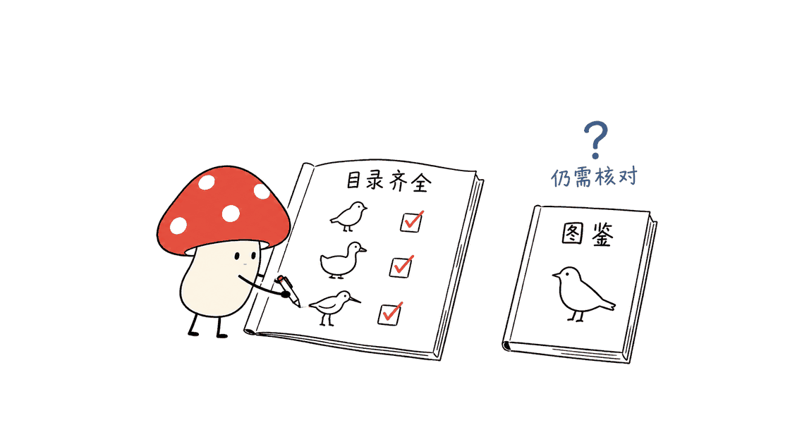

给教学卡片、自然主题设计或资料页面找鸟类图片，这个仓库提供了一个方便的起点：每张贴纸都能关联到物种记录。但使用时需要同时检查质量标记和许可，不能把“每种都有图”理解为“每张都适合识鸟或任意商用”。

项目为花叔（Huashu，GitHub：alchaincyf）发布的 `huashu-bird-sticker`，素材出自其 iOS 观鸟 App「鸣迹」。本次核查固定到提交 `47bb6f366641a76a482e2fb2fd26b2ac515f1a13`，日期为 2026 年 10 月 31 日。

仓库：https://github.com/alchaincyf/huashu-bird-sticker

## 它交付的是图片，还是物种数据库？

两者都有。图片是透明背景、白色描边的 WebP 贴纸，按目、科、学名组织；结构化数据则把图片路径与鸟名、分类、分布、形态、保护状态和参考来源连接起来。

本次解析 `data/species.json`，并与 GitHub 完整文件树逐项比对：11,064 条记录的 ID 唯一，11,064 个贴纸路径也全部对应。记录包含 44 目、250 科。这验证了该提交中的记录与路径完整性，没有逐张下载全部图片核对内容，也没有重新审定全球鸟类分类。

“11,064”应理解为这个仓库采用的名录与收录口径。鸟类拆分、合并和灭绝状态会改变统计，不能把它当作永远固定的世界鸟种总数。

| 文件 | 能做什么 | 使用时注意 |
|---|---|---|
| `stickers/` | 获取单种鸟类的透明贴纸 | 图片质量与许可逐条检查 |
| `data/species.json` | 按物种查询图片及结构化信息 | 是关联数据的主要入口 |
| `data/species.csv` | 用表格软件整理和筛选 | 是展平后的数据子集 |
| `data/names.csv` | 制作多语言名称索引 | 语言覆盖并不整齐 |
| `data/field-guide.zh-Hans.json` | 查看部分物种的中文图鉴文字 | 与项目整理数据的许可不同 |

这种组织方式比一个纯图片压缩包更容易维护：页面可以通过稳定 ID 关联学名、图片和来源，而不必靠肉眼识图或文件名猜测。

数据说明：https://github.com/alchaincyf/huashu-bird-sticker/blob/47bb6f366641a76a482e2fb2fd26b2ac515f1a13/data/README.md


## “43种语言”是否意味着每只鸟都有43个名字？

不能这样理解。项目的语言表包含 46 个名称列，对应 43 种语言及部分变体，例如简繁中文和葡萄牙语变体。不同语言的覆盖程度不同。

本次数据核查中，英语名称覆盖 11,064 条记录，简体中文覆盖 11,041 条，缺少 23 条。其他语言也要按实际字段判断，不能在界面上直接承诺完整覆盖。

数据中还含跨数据库 ID、分布和形态字段。使用时应保留缺失值与来源信息：`traits.inferred` 表示某些性状经过推断；保护等级来自汇总数据，可能落后于最新评估。把数据放进漂亮的卡片，不会让它自动变成实时权威记录。

第三方来源说明：https://github.com/alchaincyf/huashu-bird-sticker/blob/47bb6f366641a76a482e2fb2fd26b2ac515f1a13/NOTICE.md

## 好看的预览，能代表全部图片吗？

作者公开了质量分层，这是这个项目值得认真阅读的部分。本次从逐条记录重新汇总，得到以下结果：

| 元数据项目 | 数量 |
|---|---:|
| AI 插画 | 11,030 |
| 真实照片抠图 | 34 |
| 作者标为达到质量门槛 | 7,676 |
| 作者标为未达到质量门槛 | 3,388 |

未达标图片中，3,273 张评分为 70–79，109 张低于 70；另有 6 张虽然评分达到 80，仍未通过后续盲评。因此，筛选时应读取 `meetsQualityBar`，不能只写一个 `reviewScore >= 80` 条件。

这些分数是作者的评审记录，不是经过校准的识别准确率。80 分不表示野外识别有 80% 的可靠性，完整路径也不意味着喙形、羽色、眼纹和足部细节全部正确。

封面采用仓库的 40 鸟预览图。按预览索引核查，这 40 张都是 AI 插画，且均被作者标为达标；它是一组精选，不能代表整库的平均质量。本次没有重跑作者的图像生成与评审流程，也没有进行独立鸟类学鉴定。

更稳妥的定位是：它提供友好的视觉素材，细节判断仍应对照可靠图鉴和原始记录。用于真实观测时，单张静态贴纸也无法涵盖年龄、性别、季节羽和相似种的所有差别。

作者的制作与质量说明：https://github.com/alchaincyf/huashu-bird-sticker/blob/47bb6f366641a76a482e2fb2fd26b2ac515f1a13/README.zh-Hans.md



## 能否直接拿去做商业产品？

要先区分内容层。项目根目录的许可表并不是一句“整个仓库 MIT”。

| 内容 | 项目声明的条款 |
|---|---|
| AI 贴纸与预览图 | PolyForm Shield 1.0.0 |
| 项目自行整理的数据 | MIT，但仅覆盖其拥有的权利 |
| IOC 分类与多语鸟名 | CC BY 3.0 |
| AVONET 形态与生态数据 | CC BY 4.0 |
| 中文图鉴文字 | CC BY-SA 4.0 |
| 34 张照片抠图 | 各自原照片的许可 |

Shield 的关键是竞品限制。仓库将鸣迹的业务范围写为观鸟记录、识鸟及鸟类图鉴；提供竞争产品时，免费并不能自动避开限制。作者列举出版、教学、科研、博物馆和文创等可用场景，具体使用仍应对照完整条款和涉及的第三方材料。

按 OSI 的开源定义，许可不得限制应用领域。因而这里更准确的说法是“公开可获取、按不同条款授权的素材与数据”，不应把有竞品限制的贴纸称为无领域限制的开源资源。

项目许可：https://github.com/alchaincyf/huashu-bird-sticker/blob/47bb6f366641a76a482e2fb2fd26b2ac515f1a13/LICENSE.md

Shield 原文：https://polyformproject.org/licenses/shield/1.0.0

OSI 定义：https://opensource.org/osd

还有一层不能忽略：参考照片。作者记录的来源包含开放许可、非商业或禁止演绎许可、保留所有权利及未记录许可的照片。参考照片本身不在仓库中；重新绘制也不能自动证明所有后续用途的权利都已解决。需要分发或商业使用时，应逐项保留并检查 `sticker.reference`，不能只过滤顶层许可证字段。


## 一个设计或教学项目怎样开始？

先选少量主题明确的物种，读取完整记录，再决定图片与数据如何展示。首次制作可以按以下顺序推进：

1. 从学名或稳定 ID 查找物种，检查目标语言名称是否存在。
2. 读取 `meetsQualityBar`、图片类型与参考来源；给未达标或信息不足的条目留出人工核对步骤。
3. 检查会实际使用的图片、文字和数据字段各自的条款，并保留署名与许可说明。
4. 只下载需要的图片，制作一页小样，对照图鉴检查关键细节，再扩大范围。

本地查一条记录只需要普通 Python，例如：

```python
import json

with open("data/species.json", encoding="utf-8") as f:
    records = json.load(f)["species"]

bird = next(x for x in records if x["scientificName"] == "Pica pica")
print(bird["names"].get("zh-Hans"))
print(bird["sticker"]["file"])
print(bird["sticker"]["meetsQualityBar"])
```

这是数据读取示例，不是识鸟模型。查阅 WebP、筛选 JSON 和设计小样不需要为这个仓库配置独显。作者提供稀疏下载方式，可以先取 `data/` 与某个类群，避免一开始获取约 700 MB 的全部仓库内容；该体积是作者说明，本次没有全量克隆测量。

素材类项目的价值，最终取决于能否把图片、物种身份、质量状态和来源一起交付。这个仓库在结构化组织上提供了实用起点，使用者仍需保留这些信息，避免把精选插画误当成无差别可靠的图鉴资产。

同样关于“公开资源不等于所有组件都能无条件使用”的讨论，可参阅本站：https://blog.mushroom.cv/blog/awesome-short-drama-skills-guide/

## 常见问题

### 这是免费鸟类识别 App 吗？

它是贴纸和数据仓库，素材来自鸣迹，但不等于鸣迹 App 源码，也不是可直接运行的识鸟模型。

### 能用来新建观鸟或识鸟网站吗？

先核查 Shield 的竞品限制。网站是否收费不是唯一条件；项目明确把相关业务写入许可说明，不能仅凭“免费”判断可用。

### 为什么有图片还要保留来源字段？

来源字段帮助核查物种、评审状态和许可。图片被复制到别处后，如果这些信息丢失，后续纠错与授权检查都会更困难。

封面图来源：Huashu 的 `previews/hero.webp`，已裁切、压缩用于本文介绍；适用 PolyForm Shield 1.0.0，许可地址见上。以下 Required Notice 为原项目要求保留的声明：

Required Notice: Copyright (c) 2026 Huashu (alchaincyf), https://github.com/alchaincyf/huashu-bird-sticker

本文文字及原创示意图采用下方 CC BY 4.0 声明；第三方鸟类封面图及所介绍的数据保留各自条款。

---

> © 2026 Author: Mycelium Protocol. 本文采用 [CC BY 4.0](https://creativecommons.org/licenses/by/4.0/deed.zh) 授权——欢迎转载和引用，须注明作者姓名及原文链接，不得去除署名后以原创发布。

<!--EN-->

This repository is a useful starting point for bird-themed educational cards, designs and reference pages: each sticker links to a species record. Check quality and licensing together. Complete picture coverage does not establish field-identification reliability or unrestricted commercial reuse.

Huashu, GitHub account alchaincyf, published `huashu-bird-sticker` using assets from the iOS birding app Mingji. This review pins commit `47bb6f366641a76a482e2fb2fd26b2ac515f1a13`, checked October 31, 2026.

Repository: https://github.com/alchaincyf/huashu-bird-sticker

## Pictures or a species database?

Both. Transparent, white-outlined WebP files are organized by order, family and scientific name. Structured records connect them to names, taxonomy, distribution, traits, conservation categories and references.

Local checks parsed the JSON and compared every sticker path with GitHub's complete file tree: 11,064 unique records matched 11,064 unique paths, covering 44 orders and 250 families. This establishes record/path correspondence, not inspection of all image bytes or an independent taxonomic census.

Treat 11,064 as the repository's versioned scope, rather than a permanently fixed global species count.

| File | Use | Boundary |
|---|---|---|
| `stickers/` | Individual transparent images | Check quality and rights |
| `data/species.json` | Join images and species information | Main structured entry point |
| `data/species.csv` | Spreadsheet processing | Flattened subset |
| `data/names.csv` | Multilingual indexing | Uneven language coverage |
| Chinese field-guide JSON | Notes for some species | Separate license |

Stable identifiers make maintenance easier than a disconnected image archive. Pages can join names, images and sources without guessing species from appearance or filenames.

Data reference: https://github.com/alchaincyf/huashu-bird-sticker/blob/47bb6f366641a76a482e2fb2fd26b2ac515f1a13/data/README.md


## Does every bird have names in 43 languages?

No. The language table contains 46 columns representing 43 languages and variants. Local checks found English names for all 11,064 records and Simplified Chinese names for 11,041, leaving 23 absent. Other languages also require missing-value handling.

Preserve provenance for traits and conservation data. Inferred traits are marked, and aggregated conservation categories may lag current assessments. A polished card does not turn a database snapshot into a live authoritative record.

Source notice: https://github.com/alchaincyf/huashu-bird-sticker/blob/47bb6f366641a76a482e2fb2fd26b2ac515f1a13/NOTICE.md

## Does the preview represent the whole library?

The project exposes quality tiers. Recomputed metadata totals are:

| Category | Count |
|---|---:|
| AI illustrations | 11,030 |
| Photo cutouts | 34 |
| Author-marked quality pass | 7,676 |
| Author-marked quality fail | 3,388 |

Of the failing entries, 3,273 score 70–79 and 109 score below 70. Six score at least 80 but failed a subsequent blind review. Use `meetsQualityBar`, rather than a score threshold alone.

These are recorded author judgments, not calibrated accuracy probabilities. A score of 80 is not 80% field-identification accuracy.

The cover uses the 40-bird preview. Its index maps to 40 AI illustrations, all marked as passing by the author. This is a selection, not a representative quality sample. This review did not rerun generation or judging, or conduct independent ornithological assessment.

Use the pictures as friendly illustrations and verify diagnostic details against reliable field guides. A static sticker cannot cover every age, sex, seasonal plumage and similar-species distinction.

Production and quality notes: https://github.com/alchaincyf/huashu-bird-sticker/blob/47bb6f366641a76a482e2fb2fd26b2ac515f1a13/README.zh-Hans.md


## Can commercial products use it directly?

First separate the layers:

| Material | Declared terms |
|---|---|
| AI stickers and previews | PolyForm Shield 1.0.0 |
| Project-owned data compilation | MIT, within rights held |
| IOC taxonomy and names | CC BY 3.0 |
| AVONET traits | CC BY 4.0 |
| Chinese field-guide text | CC BY-SA 4.0 |
| Photo cutouts | Individual original-photo licenses |

Shield excludes competing products. The repository identifies birding records, bird identification and field guides as Mingji's business; offering a competing service for free does not remove that restriction. Its examples of permitted uses include publishing, teaching, research, museums and merchandise, subject to the full terms and underlying materials.

OSI's definition rejects field-of-use restrictions. Describe this as publicly available, separately licensed assets and data, rather than unrestricted open source throughout.

Repository license: https://github.com/alchaincyf/huashu-bird-sticker/blob/47bb6f366641a76a482e2fb2fd26b2ac515f1a13/LICENSE.md

Shield: https://polyformproject.org/licenses/shield/1.0.0

Open Source Definition: https://opensource.org/osd

Reference photographs add another boundary. Recorded sources include open licenses, noncommercial/no-derivatives terms, reserved rights and unrecorded licenses. Original references are not distributed. A new drawing does not automatically establish clearance for every subsequent use; retain and inspect `sticker.reference`, rather than filtering only the top-level license.


## How should a small project start?

1. Select a few relevant species by scientific name or stable ID; check the desired language field.
2. Inspect quality status, image kind and references, reserving manual review for uncertain entries.
3. Check terms for the actual images, text and fields used; preserve attribution and license information.
4. Download selected files, create one sample page, and verify key details before expanding.

Ordinary Python can read a record:

```python
import json

with open("data/species.json", encoding="utf-8") as f:
    records = json.load(f)["species"]

bird = next(x for x in records if x["scientificName"] == "Pica pica")
print(bird["names"].get("en"))
print(bird["sticker"]["file"])
print(bird["sticker"]["meetsQualityBar"])
```

This is database access, not an identification model. Viewing WebP files, filtering JSON and preparing layouts do not require a discrete GPU for this repository.

The README offers sparse checkout for data and selected groups instead of fetching the roughly 700 MB repository. That size is the author's description, not a full-clone measurement performed here.

The useful contribution is connecting pictures, species identities, quality flags and provenance. Preserve those connections when reusing assets rather than turning a curated illustration library into an assumed scientific authority.

Related resource-selection discussion: https://blog.mushroom.cv/blog/awesome-short-drama-skills-guide/

## FAQ

### Is this a free bird-identification application?

It is an asset and data repository derived from Mingji materials, not the Mingji application source or a ready-to-run identification model.

### Can it power a new birding website?

Check the noncompete restriction. Charging users is not the sole criterion, and the repository explicitly identifies the relevant business scope.

### Why keep source fields with copied images?

They support species checks, corrections, review provenance and license assessment. Dropping them makes later maintenance harder.

Cover: Huashu's `previews/hero.webp`, cropped and compressed for this review under PolyForm Shield 1.0.0, linked above. Required upstream notice:

Required Notice: Copyright (c) 2026 Huashu (alchaincyf), https://github.com/alchaincyf/huashu-bird-sticker

The following CC BY statement covers this article's text and original conceptual illustrations. Third-party bird imagery and described datasets retain their respective terms.

---

> © 2026 Author: Mycelium Protocol. Licensed under [CC BY 4.0](https://creativecommons.org/licenses/by/4.0/) — free to share and adapt with attribution. You must credit the author and link to the original; removing attribution and republishing as original is not permitted.
