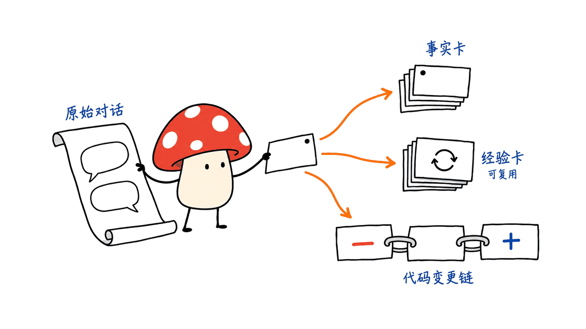
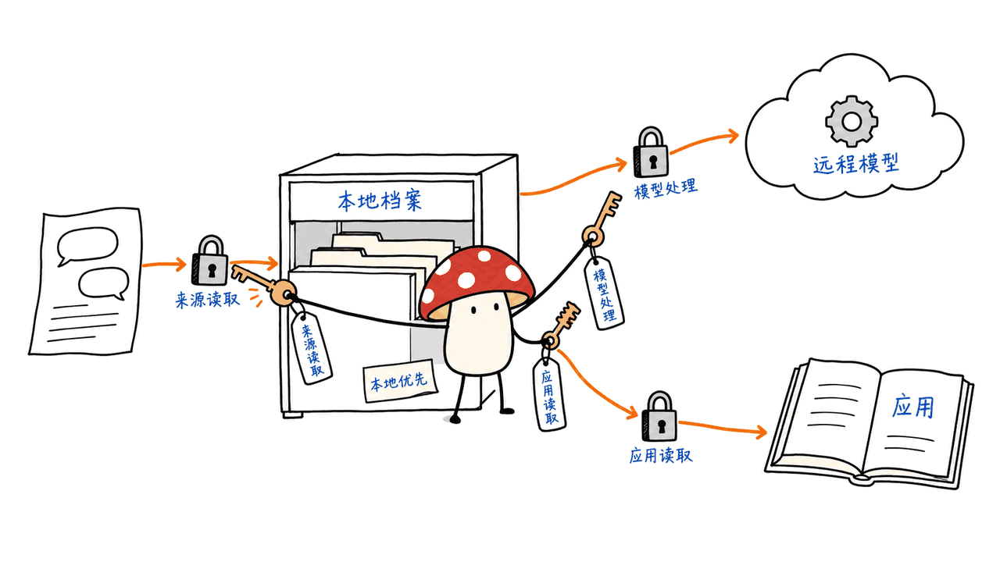

Hy Memory 为 AI Agent 提供可持续更新的外部记忆：不只找回旧对话，还把经历整理成事实、可复用经验与代码变更轨迹。腾讯混元这次同时公布了 Python SDK、跨应用记忆产品 MemHub，以及负责写记忆的 Hy-Memory-30B-A3B 模型。三者处于不同层，不能把模型权重当成一个安装后即可接管所有应用的记忆助手。

我们修复了素材里被换行截断的地址，并核对官方仓库、模型卡、配置、发行页和源码。SDK 固定版本的42项定向测试通过；没有下载30B模型、调用真实模型服务或安装跨应用后台服务。

仓库：https://github.com/Tencent-Hunyuan/Hy-Memory

模型：https://huggingface.co/tencent/Hy-Memory-30B-A3B

代码固定版本：`fba347ad8d04eefbc51a466fa4cbd7d4e1936109`；模型卡与配置版本：`64a460a94d5498b7316fb02395c72d01c47a7347`。核验日期：2026年10月16日。

## SDK、MemHub与30B模型，分别解决什么？

| 组件 | 职责 | 接入时还需要什么 |
| --- | --- | --- |
| Hy Memory 2.0.1 | 记忆写入、检索、冲突协调和演化的Python SDK | 选择模式、存储，以及对应的模型服务 |
| MemHub | 把获授权的AI应用对话与编码轨迹交给统一Runtime管理 | 来源、模型处理、宿主读取各自授权 |
| Hy-Memory-30B-A3B | 专用记忆写入模型，决定保留什么、如何更新记忆 | 独立推理服务；它不替代向量库或完整回答模型 |

SDK 可以配置兼容接口的LLM与Embedding服务，并非只能使用这份30B权重。MemHub 的 Python Core 是唯一记忆数据面与业务数据库写入者，CLI与桌面端共享Runtime和数据目录。它针对授权来源提供跨应用复用，而不是通过录屏、OCR、键鼠或后台录音获取全部活动。

最值得关注的工程问题是记忆的生命周期：新事实覆盖旧事实时，能否保留证据和变更关系；不同应用和用户之间，能否按来源与身份限制读取。单纯把聊天切块放入向量库，并不会自动解决这些问题。



## 为什么Chat、Working和Coding分成三条路径？

Chat 使用L0到L7的层次结构，包含基本信息、原始对话、事实、摘要、图上的schema和带期限的意图；文档明确将L4 Identity与L5 Knowledge标为预留，不能把八层说成八种都已完整实现的认知能力。

Working 面向研究、文档、表格等任务，把会话事实与可复用经验分开：前者记录做过什么，后者需要达到价值阈值才保留。Coding 复用这套双层结构，再附加真实diff组成的版本演化链，以补充总结中容易丢失的撤回、重做和分支变化。该链是事实结果的附加上下文，不是取代向量检索的新检索器；可记录多少版本也取决于实际输入的Git差异或工具动作。

模式是另一条轴：

| 模式 | 处理方式 | 不应误读为 |
| --- | --- | --- |
| lite | 原始内容Embedding写入与搜索，不调用LLM | 无Embedding成本或自动事实抽取 |
| pro | 加入LLM抽取与冲突协调，图可选且默认关闭 | 每次写入都零模型调用 |
| ultra | 加入System 2归纳，evolve触发演化，图始终启用 | 持续无人监管地自动训练基础模型 |

README里“零LLM调用”的自动路由描述，指特定路由选择本身；pro模式后续抽取仍可能调用LLM。把局部少一次分类，写成整个记忆管线免费，会把成本算错。这里的System 1/2是记忆架构分工，也不能直接等同其他项目同名的决策模型接口。

## 专用writer，比“把聊天总结一下”多了什么？

模型卡把训练分成Memory On-Policy Distillation和Attributed Memory Reinforcement Learning。前一阶段提供教师监督，后一阶段对分块写入后的记忆状态分配信用，让训练信号对应到具体写入选择，而不只是最终回答是否流畅。

它在外部记忆框架的写入路径中替换通用LLM：保留哪些事实、如何准确表述、遇到新证据如何更新记忆。回答问题、检索和评分仍由评测中的其他固定组件完成。因此，“writer分数更高”不等于该模型作为聊天、编码或通用推理模型全面超过对照模型。


## 官方55.49分应该怎样读？

模型卡的主矩阵使用每个基准固定20%子集，每个框架内等权平均六项指标，再对四个框架等权平均。六项包括LoCoMo、LongMemEval、PersonaMem-v2、旅行、购物和Code Memory Bench；CMB本身又是两项仓库问答的平均。

| 写入模型 | Mem0 | Hy Memory | MemOS | EverMemOS | 四框架平均 |
| --- | ---: | ---: | ---: | ---: | ---: |
| Hy-Memory-30B-A3B | 54.02 | 60.55 | 50.51 | 56.89 | 55.49 |
| Claude Opus 5 | 53.43 | 60.53 | 50.50 | 54.04 | 54.62 |
| DeepSeek V4.1 Flash | 49.73 | 60.20 | 49.17 | 55.47 | 53.64 |
| Hy3-A3B Base | 40.20 | 50.39 | 49.05 | 50.98 | 47.66 |

以上全部是官方报告，并非我们的复测。相对表中Opus 5，平均高0.87分；但Hy Memory与MemOS两个框架的差距仅0.02和0.01分，不能仅凭这张表认定具有稳定统计优势。所引表格没有给出这些差值的置信区间。

EverMemOS是训练中留出的框架，56.89对54.04是有价值的迁移线索；同时单项表仍有对照模型更高的项目。应查看自己的任务、框架和失败类型，而不是拿宏平均宣称每个场景都领先，也不能和全量测试的外部数字直接拼榜。

模型卡原文：
https://huggingface.co/tencent/Hy-Memory-30B-A3B/blob/64a460a94d5498b7316fb02395c72d01c47a7347/README.md

## 3B激活参数，为什么不是一台3B小模型机器？

Hugging Face元数据报告总参数约300.65亿，模型索引的`total_size`为60,129,463,808字节，约60.1GB（约56.0GiB）。这是权重字节，不是实际运行峰值；KV cache、运行时、上下文与并发还需要空间。MoE每次激活约3B，不会让其余专家权重自动消失。

配置声明48层、128个路由专家、每token选8个专家，并有共享专家。模型卡提供OpenAI-compatible调用示例，报告使用vLLM 0.31.0测试，服务名为`hy-memory`，示例使用`reasoning_effort: no_think`。这些是官方兼容性与配置说明，不是我们在M4上的部署验证；本机16GB没有下载或加载它。

权重索引：
https://huggingface.co/tencent/Hy-Memory-30B-A3B/blob/64a460a94d5498b7316fb02395c72d01c47a7347/model.safetensors.index.json

如果先评估SDK，可以使用已有模型服务，不必把“先装好30B模型”作为唯一入口。按照README配置LLM和Embedding两个端点后，再从简单模式、隔离工作区和单个应用来源开始：

```bash
pip install hy-memory==2.0.1
# 按官方配置表设置MEMORY_LLM_*与MEMORY_EMBEDDER_*
```

```python
from hy_memory import HyMemoryClient

client = HyMemoryClient(mode="lite")
try:
    client.add("本项目先审阅变更再发布。", user_id="demo", source="codex")
    result = client.search(
        "发布流程", user_ids=["demo"], include_sources=["codex"], limit=3
    )
    print(result["memories"]["normal"])
finally:
    client.close()
```

这里的lite避免LLM抽取，但仍需要可用Embedding端点。示例不是本次真实模型验收记录。`source`过滤是隔离手段之一，不能自行取代应用鉴权和对输入证据的审查。

## MemHub是否已经能直接安装？

文档目标包括Linux x64/arm64与macOS arm64/x64，明确不支持Windows，并要求正式支持以Release及`release-manifest.json`共同核对。本次公开v1.0.0页列出了macOS arm64 DMG及两个Linux Runtime ZIP；不能由目标平台表推断所有平台的正式制品都已齐全。

我们查询公开npm的`memhub-cli/latest`得到404，且Release附件列表中没有独立的`release-manifest.json`。这不证明所有DMG或ZIP不可用，但文档中的npm Bootstrap安装流程尚未被本次核验为可用。本文没有安装DMG、注册系统服务或绕过校验；使用前应核对当前发行页和正式校验信息。

发行页：https://github.com/Tencent-Hunyuan/Hy-Memory/releases

产品还有几个容易忽略的生命周期边界：关闭桌面UI不等于停止后台Runtime；卸载应用或CLI默认保留记忆；删除数据是独立操作。来源原文、本地数据库、服务版本目录和应用安装包也不是同一种东西，备份与清理应分别处理。



MemHub的隐私说明写得很具体：第三方模型会接收完成获授权任务所需的内容；debug模式可把完整模型prompt/response写到本地，切回info不会自动清除旧调试文件。这些都说明本地优先需要配套授权和数据管理，不能只看数据目录在哪里。

## 我们本机验证了什么？

在M4 / 16GB / macOS 26.6.2上，我们创建隔离Python 3.12环境，按固定源码安装SDK及dev依赖，运行42项定向上游测试，全部通过。范围为数据模型、lite原始内容写入搜索、来源规范化、Chroma来源过滤及版本链排除来源检查。

lite测试用固定8维向量替代网络Embedding，部分检查使用模拟组件；因此通过结果支持的是相关数据与过滤路径，不能当成真实抽取准确率、语义检索质量或30B模型成绩。我们没有运行全仓库测试、付费服务、MemHub桌面与系统服务、跨应用导入或完整模型评测。

我的判断是，这次发布的重点是把“记忆写什么”从通用聊天能力中分离出来，并给开发者一条治理、存储与模型选择可拆开的工程路径。产品落地时，优先验收错误事实能否更正、来源撤权后能否停止读取、旧版本能否追溯；这些比只看写入数量或宏平均更接近真实需求。

SDK、MemHub及模型卡标注Apache-2.0，第三方组件仍有各自条款。SDK用法与产品权限说明：
https://github.com/Tencent-Hunyuan/Hy-Memory/blob/fba347ad8d04eefbc51a466fa4cbd7d4e1936109/docs/usage.md
https://github.com/Tencent-Hunyuan/Hy-Memory/blob/fba347ad8d04eefbc51a466fa4cbd7d4e1936109/memhub/PRIVACY.md

延伸阅读：Hindsight的retain、recall、reflect记忆路径。
https://blog.mushroom.cv/blog/hindsight-agent-memory-retain-recall-reflect/

## 常见问题

### 安装SDK必须运行30B模型吗？

不必，SDK支持配置其他兼容的LLM与Embedding服务，所选模式决定处理路径。

### 3B激活参数代表只需约6GB内存吗？

不是。完整权重索引约60.1GB，运行时还存在额外开销；本篇没有测试量化或卸载方案。

### 官方平均分高于Opus 5，意味着全面更强吗？

不意味着。该矩阵固定其他组件、只更换writer，使用固定20%子集和等权平均；单项表现与统计不确定性必须另看。

---

> © 2026 Author: Mycelium Protocol. 本文采用 [CC BY 4.0](https://creativecommons.org/licenses/by/4.0/deed.zh) 授权——欢迎转载和引用，须注明作者姓名及原文链接，不得去除署名后以原创发布。

<!--EN-->

Hy Memory gives agents an external memory pipeline that can update facts, reusable experiences and code-change histories. Tencent Hunyuan released three distinct components: the Python SDK, the cross-application MemHub product, and a specialist Hy-Memory-30B-A3B memory writer. Downloading the weights does not install a complete cross-app assistant.

We repaired the line-broken source URLs and checked official documentation, configuration, releases and source. Forty-two targeted upstream SDK tests passed. We did not download the 30B model, use real model endpoints or install a background cross-app service.

Repository: https://github.com/Tencent-Hunyuan/Hy-Memory

Model: https://huggingface.co/tencent/Hy-Memory-30B-A3B

Code pin: `fba347ad8d04eefbc51a466fa4cbd7d4e1936109`. Model/card pin: `64a460a94d5498b7316fb02395c72d01c47a7347`. Checked October 16, 2026.

## Which component does what?

| Component | Role | Separate requirement |
| --- | --- | --- |
| Hy Memory 2.0.1 | Python write, retrieval, reconciliation and evolution SDK | Mode, storage and appropriate model services |
| MemHub | Govern authorized conversations and coding traces in one runtime | Source reading, model processing and host reading authorization |
| 30B-A3B model | Decide what to write and how new evidence updates memories | Inference service; not a vector store or complete answer model |

The SDK accepts compatible LLM and embedding services, not only these weights. MemHub's Python Core owns the memory data plane and business database writes; desktop and CLI share a runtime and data directory. Its documented collection scope excludes screens, OCR, keyboard/mouse, clipboard and background recording. Source histories are authorized inputs, not blanket access to activity.

The engineering problem is lifecycle: retaining evidence when facts change and restricting recall by user and application. Chunking conversations into a vector database alone does not implement that governance.


## Why separate Chat, Working and Coding?

Chat defines layers L0–L7 for basic information, raw dialogue, facts, summaries, schema and expiring intentions. Identity L4 and Knowledge L5 are explicitly reserved, not eight fully implemented cognitive functions. Working separates session facts from experiences that pass a value threshold. Coding adds a real diff-based evolution chain to that structure. The chain decorates retrieved facts; it does not replace retrieval. Coverage depends on supplied Git differences or supported tool actions.

| Mode | Behavior | Cost boundary |
| --- | --- | --- |
| lite | Embed and search raw content without LLM extraction | Embedding still required |
| pro | LLM extraction and reconciliation; optional graph, off by default | Not a zero-LLM write pipeline |
| ultra | System 2 induction through evolve, graph always enabled | Not autonomous foundation-model training |

Zero-LLM routing claims refer to certain routing decisions, not all later pro-mode processing. These System 1/2 names describe memory architecture and should not be confused with unrelated decision-model interfaces.

## What is the specialist writer trained to do?

The model card describes Memory On-Policy Distillation followed by Attributed Memory Reinforcement Learning. Teacher supervision is followed by chunk-level credit over resulting memory states. The target is what to retain, precise representation and reconciliation—not merely fluent answers.

The writer replaces a general LLM in an external framework's write path. Retrieval, answer generation and judging remain fixed in the comparison. A better writer result is therefore not evidence of general superiority in chatting, coding or reasoning.


## How should the reported 55.49 be interpreted?

The main matrix uses a fixed 20% subset of each benchmark. Each framework averages six metrics equally, then Overall averages four frameworks equally. Metrics cover LoCoMo, LongMemEval, PersonaMem-v2, travel, shopping and CMB; CMB itself averages two repository-QA evaluations.

| Writer | Mem0 | Hy Memory | MemOS | EverMemOS | Average |
| --- | ---: | ---: | ---: | ---: | ---: |
| Hy-Memory-30B-A3B | 54.02 | 60.55 | 50.51 | 56.89 | 55.49 |
| Claude Opus 5 | 53.43 | 60.53 | 50.50 | 54.04 | 54.62 |
| DeepSeek V4.1 Flash | 49.73 | 60.20 | 49.17 | 55.47 | 53.64 |
| Hy3-A3B Base | 40.20 | 50.39 | 49.05 | 50.98 | 47.66 |

All are author-reported, not our reruns. The Opus difference is 0.87 overall, but only 0.02 and 0.01 in Hy Memory and MemOS. The cited tables provide no confidence intervals establishing stable differences that small. EverMemOS is held out from training, making 56.89 versus 54.04 useful transfer evidence, while individual metrics still favor other writers. Do not combine this subset matrix with unrelated full-benchmark results.

Card: https://huggingface.co/tencent/Hy-Memory-30B-A3B/blob/64a460a94d5498b7316fb02395c72d01c47a7347/README.md

## Why does 3B active not mean a 3B-sized machine?

Hugging Face metadata reports roughly 30.065 billion total parameters. The weights index totals 60,129,463,808 bytes, about 60.1GB or 56.0GiB, before runtime, KV cache, context and concurrency overhead. Inactive experts do not disappear from storage.

Configuration declares 48 layers, 128 routed experts, eight selected per token and a shared expert. The card reports testing with vLLM 0.31.0, an OpenAI-compatible service named hy-memory and a no_think example. These are upstream configuration claims, not our M4 deployment. We did not load the weights on this 16GB Mac.

Weights index: https://huggingface.co/tencent/Hy-Memory-30B-A3B/blob/64a460a94d5498b7316fb02395c72d01c47a7347/model.safetensors.index.json

To evaluate the SDK first, configure existing LLM/embedding endpoints rather than making the 30B deployment mandatory:

```bash
pip install hy-memory==2.0.1
# Configure MEMORY_LLM_* and MEMORY_EMBEDDER_* as documented.
```

```python
from hy_memory import HyMemoryClient

client = HyMemoryClient(mode="lite")
try:
    client.add("Review changes before release.", user_id="demo", source="codex")
    result = client.search(
        "release process", user_ids=["demo"], include_sources=["codex"], limit=3
    )
    print(result["memories"]["normal"])
finally:
    client.close()
```

Lite still requires embeddings. This snippet is guidance, not a real-endpoint acceptance run. Source filters complement rather than replace application authentication and evidence review.

## Is the MemHub installation path verified?

Documentation targets Linux x64/arm64 and macOS arm64/x64, excludes Windows, and requires matching Release and release-manifest entries for formal support. The public v1.0.0 page currently lists an arm64 Mac DMG and two Linux Runtime ZIP files; a target-platform table is not evidence that all artifacts are present.

Our public npm memhub-cli/latest query returned 404, and no separate release-manifest.json appears in that Release's attachment list. This does not establish that all DMG/ZIP artifacts fail, but we cannot call the documented npm Bootstrap installation verified. We installed no DMG or system service and bypassed no checks.

Releases: https://github.com/Tencent-Hunyuan/Hy-Memory/releases

Closing the desktop UI does not necessarily stop the runtime. Uninstall normally retains memory; deleting data is a separate action. Evidence, databases, runtime versions and application packages have different backup and removal semantics.


The privacy document says authorized task content can reach selected third-party models. Debug mode can log full prompts/responses locally; returning to info does not erase old debug files. Local-first needs authorization and data lifecycle controls as well as a local directory.

## What did our checks establish?

On an M4/16GB/macOS 26.6.2, we installed pinned SDK source and dev dependencies in an isolated Python 3.12 environment. Forty-two selected upstream tests passed: data structures, lite raw-memory write/search, source normalization, Chroma filtering and evolution-chain source exclusion.

Lite tests replace network embeddings with fixed eight-dimensional vectors; some checks use mocks. This validates those data/filter paths, not real extraction, semantic relevance or 30B scores. We ran no full suite, paid endpoint, MemHub desktop/service, cross-app import or model benchmark.

The useful separation is between deciding what to remember and operating a governed memory system. For deployment, validate correction of wrong facts, revoked-source behavior and version traceability, rather than only write volume or a macro average. SDK, MemHub and card identify Apache-2.0; third-party terms remain separate.

Usage and privacy:
https://github.com/Tencent-Hunyuan/Hy-Memory/blob/fba347ad8d04eefbc51a466fa4cbd7d4e1936109/docs/usage.md
https://github.com/Tencent-Hunyuan/Hy-Memory/blob/fba347ad8d04eefbc51a466fa4cbd7d4e1936109/memhub/PRIVACY.md

Related memory pipeline: https://blog.mushroom.cv/blog/hindsight-agent-memory-retain-recall-reflect/

## Frequently asked questions

### Must the SDK run the 30B writer?

No. It supports other compatible model/embedding services; the mode determines the pipeline.

### Do 3B active parameters imply roughly 6GB RAM?

No. The complete indexed weights are about 60.1GB, plus runtime overhead. We tested no quantized/offloaded deployment.

### Does the Opus comparison establish universal superiority?

No. It swaps the writer, fixes other components, uses 20% subsets and equal-weight means. Individual metrics and statistical uncertainty remain relevant.

---

> © 2026 Author: Mycelium Protocol. Licensed under [CC BY 4.0](https://creativecommons.org/licenses/by/4.0/) — free to share and adapt with attribution. You must credit the author and link to the original; removing attribution and republishing as original is not permitted.
