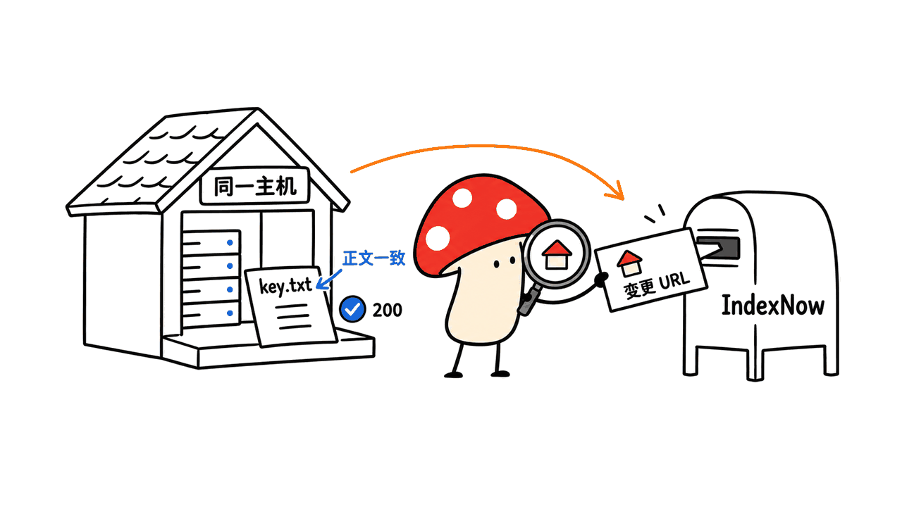
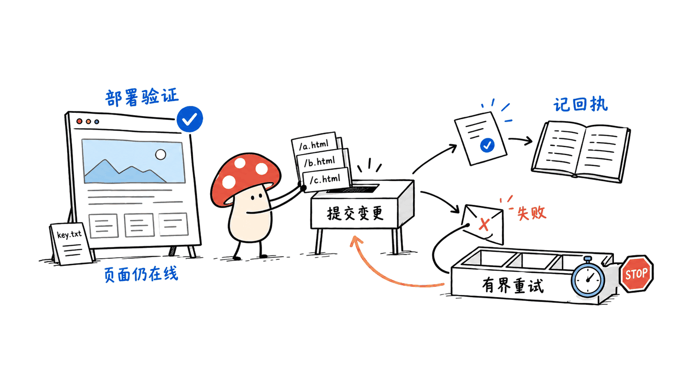

IndexNow 让网站在页面新增、更新或删除后，主动把 URL 通知给参与的搜索服务，减少等待爬虫自行发现变化的时间。它是内容发现的通知协议，不能保证马上抓取、收录，更不能保证排名或 AI 引用。

对普通站长，最容易落地的路线有三种：WordPress 使用现有插件；已接入 Cloudflare 的网站评估 Crawler Hints；静态站和自研 CMS 在发布成功后提交变更 URL。先确认有没有平台代发，避免插件、CDN 和自建任务同时重复通知。

## 谁支持它，Google 呢？

IndexNow 由 Microsoft Bing 与 Yandex 发起。本次在 2026-10-17 读取官方 `searchengines.json`，列有 Bing、Yandex、Seznam、Naver、Yep、Internet Archive、Amazonbot。参与方不全是传统网页搜索引擎；通知共享也不意味着它们会以相同方式展示内容。

Google 不在当前参与名单。Google 官方 Indexing API 仅适用于带 JobPosting，或 VideoObject 中嵌套 BroadcastEvent 的特定页面；普通博客不要伪造这些结构化数据来走这条通道。面向 Google 的基础工作仍是可抓取页面、内链、准确 Sitemap 和 Search Console。

**通知、抓取、收录、排名是四个状态。** IndexNow 接收请求，只完成第一段；后续仍由各服务决定。它有助于减少“还不知道更新”的空窗，不能修复空白正文、重复内容、错误 canonical 或无意设置的 noindex。


## 普通网站怎么选接入方式？

| 网站类型 | 优先路线 | 需要自己验收 |
| --- | --- | --- |
| WordPress | Microsoft 的 IndexNow 插件或已支持该协议的现有 SEO 插件 | 新增、更新、删除的触发；正式 URL；失败日志 |
| Cloudflare 代理网站 | 检查 Crawler Hints 的可用配置与缓存信号行为 | 是否启用、目标主机、变更是否被发现 |
| Astro、Hugo、Next 静态输出 | 部署成功后的 CI 任务 | 变更清单、线上 URL/密钥文件可访问、通知回执 |
| 自研 CMS / 商城 | 发布事件写入队列，后台批量提交 | 事务提交后发事件、重试、删除与重定向处理 |

官方 WordPress 插件仓库是 `microsoft/indexnow-wordpress-plugin`。Cloudflare 官方资料说明 Crawler Hints 用缓存信号推断内容变化并支持 IndexNow；这与应用明确知道哪篇文章发布的 webhook 不同。对更新很少的个人站，先选已有平台能力，往往不需要再维护一套程序。

## 手动接入：从一条 URL 开始

准备一个自己控制、允许公开抓取的正式主机，例如 `www.example.com`。主域、www、子域要分清，不能把 `example.com` 的验证直接当作所有子域都完成。

第一步生成随机 key。用 32 位十六进制字符串是简单、兼容的做法，落在文档要求的 8–128 字符范围内：

```bash
openssl rand -hex 16
```

第二步把 key 原样放到 UTF-8 文本文件，文件名为 `<key>.txt`，上传网站根路径。以示例 key 为例：

```text
https://www.example.com/0123456789abcdef0123456789abcdef.txt
```

文件正文只写同一个 key，不放 HTML、不套登录或验证码。这个公开可读取文件用于证明对主机的控制，不是网站后台密码，也不赋予业务 API 权限；仍应避免不必要地传播 key 与提交日志。使用自定义 `keyLocation` 时，必须同主机，子目录放置还可能限制可提交的路径范围。普通站优先根目录，最省事。

第三步先用 `curl` 或浏览器确认文件返回 200、正文正确。静态框架一般放进原样复制的 public 目录，但最终以线上路径为准；SPA 的 200 HTML 兜底页不算验证成功。

第四步写一个 JSON 文件，再 POST。这样不用手工拼 GET 的 URL 转义：

```json
{
  "host": "www.example.com",
  "key": "0123456789abcdef0123456789abcdef",
  "keyLocation": "https://www.example.com/0123456789abcdef0123456789abcdef.txt",
  "urlList": ["https://www.example.com/blog/your-post/"]
}
```

```bash
curl -i https://api.indexnow.org/indexnow   -H 'Content-Type: application/json; charset=utf-8'   --data-binary @indexnow-payload.json
```

这里全是示例域名与示例 key，不能原样用于自己的站。每次 POST 最多 10,000 个 URL，归属同一个 host；超过就分批。参与方之间会共享收到的 URL，一次提交给一个参与端点即可，不需要向每家再发同一批。



## 200、202 和错误码怎样处理？

| 状态码 | 官方含义 | 下一步 |
| --- | --- | --- |
| 200 | URL 已提交 | 留回执，继续观察抓取与收录 |
| 202 | 已收到，key 校验待完成 | 检查文件可访问，保留待确认状态；不记作收录 |
| 400 | 请求格式无效 | 修复 JSON、参数或编码 |
| 403 | key 无效 | 查文件路径、正文、访问限制 |
| 422 | URL 不属于 host 或 key 不符合协议格式 | 对照主机与验证范围 |
| 429 | 请求过多，可能被视为垃圾提交 | 减速，按 Retry-After（若提供）及退避策略重试 |

网络中断和 5xx 可采用带上限的指数退避；配置错误的 4xx 不应该每分钟原样重试。202 是通知已接收且验证待定，最好与 200 分开存储。记录 host、批次、URL 摘要、内容版本、提交时间、状态和重试次数，不把长回执正文或不必要的 key 暴露到公开日志。

## 静态站怎样接进发布流程？

推荐顺序是：构建并部署成功 → 验证正式站页面与 key 文件 → 生成本次新增、实质更新、删除的 URL 清单 → 去重分批 → 提交并记回执。部署失败不发通知；草稿和预览域不混进正式清单。内容没变，仅重新部署全站，也不要把所有旧 URL 重发一遍。

清单应按页面内容版本或发布事件生成，不能只比较 Sitemap 的更新时间。重命名页面时，旧 URL 应配置明确重定向或正确删除响应，再通知旧 URL 与新 URL；删除页面也属于有效变更，别为了“只能提交 200 页面”而漏掉它。Sitemap 保留有效正式 URL，删除项从 Sitemap 移除。

我建议把通知做成可重试的发布后任务：通知失败不回滚已经上线的文章，但必须保留待补队列。为同一 URL 的短时间连续编辑做合并，发送最终状态；处理完成再更新本地发送账本，不能在网络请求前就标记已成功。

这是一种接入设计建议，不是本文替读者改好了 CI。我们没有向真实搜索服务提交示例 URL，也没有改动本站的 IndexNow 配置。提供了只生成和验证 payload 的 Python 示例，并做离线边界检查，下载地址：https://blog.mushroom.cv/downloads/indexnow-payload.py；接收通知到收录的耗时不在本次实测范围。



## 怎么判断接入有没有价值？

用几个真实且允许公开的更新观察：发布到首次搜索引擎抓取的时间、已提交与失败批次数、URL Inspection 的发现和收录状态。确认来访日志中的爬虫身份，不能仅信 User-Agent；小样本和不同页面质量会影响结论。

不要只看 site: 查询或一次搜索结果就说成功或失败，更别承诺“开了就会被 ChatGPT 引用”。减少发现延迟与增加最终流量是两件事。对于更新频繁的招聘、商品、新闻站，通知的时效性更容易体现；几个月不更新的展示页，维护成本可能比收益更值得考虑。

它也不替代本站自己的语义检索索引：IndexNow 面向外部搜索参与方，Vectorize 或站内搜索是另一条发布链路。两边都应有独立回执。关于发布后验证的分层思路，可参见：https://blog.mushroom.cv/blog/opentiny-tinyrobot-agent-ui/

## 常见问题

### 需要付费购买 IndexNow key 吗？

协议手动接入可自行生成 key；第三方产品可能收服务费，那是产品费用，不是协议要求。

### key 文件放子目录可以吗？

可以，但需要传正确 keyLocation，并遵守该位置对应的 URL 范围。根目录通常更容易配置正确。

### 返回 200 却搜不到怎么办？

先确认它只表示提交成功。继续检查页面可抓取性、canonical、noindex、重复内容和站长工具状态；不要靠重复提交替代排查。

## 官方资料与仓库

- 协议：https://www.indexnow.org/documentation
- FAQ：https://www.indexnow.org/faq
- 当前参与方：https://www.indexnow.org/searchengines.json
- WordPress 插件：https://github.com/microsoft/indexnow-wordpress-plugin ，https://wordpress.org/plugins/indexnow/
- Cloudflare：https://developers.cloudflare.com/cache/advanced-configuration/crawler-hints/
- Google API 限制：https://developers.google.com/search/apis/indexing-api/v3/quickstart

---

> © 2026 Author: Mycelium Protocol. 本文采用 [CC BY 4.0](https://creativecommons.org/licenses/by/4.0/deed.zh) 授权——欢迎转载和引用，须注明作者姓名及原文链接，不得去除署名后以原创发布。

<!--EN-->

IndexNow lets a website notify participating search services when a URL is added, changed or deleted. It reduces the wait for change discovery. It does not guarantee immediate crawling, indexing, ranking or citation by an AI service.

For ordinary site owners, start with an existing WordPress integration, evaluate Cloudflare Crawler Hints if applicable, or add a post-deployment job for a static site or custom CMS. Check for existing notifications before enabling duplicate plugin, CDN and application paths.

## Who supports it, and what about Google?

Microsoft Bing and Yandex initiated the protocol. On October 17, 2026, the official participant registry lists Bing, Yandex, Seznam, Naver, Yep, Internet Archive and Amazonbot. These services are not all conventional web search engines and do not promise identical downstream treatment.

Google is absent from that registry. Google’s separate Indexing API is limited to JobPosting pages or BroadcastEvent nested in VideoObject. Ordinary blogs should not fabricate this markup. Crawlable pages, internal links, accurate sitemaps and Search Console remain the basic Google path.

Notification, crawling, indexing and ranking are separate states. IndexNow addresses the first. It cannot repair empty content, duplicates, incorrect canonical tags or unintended noindex directives.


## Which integration should a website choose?

| Site | Starting point | Acceptance checks |
| --- | --- | --- |
| WordPress | Microsoft’s plugin or an existing compatible SEO plugin | Publish/update/delete events, final URLs and failure logs |
| Cloudflare-proxied site | Evaluate Crawler Hints | Configuration, hostname and cache-derived change signals |
| Static site | CI after successful production deployment | Changed URLs, reachable key file and receipts |
| Custom CMS or store | Queue events after publication commits | Transactions, bounded retries and deletion handling |

Cloudflare documents cache-signal-based change detection with IndexNow support. That differs from a CMS webhook that knows precisely which record changed. Small sites should use existing platform features before maintaining additional code.

## How do you submit one URL manually?

Use a production hostname that you control. Distinguish the apex domain, www and subdomains; one host’s verification should not be assumed to verify all others.

Generate a random key. A 32-character hexadecimal string is a simple compatible choice within the documented length range:

```bash
openssl rand -hex 16
```

Publish a UTF-8 file named `<key>.txt` at the host root, containing that same key. For example:

```text
https://www.example.com/0123456789abcdef0123456789abcdef.txt
```

The file must be publicly retrievable without login, challenge pages or HTML wrapping. It demonstrates host control; it is not a website login password or a business-API credential. Avoid unnecessarily distributing the key and submission logs. A custom keyLocation must be on the same host, and a directory placement can restrict the URL scope. Root placement is simplest.

Check both the HTTP status and exact body. A single-page-app fallback returning HTTP 200 with HTML is not a valid key file. Static frameworks commonly copy files from public, but the live URL is the final check.

Write the payload to a file:

```json
{
  "host": "www.example.com",
  "key": "0123456789abcdef0123456789abcdef",
  "keyLocation": "https://www.example.com/0123456789abcdef0123456789abcdef.txt",
  "urlList": ["https://www.example.com/blog/your-post/"]
}
```

Then submit it:

```bash
curl -i https://api.indexnow.org/indexnow   -H 'Content-Type: application/json; charset=utf-8'   --data-binary @indexnow-payload.json
```

These are example values; replace them with your own verified hostname and key. A POST accepts at most 10,000 URLs for one host. Participating services share submissions, so submitting the same batch independently to every participant is unnecessary.


## What do response codes mean?

| Code | Meaning | Action |
| --- | --- | --- |
| 200 | URLs submitted | Retain receipt; observe later crawling and indexing |
| 202 | Received; key validation pending | Check accessibility; preserve a pending-verification state |
| 400 | Invalid request format | Fix parameters, JSON or encoding |
| 403 | Invalid key | Inspect file URL, body and access controls |
| 422 | Wrong-host URLs or invalid key schema | Check host and validation scope |
| 429 | Too many requests | Slow down; honor Retry-After when supplied and use backoff |

Use bounded exponential backoff for network errors and 5xx responses. Repeating an unchanged invalid 4xx request every minute is not a repair strategy. Store 200 and 202 distinctly. Useful logs include host, batch identifier, URL summary, content version, time, status and retry count, without unnecessarily exposing keys.

## How should static-site CI work?

Build and deploy first. Verify production pages and the key file, derive added/meaningfully changed/deleted URLs, deduplicate and batch them, then submit and record receipts. Do not notify after a failed deploy or mix preview URLs into the production queue.

Use content versions or publication events rather than merely a sitemap timestamp. A redeploy with unchanged content should not resend the entire site. On a rename, establish the intended redirect or deletion response, then notify both old and new URLs. Deleted URLs are valid changes; do not require every submitted URL to return 200. Keep only valid current URLs in the sitemap.

We recommend a retryable post-publication task. Submission failure should not roll back a successful content deploy; it should leave a visible pending queue. Coalesce rapid edits and record success after the network response, not before sending.

This is implementation guidance, not a claim that we changed a reader’s CI. We sent no example URLs to live search services and changed no IndexNow settings on this site. An offline payload builder with boundary checks is available at https://blog.mushroom.cv/downloads/indexnow-payload.py . We measured no discovery-to-indexing delay.


## How do you evaluate the result?

Track publication-to-first-verified-crawl time, accepted and failed batches, and URL Inspection discovery/indexing status for legitimate public changes. Verify crawler identity rather than trusting User-Agent alone. Page quality and small samples limit conclusions.

A site: query alone is not proof of protocol success or failure. Reduced discovery delay does not guarantee traffic or AI citation. Frequently changing product, news or job pages may have a clearer use case than a rarely updated brochure site.

IndexNow also differs from a website’s own semantic search index. External notification and internal retrieval need independent receipts. Related publication-verification context: https://blog.mushroom.cv/blog/opentiny-tinyrobot-agent-ui/

## FAQ

### Must I buy a protocol key?

You can generate your own key. Third-party products may charge for their services, rather than for a protocol requirement.

### Can the file live in a subdirectory?

Yes, with a correct keyLocation and the corresponding URL scope. Root placement is easier to configure.

### Why is a URL absent after HTTP 200?

200 confirms submission only. Check crawl access, canonical tags, noindex, duplicate content and webmaster-tool status instead of repeatedly resubmitting.

## Official documentation and code

- Protocol: https://www.indexnow.org/documentation
- FAQ: https://www.indexnow.org/faq
- Participants: https://www.indexnow.org/searchengines.json
- WordPress: https://github.com/microsoft/indexnow-wordpress-plugin ; https://wordpress.org/plugins/indexnow/
- Cloudflare: https://developers.cloudflare.com/cache/advanced-configuration/crawler-hints/
- Google restrictions: https://developers.google.com/search/apis/indexing-api/v3/quickstart

---

> © 2026 Author: Mycelium Protocol. Licensed under [CC BY 4.0](https://creativecommons.org/licenses/by/4.0/) — free to share and adapt with attribution. You must credit the author and link to the original; removing attribution and republishing as original is not permitted.
