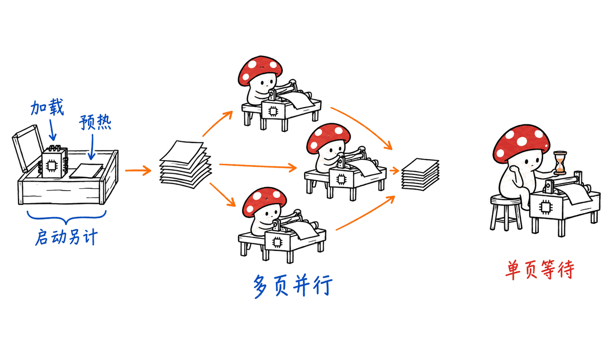
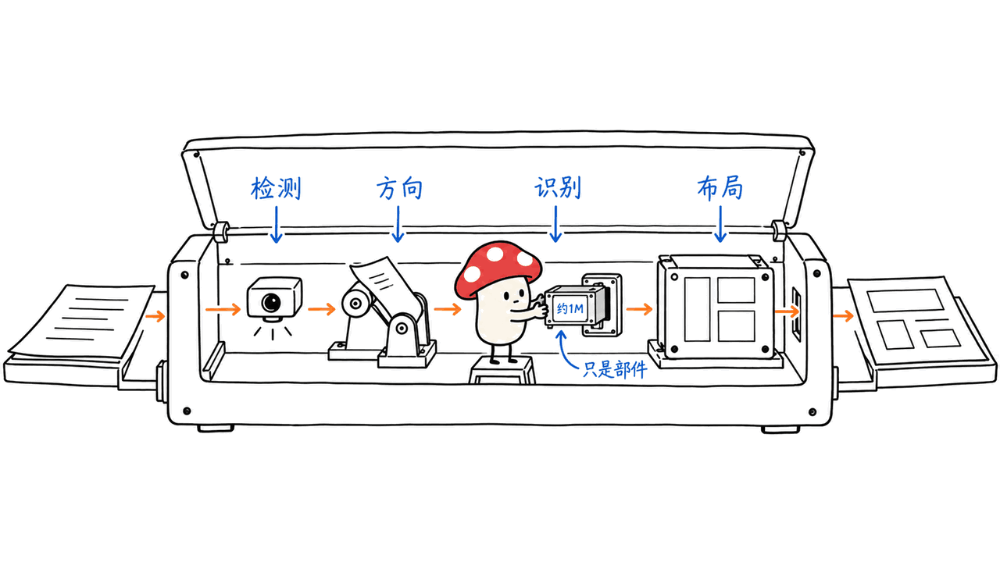
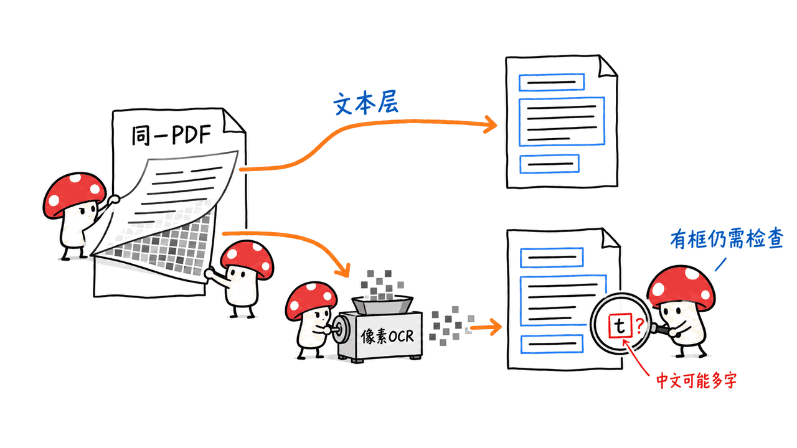

Indra OCR 是一个面向CPU的轻量文档解析工具：除了识别文字，还输出行边界框、布局块、阅读顺序和Markdown。它适合研究低成本批量处理，但49页／秒、1M参数和41.3分，分别有不同的适用条件。

Datalab于2026年10月13日介绍该项目。本文固定代码提交 `3d773aeedc5d79d1d0a2a04007a9075cd71a59f4`，包版本0.3.2；模型固定Hugging Face版本 `ed345c7f158eddbc7dee0c6a7269afb75a94f7e8`，对应代码默认选择的v3.1.1模型标签。我们实际在M4、16GB Mac上运行了CPU识别，但没有复测官方吞吐榜。

仓库：https://github.com/datalab-to/indra

模型：https://huggingface.co/datalab-to/indra-ocr

官方介绍：https://www.datalab.to/blog/indra-ocr

## 49页／秒是批量吞吐，不是单页20毫秒

官方49.4页／秒来自32核AMD EPYC CPU，在同一组300页OmniParseBench文档上，以OCR模式、每核一个单线程worker并行处理。Indra取三次运行均值，其他引擎运行一次；计时不包含模型加载与每个worker的一页预热。

| 引擎 | 4核吞吐：页／秒 | 32核吞吐：页／秒 |
|---|---:|---:|
| Indra OCR | 7.3 | 49.4 |
| PP-OCRv6 small文本模型，经RapidOCR | 0.65 | 4.28 |
| Tesseract 5 | 0.78 | 2.92 |

所以“约11倍、17倍”对应的是该32核批量设置。把模型加载计入300页作业后，官方报告的32核吞吐为37.7页／秒。它仍然值得关注，但不是任何CPU、任何短任务都能稳定达到49页／秒。

单页测试又是另一条线：官方在4个x86 vCPU、逐页处理下，报告默认模式单页延迟中位数228毫秒，强制OCR为303毫秒。不能用 `1 ÷ 49.4` 推出一个用户等待单页结果只需约20毫秒。

这些数字均为作者测试。本机验证只检查能否正确走完管线、返回合理结果，不提供我们自己的吞吐、延迟或相对加速结论。



## 41.3分里，PDF文本层贡献了什么？

默认 `auto` 模式会优先读取可用的PDF文本层，只对缺失部分等情况运行OCR。`ocr` 模式则忽略文本层，强制走图像识别。对于原生数字PDF，直接利用已有文字通常是合理的工程选择，但它不能等同于识别扫描图片的能力。

OmniParseBench同样由Datalab维护，以下是开发者自报结果，不是独立第三方复测。该测试包含2,937页、16,288项通过／失败检查。下面是官方报告的同一组结果摘要；text分是该测试族评分，不是字符准确率或“识别了多少页”的百分比。

| 模式或引擎 | 综合分 | text | tables | layout |
|---|---:|---:|---:|---:|
| Indra auto：文本层＋OCR | 62.1 | 41.3 | 56.4 | 88.6 |
| Indra OCR only | 57.5 | 33.5 | 50.9 | 88.2 |
| Indra auto＋math | 66.8 | 57.5 | 54.8 | 88.1 |
| PP-OCRv6 small文本模型 | — | 35.8 | 0.0 | — |
| PaddleOCR PP-StructureV3完整管线 | 58.4 | 55.6 | 47.8 | 71.7 |
| Tesseract 5 | — | 19.3 | 0.0 | — |

这里有两个必须同时说的结论：Indra默认混合模式的text分高于PP-OCR文本模型；关闭文本层后，33.5低于PP-OCR的35.8。另外，PaddleOCR的完整PP-StructureV3管线默认text分55.6，高于Indra的41.3。

不能把“PP-OCR文本模型”简写成整个PaddleOCR家族，再得出全面领先结论。只输出文本行的引擎也没有相同的布局能力，表中未评分不等于它们在同一任务上拿了零分。

PP-StructureV3的结果还缺少一个停滞分片涉及的19页。`--math`的延迟数据来自另一次运行，不能和默认228毫秒毫无保留地拼成同一轮计时。Indra表格分从56.4降到54.8，也说明开启公式路径存在取舍。

## 1M级识别器，不等于整套流程只有一个模型

仓库所说的1M参数，是主文字识别器 `rec.onnx` 的量级。完整流程还需要检测、方向、文字系统分类、中文识别器，以及阅读顺序／布局相关模型。

本次默认模型目录中有六个ONNX文件，合计18,158,743字节，约18.2MB；我们没有下载可选数学模型。这比许多大模型解析器轻得多，但不能把完整模型集合写成一个1M参数文件。



配图表示模型组件，不表示源码执行顺序；实现会先校正页面方向，再检测文字行。

运行使用ONNX Runtime，不要求PyTorch。JSON可保留每行文字、置信度与框坐标，以及带标签的布局块、页面来源和处理信息。布局框能让下游把答案定位回页面，但“有框”本身不证明框的定位、分类和阅读顺序全部正确。

对检索系统而言，值得利用的是结构：保留页码、块类型与坐标，减少标题、页眉和正文混在一起的情况。实际采用前仍需抽查分栏、表格与脚注，避免结构化输出只是把错误装得更整齐。这是我们的工程判断。

## 本机CPU测试：跑通了，也出现了错误

我们在隔离Python环境中，用固定版本的本地模型，显式选择 `CPUExecutionProvider`、2个线程，准备了两个原始测试输入：一页英文发票样式PDF和一张清晰中文印刷体图片。

| 输入及模式 | 页面来源 | 识别行数 | 布局块数 | 检查结果 |
|---|---|---:|---:|---|
| 英文PDF，auto | text | 12 | 12 | 编号、金额读取成功 |
| 同一英文PDF，强制ocr | ocr | 12 | 12 | 编号、金额读取成功 |
| 中文图片，ocr | ocr | 5 | 4 | 关键内容读取成功，但多出一行`t` |

英文两条路径返回的全文一致，金额 `125.50` 与编号内容可见；中文能识别“文档识别测试”、编号 `20261015` 和金额 `125.50`，却额外产生一行 `t`。输入本来只有四行，因此不能把这次试跑写成“中文零错误”。



三个结果都返回了非空Markdown和带标签的布局块，行框坐标有限且顺序合法。我们检查的是结构存在与基本坐标约束，没有标注完整布局真值，也没有计算CER、WER或布局IoU。

此外，27项原有测试全部通过。以上只能证明固定环境下的小范围运行与输入／文本层逻辑；不能推广到复杂表格、手写、旧扫描件，更不能替代OmniParseBench或49页／秒的复测。

## 怎样在自己的机器上试？

项目要求Python 3.10及以上。先使用隔离环境安装已核对的0.3.2版本：

```bash
python3 -m venv .venv
source .venv/bin/activate
pip install indra-ocr==0.3.2
indra-ocr paper.pdf --format json --out results/ --cores 2
```

首次运行会从Hugging Face下载默认模型。要核对扫描识别本身，可以对同一输入再运行：

```bash
indra-ocr paper.pdf --mode ocr --format json --out ocr-results/ --cores 2
```

不要让两次结果写到同一输出目录。先对照 `source` 字段，确认是在读取文本层、执行OCR，还是混合模式，再比较文本与框。需要复现时固定代码、模型版本和输入，而不只记录Python包名。

模型可提前下载到本地，通过 `--model-dir` 或 `INDRA_OCR_MODEL_DIR` 指定。可视化检查可用 `indra-ocr-viewer`，默认地址为 `http://localhost:8765`。预下载模型不代表已做网络隔离验证；敏感数据场景应另外核对运行环境。

## 中文、公式与商用分别要注意什么？

扫描图片的OCR覆盖拉丁、西里尔、希腊、天城、孟加拉文字与简繁中文；数字PDF通过文本层能读取更多文字系统，不能据此说所有这些语言都支持扫描识别。竖排中文仍不支持。

官方另列了136项中文检查：Indra为64.7，PP-OCRv5 mobile中文文本模型为65.4。这里的对照版本是PP-OCRv5，不是前面主表的PP-OCRv6 small，不能混着排名。

`--math`默认关闭，会下载附加模型并增加处理成本。手写、严重退化扫描、复杂合并表格本来就是项目注明的弱项；有表格HTML输出不等于已可靠还原每个单元格关系。

许可也要分开：代码是Apache 2.0，权重使用修改版OpenRAIL-M。权重条款涉及上一年总收入超过2,000万美元、累计股权或债务融资超过2,000万美元，以及与许可方或其关联方产品／服务竞争等限制，收入和融资条款列有个人／研究用途例外，不能自动套用到另列的竞争限制。不能拿代码许可证替代权重使用条件。

权重许可原文：https://huggingface.co/datalab-to/indra-ocr/blob/main/LICENSE

如果目标是大量清晰印刷体文档的预处理，Indra值得加入候选；如果主要任务是复杂表格、手写或不支持文字系统的扫描件，就应单独评估其他路径。与轻量解析有关的另一条路线，可参看本站LiteParse介绍：
https://blog.mushroom.cv/blog/liteparse-llamaindex-local-document-parser/

## 常见问题

### 任意CPU都能做到49页／秒吗？

不能这样推断。官方数字有32核EPYC、300页、并发worker和排除加载／预热的条件。

### 41.3分证明扫描文字比PaddleOCR都强吗？

不证明。41.3来自文本层与OCR混合模式；强制OCR为33.5，且PaddleOCR的文本模型和完整管线是不同对照。

### 下载权重后可以按Apache 2.0无限制商用吗？

代码与权重许可不同。应阅读修改版OpenRAIL-M的实际条款，不能把代码许可扩大到模型。

---

> © 2026 Author: Mycelium Protocol. 本文采用 [CC BY 4.0](https://creativecommons.org/licenses/by/4.0/deed.zh) 授权——欢迎转载和引用，须注明作者姓名及原文链接，不得去除署名后以原创发布。

<!--EN-->

Indra OCR is a lightweight CPU document parser that returns text, line boxes, layout blocks, reading order and Markdown. Its headline throughput, recognition-model size and benchmark score describe different parts of the system.

Datalab introduced it on October 13, 2026. We pinned code `3d773aeedc5d79d1d0a2a04007a9075cd71a59f4`, package 0.3.2, and model revision `ed345c7f158eddbc7dee0c6a7269afb75a94f7e8`, matching the default v3.1.1 model tag. We ran real CPU inference on an M4 Mac with 16GB memory, but did not reproduce the throughput benchmark.

Repository: https://github.com/datalab-to/indra

Models: https://huggingface.co/datalab-to/indra-ocr

Announcement: https://www.datalab.to/blog/indra-ocr

## Throughput is not single-page response time

The reported 49.4 pages/s uses 32 AMD EPYC CPU cores, 300 OmniParseBench pages, OCR mode and one single-threaded worker per core. Indra averages three runs; other engines ran once. Model loading and one warm-up page per worker are excluded.

| Engine | 4 cores, pages/s | 32 cores, pages/s |
|---|---:|---:|
| Indra OCR | 7.3 | 49.4 |
| PP-OCRv6 small text models, via RapidOCR | 0.65 | 4.28 |
| Tesseract 5 | 0.78 | 2.92 |

Including loading, the reported 300-page job reaches 37.7 pages/s on 32 cores. Separately, the authors report a 228ms median per page in default mode on four x86 vCPUs, or 303ms with forced OCR. Dividing one second by batch throughput does not establish an individual request's latency.

These are author measurements. Our checks below make no throughput, latency or relative-speed claim.


## The text layer changes what the score measures

Default `auto` mode uses a usable PDF text layer and OCRs missing content where needed. Forced `ocr` ignores that layer. Reusing digital text is useful engineering, but does not measure the same capability as reading scanned pixels.

OmniParseBench is maintained by the same organization; these are developer-reported results, not an independent reproduction. It has 16,288 pass/fail checks on 2,937 pages. Its text-family score is not character accuracy or the share of fully successful pages.

| Mode or engine | Headline | Text | Tables | Layout |
|---|---:|---:|---:|---:|
| Indra auto | 62.1 | 41.3 | 56.4 | 88.6 |
| Indra OCR only | 57.5 | 33.5 | 50.9 | 88.2 |
| Indra auto plus math | 66.8 | 57.5 | 54.8 | 88.1 |
| PP-OCRv6 small text models | — | 35.8 | 0.0 | — |
| PP-StructureV3 full pipeline | 58.4 | 55.6 | 47.8 | 71.7 |
| Tesseract 5 | — | 19.3 | 0.0 | — |

Default Indra outscored PP-OCR's text models, while OCR-only Indra scored lower: 33.5 versus 35.8. The full PP-StructureV3 pipeline also scored higher on default text, 55.6 versus 41.3. “PaddleOCR” cannot stand in for both configurations without qualification.

PP-StructureV3 omitted 19 pages affected by a stalled shard. Math-mode latency came from a separate run. Enabling math improves several scores but lowers Indra's table score from 56.4 to 54.8; it is not a free improvement on every axis.

## A small recognizer inside a multi-model pipeline

The roughly 1M headline describes the main `rec.onnx` recognizer. Detection, orientation, script classification, Chinese recognition and reading-order/layout processing use additional models.

Our default download contained six ONNX files totaling 18,158,743 bytes, about 18.2MB, without optional math models. The runtime does not require PyTorch. JSON preserves line text, confidence, coordinates, labeled blocks and the page's source path.


The illustration decomposes components, not execution order: the implementation corrects page orientation before detecting text lines.

Our engineering interpretation is that these structures help retrieval retain page and region provenance. Their presence alone does not prove accurate localization, classification or reading order. Inspect columns, tables and footnotes before relying on structured output.

## Real M4 CPU checks, including an error

We used pinned local weights, `CPUExecutionProvider` and two threads in an isolated Python environment. Two original fixtures exercised three paths:

| Input and mode | Source | Lines | Blocks | Observation |
|---|---|---:|---:|---|
| English invoice-style PDF, auto | text | 12 | 12 | Identifier and amount recovered |
| Same PDF, forced OCR | ocr | 12 | 12 | Identifier and amount recovered |
| Chinese printed image, OCR | ocr | 5 | 4 | Key text recovered; extra `t` line |

Both English paths returned identical text. The Chinese image recovered the document heading, identifier `20261015` and amount `125.50`, but inserted an extra `t` despite four input lines. This was not an error-free Chinese result.


All cases returned nonempty Markdown and labeled blocks, with finite, ordered line coordinates. We checked structural existence and coordinate constraints, not ground-truth layout overlap or CER/WER. The 27 unchanged upstream tests also passed.

We did not run OmniParseBench, math recognition, complex-table or handwriting evaluation, or any speed comparison. A small controlled smoke test cannot establish general document quality.

## Try and inspect both paths

The package requires Python 3.10 or newer. Use an isolated environment:

```bash
python3 -m venv .venv
source .venv/bin/activate
pip install indra-ocr==0.3.2
indra-ocr paper.pdf --format json --out results/ --cores 2
indra-ocr paper.pdf --mode ocr --format json --out ocr-results/ --cores 2
```

The first run downloads default models from Hugging Face. Separate output directories prevent overwriting the first run. Inspect `source` before comparing text and boxes, and pin model revision as well as package version for reproducibility.

Use `--model-dir` or `INDRA_OCR_MODEL_DIR` for prepared local weights. The viewer starts with `indra-ocr-viewer` at `http://localhost:8765`. Pre-downloading weights is not a network-isolation audit.

## Language, math and licensing boundaries

Image OCR supports Latin, Cyrillic, Greek, Devanagari, Bengali and Chinese. Digital PDF text-layer coverage is broader; that does not extend scanned-image recognition to all those scripts. Vertical Chinese remains unsupported.

On a separate set of 136 Chinese checks, the authors report 64.7 for Indra and 65.4 for PP-OCRv5 mobile Chinese text models. That comparator is not the PP-OCRv6 small model used in the main table.

Math is opt-in and downloads additional models. Handwriting, degraded scans and complex merged tables remain documented weaknesses. An HTML table is not proof of faithful cell relationships.

Code is Apache 2.0; weights use modified OpenRAIL-M terms. These include restrictions involving over $20M prior-year gross revenue, over $20M cumulative equity or debt funding, and competing products/services, with personal/research exceptions stated for the revenue and funding clauses. Those exceptions should not be generalized to the separately listed competition restriction. The code license does not replace the weights' terms.

Weight license: https://huggingface.co/datalab-to/indra-ocr/blob/main/LICENSE

Related lightweight parsing: https://blog.mushroom.cv/blog/liteparse-llamaindex-local-document-parser/

## FAQ

### Will every CPU achieve 49 pages per second?

No. The reported workload uses 32 EPYC cores and excludes loading and worker warm-up.

### Does 41.3 establish superior scanned-text recognition?

No. It includes the PDF text layer. Forced OCR scored 33.5, and PaddleOCR's text models and full document pipeline are different comparators.

### Are the weights unrestricted Apache-licensed software?

No. Code and weights have different licenses; consult the modified OpenRAIL-M terms.

---

> © 2026 Author: Mycelium Protocol. Licensed under [CC BY 4.0](https://creativecommons.org/licenses/by/4.0/) — free to share and adapt with attribution. You must credit the author and link to the original; removing attribution and republishing as original is not permitted.
