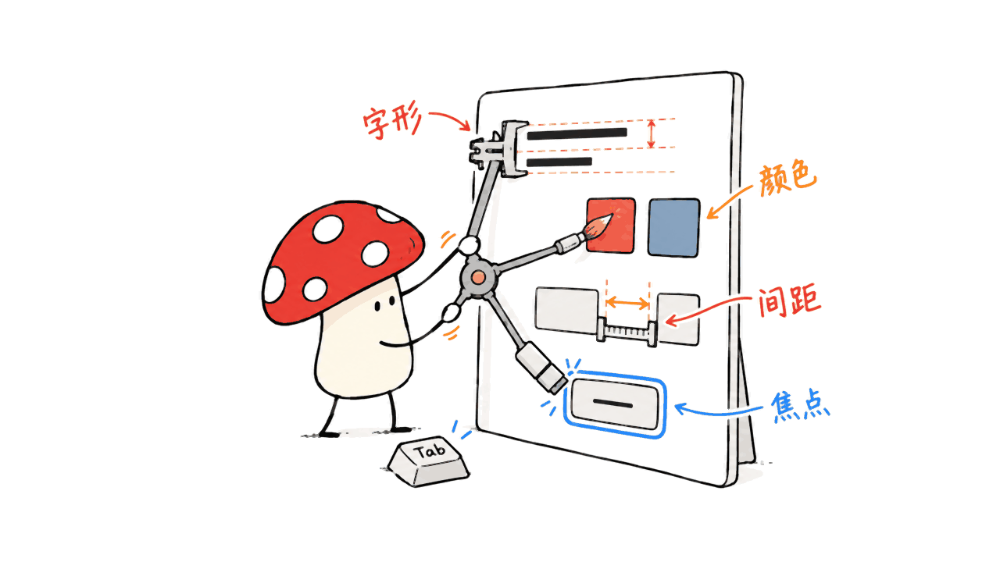
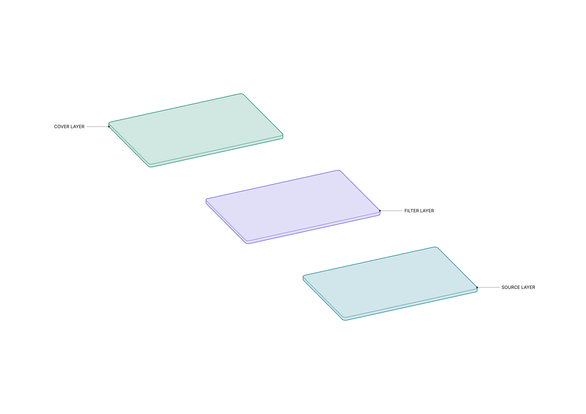

`teardown` 可以把物品或概念层次构建成可着色、可标注、可导出的技术解释图。本文在原有技能库总览上，新增了离线预览和实际 SVG、PNG 导出的验证；未知内部结构仍须标为示意，不能当作制造工程图。

`jakubkrehel/skills` 把界面设计经验整理成了 14 项可供编程 Agent 使用的技能。它最有用的地方，是让“这个页面不太对劲”变成有位置、有证据、有修复顺序的检查，而不只是让 AI 换一种配色。

作者 Jakub Krehel 也是设计工程杂志 Interfaces 的作者。仓库采用 MIT 许可证；2026-10-29 再次核对的提交仍为 `592aedc44d7d5b3e29740984252902f3e5402a1c`，Claude Code 插件清单版本为 `1.17.0`。Mycelium Protocol 已在本机完成 14 项技能安装和文件一致性校验，但没有据此宣称网站设计效果获得了可量化提升。

仓库：https://github.com/jakubkrehel/skills

作者网站：https://jakub.kr/

Interfaces：https://interfaces.dev/

## 这条命令究竟装了什么？

```sh
npx skills add jakubkrehel/skills
```

安装的是技能文件、参考资料、宿主配置，以及少量辅助代码。它没有安装一个新的大模型，也没有把浏览器、Figma 授权或项目运行环境一并交给 Agent。

大部分技能用 Markdown 描述规则和工作步骤，按需读取旁边的参考文件。`teardown` 还带有几何、投影、预览和导出相关代码。因此它既不完全等于一条提示词，也不能简单当成一套前端组件库。

初次安装时实际运行了只列出技能的命令，CLI 返回 `Found 14 skills`：

```sh
npx --yes skills add jakubkrehel/skills --list
```

需要按项安装时，CLI 也提示使用 `--skill <name>`。初次接入可先选择下面的总审阅入口及其六个领域技能，避免只安装总入口，却缺失它需要读取的规则。

## 14 项技能怎样分工？

先看基础七项：一个总入口，六个领域负责人。

| 技能 | 适合解决什么问题 |
|---|---|
| `better-interface` | 汇总六个领域的检查，输出一份按影响排序的报告 |
| `better-accessibility` | 键盘、焦点、可访问名称、表单、读屏、缩放和减少动效 |
| `better-layout` | 分组、对齐、阅读顺序、响应式和翻译后文字的容纳 |
| `better-writing` | 按钮标签、错误、空状态和确认文案 |
| `better-typography` | 字阶、字距、行距、字体特性、换行与截断 |
| `better-colors` | 调色板、语义 token、颜色格式与对比度测量 |
| `better-ui` | 表面、图标、阴影、圆角、光学对齐和动效细节 |

`better-interface` 的检查顺序从无障碍开始，依次进入布局、文案、排版、颜色和视觉打磨。这个顺序值得保留：用户无法用键盘完成任务时，先调整阴影几乎没有实际价值。



另外七项负责具体工作流，彼此的任务也不相同：

| 技能 | 工作流与边界 |
|---|---|
| `interface-review` | 审分支、PR 或未提交修改，区分新引入、回归和既有问题 |
| `explain-interface` | 从网站或截图解释界面、效果或动画怎样实现 |
| `break` | 在临时页面展示组件可能遇到的极端内容，报告实际看到的破损 |
| `state-machine` | 用模拟数据和切换器逐个展示组件状态，方便继续设计 |
| `variant` | 为一个组件做三种有明确差异的方案，留给人选择 |
| `build-design` | 读取 Figma 或设计图，复用项目已有组件和 token 实现 |
| `teardown` | 构建技术插图，并提供配置、着色、预览和导出页面 |

其中 `break` 把场景并排展开，目的是发现承压后的问题；`state-machine` 是逐个切换正常业务状态；`variant` 则是在同一个设计问题上比较不同答案。把三者都叫“生成预览”，会丢掉它们最重要的区别。

原始目录与各项入口：https://github.com/jakubkrehel/skills/tree/592aedc44d7d5b3e29740984252902f3e5402a1c/skills

## 为什么它强调“证据”，而不是设计偏好？

`better-interface` 明确要求尊重项目已经存在的密度、圆角、语气和设计约定。单纯不喜欢某种风格，不应该成为问题。

每条有效发现需要说明位置、当前实现、建议修改和用户影响。视觉或交互决定结果时，还需要看真实渲染；无法验证的内容应标为 `Not verified`，没有加载对应规则的领域应标为 `Not reviewed`。

总报告最多列 15 条发现，同一根因要合并，优先处理影响范围大的共享组件或 token。修复顺序也很节制：先考虑删除多余东西，再使用平台原生能力、复用已有实现、修正数值，最后才新增结构。

这给小团队一个实际收益：讨论从“我觉得这样好看”转向“哪个任务受阻，证据是什么，修改哪个共同原因”。不过，报告中的 `Approve` 只覆盖实际检查过的领域，不能拿来当作整个产品已获完整审计。


总审阅规则：https://github.com/jakubkrehel/skills/blob/592aedc44d7d5b3e29740984252902f3e5402a1c/skills/better-interface/SKILL.md

## 如何在实际项目中使用？

建议第一次只选一个完整任务，例如“登录并找回密码”，先要求只审阅、不修改：

```text
使用 better-interface 检查登录与找回密码流程。
覆盖窄屏、键盘操作、加载、失败和成功状态。
先读取项目的组件与设计约定，给出范围、证据和修复排序。
没有实际观察到的行为标为未验证，先不要改代码。
```

随后选择一两项高影响问题实施修复，再复查同一条流程。总审阅本身默认只读；安装技能不等于授权 Agent 把整个网站重新设计。

需要查看一个组件的空、加载、错误、成功状态时，再明确调用 `state-machine`。需要长用户名、大金额或极窄容器等极端输入时，调用 `break`。这些临时页面要与生产数据隔离，并在结束后清理。

有三种方案要比较时，再用 `variant`，例如只沿“信息密度”这一主轴做三版，而不是同时换布局、颜色、字体和文案，导致无法判断自己究竟喜欢什么。

准备合并修改时，用 `interface-review` 指定 PR、分支或明确范围。它审的是改动造成的界面后果，不能用一份全站旧问题清单淹没本次提交。


## 哪些能力仍然依赖宿主工具？

`build-design` 需要能读取设计来源。Figma 链接对应可用且已授权的 Figma 工具；只有截图时，尺寸只能按截图比例估算。技能文件不会自动提供账号权限。

视觉验证也依赖运行条件。项目无法启动、没有可用浏览器，或者截图缺少某种状态，Agent 就没有足够证据声称界面一致或交互正常。

无障碍技能引用 WCAG 2.2，但使用它不等于获得合规认证。一个很好的细节是，它将 24×24 CSS 像素的 AA 点击目标基线及例外，与更大的触控目标建议区分开，避免把所有设计建议都写成强制标准。具体任务仍需检查实际交互。

`teardown` 也明确区分技术解释图与制造工程图：估计的内部结构、尺寸必须标明，不提供制造公差，不能直接把看起来精细的插图当成加工依据。

设计实现规则：https://github.com/jakubkrehel/skills/blob/592aedc44d7d5b3e29740984252902f3e5402a1c/skills/build-design/SKILL.md

无障碍规则：https://github.com/jakubkrehel/skills/blob/592aedc44d7d5b3e29740984252902f3e5402a1c/skills/better-accessibility/SKILL.md

## 安装方式与调用名称有什么区别？

通用 skills CLI 的入口是用户给出的命令。具体选择哪个 Agent、安装在项目还是个人范围，需要看交互选项与自己的工作方式。不要因为看见仓库名称就假定所有宿主的命令名称完全一致。

Claude Code 也有官方仓库提供的插件路线：

```text
/plugin marketplace add jakubkrehel/skills
/plugin install interfaces@interfaces
```

仓库说明中，skills CLI 路线使用 `/better-interface` 这类名称，插件路线带命名空间，例如 `/interfaces:better-interface`。Codex 中则可按技能名明确引用，例如 `$better-interface`。

2026-10-26 的安装使用当前环境的 skill-installer，把固定提交的全部 14 项装入 Codex 个人技能目录，保留各项参考资料和 `agents/openai.yaml`，未在博客项目中再装一份，也未修改博客依赖。技能现已在当前环境可用。

另一个值得留意的设置是：`interface-review`、`variant`、`break`、`state-machine`、`explain-interface` 五项同时设置了 Claude Code 的 `disable-model-invocation: true` 和 Codex 的 `allow_implicit_invocation: false`。这些文件表达了必须明确调用的意图，实际执行仍由宿主决定。

插件清单：https://github.com/jakubkrehel/skills/blob/592aedc44d7d5b3e29740984252902f3e5402a1c/.claude-plugin/plugin.json

## 本机验证了什么，遇到了什么问题？

初次安装将目录里的全部文件与固定提交逐项比对，14 项全部一致。随后在已安装的 `teardown` 目录运行五个随附 Node 检查脚本，全部退出成功；其中几何脚本报告 28 项检查通过。

上述是 2026-10-26 的初次辅助逻辑检查，不包含浏览器导出。2026-10-29 新增的 teardown 预览和真实下载验证见下一节；两次验证范围不同，也都不构成 Figma 接入或设计质量的保证。

检查还遇到一个可复现的环境差异：把同一份源码放到本博客的目录中，几何脚本报 `G.unit is not a function`。本博客的 `package.json` 设置了 `type: module`，使辅助代码的 `.js` 文件按 ESM 解释，而测试按 CommonJS 导入它。相同文件在个人技能目录下通过。

该检查未修改上游源码。它提醒使用者：按项目安装或把辅助脚本复制进既有工程后，要重新检查模块作用域；在一个目录里通过，不意味着换个项目仍会自动通过。

## teardown 怎样做出可编辑的拆解图？

它的入口是技能规则，而非一个独立的文生图模型。Agent 先收集对象、资料、部件关系与尺寸依据，再用随附几何和投影代码建立一份共同结构，由它生成装配与爆炸视图。这样切换视角时，部件关系有同一份几何依据。

除了真实物品，也可以解释显示层、界面层等概念结构。但照片看不到的内部构造、随意补出的尺寸，都必须写进证据记录，区分实测、估算和虚构。漂亮的剖面不能证明某个真实产品内部确实如此。

固定版本规则：https://github.com/jakubkrehel/skills/blob/592aedc44d7d5b3e29740984252902f3e5402a1c/skills/teardown/SKILL.md

### 安装之后，给它什么任务？

只安装这一项可以使用：

```sh
npx skills add jakubkrehel/skills --skill teardown
```

在支持的宿主里明确调用 `teardown`；Codex 可用 `$teardown`，Claude Code 插件安装的命令名称则可能带 `interfaces` 命名空间，不能把不同安装方式混为一谈。可以从这样的需求开始：

```text
使用 teardown，制作一个三层光学结构的概念拆解图。
三层分别叫 Source layer、Filter layer、Cover layer。
全部几何与尺寸都是虚构示意，在 evidence.md 明确记录。
保持装配图与爆炸图使用相同几何，给三个部件稳定的 ID。
提供单部件颜色、填色、名称引线和整体拆解间距控制。
输出独立 HTML 预览，以及 SVG 和 300 dpi PNG。
先检查最小、默认、最大宽度，再检查装配、爆炸和展开视图。
```

参考资料充足时，可以把这段概念要求换成实际对象的照片、尺寸表或 CAD。涉及教学或产品说明，先指定读者需要理解的部件关系，通常比要求“画得复杂”更有用。

### 颜色、标注与导出分别在哪里改？

`drawing.json` 定义部件 ID、显示名称、参数范围与初始颜色；模型脚本产生几何。预览页面可以选择整体或单个部件调色、开关填色、显示名称引线，以及切换装配和爆炸状态。普通标注开关不等于自动生成尺寸、公差或完整工程编号。

生成时需要 Node 环境和构建依赖，包括 `jspdf`、`svg2pdf.js`、Inter 字体包；构建完成的单文件 HTML 把脚本与字体打包进去。制作阶段需要工具与依赖，离线查看阶段则可以不依赖外部 CDN。

SVG 适合继续编辑线条和颜色，PNG 适合文章与幻灯片。页面还提供 PDF；本次只确认 PDF 成功下载，没有独立解析其内部矢量保真度。不能把导出按钮存在写成所有格式已全面验证。

### 实际示例验证到了哪一步？

2026-10-29 的演示使用三个圆角薄板，宽度范围 70–110，默认 90；这些数值全部虚构。它只说明“下层发出信息，经中层处理，到上层呈现”的层次，不代表任何真实显示器的光学设计。



可交互预览：https://blog.mushroom.cv/demos/teardown-layers/

SVG：https://blog.mushroom.cv/demos/teardown-layers/layer-stack-exploded-technical.svg

PNG：https://blog.mushroom.cv/demos/teardown-layers/layer-stack-exploded-technical.png

验证分为三层：

- 随附 proof 脚本生成最小、默认、最大宽度与三种视图组合，共 9 组图稿；未出现检查警告。
- 隔离 Chrome 会话打开本地 HTML，三个部件正常显示；切换装配和爆炸状态、开启名称标注、把中层色相改为 280 后，从真实按钮下载文件。
- SVG 元数据记录中层颜色为 `#594fd7`，保留三个填色部件与标注；PNG 文件实读为 4961×3508、约 300 dpi，人工查看没有发现部件或引线裁切。运行时未观察到外部网络请求或脚本异常。

示例使用独立的 CommonJS 工作目录，绕开下文记录的 ESM 作用域差异，没有修改博客依赖或上游实现。此次没有测试复杂曲面、任意 CAD 导入、所有参数组合或制造精度；三块板的成功不能外推为任意机械总成都能自动准确拆解。

技术绘图的真正门槛仍是资料和验证。它适合把知识变成可读、可修改的说明图，尤其适合教程、产品结构讲解和层次关系演示。若目标是维修、加工或安全判断，应回到有来源的结构资料与专业 CAD 流程。

## 值不值得装？

如果团队经常让 Agent 写前端，又反复遇到排版不一致、错误状态遗漏、键盘不可用、截图好看却操作困难，这套技能值得作为检查与实现的共同语言。

它的价值取决于能否把规则接入真实证据：跑起页面、提供实际数据形态、明确修改范围、记录尚未验证的状态。先选一条高频流程完成“审阅—修复—复查”，比同时对全站调用 14 项更容易判断收益。

仓库中的技能是 MIT 开源；Interfaces 网站的订阅文章与其他资源有自己的访问条件，不能把仓库许可证延伸为全部杂志内容都免费开放。

## 常见问题

### 安装之后会自动重写整个项目吗？

不会因安装本身发生。总审阅默认只读，几个会创建临时页面的工作流还要求明确调用。实际修改仍应有清楚的任务范围。

### 只装 better-interface 就足够吗？

它要读取六项领域技能。缺少某项时，规则要求把该领域标为未审阅，而不是从记忆里补出一份看似完整的报告。

### 测试脚本通过，是否证明 AI 做出的页面一定更好？

不能。脚本只验证对应辅助代码，实际页面还需要结合任务完成、键盘交互、窄屏、错误恢复和视觉检查来判断。

封面采用仓库 README 链接的 Interfaces 官方图形，相关品牌与素材权利归原作者，不纳入本文文字的 CC 授权范围。

原文与后续更新：https://blog.mushroom.cv/blog/jakub-krehel-interface-skills/

---

> © 2026 Author: Mycelium Protocol. 本文采用 [CC BY 4.0](https://creativecommons.org/licenses/by/4.0/deed.zh) 授权——欢迎转载和引用，须注明作者姓名及原文链接，不得去除署名后以原创发布。

<!--EN-->

`jakubkrehel/skills` turns interface design knowledge into 14 skills for coding agents. Its most useful contribution is making vague discomfort actionable: identify the location, gather evidence and rank a fix by user impact.

Jakub Krehel also writes Interfaces, a design-engineering magazine. This MIT-licensed repository was reviewed at commit `592aedc44d7d5b3e29740984252902f3e5402a1c` on October 26, 2026; its Claude Code plugin manifest reports version `1.17.0`. Mycelium Protocol installed and verified all 14 skills locally. That establishes installation, not a measured improvement in interface quality.

Repository: https://github.com/jakubkrehel/skills

Author: https://jakub.kr/

Magazine: https://interfaces.dev/

## What does the installation command provide?

```sh
npx skills add jakubkrehel/skills
```

It installs skill instructions, reference material, host configuration and some helper code. It does not supply a new model, browser, Figma account or working project environment.

Most of the collection is Markdown. The `teardown` skill additionally includes geometry, projection, preview and export code. This makes the repository more than one prompt, while remaining distinct from a frontend component library.

Our discovery-only CLI run returned `Found 14 skills`:

```sh
npx --yes skills add jakubkrehel/skills --list
```

The CLI also advertises `--skill <name>` for selecting individual skills. If installing the review orchestrator, include the six domain skills it reads.

## How are the 14 skills organized?

Seven provide orchestration and domain rules:

| Skill | Responsibility |
|---|---|
| `better-interface` | Consolidated review across six domains |
| `better-accessibility` | Keyboard, focus, semantics, forms, announcements, motion and zoom |
| `better-layout` | Grouping, alignment, reading order, responsiveness and translated text |
| `better-writing` | Labels, errors, empty states and confirmations |
| `better-typography` | Type scale, spacing, features, wrapping and truncation |
| `better-colors` | Palettes, semantic tokens, formats and contrast |
| `better-ui` | Surfaces, icons, shadows, radii, optical alignment and motion |

The orchestrator reviews accessibility before layout, writing, typography, color and polish. This ordering is useful: refining shadows does little for someone unable to complete the task with a keyboard.


The other seven provide distinct procedures:

| Skill | Procedure |
|---|---|
| `interface-review` | Review change scope and distinguish introduced, regressed and existing problems |
| `explain-interface` | Explain implementation from a live interface or screenshot |
| `break` | Expose a component to relevant extreme inputs on a temporary page |
| `state-machine` | Display product states with mock data and a switcher |
| `variant` | Build three deliberately different answers for a person to choose |
| `build-design` | Implement Figma or image designs using existing project components and tokens |
| `teardown` | Produce configurable technical illustrations with preview and export |

`break` displays scenarios together to reveal failures. `state-machine` lets someone work through business states one at a time. `variant` explores different design answers. These are different tasks, despite all involving previews.

Skill sources: https://github.com/jakubkrehel/skills/tree/592aedc44d7d5b3e29740984252902f3e5402a1c/skills

## Why is evidence more important than taste?

The orchestrator respects established project choices about density, radii and voice. Disliking a style is not itself a finding.

A finding needs a location, current implementation, actionable change and user impact. Visual or interactive conclusions require rendered evidence when relevant. Missing runtime verification is labeled `Not verified`; a domain whose owning rules were unavailable is `Not reviewed`.

The consolidated report has a maximum of 15 findings and groups shared root causes. It prefers deletion, native platform behavior and existing project primitives before adding structure. Its approval applies only to inspected domains, not an unreviewed entire product.

For a small team, this can make design discussion more concrete: which task fails, what establishes the problem, and which shared change would help? It is not proof that the agent's judgment is always correct.


Review rules: https://github.com/jakubkrehel/skills/blob/592aedc44d7d5b3e29740984252902f3e5402a1c/skills/better-interface/SKILL.md

## How should a team adopt it?

Start with one complete flow, such as login and password recovery. Ask for a read-only review covering keyboard access, narrow widths, loading, failure and success. Require the agent to read project conventions, state its coverage and separate observations from unverified predictions.

Implement one or two consequential findings, then check the same flow again. Installing a skill does not authorize a whole-site redesign.

Explicitly use `state-machine` when the task is inspecting product states, `break` for extreme content and `variant` for alternatives. Keep temporary fixtures separate from production data and remove them afterward. For alternatives, choose one main axis, such as density, so a comparison does not change layout, type, color and voice simultaneously.

Before merging, target `interface-review` at the actual PR or branch. A change review should explain what changed rather than drown the submission in unrelated old issues.


## What still depends on external tools?

`build-design` needs access to its design source. Figma requires available, authenticated tools. Screenshot measurements remain estimates at a stated scale. The skill does not grant account access.

Rendered verification requires a working preview and browser. Missing states, inaccessible projects and unavailable tools limit what the agent can establish.

The accessibility skill uses WCAG 2.2, but invoking it is not a compliance certification. It distinguishes the 24×24 CSS-pixel AA target baseline and its exceptions from larger recommended targets, rather than treating every heuristic as a mandatory rule.

`teardown` similarly distinguishes explanatory technical illustrations from manufacturing drawings. Estimated construction and dimensions must remain identified; fine linework does not supply manufacturing tolerances.

Design implementation: https://github.com/jakubkrehel/skills/blob/592aedc44d7d5b3e29740984252902f3e5402a1c/skills/build-design/SKILL.md

Accessibility: https://github.com/jakubkrehel/skills/blob/592aedc44d7d5b3e29740984252902f3e5402a1c/skills/better-accessibility/SKILL.md

## How do installation and invocation differ?

Use the skills CLI's interactive choices to select an agent and installation scope. The repository also provides a Claude Code plugin route:

```text
/plugin marketplace add jakubkrehel/skills
/plugin install interfaces@interfaces
```

Its repository guidance distinguishes CLI-style `/better-interface` from plugin-style `/interfaces:better-interface`. In Codex, a skill can be referenced explicitly by name, such as `$better-interface`.

The original October 26 installation used the environment's skill-installer helper to install the pinned revision into the personal Codex skills directory, including references and `agents/openai.yaml`. No second installation or dependency change was made inside the blog. The skills are now available in this environment.

Five procedures declare explicit invocation in both host configurations: `interface-review`, `variant`, `break`, `state-machine` and `explain-interface`. Their frontmatter uses `disable-model-invocation: true`, and their Codex metadata uses `allow_implicit_invocation: false`. Host implementations determine actual enforcement.

Plugin manifest: https://github.com/jakubkrehel/skills/blob/592aedc44d7d5b3e29740984252902f3e5402a1c/.claude-plugin/plugin.json

## What did local verification establish?

Every installed file matched the pinned source across all 14 skills. All five bundled Node helper-check scripts passed from the installed `teardown` directory. The geometry script reported 28 successful checks.

Those October 26 checks covered helpers, not browser exports. The October 29 viewer and actual-download checks below extend that scope; neither establishes Figma integration or design quality.

The initial check also reproduced an integration difference. Placing the same files under this blog caused the geometry check to fail with `G.unit is not a function`. The blog's `type: module` setting makes `.js` helpers load as ESM, while that test imports them through CommonJS. Identical files passed in the personal skills directory.

No upstream patch was used to hide that result. Project-local installation and copying helpers into an application deserve their own module-scope checks; success in one directory does not establish success in another.

## How does teardown produce editable technical diagrams?

`teardown` is a procedure with geometry, projection and export helpers. It builds a shared geometric description, then uses it for assembled and exploded views. It can describe physical objects or conceptual layers. Hidden structures and invented dimensions must be recorded as illustrative; the result is not a toleranced manufacturing drawing.

Install just this skill with `npx skills add jakubkrehel/skills --skill teardown`. Invoke it explicitly in the host: `$teardown` in Codex, or the appropriate namespaced command when installed as a Claude Code plugin. Provide the intended reader, component relationships, reference photographs or CAD, known dimensions and required output formats.

A useful first request is: “Create three conceptual layers named Source, Filter and Cover; record all geometry as invented in evidence.md; keep assembled and exploded views coherent; provide individual colors, fills, name leaders, an offline HTML viewer, SVG and 300 dpi PNG; check minimum, default and maximum widths.”

The configuration stores stable part IDs, names, parameter ranges and initial hues. The viewer controls overall or individual colors, tint fills, annotations and explosion spacing. Name leaders do not automatically provide manufacturing dimensions or tolerances. Building requires Node dependencies such as jsPDF, svg2pdf.js and the Inter font package; the resulting single HTML file bundles runtime assets.


Interactive example: https://blog.mushroom.cv/demos/teardown-layers/

Editable SVG: https://blog.mushroom.cv/demos/teardown-layers/layer-stack-exploded-technical.svg

300 dpi PNG: https://blog.mushroom.cv/demos/teardown-layers/layer-stack-exploded-technical.png

The October 29 example used three rounded plates with an illustrative width range of 70–110 and default 90. Nine proof combinations covered minimum/default/maximum widths and assembled/exploded/spread views without reported warnings. A fresh isolated Chrome session rendered all three parts, switched assembled and exploded views, enabled labels, changed the filter hue to 280, and downloaded SVG, PNG and PDF through the actual buttons.

The exported SVG metadata retained filter color `#594fd7`, three filled components and annotations. The PNG measured 4961×3508 pixels at approximately 300 dpi; visual inspection found no clipped parts or leaders. No external runtime network request or JavaScript exception was observed. PDF download succeeded, but its internal vector fidelity was not independently parsed or verified.

This demonstration uses an isolated CommonJS directory, addressing the module-scope issue in the original checks without changing blog dependencies or upstream code. It does not establish complex-surface support, arbitrary CAD import, every parameter combination or engineering accuracy. Its value is an editable explanation artifact grounded in explicit evidence, suitable for teaching and product communication.

Pinned instructions: https://github.com/jakubkrehel/skills/blob/592aedc44d7d5b3e29740984252902f3e5402a1c/skills/teardown/SKILL.md

## Is the collection worth adopting?

It is a useful candidate when agents repeatedly produce inconsistent typography, incomplete error states or interfaces that look plausible in screenshots but fail during interaction. Its value is a shared process for identifying and correcting those problems.

Start with a frequent user task and complete a review–fix–recheck cycle. Provide real-shaped data, a working preview and clear boundaries. That gives better evidence of usefulness than invoking every skill across an entire application.

The repository is MIT-licensed. Interfaces magazine subscriptions and other resources have their own access conditions; the repository license does not make the entire magazine freely available.

## FAQ

### Will installation rewrite the project automatically?

Installation alone does not. The orchestrated review defaults to read-only, and several temporary-page workflows require explicit invocation. Actual edits need a defined task.

### Is better-interface alone sufficient?

It reads six domain skills. A missing domain must be labeled unreviewed rather than reconstructed from memory and presented as complete coverage.

### Do passing helper tests establish better AI-generated interfaces?

No. They validate their respective helpers. Judge actual interfaces through task completion, keyboard use, narrow layouts, error recovery and rendered inspection.

The cover uses the official Interfaces graphic linked from the repository README. Its branding and source artwork remain the rights of their owners and are excluded from this article's text license.

Canonical article: https://blog.mushroom.cv/blog/jakub-krehel-interface-skills/

---

> © 2026 Author: Mycelium Protocol. Licensed under [CC BY 4.0](https://creativecommons.org/licenses/by/4.0/) — free to share and adapt with attribution. You must credit the author and link to the original; removing attribution and republishing as original is not permitted.
