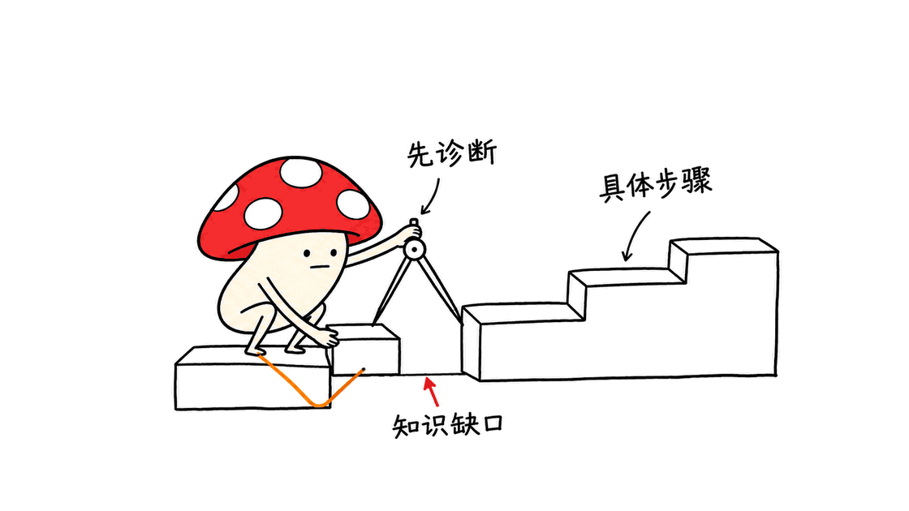
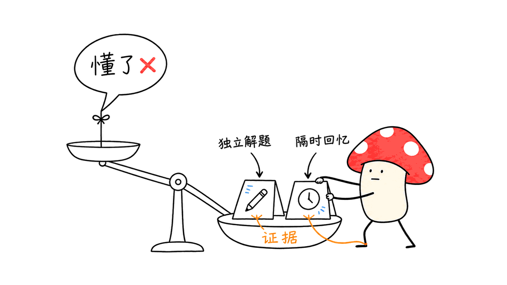
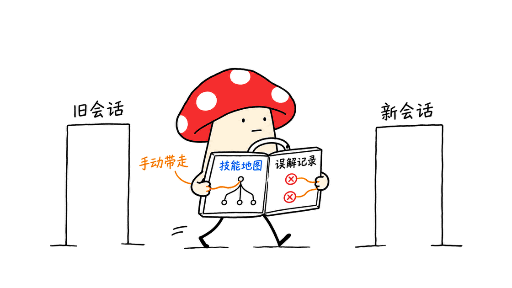

Jane Street 的 agent_skills 让 AI 用诊断、追问和复习来辅导学习，要求拿出会做的证据再升级。

仓库位于 `janestreet/agent_skills`，采用 MIT 许可。本次检查时，它只有一个技能 `socratic-tutor`：一份 102 行、5,243 字节的 Markdown 文件，没有模型权重、教学 App 或训练框架。它也没有公开交易策略。

Mycelium Protocol 逐段核对了固定提交 `7c6715c29548a3b39d4a9545c698ee4fd17a7213`。最值得借鉴的是把“掌握”拆成可观察行为：能解释、能独立完成、能处理反例，不能因为用户说“懂了”就宣布学会。

## 这一个 Skill，怎样改变聊天方式？

直接让 AI “解释 SQL”，通常得到一份答案。这个技能要求 AI 建立持续教学过程：先判断你会多少，再决定下一题；答错时缩小问题，暴露推理里的矛盾，而不是立刻贴标准答案。

它还有一个明确的启动边界。一次性的“这是什么”“解释一下”应正常回答，不启动测验；只有用户明确希望被教、被考、练到掌握，才进入教学循环。意图含糊时，先简短确认。

这条边界很实用：好的工作流不仅规定怎么做，也规定什么时候不做。阅读本文不需要安装技能，更不意味着要接受一次诊断测验。



## 教学流程有哪些具体约束？

文件给出的流程并不复杂，但每一步都限制了模型常见的敷衍行为。

| 环节 | 技能中的要求 | 目的 |
|---|---|---|
| 拆分目标 | 通常拆成4—10项具体子技能，宽泛主题可建两层树 | 让“学数据库”变成具体能力 |
| 初始诊断 | 3—5道探测题，一次一道，诊断完成前不教学 | 区分已有能力与刚听到的答案 |
| 过程练习 | 每次只问一道，问完停止等待 | 给学习者真实推理空间 |
| 错误处理 | 先用更窄的问题追问，失败2—3次后可直接解释并换角度复测 | 避免只给答案，也避免无限追问 |
| 升级判断 | 至少两次独立检查，其中一次是非刚提示后的主动回忆 | 减少把复述当掌握 |
| 完成考核 | 每项子技能至少一题，再加一道综合题 | 验证能否把知识连起来用 |

初始技能地图会展示进度，用户可以调整从哪一项开始。过程中发生等级变化时，AI 应更新地图；先前会做的内容在复习中失败，也可以降级重练。所有子技能达到目标后才进入最终混合考核，没通过则继续练习。

答对也不一定立刻升级。技能要求偶尔用反例追问，让学习者为正确答案辩护，并避免用泛泛的赞美替代判断。

但这些数字是教学规则，不是项目公布的实验结果。“至少两次检查”不代表学习效率提高两倍，仓库也没有提供对照试验来证明成绩提升。

## 0—5级，究竟在评估什么？

技能地图给每项能力打0—5级：从没接触过，到听说过、能跟着理解、需要帮助才能做，再到独立完成，最后是能讲给别人并处理边界情况。

默认目标是4级，也就是可以独立做。用户明确要求全面掌握时，目标设为5级；还要能面对反例或刁钻问题，并清楚解释概念。

这比“你学会了80%”更容易检查。不过，地图里的百分比仍是模型依据对话做的估计。文件没有定义经过校准的概率模型，不能把进度条当成正式资格证书或准确的掌握率。



尤其要注意提示污染：刚看过答案后原样复述，不能算独立回忆。实际使用时，可以要求 AI 换一份数据、换一种问法，或者隔几题再检查同一知识点。

## 用一个真正执行过的 SQL 例子说明

假设学习目标是“找出没有订单的客户”。我们构造三位客户，订单里既有客户1，也有一条 `NULL` 客户标识。

```sql
CREATE TABLE customers(id INTEGER);
CREATE TABLE orders(customer_id INTEGER);
INSERT INTO customers VALUES (1),(2),(3);
INSERT INTO orders VALUES (1),(NULL);
```

AI 家教可以先问：“下面的查询会返回哪些客户？先预测，不要执行。”

```sql
SELECT id FROM customers
WHERE id NOT IN (SELECT customer_id FROM orders)
ORDER BY id;
```

如果学习者回答“2和3”，更有价值的下一问是：“当集合里包含 NULL 时，比较结果一定是真或假吗？”然后根据回答继续缩小问题，而不是立即补上大段说明。

我们用本地 SQLite 实际执行，第一条查询返回空结果；改成下面的 `NOT EXISTS` 写法，才返回2和3。对原子查询显式排除 NULL 的 `NOT IN` 写法，在这组客户ID均非NULL的数据上也返回2和3。

```sql
SELECT id FROM customers AS c
WHERE NOT EXISTS (
  SELECT 1 FROM orders AS o WHERE o.customer_id=c.id
)
ORDER BY id;
```

NULL 参与比较会引入 UNKNOWN；WHERE 不把 UNKNOWN 当作通过。这组实验给学习内容提供了可运行的判据。之后可以换一个包含重复订单或可空客户ID的例子，检查学习者能否迁移理解，而不是背住修正版。

这是我们自拟教学案例的数据库执行核验，脚本与结果已保存。它没有运行上游技能的完整辅导会话，没有比较不同模型，也不能据此宣称这份提示词改善了学习成绩。

## 怎么使用，需要安装程序吗？

README 给出两种方式。支持 `SKILL.md` 的 Agent，可以把 `socratic-tutor` 目录放进该客户端的技能目录；普通聊天机器人则可以粘贴技能正文，再说明自己的学习目标。

先拿到源码并阅读：

```bash
git clone https://github.com/janestreet/agent_skills.git
cd agent_skills
cat socratic-tutor/SKILL.md
```

不同客户端的技能搜索路径和启用方法不同，按当前客户端文档放置目录即可。这不是 npm 包，也不是装完就出现独立界面的软件；本文没有修改你本机任何 Agent 的技能配置。

启动时可以这样提出需求，这是我们的使用示例：

```text
请使用 socratic-tutor，教我 SQL 的 NULL 与反连接。
我能写普通 SELECT，但没系统学过三值逻辑。
目标是独立完成相关查询，先做诊断，一次只问一道题。
如果需要执行 SQL，只使用临时练习数据库。
```

这份文件本身没有强制安装工具的脚本。实际练习若需要代码运行或查询数据库，仍依赖宿主 Agent 的工具、权限和环境。模型能访问你的正式数据库，不代表练习就应该在正式库上执行。

## 复习和长期记忆做到了哪一步？

技能要求在教学过程中穿插复习，失败时回退重练。这是对模型行为的指令，没有附带日历调度器、通知服务或专门的遗忘曲线算法。它不会仅靠这份文件，在三天后主动给你发题。

跨会话延续采用人工保存状态的方式。输入 `save state`，让模型输出主题、技能地图、误解和已经覆盖的内容；新会话用 `resume from:` 加上状态块继续。



这不等于内置持久化数据库，更不是训练了模型权重。实际接续效果取决于状态块是否完整、新会话是否读入，以及模型是否遵循规则。保存时也不需要把公司机密、真实客户数据或访问密钥写进学习记录。

其他命令包括 `show progress`、`harder`、`easier`。`just tell me` 可以对当前问题暂时越过苏格拉底式追问，直接要答案；它不是永久关闭整个学习流程。

## 对开发者来说，真正值得复制什么？

Mycelium Protocol 的判断是，这份小文件展示了一个具体的 Skill 写作方法：定义触发条件、过程、证据标准、失败回退、完成条件和状态交接，而不是只写“你是一名资深老师”。

它依然是提示词约束，执行质量取决于宿主和模型。模型可能误判答案、泄漏提示、虚构进度，或者把不熟悉领域的错误解释得很自信。专业课程最好提供可信参考答案，并用程序执行、人工复核或权威资料核验关键结论。

如果你总能看懂 AI 的解释，却离开提示就不会做，这套流程值得试。如果你只想快速查一个语法，不必启动完整诊断。采用之后应比较自己的独立完成情况，而不是只看 AI 给的进度条。

关于技能格式与筛选标准，也可参考本站的整理：https://blog.mushroom.cv/blog/awesome-agent-skills-cross-vendor-paths-quality-criteria-anti-slop/ 。技能目录解决的是可发现、可加载的问题，教学效果还需要另外验证。

## 常见问题

### Jane Street 开源了完整的 AI 家教产品吗？

当前检查的仓库只有一个 Markdown 教学技能，没有独立前后端、用户系统、模型权重或自动复习服务。

### 普通聊天机器人也能使用吗？

可以，README 允许粘贴技能正文使用。是否严格遵守一次一题、回忆检查和升级规则，要看模型与聊天环境。

### 文件会自动记住上次学到哪里吗？

没有自带持久化实现。技能提供保存和恢复状态的对话命令，需要用户或外部系统保管并重新传入状态。

### 已经证明比普通聊天学得更快吗？

本次所查仓库没有提供对照学习实验。本文只核验文件内容和自拟 SQL 示例的执行结果，没有测量学习效率。

## 一手资料

- 仓库：https://github.com/janestreet/agent_skills
- 固定版本技能：https://github.com/janestreet/agent_skills/blob/7c6715c29548a3b39d4a9545c698ee4fd17a7213/socratic-tutor/SKILL.md
- 使用说明：https://github.com/janestreet/agent_skills/blob/7c6715c29548a3b39d4a9545c698ee4fd17a7213/README.md
- MIT许可：https://github.com/janestreet/agent_skills/blob/7c6715c29548a3b39d4a9545c698ee4fd17a7213/LICENSE.md
- Agent Skills格式规范：https://agentskills.io/specification

---

> © 2026 Author: Mycelium Protocol. 本文采用 [CC BY 4.0](https://creativecommons.org/licenses/by/4.0/deed.zh) 授权——欢迎转载和引用，须注明作者姓名及原文链接，不得去除署名后以原创发布。

<!--EN-->

Jane Street's agent_skills asks an AI tutor to diagnose, question and review a learner, requiring evidence before increasing a skill level.

The MIT-licensed repository currently contains one skill, `socratic-tutor`: a 102-line, 5,243-byte Markdown file. It does not ship model weights, a tutoring application, a training framework or trading strategies.

Mycelium Protocol inspected commit `7c6715c29548a3b39d4a9545c698ee4fd17a7213`. The useful idea is to define observable mastery: explain a concept, solve a problem independently and handle an edge case. Saying “I understand” is insufficient evidence.

## What does this Skill change?

Asking an assistant to explain SQL usually produces an answer. This skill instead defines an ongoing teaching process: determine the learner's starting point, ask a question, examine the answer and choose the next intervention.

It also defines when to stay out of the way. One-off explanation requests should receive ordinary answers rather than an unwanted quiz. Explicit requests for teaching or mastery activate the loop; ambiguous intent calls for a short clarification.

That distinction is part of the design: a useful workflow specifies its entry conditions as well as its actions. This article is an introduction, not an invitation to start diagnosing the reader.


## Which constraints structure the teaching loop?

| Stage | Instruction | Purpose |
|---|---|---|
| Decomposition | Usually 4–10 concrete subskills; a two-level tree for broad topics | Turn a broad ambition into specific abilities |
| Placement | 3–5 diagnostic questions, one at a time, before teaching | Distinguish prior knowledge from newly supplied answers |
| Practice | Ask one question and stop for the learner's response | Preserve room for actual reasoning |
| Errors | Narrow the question; after 2–3 failed attempts, explain and retest differently | Avoid both answer dumping and endless interrogation |
| Promotion | At least two independent checks, including recall that does not immediately follow an explanation | Avoid mistaking repetition for mastery |
| Completion | A question for every subskill plus an integrative problem | Check whether knowledge connects across tasks |

The initial map proposes a starting point, which the learner can override. Level changes should update the map. Failure during review can lower a level and return a subskill to practice. All subskills must reach the target before the final mixed assessment; failure returns the learner to practice.

Correct answers can also face counterexamples that require a defense. The instructions discourage flattery as a substitute for evaluation.

These numbers are procedural requirements, not experimental outcomes. Two checks do not establish a twofold learning improvement; the inspected repository provides no controlled learning study.

## What do levels 0–5 mean?

The map progresses from unfamiliarity, to recognition, to following an explanation, to performing with help, to independent performance. Level 5 adds clear explanation to others and handling edge cases.

The default target is level 4. An explicit request for full mastery changes the target to 5 and adds adversarial or boundary questions before the tutor concludes full mastery.

The displayed percentage is still an assistant's conversational estimate. The file does not define a calibrated probability model, so a progress bar should not be interpreted as a credential or an accurate probability of mastery.


Prompt contamination matters: repeating an answer immediately after seeing it is not independent recall. Change the data or question framing, or revisit the same concept after intervening exercises.

## A SQL example we actually executed

Consider finding customers without orders. Our example creates customers 1, 2 and 3, while the orders contain customer 1 and a NULL customer identifier:

```sql
CREATE TABLE customers(id INTEGER);
CREATE TABLE orders(customer_id INTEGER);
INSERT INTO customers VALUES (1),(2),(3);
INSERT INTO orders VALUES (1),(NULL);
```

A tutor might ask the learner to predict this query's result before running it:

```sql
SELECT id FROM customers
WHERE id NOT IN (SELECT customer_id FROM orders)
ORDER BY id;
```

If the learner answers “2 and 3,” a narrower follow-up can ask whether comparisons involving NULL are necessarily true or false. The tutor then works from the learner's reasoning instead of immediately supplying the solution.

We executed the example in local SQLite. The first query returned no rows. The following `NOT EXISTS` version returned 2 and 3:

```sql
SELECT id FROM customers AS c
WHERE NOT EXISTS (
  SELECT 1 FROM orders AS o WHERE o.customer_id=c.id
)
ORDER BY id;
```

Filtering NULL out of the original subquery also returned 2 and 3 for this dataset, whose customer identifiers are non-NULL. NULL comparisons can produce UNKNOWN, and WHERE does not accept UNKNOWN as true.

A subsequent exercise can change duplicate orders or introduce nullable customer identifiers to test transfer rather than memorization. Our saved reproduction verifies an author-designed database example. It does not evaluate the upstream tutoring loop, compare models or establish educational effectiveness.

## How do you use it?

The README describes two routes. An agent supporting the common skill format can load the `socratic-tutor` directory from its skills location. A regular chatbot can receive the skill body as pasted instructions, followed by the learning request.

To inspect the source:

```bash
git clone https://github.com/janestreet/agent_skills.git
cd agent_skills
cat socratic-tutor/SKILL.md
```

Skill discovery paths and activation methods depend on the client. This is not an npm package or a standalone graphical application. We did not change any locally installed agent configuration.

An example request we suggest is:

```text
Use socratic-tutor to teach me SQL NULL semantics and anti-joins.
I can write ordinary SELECT queries, but have not studied three-valued logic.
Aim for independent performance. Start with diagnosis, one question at a time.
Use only a temporary practice database for SQL execution.
```

The file contains no required tool-installation script. Running exercises depends on the host's available tools, permissions and environment. Access to a production database is not a reason to use it for practice.

## What about review and long-term memory?

The instructions call for revisiting earlier subskills and lowering levels when review fails. They do not include a calendar scheduler, notification service or dedicated forgetting-curve implementation. The file alone will not initiate a review three days later.

Cross-session continuity uses manual state transfer. `save state` requests a compact summary of the topic, map, misconceptions and covered material. `resume from:` followed by that block restores the conversational context.


This is neither a built-in persistent database nor model-weight training. Continuity depends on the completeness of the state block, its inclusion in the next session and the model's adherence. Avoid putting company secrets, customer records or credentials into learning-state summaries.

Other commands include `show progress`, `harder` and `easier`. `just tell me` overrides questioning for the current question only, rather than permanently abandoning the workflow.

## What should developers take from this?

Our assessment is that this small file demonstrates practical workflow writing: specify activation, process, evidence, recovery, completion and state handoff. Those instructions are more actionable than merely assigning an expert persona.

They remain prompt-level constraints. A model may grade incorrectly, leak hints, invent progress or confidently explain unfamiliar material. For specialized topics, supply trustworthy answers and verify important conclusions through execution, human review or authoritative references.

Try the workflow if explanations feel clear but independent work remains difficult. For a quick syntax lookup, the diagnostic loop is unnecessary. Evaluate it through actual independent performance rather than the assistant's progress display.

For related skill-format and selection context, see https://blog.mushroom.cv/blog/awesome-agent-skills-cross-vendor-paths-quality-criteria-anti-slop/ . Discoverability and loading are separate concerns from educational outcomes.

## FAQ

### Is this a complete AI tutoring product?

The inspected repository contains one Markdown tutoring skill, with no standalone frontend, user-management system, model weights or scheduled review service.

### Can a normal chatbot use it?

Yes. The README allows pasting the skill body into a chat. Adherence to questioning, recall and promotion rules depends on the model and host environment.

### Does it automatically remember previous sessions?

No persistence implementation is included. The skill defines conversational save and resume commands; a person or external system must retain and supply the state.

### Has faster learning been demonstrated?

No controlled educational evaluation was provided in the inspected repository. We inspected the instructions and executed our SQL example, without measuring learning efficiency.

## Primary sources

- Repository: https://github.com/janestreet/agent_skills
- Pinned skill: https://github.com/janestreet/agent_skills/blob/7c6715c29548a3b39d4a9545c698ee4fd17a7213/socratic-tutor/SKILL.md
- README: https://github.com/janestreet/agent_skills/blob/7c6715c29548a3b39d4a9545c698ee4fd17a7213/README.md
- MIT license: https://github.com/janestreet/agent_skills/blob/7c6715c29548a3b39d4a9545c698ee4fd17a7213/LICENSE.md
- Agent Skills specification: https://agentskills.io/specification

---

> © 2026 Author: Mycelium Protocol. Licensed under [CC BY 4.0](https://creativecommons.org/licenses/by/4.0/) — free to share and adapt with attribution. You must credit the author and link to the original; removing attribution and republishing as original is not permitted.
