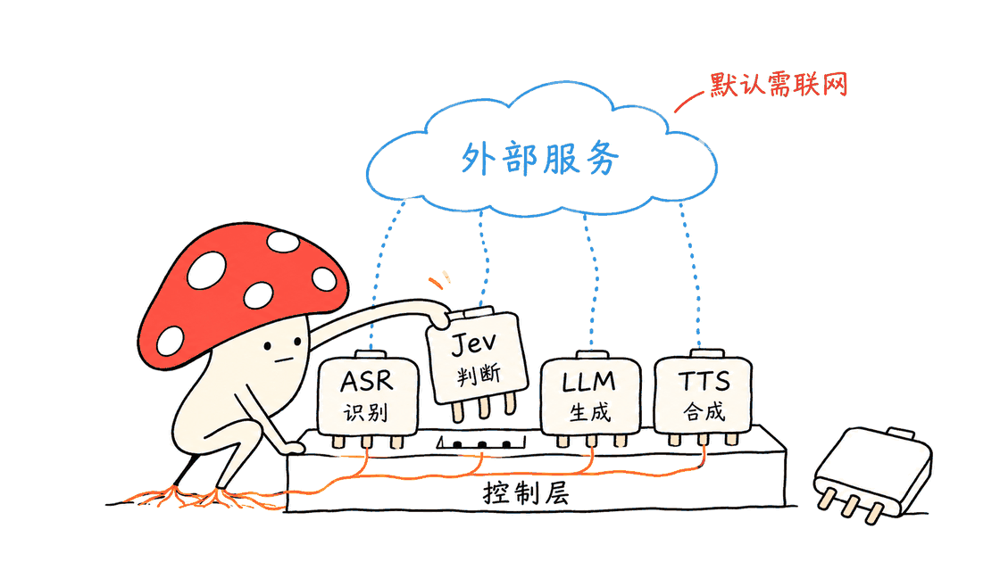

Jev-Interaction 把语音助手“该接话还是等一下”变成可修改、可记录的决策，让开发者分别控制说什么与什么时候说。

完整仓库是 https://github.com/native-bond-lab/Jev-Interaction ，用户消息中的换行把组织名与仓库名拆开了。代码采用 Apache-2.0，当前包版本为 0.1.0，README 标注 Alpha。它提供级联语音交互框架；真实通话默认还需要 Jev、大模型以及语音服务。

## Jev-Interaction 解决了什么问题？

普通语音流水线可以识别一句话、生成回答并朗读，但“嗯”可能只是表示在听，停顿可能只是想词，插话也可能是在跟房间里的另一个人说话。单靠“有声音就停”和固定静音超时，很难表达这些差别。

该项目把快判断交给 Jev，把内容生成交给另一个语言模型。识别文本、停顿时长、最近对话和角色习惯被整理为状态；Jev 回答带选项的问题，并为选项返回概率；策略再决定实际动作。

这个分工的价值是可以定位错误：是识别漏了词，题目没表达清楚，概率判断不合适，还是策略把一次轻微附和升级成了中断。控制层可修改，也就有了逐层验证的入口。


## 五类决策怎样变成对话动作？

源码中的问题与策略不是同一层。前者描述当前时刻可能发生什么，后者决定产品愿意采取什么行动。

| 时刻 | 题目类别 | 要做的判断 |
|---|---|---|
| 用户停顿 | turn | 是否说完、再等多久、需要回复还是只应声、当前节奏 |
| 用户仍在说 | listen | 接续音、情绪反应、复述关键词、保持安静或准备回答 |
| 双方同时说 | floor | 继续、让话、讲完当前句、拿回话头或立即回应 |
| 角色主动插话 | cut_in | 插话还是让对方继续 |
| 冷场 | quiet | 继续、确认对方还在、等待或结束通话 |

策略包括取最大概率、按概率采样和阈值判断。同样一组概率，陪伴角色可以更常应声，客服则可以要求更高置信度再采取动作。采样也意味着相同输入未必每次走同一路径；测试时需要固定随机性，或明确统计多次运行的分布。

任务配置分别提供给语言模型看的 `prompt`，以及给 Jev 看的 `manner`。家教可以先讲完一句，客服可以更快让话。它改变的不只是措辞，也包括轮次行为。normal、patient、narrate、eager 等节奏的参数还会按概率混合，而非只选一个硬切换。

## 从麦克风到播放，实际依赖哪些组件？

自带演示服务器使用 FastAPI。浏览器通过 WebSocket 上传 PCM16、16 kHz 音频，接口说明约定 200 毫秒帧；服务端把识别片段和客户端播放状态送进 Session。默认是能量 VAD，README 建议戴耳机。

默认适配器组合如下：

| 环节 | 仓库默认实现 | 工程含义 |
|---|---|---|
| 识别 | ElevenLabs Scribe realtime | 实时音频会进入该服务 |
| 快判断 | Jev / TypeSafe systemone API | 状态文本进入外部判断接口，需要 JEV_API_KEY |
| 内容生成 | OpenAI-compatible HTTP 接口 | 可替换兼容端点；默认示例为 xAI |
| 合成 | ElevenLabs TTS | 回复文本进入语音合成服务 |

因此，开源框架可以自托管，不等于默认整套语音栈离线运行。仓库没有随附完整 Jev、ASR、TTS 模型权重。`JEV_URL` 可配置，但换成本地地址仍需要实现相同请求和回答协议，不能仅凭换 URL 就宣称完成本地模型替代。

语言模型适配器按换行逐段产出文本，再启动语音合成。客户端收到 hold、unhold、stop、finish_line 等事件，负责控制播放。源码也用轮次或生成编号检查旧决策是否过期，避免较晚返回的判断干扰已经推进的对话。

这是一套由识别、控制、生成和播放共同实现的全双工架构。它没有把所有输入输出统一进一个端到端语音模型；速度也要拆成识别、等待、判断、首段生成、合成与播放分别观察。



## 我们实际跑通了什么？

Mycelium Protocol 固定了研究记录中的 Git commit，在隔离 Python 环境安装项目和开发依赖，运行上游测试：十项全部通过，测试程序报告用时 3.21 秒。

这些测试使用 FakeJudge、FakeASR、FakeLLM 和 FakeVAD，覆盖策略选择、角色习惯进入判断状态、问题选项、已完成轮次触发回复、节奏等待时间混合、被插话后的 hold/stop、冷场结束保护、背景声过滤及过长应声丢弃等行为。

这证明该快照中的控制逻辑在这些构造场景下符合断言。它没有验证真实 Jev 的语义判断、麦克风回声、中文识别、真实合成音质，也不是端到端延迟或公共基准复现。测试用时更不能解读成语音响应速度。

## 作者基准应该怎样读？

README 给出四个公开基准与十六项指标，并分别讨论停顿、插话、背景人声和结束轮次。作者也列出了弱项，例如插话后约 1.7 秒才开始回复，以及只看文本时对纯声音节奏的判断限制。这些均为作者报告，本次没有重新运行付费服务或复现分数。

一个容易漏掉的说明更关键：部分改进通过评测 harness 中的旋钮实现，文档明确写着尚未进入实际引擎。例如某些停顿和附和实验的调参结果，不能直接当成你克隆仓库、使用默认配置就会得到的行为。

“基准零样本”描述的是没有为这些任务额外训练控制模型，不意味着底层 Jev 没有训练过程，也不意味着完全没有配置选择或评测迭代。比较时应记录具体 profile、旋钮、依赖模型、样本数和引擎版本。

费用同样如此：作者给出过一次回复约 0.002 美元的大模型开销，但这不是完整通话固定单价。Jev 判断次数、ASR 音频量、TTS 字符、主模型上下文与供应商计价都要分别统计。本文未核验各供应商当前报价，不给出完整分钟价承诺。

## 工程上如何开始用？

先克隆源码安装，再在本机填写自己的服务配置。以下命令来自仓库流程，绑定本地地址便于先做演示验证：

```bash
git clone https://github.com/native-bond-lab/Jev-Interaction
cd Jev-Interaction
python -m venv .venv
source .venv/bin/activate
pip install -e ".[server]"
cp .env.example .env
# 填写 JEV_API_KEY、LLM 配置、ELEVENLABS_API_KEY 与 VOICE_ID
uvicorn server.app:app --host 127.0.0.1 --port 8080
```

打开 `http://localhost:8080`，选任务配置再开始通话。想先看控制逻辑而不调用真实服务，可装开发依赖并跑测试：

```bash
pip install -e ".[dev]"
python -m pytest -q tests
```

修改时一次只动一层：先固定识别与生成服务，比较 companion、support、tutor 等 profile；再改一种决策的题目或阈值；最后才换适配器。否则一段不自然的插话很难定位来源。

项目会把状态、判断概率和事件写入 JSONL。`tools/replay.py` 可以重问录下来的状态，比较题目修改前后的选择变化；它会再次调用 Jev，不是纯离线播放。没有人工标签时，选择发生翻转也不等于准确率提高。


从演示走向产品，还需要验证网络超时与降级行为、播放取消是否及时、真实噪声和回声下的轮次体验。自带服务器展示的是最小接入方式；其中按行保存的文本和默认通话日志，也需要结合业务设计生命周期和访问控制。上述产品环节本次没有完成部署验证。

## 常见问题

### 这是一个可以直接下载离线运行的全双工模型吗？

它是开源控制框架。默认链路依赖外部 Jev、识别和合成服务，仓库本身不提供这些组件的整套模型权重。

### 接上本地大模型，就能整套离线吗？

只能替换内容生成这一段。识别、Jev 判断和合成仍须分别替换，适配接口、延迟和行为也要逐项验证。

### 十项测试通过，是否说明真实通话已经好用？

不能。它们验证模拟依赖下的控制行为；真实通话仍受识别错误、服务延迟、设备回声和播放时序影响。

完整仓库：https://github.com/native-bond-lab/Jev-Interaction
中文说明：https://github.com/native-bond-lab/Jev-Interaction/blob/main/README.zh-CN.md
任务配置：https://github.com/native-bond-lab/Jev-Interaction/tree/main/examples/profiles

---

> © 2026 Author: Mycelium Protocol. 本文采用 [CC BY 4.0](https://creativecommons.org/licenses/by/4.0/deed.zh) 授权——欢迎转载和引用，须注明作者姓名及原文链接，不得去除署名后以原创发布。

<!--EN-->

Jev-Interaction makes waiting, replying, backchanneling, and yielding explicit decisions that developers can inspect and modify. It separates what an assistant says from when it speaks.

The complete repository is https://github.com/native-bond-lab/Jev-Interaction . The project is Apache-2.0 licensed, reports package version 0.1.0, and is marked Alpha. Its default live-call stack still depends on external services.

## How does the decision architecture work?

An ASR transcript, timing information, recent dialogue, and persona manner are assembled into a state. Jev answers multiple-choice questions with probabilities. A policy converts those probabilities into an action, while another language model generates the words.

Five decision categories cover user pauses, listening responses, overlapping speech, proactive interruptions, and silence. Actions include waiting, continuing, yielding, finishing a sentence, acknowledging, or ending a call.

Argmax, sampling, and threshold policies can interpret the same probabilities differently. Profiles separate the responder prompt from the interaction manner passed to Jev. Pace parameters can blend normal, patient, narrate, and eager probabilities rather than switching only to the highest-scoring mode. Sampling also means repeated inputs need not produce identical behavior.


## Which components are actually included?

The FastAPI demonstration receives browser audio over WebSocket. Its interface describes 200 ms PCM16 frames at 16 kHz. The default energy VAD is simple, and the README recommends headphones.

The supplied stack uses ElevenLabs Scribe realtime for recognition, the TypeSafe systemone API for Jev judgements, an OpenAI-compatible HTTP responder, and ElevenLabs TTS. The default responder example points to xAI. Audio goes to the recognizer; judgement state and generated speech text go to their respective providers.

Self-hosting the controller does not make the default stack offline. The repository does not bundle the complete Jev, recognition, and synthesis model weights. Configuring JEV_URL requires a service implementing the same protocol; it does not by itself supply a local model replacement.

The responder yields text by newline so synthesis can begin before the entire answer finishes. Browser events such as hold, unhold, stop, and finish_line control playback. Generation identifiers help reject decisions that arrive after the relevant interaction has advanced.


## What did we verify locally?

Mycelium Protocol installed a pinned repository snapshot in an isolated Python environment and ran the upstream suite: ten tests passed, with the test runner reporting 3.21 seconds.

These tests use fake Judge, ASR, LLM, and VAD adapters. They cover policy selection, persona state, question choices, reply scheduling, blended waiting times, overlapping-speech controls, silence safeguards, profile policies, background-voice filtering, and dropping excessive listening responses.

This is control-logic verification under constructed inputs. It does not establish real Jev accuracy, microphone echo performance, Chinese recognition, speech quality, or live-call latency. Test-suite duration is not a voice-response benchmark.

## How should the reported benchmarks be interpreted?

The README reports four public benchmarks and sixteen metrics. It also reports weaknesses, including roughly 1.7 seconds before replying after an interruption and limitations from judging words rather than audio timing. These are author-reported results; we did not rerun paid providers or reproduce the benchmark scores.

Crucially, some improvements were implemented only as evaluation-harness knobs. The documentation explicitly distinguishes them from changes in the deployed engine. A tuned chart therefore does not guarantee that the default cloned application has the same behavior.

Zero-shot evaluation does not imply that Jev itself was never trained, or that no configuration selection occurred. Comparisons need the exact profile, knobs, underlying models, sample counts, and engine version.

The reported approximately $0.002 language-model cost per reply is also not a complete fixed call price. Judgement frequency, ASR audio, TTS usage, history size, and provider pricing require separate accounting. We did not verify current provider prices.

## How can an engineer start?

Clone and install the server extra, populate your own .env configuration, then keep the first demonstration on loopback:

```bash
git clone https://github.com/native-bond-lab/Jev-Interaction
cd Jev-Interaction
python -m venv .venv
source .venv/bin/activate
pip install -e ".[server]"
cp .env.example .env
uvicorn server.app:app --host 127.0.0.1 --port 8080
```

Provide the Jev, responder, and ElevenLabs credentials before making a real call. Open http://localhost:8080 and choose a profile. To inspect the controller with fake dependencies instead, install the dev extra and run python -m pytest -q tests.

Change one layer at a time: compare profiles with fixed providers, modify one question or policy, then evaluate adapter replacements. JSONL logs preserve judgement states and probabilities.

The replay utility re-asks Jev about recorded states using revised questions. It can consume API calls; it is not merely offline audio playback. Without labels, answer flips measure changes, not improvements in accuracy.


Before production, validate timeout behavior, degradation, playback cancellation, noisy devices, and echo. The sample server's line-text storage and call logs also need a business-appropriate lifecycle and access controls. We did not validate those production deployments.

## FAQ

### Is this a downloadable offline full-duplex model?

It is an open controller framework. Default Jev, ASR, and TTS dependencies remain external, and their complete weights are not supplied here.

### Does a local responder make the entire system offline?

Only the response-generation stage becomes local. Recognition, judgement, and synthesis must each be replaced and verified separately.

### Do ten passing tests establish natural live conversation?

No. They verify controller behavior with fake adapters. Recognition errors, real provider latency, echo, and playback timing remain separate tests.

Sources: https://github.com/native-bond-lab/Jev-Interaction ; https://github.com/native-bond-lab/Jev-Interaction/blob/main/README.zh-CN.md ; https://github.com/native-bond-lab/Jev-Interaction/tree/main/examples/profiles .

---

> © 2026 Author: Mycelium Protocol. Licensed under [CC BY 4.0](https://creativecommons.org/licenses/by/4.0/) — free to share and adapt with attribution. You must credit the author and link to the original; removing attribution and republishing as original is not permitted.
