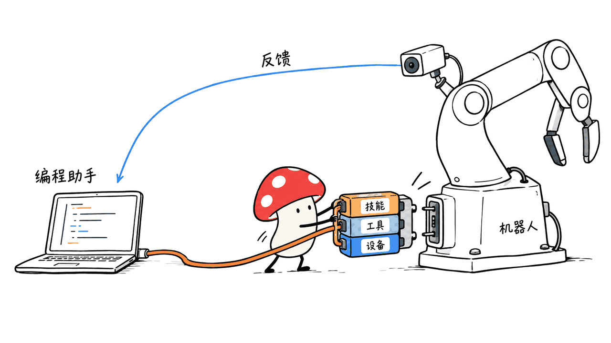
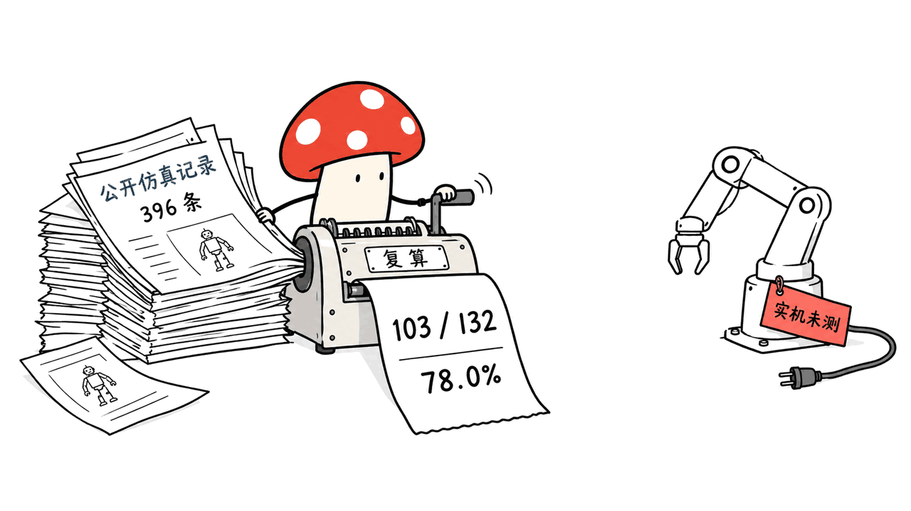
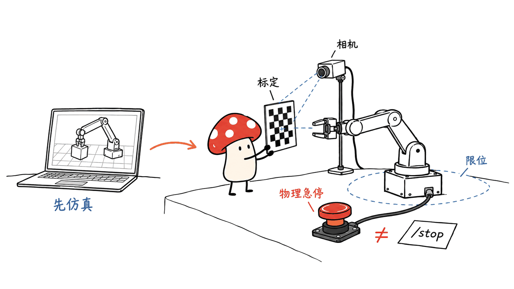

Kinex 让编程 Agent 通过统一接口观察和操纵机器人，减少每换一种硬件就重写连接逻辑的工作。它提供机器人操作的运行框架，模型能力仍来自接入的模型提供方。

stacx-lab/kinex 于 2026-10-15 发布 v1.0.0，采用 Apache 2.0。本文固定提交 `15207927c6669fe98f1213a3fd05148e0fe938d3`，核查日期为 2026-10-17。

## Kinex 如何把文字任务接到物理设备？

架构分为 devices、tools、skills：devices 表达相机、机械臂、夹爪或仿真环境；tools 提供可执行操作；skills 描述任务方法和使用条件。模型根据观察选择操作，再读反馈，形成闭环。

独立应用基于 Pi SDK，复用模型接入、会话和编程工具。设备核心与上手配置、标定分包，ROS 实现不塞进核心。这个拆法的价值是让硬件接口可以复用，而不是把每个任务都做成一段巨大的提示词。



另一个 kinex-plugins 仓库提供 Pi、Claude Code 和 Codex 接入，经共享 MCP 适配器提供设备工具、技能和上下文。独立应用与插件版本分别更新；README 明确当前不支持 OpenCode。因此，看到 Pi 支持某能力，不能直接推定所有宿主插件都已具备。

## 官方 78% 成功率是怎么来的？

官网给出 132 个仿真任务，分布为 LIBERO 40、RoboTwin 50、RoboDojo 42。我们下载 Hugging Face 的 396 条 episode 记录，按 `case` 重新计算，而不是只抄一张官网图。

| 同用 GPT-6 Astra / high | 成功任务 / 总任务 | 均摊估算成本 / 任务 |
|---|---:|---:|
| Codex + 原生 control API | 96 / 132，72.7% | $3.306 |
| Codex + device API | 96 / 132，72.7% | $2.161 |
| Kinex + device API | 103 / 132，78.0% | $1.888 |

这批记录重算支持官网汇总：Kinex 比原生 control 方案多成功 7 题，约提高 5.3 个百分点；均摊 API 等价成本下降约 42.9%。成本包含失败 episode，是按用量折算的估计，不是核验过的实际账单。



评测保持大部分环境原生步数预算，但 RoboDojo 改为 1,875 步；任务描述依 BenchMend 思路显式写出隐藏条件。这些设置适用于本批对照，不能拿去与不同任务文本、预算和模型强度的其他榜单直接排总名次。

每种配置对每个任务的这批单次记录，也不足以说明多随机种子的方差、统计显著性或真实环境可靠性。我们复算的是公开数据，没有重跑机器人评测。

## 普通开发者怎样跑第一条闭环？

先在模拟环境验证连接，再接真实设备。基础要求包括 Linux 或 macOS、Node.js ≥22.19、Python ≥3.11 与 uv；记录视频需要 FFmpeg。模型接入通过 `/login` 和 `/model` 完成，模型调用成本另计。

上游安装脚本是远程 shell 入口，适合先下载审阅并固定版本；本次没有执行安装脚本，也没有改变机器默认环境。想沿用现有编程宿主，可以从独立插件仓库按对应宿主配置。

RoboEnv 的 `launch` 接收任务 ID，`setup` 接收机器人 ID，二者不能混用。启动服务并等到 Ready，设置 `ROBOENV_ENDPOINT`，再在 Kinex 执行 `/load all`、`/ping all`，最后提交一个可观察结果的任务。

```text
roboenv launch robotwin/handover-block-aloha-agilex --port 8123
roboenv setup robotwin/robotwin-aloha-agilex
```

这两行只是上游示例中的不同阶段，需分别按 README 准备环境、工作目录和会话。验收时同时保存指令、配置、模型版本、录像、调用轨迹和结果判据。



真实设备还需要相机到机械臂坐标标定、运动范围和工具配置。`/stop` 是软件停止操作，不能替代物理急停。这个限制直接影响部署验收，不应被“自然语言就能控制机器人”的演示省略。

## 我们本机验证了什么？

在 Apple Silicon Mac 的 Python 3.12 环境，我们运行上游 `driver_contract.py`，9 项测试通过，涉及标量命令、缓冲所有权和失败反馈等契约。没有安装原生驱动、启动仿真器、调用付费模型或连接真实机械臂。

Mycelium Protocol 的判断是：Kinex 值得关注的不是“换一个提示词机器人就会干活”，而是把设备能力、反馈与生命周期纳入可复用接口。下一步最有信息量的验证，是同一任务换设备后，哪些配置能复用、哪些标定必须重做，以及失败时能否可靠退出。

## 常见问题

### Kinex 是新的机器人基础模型吗？

不是。它是连接编程 Agent 与设备的 harness，模型需要另选；开源软件许可也不包含商业模型免费额度。

### 78% 可以代表真实机器人成功率吗？

不可以。它来自指定模型、预算和任务文本下的 132 个仿真任务，不是实机重复试验。

### 可以继续用现有的编程 Agent 吗？

可以查看独立的 kinex-plugins。其 README 支持 Pi、Claude Code、Codex，但各宿主功能和快照需分别核对。

## 一手资料与关联阅读

项目主页：https://stacx-lab.github.io/kinex/

源码：https://github.com/stacx-lab/kinex

插件：https://github.com/stacx-lab/kinex-plugins

公开记录：https://huggingface.co/datasets/stacx-lab/kinex-benchmark-release

仿真环境：https://github.com/stacx-lab/RoboEnv

关联阅读：https://blog.mushroom.cv/blog/opengcua-generalist-computer-use-stack/

封面与正文配图均为解释性概念图，不是我们的实机实验照片。

---

> © 2026 Author: Mycelium Protocol. 本文采用 [CC BY 4.0](https://creativecommons.org/licenses/by/4.0/deed.zh) 授权——欢迎转载和引用，须注明作者姓名及原文链接，不得去除署名后以原创发布。

<!--EN-->

Kinex connects coding agents to robots through reusable interfaces for observation and action. It is a robotics harness, while the connected model provider supplies reasoning capability.

stacx-lab released version 1.0.0 on October 15, 2026 under Apache 2.0. This review pins commit `15207927c6669fe98f1213a3fd05148e0fe938d3` as inspected on October 17.

## How does an agent reach a robot?

Devices expose hardware, simulators or services; tools provide executable operations; skills supply task guidance. The agent observes, acts and checks feedback rather than treating a physical task as a single text response.

The standalone application builds on the Pi SDK. Core device management stays separate from onboarding and calibration, with ROS implementation outside the core. A separate kinex-plugins repository integrates Pi, Claude Code and Codex through a shared MCP adapter. Plugin snapshots and standalone releases evolve independently; OpenCode is explicitly unsupported in the current README.


## What does the reported 78% measure?

We downloaded the public Hugging Face episode file and recomputed its aggregates. It contains 396 records: three configurations evaluated over the same 132 simulation tasks, covering 40 LIBERO, 50 RoboTwin and 42 RoboDojo tasks.

| GPT-6 Astra / high configuration | Successful / total | Mean estimated API cost |
|---|---:|---:|
| Codex + native control API | 96 / 132 | $3.306 |
| Codex + device API | 96 / 132 | $2.161 |
| Kinex + device API | 103 / 132 | $1.888 |

The records support the published 72.7% versus 78.0% comparison: seven additional successful tasks, approximately 5.3 percentage points. Kinex's mean estimated cost is about 42.9% lower than the native-control baseline. Costs include failed episodes and are API-equivalent calculations, not verified account charges.


The protocol changes RoboDojo's control budget to 1,875 steps and rewrites instructions to expose hidden success conditions following BenchMend. Such settings matter when comparing against other reports. These single recorded task runs do not establish multi-seed variance, significance or hardware reliability. We recomputed released data; we did not rerun the benchmark.

## How should a developer build the first loop?

Start with simulation. The documented environment uses Linux or macOS, Node.js ≥22.19, Python ≥3.11 and uv; FFmpeg enables recording. Configure a model with `/login` and `/model`, with provider charges accounted for separately.

Review and pin the remote installation script before relying on it. We did not execute it or change the machine's default environment. Existing-agent users should follow their host's instructions in the separate plugin repository.

RoboEnv `launch` takes a task ID, while `setup` takes a robot ID. Prepare the environment, wait for Ready, configure `ROBOENV_ENDPOINT`, then use `/load all` and `/ping all` before requesting a task. Preserve instructions, device configuration, model version, recordings, traces and success criteria.


On real hardware, verify camera-to-arm calibration, motion limits and tools. The software `/stop` command does not replace a physical emergency stop. These are necessary acceptance conditions for the advertised robot workflow.

## What did we verify locally?

Nine upstream `driver_contract.py` tests passed on an Apple Silicon Mac using Python 3.12, covering scalar commands, buffer ownership and failure feedback. We did not install native drivers, run a simulator, call a paid model or connect a robot.

Our independent conclusion is that reusable device capability and lifecycle contracts deserve attention. A useful next experiment would track what configuration survives a hardware change, what calibration must be repeated and whether failed operations release resources predictably.

## FAQ

### Is Kinex a robotics foundation model?

No. It is a harness; model access and pricing remain separate.

### Is 78% a hardware success guarantee?

No. It describes the released simulation protocol under a particular model, effort level and task set.

### Can I retain an existing coding agent?

The separate plugin project documents Pi, Claude Code and Codex integrations. Check each host's features and snapshot independently.

## Primary sources and related reading

Homepage: https://stacx-lab.github.io/kinex/

Source: https://github.com/stacx-lab/kinex

Plugins: https://github.com/stacx-lab/kinex-plugins

Released episodes: https://huggingface.co/datasets/stacx-lab/kinex-benchmark-release

Simulator interface: https://github.com/stacx-lab/RoboEnv

Related reading: https://blog.mushroom.cv/blog/opengcua-generalist-computer-use-stack/

The cover and body illustrations are conceptual, not photographs of our hardware experiments.

---

> © 2026 Author: Mycelium Protocol. Licensed under [CC BY 4.0](https://creativecommons.org/licenses/by/4.0/) — free to share and adapt with attribution. You must credit the author and link to the original; removing attribution and republishing as original is not permitted.
