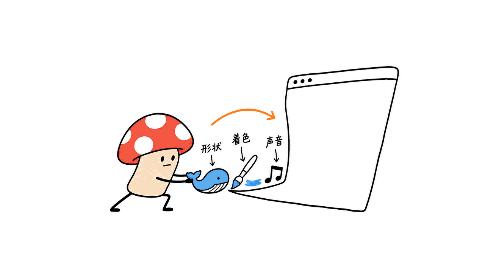
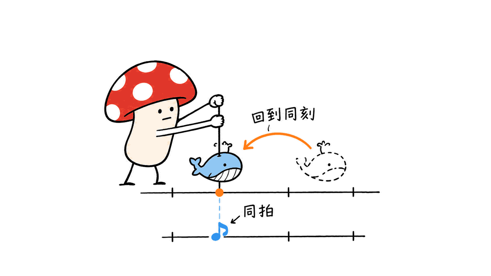
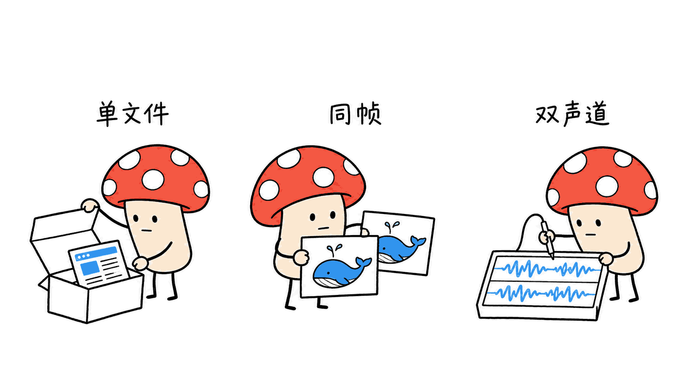

Kujira JS 把一段鲸鱼跃出海面的五秒短片，做成了可以在浏览器里实时生成的单页程序。它适合用来学习：怎样把镜头、角色、水彩质感和声音，组织成可反复定位与修改的代码动画。

仓库 henrymeihao/kujira-js 采用 MIT 许可，核心使用 three.js 与 Web Audio。本次实际构建成功，并用本地浏览器检查了画面、逐帧控制和音频缓冲；没有把“五秒短片”写成渲染耗时，也没有测设备帧率。

仓库：https://github.com/henrymeihao/kujira-js
在线演示：https://henrymeihao.github.io/kujira-js/

## 它播放的是视频，还是在现场画？

运行页现场计算图像。鲸鱼、船、海鸥和水花由程序组织，云与海面由着色器呈现，随后经过水彩、描边、泛光和最终调色。声音则通过 Web Audio 的振荡器、噪声、滤波与包络生成，不需要下载一段现成配乐。

需要特别分清：“运行不依赖图片、视频和音频素材”，不等于“仓库里没有图片”。仓库的 media 目录确实有多张 JPG，供 README 和分享预览使用；本次采用的封面也来自官方预览图。它们没有进入我们测试页面的资源请求。

同样，“无需安装依赖”不等于“没有使用库”。three.js 已放进 vendor，构建程序会把它连同着色器和业务代码嵌入 HTML。依赖被随项目携带了，并没有凭空消失。



## 五秒内容，为什么要按帧来组织？

源码设定 24 FPS 的时间轴和 120 个逻辑帧。角色动作按每秒 12 次取样，部分水花形状按每秒 8 次取样，形成有意保留的分格节奏；这与浏览器实际一秒画出多少帧，是两回事。

镜头和鲸鱼姿态根据时间计算。CUES 集中保存出水、顶点、落水和片尾等事件，画面与声音共同参考这些节点。修改一个动作时，可以回到同一时间点，而不用从头重播到那里。

我们的一个实际检查是：渲染第 62 帧，切到第 20 帧，再回到第 62 帧。两次第 62 帧的 WebGL 画布哈希相同，第 20 帧则不同。这支持同一浏览器中的帧定位与重绘可复现，不代表跨显卡、跨浏览器或字体不同的整页截图也必然逐像素一致。

对创作者而言，这种组织方式方便审稿：先固定镜头与节拍，再调整形状、颜色和声音。它给人的控制点，比一段只能整体替换的成品视频更细。



## 手绘质感来自哪些工程选择？

这个项目没有靠加载一组手绘贴图完成画风。它把几何、着色器与后处理组合起来：背景色块经过 Kuwahara 风格的平滑处理，描边依据画面信息生成，最后再叠加泛光、纸面感与调色。

海面主要是在画波纹、颜色和反光，不能据此当作可用于工程分析的流体模拟。鲸鱼也以程序几何和姿态轨道表达动作，而非一套完整的生物或物理仿真。

值得借鉴的是一致性：轮廓、颜色、动作取样与声响都服务于同一个短片节奏。若只复制某个“水彩滤镜”，却让其他部分保持不同的运动和光照逻辑，效果未必接近。

这些都是对具体源码的观察，不构成对任意场景都能获得相同画质的承诺。更复杂的角色、更长的剧情和移动设备适配，都需要另外设计。

## 怎样在本地运行？

README 要求 Node 18 及以上。本次使用 Node 26.10.0，没有执行 npm install。

```bash
git clone https://github.com/henrymeihao/kujira-js.git
cd kujira-js
node build.mjs
python3 -m http.server 8000
```

然后访问：http://localhost:8000/?q=low&t=2.6

参数 q=low 使用 1280×720 内部画布；默认是 1920×1080。t 用于定位时间，会按时间轴量化到帧；headless=1 隐藏播放器控件，便于取画面，不等于自动导出视频。界面也可以拖动进度、用左右键逐帧移动、播放和暂停。

我们重建出的 index.html 为 1,414,974 字节，与仓库提供的版本逐字节一致；用 gzip 压缩后是 295,311 字节。后者是本机压缩计算，不代表任意静态站点已经开启 gzip，也不是加载耗时。

部署时可以只提供这个 HTML。构建时需要源码、vendor 和 glsl，运行时则由嵌入内容工作；外部服务器如何设置缓存、压缩和内容安全策略，仍需自己验证，特别是页面使用了内联代码与 Blob 模块导入。

## 本次真正验证了什么？

本地临时 HTTP 服务只用于静态文件，浏览器使用隔离会话、Chrome 157 和 Low 画质，结束后已关闭。

| 检查 | 实际结果 | 能说明的范围 |
|---|---|---|
| 构建 | 成功且产物逐字节一致 | 当前版本可用本机 Node 重建 |
| WebGL 画布 | 1280×720，画面已人工查看 | 本机该配置能正常画出场景 |
| 重绘 | 第 62 帧往返哈希一致 | 同一浏览器中重复定位有效 |
| 控件 | 右方向键至第 63 帧，播放及暂停状态正确 | 所检查的交互状态有效 |
| 音频 | 5 秒、48kHz、双声道缓冲，首声道采样值有限、信号非零 | 浏览器实际完成了音频合成 |
| 资源 | 所观察的资源条目没有外部素材 | 该次运行没有图片、音频等外部资源依赖 |

音频缓冲存在，不等于我们已做扬声器试听或音乐质量评测。没有测移动端兼容性、持续运行温度、功耗、真实 FPS、音画延迟和视频编码导出，也没有验证所有 GPU 上的着色器行为。



## 工程师可以怎样借鉴？

先用它学习一个小而完整的作品，而不是急着抽象成通用视频引擎。保留时间轴、镜头状态、角色姿态、绘制和声音这几个边界，每次只替换一个部分，容易看出变化来自哪里。

如果要做可控取帧，先固定分辨率、帧号、随机种子和运行环境。若要导出带声音的视频，还需要设计画面捕获、音轨封装、时间同步与编码流程；项目里的逐帧入口提供了基础，却没有自动替你完成这些工作。

如果用于网页首屏或交互展示，建议给静态降级图和暂停入口留位置，并在目标设备上实际测量。多道后处理需要 GPU 工作，“只有一张网页”并不意味着低功耗或所有手机都能流畅播放。

## 常见问题

### 是完全没有依赖的 JavaScript 吗？

不是。它使用内置的 three.js。构建不用安装包，是因为所需库已随仓库提供，不能把两种说法混用。

### 可以直接导出 MP4 吗？

本次没有看到完整的视频导出工作流，也未测试编码。headless=1 负责隐藏控件，逐帧入口负责画面定位，后续录制和封装需要另外实现。

### 能用于自己的作品吗？

仓库采用 MIT。使用或分发实质代码时应保留版权与许可；还要保留作者列出的 three.js，以及来自 0xCodez/leviathan 的水彩和描边代码许可与署名。项目不是任何动画工作室的官方作品。

相关浏览器图形项目：https://blog.mushroom.cv/blog/abyssal-garden-webgpu-procedural-underwater-world/

## 来源与复核范围

核查版本：5821c4f2c6689c24a5a7786c917f36ca74a8023f，日期：2026-11-17。封面采用作者 media/rise.jpg，MIT，作者 henrymeihao；正文小M配图为解释示意。构建记录、浏览器检查与源码版本已保留。

https://github.com/henrymeihao/kujira-js
https://henrymeihao.github.io/kujira-js/
https://github.com/henrymeihao/kujira-js/blob/main/LICENSE

---

> © 2026 Author: Mycelium Protocol. 本文采用 [CC BY 4.0](https://creativecommons.org/licenses/by/4.0/deed.zh) 授权——欢迎转载和引用，须注明作者姓名及原文链接，不得去除署名后以原创发布。

<!--EN-->

Kujira JS turns a five-second whale-breach short into a browser program that generates its pictures and sound locally. It is a compact study in organizing cameras, character motion, painted rendering and audio on a controllable timeline.

The MIT-licensed repository uses three.js and Web Audio. We rebuilt it and checked real browser rendering, frame controls and an audio buffer. Five seconds describes the short’s duration, not render time or a measured performance result.

Repository: https://github.com/henrymeihao/kujira-js
Demo: https://henrymeihao.github.io/kujira-js/

## Is it playing a video or drawing the scene?

It computes the scene. Procedural geometry and shaders generate the whale, boat, birds, sea and sky; post-processing creates the painted appearance. Web Audio synthesizes music and effects rather than downloading a soundtrack.

Runtime asset independence does not mean the repository contains no images. Its media directory contains JPG previews for documentation and sharing. The article banner uses one of those official previews; they were not runtime resource dependencies in our local check.

Likewise, no package installation does not mean no library dependencies. three.js is vendored and embedded with the shaders and application code into the built HTML.


## Why organize the short by frame?

The timeline has 120 logical frames at 24 FPS. Character poses use 12 updates per second, and some water-effect shapes use eight. These artistic sampling rates are separate from the browser’s achieved rendering rate.

Shared cue times coordinate picture and sound. Frame-based state makes it practical to revisit a moment while editing a camera move, pose or effect.

We rendered frame 62, visited frame 20, and returned to frame 62. The two frame-62 WebGL canvas hashes matched; frame 20 differed. This demonstrates repeatability within that browser session, not pixel identity across GPUs, browsers or font configurations.

For a creator, the useful feature is precise revision: establish timing, then change individual shapes, colors and sounds without replacing an entire finished clip.


## Where does the painted style come from?

The project combines geometry, shaders and multiple post-processing stages. Kuwahara-style smoothing organizes background color regions, a separate pass produces outlines, and bloom and final grading support the overall appearance.

The sea is a visual construction of colors, strokes and reflections, not an engineering fluid simulation. The whale’s procedural geometry and keyed poses are not a comprehensive physical or biological simulation either.

Our main takeaway is coherence: color, outlines, motion sampling and sound share one aesthetic goal. Copying a paint filter alone does not reproduce that coherence. Longer stories, more complex characters and mobile support remain additional engineering work.

## How do you run it?

The README requires Node 18+. We used Node 26.10.0 without npm install.

```bash
git clone https://github.com/henrymeihao/kujira-js.git
cd kujira-js
node build.mjs
python3 -m http.server 8000
```

Open http://localhost:8000/?q=low&t=2.6

Low mode uses a 1280×720 internal canvas; the default is 1920×1080. The t parameter locates a time quantized to the frame timeline. headless=1 hides controls for capturing images; it is not a video exporter. The player also supports scrubbing, arrow-key stepping, play and pause.

Our rebuilt index.html was 1,414,974 bytes and byte-identical to the committed artifact. Local gzip compression produced 295,311 bytes. That does not establish a hosting provider’s compression configuration or page-load latency.

A static deployment can serve the resulting HTML alone. Building still requires the source, shaders and vendored library. Verify hosting policies separately: this page uses inline code and imports its library through a Blob module URL.

## What did the local checks establish?

We served the actual HTML locally in an isolated Chrome 157 session at Low resolution and closed the session and temporary server afterwards.

| Check | Observed result | Boundary |
|---|---|---|
| Build | Successful, byte-identical output | Reproducible on the tested Node setup |
| WebGL canvas | 1280×720, manually inspected scene | Working local rendering at that configuration |
| Frame revisit | Matching frame-62 canvas hashes | Same-browser repeatability |
| Controls | Arrow to frame 63; play/pause state changes | Checked interaction states |
| Audio | Five-second, 48kHz stereo buffer; channel 0 finite and nonzero | Real browser audio synthesis completed |
| Resources | No external assets in observed resource entries | No image/audio runtime downloads in that run |

An audio buffer does not establish speaker output or subjective music quality. We did not measure real FPS, power, thermal behavior, audio–video latency, mobile compatibility, encoding or cross-GPU shader behavior.


## What should engineers borrow?

Start with one complete short rather than immediately turning it into a general video engine. Preserve boundaries between timeline state, cameras, poses, drawing and sound so changes remain understandable.

For repeatable capture, fix resolution, frame index, seed and environment. Exporting a synchronized video also requires capture, audio packaging and encoding. A frame-rendering entry point is a useful foundation, not that entire pipeline.

For a web hero or interactive demonstration, consider a static fallback and pause control, then measure target devices. Multiple GPU passes still cost work; a single HTML file does not imply low power or universal mobile smoothness.

## FAQ

### Is it dependency-free JavaScript?

It uses bundled three.js. No installation step is required because the library is already present, not because the runtime contains no dependencies.

### Can it directly export MP4?

We did not find or test a complete video export workflow. Hiding controls and rendering a selected frame are distinct from recording and encoding.

### Can I reuse the code?

The repository is MIT licensed. Retain its copyright and permission notice, plus the listed three.js and adapted 0xCodez/leviathan notices. It is an original short, not an official production of an animation studio.

Related browser graphics project: https://blog.mushroom.cv/blog/abyssal-garden-webgpu-procedural-underwater-world/

## Sources and review scope

Reviewed revision 5821c4f2c6689c24a5a7786c917f36ca74a8023f on November 17, 2026. Banner: author-provided media/rise.jpg, MIT, henrymeihao. Little M body illustrations explain concepts. Build and browser evidence and source versions are retained.

https://github.com/henrymeihao/kujira-js
https://henrymeihao.github.io/kujira-js/
https://github.com/henrymeihao/kujira-js/blob/main/LICENSE

---

> © 2026 Author: Mycelium Protocol. Licensed under [CC BY 4.0](https://creativecommons.org/licenses/by/4.0/) — free to share and adapt with attribution. You must credit the author and link to the original; removing attribution and republishing as original is not permitted.
