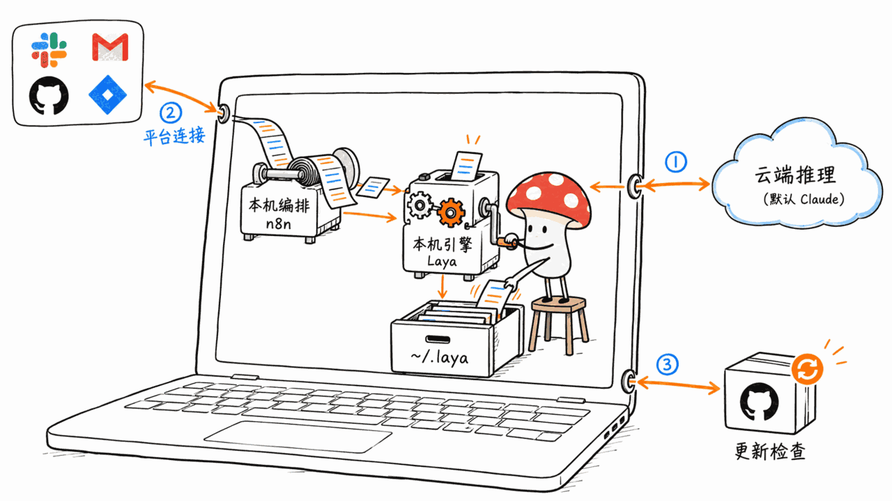
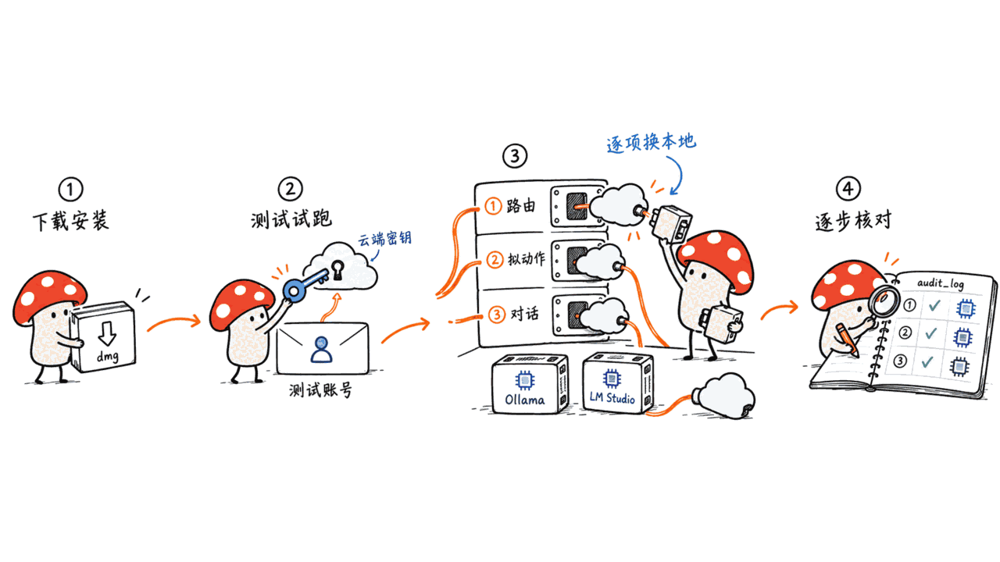
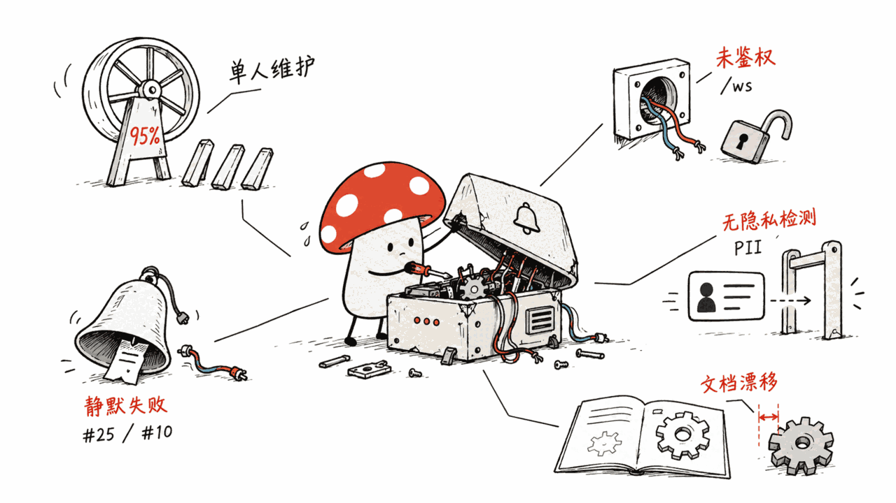
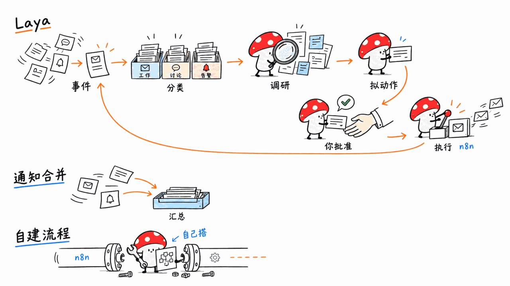

> 开源仓库：aayushch/laya
> GitHub：https://github.com/aayushch/laya
> 协议：Apache-2.0 ｜ 语言：Python（引擎）+ Svelte 5 + Rust（Tauri v2）｜ Stars：745 ｜ Forks：120 ｜ 创建：2026-05-10 ｜ 最近提交：2026-10-20 ｜ 最新版本：v2.3.0（2026-10-20）

---

**先说清楚是哪个 Laya**：本文的 Laya 是 aayushch 做的桌面应用「AI 通知指挥中心」。它和本站之前写过的两个东西**没有关系**：一个是《Laya 决策模型跑在苹果神经引擎上》里的 Laya（TypeSafe 生态的小型决策模型），另一个是 Ollaya（本地运行那类决策模型的运行时）。只是重名。下文提到「Laya」一律指这个应用。

**BLUF**：Laya 的做法是把你的 Slack、Gmail、GitHub、Bitbucket、Jira、Linear、Notion、Outlook、Google Calendar 事件，经本机的 n8n 收进来，交给 LLM 分类、检索上下文、拟好动作，最后只给你一张「待批准卡片」——批准后才由 n8n 去真正发信、评论、建 PR。它所有数据库（SQLite + ChromaDB）都落在 `~/.laya/`，隐私政策写明项目方没有服务器、没有遥测。但我们读完 README、docs 和源码里的默认配置后要提醒：**「本地优先」不等于「默认不出本机」**。`config.py` 里默认模型是云端的 claude-haiku-4-5 和 claude-sonnet-4-6，隐私配置默认把 Gmail、Outlook、Slack 私信标为 Tier 3 并用「云端处理 + 卡片警告」。要做到邮件正文一个字节都不出本机，你得自己把每个阶段的模型改成 Ollama 或 LM Studio。能做到，只是不是开箱状态。

本文基于一手资料（README、docs/、SECURITY.md、landing/privacy.html、`engine/laya/config.py`、Tauri 配置和发布页），**我们没有在本机安装运行它**，所以没有性能数据；所有「实测」类说法都不会出现，凡是来自 README 的都标了「README 声称」。

## 它到底是什么？

README 的链路图很简洁：

```
你的工具 → n8n（本机 Node.js，标准化事件）→ Laya 引擎（Python，分类/研究/拟动作）
        → Laya UI（Tauri + Svelte，Action Card）→ 你批准 → n8n 执行（发回复、建 PR 等）
```

要点：

- **三层结构**：Tauri v2 外壳（Rust）负责拉起和管理 Python 引擎（FastAPI，监听 127.0.0.1:8420）与 n8n（端口 45678）；Svelte 5 做界面；n8n 里有约 21 个预置工作流（每个平台一个采集、一个执行，外加错误处理）。
- **多角色路由**：每个事件会被分派给 Engineer、Comms、Ops、Sales、HR、Finance 等角色 worker，再由 stager 生成动作建议，落成 Action Card。
- **不自动写**：设计文档强调「没有自主写入，所有写操作都经过 Action Card 批准」，邮件正文、PR 差异这类不可信内容在提示词里被结构化地标成不可信输入。
- **周边能力**：跨平台实体关联（把 Jira 的 BUG-1234、Bitbucket 的 PR-891 和 Slack 里「那个支付 bug」连起来）、每日简报（默认 07:00）、Chat 侧栏、混合检索（ChromaDB 向量 + SQLite FTS5 的 BM25，用倒数排名融合合并）、本地文档库 Corpus，以及一个只绑 127.0.0.1 的 MCP 服务（`/mcp/sse`），让 Claude Desktop、Cursor 等客户端查询你的卡片。
- **能跑的推理后端**：Ollama、LM Studio、任何 OpenAI 兼容端点、Claude/GPT/Gemini（自带 key，经 LiteLLM）。还有一个有意思的模式：把已安装的 Claude Code、Codex、Gemini CLI、Pi CLI 当作推理后端（模型 ID 写成 `agent/<id>/<model>`），用它们自己的订阅额度跑分类，而不是 API key。

规模方面（GitHub 与 README 声称）：745 星、120 个 fork、9 个公开 issue；README 称 28 个 API 路由器、74 次数据库迁移；我们从仓库目录树数到 `engine/tests/` 下约 108 个文件。贡献者 6 人，其中作者 aayushch 一人占约 431 次提交，其余合计十几次——**这基本是一个人的项目**。创建于 2026-05-10，不到半年就发到了 v2.3.0，共 15 个 release，迭代很快。

## 数据到底出不出本机？



这是大家最关心的问题，答案要分层看。

**确实在本机的部分。** 隐私政策写得很直白：项目方没有公司、没有服务器、没有账号体系，Laya 本身不发遥测、不发崩溃报告。事件、卡片、聊天记录、向量、设置和日志都在 `~/.laya/`（SQLite 在 `~/.laya/data/laya.db`，向量在 `~/.laya/data/chroma/`）。Corpus 文档是「原地读取、从不复制」，只把提取文本和向量存在本地。n8n 在 Tauri 里被强制绑到 `127.0.0.1`（源码注释特意说明 `N8N_HOST` 只影响 URL，真正的监听地址是 `N8N_LISTEN_ADDRESS`），并关掉了 n8n 的诊断上报。引擎 API 每次启动生成新的 bearer token，仅存在内存里。仓库里还有一个 `_telemetry_suppression.py`，在导入时把 ChromaDB、PostHog、HuggingFace Hub 等依赖的遥测开关设为关闭——但它自己的注释也承认这是「尽力而为，不是保证」。

**不在本机的部分，至少有三个：**

1. **LLM 推理本身。** 默认设置里 router 是 `claude-haiku-4-5`，stager、chat、trace、omni 都是 `claude-sonnet-4-6`，`local` 只是预留的 `ollama/llama3`。也就是说，不改设置、填一个 Anthropic key，你的 Slack 消息和邮件内容就会被发给 Anthropic。隐私政策第 3 节也承认：发送的内容可能包括邮件正文、消息、Issue 描述、PR diff、日历详情和 Corpus 提取文本。
2. **三层数据分级默认偏向云端。** `config.py` 里 `privacy.tier3_sources` 默认是 `["gmail", "outlook", "slack_dm"]`，`tier3_processing` 默认是 `cloud_with_warning`。设计文档的表格是：Tier 1（元数据）总是云端；Tier 2（Jira 描述、PR diff、频道消息）默认云端；Tier 3（私信、邮件正文）云端，但卡片上带隐私警告。决策日志里的说法是「由用户在质量与隐私之间有意识地取舍」，并且 v0.1 明确**没有 PII 检测**。所以「警告」只是提示，不是拦截。
3. **你自己授权的第三方平台。** 它需要读 Gmail、Slack 等，这些数据本来就在对方服务器，Laya 以你的身份拉取。

此外还有一个小点：Tauri 的自动更新端点是 `https://github.com/aayushch/laya/releases/latest/download/latest.json`，更新包有 minisign 签名校验。也就是说应用会向 GitHub 查更新——这不是遥测，但属于「会联网」。

**怎么真正做到不出本机？** 按文档推断，需要同时做到：每个阶段（router、stager、chat、trace、omni，以及 Context Association 的 LLM 确认、规则学习等）都选本地模型；不使用 `agent/...` 推理后端（它们会走各自云端订阅）；Chat 里不要选云端模型。这一点 README 没有给出一键的「全本地」开关，是我们读配置后的推断，**建议你装好后在 Settings → Models 逐项核对**，并结合 audit_log（每一步都记录了所用模型和处理层级）确认。

## OAuth 令牌和密钥存在哪？这里文档自相矛盾

我们读到三处互相对不上的说法：

| 来源 | 说法 |
|---|---|
| SECURITY.md | 凭据在 OS 钥匙串，「从不放在明文配置里」；平台 OAuth 令牌由连接代理（connection broker）管理 |
| architecture.md（安全一节） | LLM API key 在钥匙串；**平台 OAuth 令牌在 n8n 的加密凭据库** |
| egress-connection-broker.md | 钥匙串是「真相之源」，n8n 凭据由它派生；密钥格式 `laya-egress:{platform}:{id}:{field}` |
| n8n-data-persistence.md | n8n 把凭据（含 OAuth 令牌）加密存在自己的 SQLite 里，AES 密钥是同目录下的 `encryptionKey` 文件；**n8n 不使用钥匙串** |

综合起来更像是「双份存储」：新的 egress 连接走钥匙串并同步给 n8n，而 n8n 自己那份用同目录的密钥文件加密。**加密密钥和密文放在同一个数据目录里，对抗的是「不小心看到文件」，挡不住拿到你整个 `~/.laya/` 的人**。另外这些文档里目录名也不一致（`~/.laya/n8n/` 对 `~/.laya/n8n-data/`），说明文档有滞后。我们没读完所有代码，所以这里只能说：文档层面不能证明「令牌只在钥匙串」，备份 `~/.laya/` 时要把它当成含凭据的敏感目录。

OAuth 流程本身是桌面应用的常规做法：授权码 + PKCE + 本机回环重定向（`http://127.0.0.1:8420/egress/connections/oauth/callback`）。其中 Google 的桌面客户端 secret 会被「轻度混淆后」内置在应用里（设计文档承认并称这是桌面应用被允许的做法）；Microsoft、Linear 等是无 secret 的公开客户端。设计文档还显示，Google 对 Gmail 受限范围的应用验证（含 CASA 评估）和 Microsoft 的发布者验证当时都标为「进行中」——这意味着个人使用时可能遇到「未验证应用」的提示，是否已完成请以你安装时的授权页为准。

## 给 Mac 用户的建议



- **安装很轻**：v2.3.0 发布页提供 `Laya_2.3.0_aarch64.dmg`（Apple Silicon，约 8.6MB）和 x64 的 dmg，另有 `.app.tar.gz` 更新包。小体积是因为引擎在首次启动时才在 `~/.laya/venv/` 装 Python 依赖，并自动配置 n8n；本机有 Python 3.10–3.14 和 Node 20+ 就复用，没有就下载自带运行时。首次启动需要联网并等几分钟。
- **签名说明有出入**：README 安装段写「macOS 发布版已签名，双击即可」，构建段又写「默认不签名，需右键打开」。后者说的是你自己从源码构建的情况，用发布版 dmg 应当按前者处理——但我们没有实际下载验证 Gatekeeper 行为。
- **本地模型的选择**：它的任务是结构化 JSON 输出（分类、拟动作），小模型容易出格式问题。仓库专门有一篇文档讲 Gemma 在 LM Studio 上输出 `\n` 填充直到截断 JSON 的坑（根因是 `<end_of_turn>` 没在运行时的停止词表里，作者称这是模型/运行时缺陷而非 Laya 的 bug，并在引擎侧加了兜底）。这说明本地模型路径是真的被踩过的，但也提示你：换模型前先小批量试。
- **统一内存**：同时跑 Laya（Python + n8n + ChromaDB）和一个常驻的 7B–14B 本地模型，16GB Mac 会比较紧；每个事件要过 router、worker、stager 多次调用，突发邮件会排队。这是我们的容量判断，不是仓库给出的数字。
- **建议的上手顺序**：先用只读的测试账号或测试邮箱接一两个平台，保持 `min_priority: HIGH` 的通知默认值，观察一周卡片质量；再把 router 换成本地小模型，stager/chat 保留强模型；最后才考虑全本地。每一步用 audit_log 核对哪个事件用了哪个模型。
- **别把它当「自动代理」**：设计上所有出站动作都要你点批准，建议保持这个习惯，尤其是 Egress 的发邮件和 Slack 消息。



## 它的局限

1. **单人项目、版本节奏快**：约 95% 的提交来自一个人，v2.1.1、v2.2.1、v2.3.0 都在 2026-10-19 至 10-20 两天内发布。SECURITY.md 写明只支持 `main` 的最新版，旧版本不修。
2. **已知的静默失败风险**：公开 issue #25 写着「Router 被设成已退役的 Gemini 模型后，每个事件永久失败且 UI 没有提示」，随后有 #38（提供方拒绝模型或 key 时挂起事件）、#39（不再推荐已退役模型）的修复在途。另有 #10「Omni 的 Needs Attention 一直为空、定时合成被静默禁用」。通知类工具最怕「悄悄不工作」，这点要留意。
3. **WebSocket 未鉴权**：README 的认证一节明确说 `/ws` 的 WebSocket「尚未做认证」，OAuth 回调也不需要 token。虽然只监听本机，但同机的其他进程理论上可以连。
4. **MCP 监听地址不可配**：issue #48 在要求可配置 MCP 监听地址，目前默认只绑 127.0.0.1，这对安全是好事，对想跨设备用的人是限制。
5. **没有 PII 检测**：决策日志写明 v0.1 没做，隐私控制完全依赖 Tier 分级和你选的模型。
6. **文档与代码有漂移**：例如上面的凭据存储说法、发布版本号（README 里的构建产物名还是 `Laya_0.1.0`）。
7. **平台覆盖不均**：Windows on ARM 的原生 ARM64 Python 缺少若干依赖的轮子，需要 x64 Python；Linux AppImage 在新版 Mesa 上可能白屏。这些在 README 的 Troubleshooting 里有写，Mac 用户基本碰不到。
8. **第三方依赖的遥测只能「尽力关闭」**：项目自己也这么说。



## 它和同类的区别

它不是又一个聊天机器人，也不是单纯的通知合并器。区别在于「事件→分类→预先做好调研→拟好动作→你批准→n8n 执行」这条闭环，加上跨平台实体关联。如果你只想要一个读 Gmail 的本地摘要，它偏重（要装 n8n、Python、ChromaDB）；如果你已经在 n8n 里自己搭流程，它相当于一套预置好的工作流加决策层。本站此前写过的本地 Agent 类项目（如审批式记忆的 exxperts、MCP 本地检索范本）侧重点不同，这里的核心卖点是**通知流**和**批准环节**。

## FAQ

### Laya（aayushch）和 Ollaya、Laya 决策模型是一回事吗？
不是。Laya 决策模型是 TypeSafe 生态里的小型模型；Ollaya 是运行这类模型的运行时；aayushch/laya 是桌面应用，仅仅名字相同。PyPI 上的 `laya` 包也是另一个无关项目，README 明确警告不要用 `pip install laya` 安装这个应用。

### 它是免费的吗？许可证是什么？
仓库协议 Apache-2.0（NOTICE 署名 Aayush Chawla），可商用、可修改。使用云端模型的 API 费用由你自己承担；应用内有 LLM 成本看板和月度预算上限，到上限会自动暂停。

### 邮件内容会发给 Anthropic 吗？
取决于你的模型设置。默认设置里的模型是 Claude，Gmail 和 Outlook 默认归为 Tier 3 并「云端处理 + 警告」。想避免，就把相关阶段改成本地模型。

### 能完全离线用吗？
推理可以（Ollama / LM Studio），但采集本身需要联网访问各平台，首次安装还要下载依赖。所谓离线，指的是「内容不发给云端 LLM」，不是断网运行。

### Mac 上要装什么？
发布版 dmg 不需要你预装 Python、Node 或 Rust。从源码构建才需要 Python 3.10+、Node 20+、Rust 工具链和 Xcode 命令行工具。

> 本文为独立分析，仅供学习与参考，不构成采购建议；项目会持续变动，请以仓库最新说明为准。

## 一手源

- https://github.com/aayushch/laya
- https://laya.aay.sh
- https://github.com/aayushch/laya/releases
- https://github.com/aayushch/laya/blob/main/SECURITY.md
- https://github.com/aayushch/laya/blob/main/docs/architecture.md
- https://github.com/aayushch/laya/blob/main/docs/decision-log.md
- https://github.com/aayushch/laya/blob/main/docs/n8n-data-persistence.md
- https://github.com/aayushch/laya/blob/main/engine/docs/egress-connection-broker.md
- https://github.com/aayushch/laya/blob/main/engine/docs/oauth-app-distribution.md
- https://github.com/aayushch/laya/blob/main/engine/docs/local-model-newline-padding.md
- https://github.com/aayushch/laya/blob/main/engine/laya/config.py
- https://github.com/aayushch/laya/blob/main/landing/privacy.html

---

> © 2026 Author: Mycelium Protocol. 本文采用 [CC BY 4.0](https://creativecommons.org/licenses/by/4.0/deed.zh) 授权——欢迎转载和引用，须注明作者姓名及原文链接，不得去除署名后以原创发布。

<!--EN-->

> Open-source repo: aayushch/laya
> GitHub: https://github.com/aayushch/laya
> License: Apache-2.0 | Languages: Python (engine) + Svelte 5 + Rust (Tauri v2) | Stars: 745 | Forks: 120 | Created: 2026-05-10 | Last commit: 2026-10-20 | Latest release: v2.3.0 (2026-10-20)

---

**Which Laya is this?** This is aayushch's desktop app, an "AI notification command center". It is **unrelated** to two things we covered earlier: the Laya decision model running on the Apple Neural Engine (a small model from the TypeSafe ecosystem), and Ollaya (a runtime for running such decision models locally). The name collision is a coincidence. Below, "Laya" means this app.

**BLUF**: Laya pulls events from Slack, Gmail, GitHub, Bitbucket, Jira, Linear, Notion, Outlook and Google Calendar through a local n8n instance, has an LLM classify them, gather context and draft the response, then shows you one "Action Card" to approve or dismiss. Only on approval does n8n actually send the reply, comment or PR. Everything is stored in SQLite and ChromaDB under `~/.laya/`, and the privacy policy says there are no project-operated servers and no telemetry. But after reading the README, the docs and the default configuration in source, our warning is that **"local-first" does not mean "nothing leaves the machine by default"**. `config.py` ships cloud Claude models as defaults (claude-haiku-4-5 for routing, claude-sonnet-4-6 for staging, chat, trace and omni), and the privacy defaults mark Gmail, Outlook and Slack DMs as Tier 3 with "cloud processing plus a warning". Keeping email bodies fully on-device is possible, but you have to switch each stage to Ollama or LM Studio yourself.

This piece rests on primary sources (README, docs/, SECURITY.md, landing/privacy.html, `engine/laya/config.py`, the Tauri config and the release page). **We did not install or run it**, so there are no benchmarks here; anything from the README is labeled "the README claims".

## What is it, exactly?

The README's pipeline:

```
Your tools -> n8n (local Node.js, normalizes events) -> Laya engine (Python: classify, research, stage)
           -> Laya UI (Tauri + Svelte: Action Cards) -> you approve -> n8n executes (reply, open PR, ...)
```

- **Three layers**: a Tauri v2 (Rust) shell supervises the Python FastAPI engine (127.0.0.1:8420) and n8n (port 45678); the UI is Svelte 5; about 21 prebuilt n8n workflows cover ingestion and execution per platform, plus an error handler.
- **Persona routing**: events go to Engineer, Comms, Ops, Sales, HR or Finance workers, then a stager drafts actions that become Action Cards.
- **No autonomous writes**: design docs say every write goes through card approval, and untrusted event content is delimited as untrusted input in prompts.
- **Extras**: cross-platform entity linking (Jira BUG-1234, Bitbucket PR-891 and "the payment bug" in Slack), a daily briefing (default 07:00), a chat sidebar, hybrid retrieval (ChromaDB vectors plus SQLite FTS5 BM25, merged with reciprocal rank fusion), a local document library called Corpus, and an MCP server bound to 127.0.0.1 (`/mcp/sse`) so Claude Desktop or Cursor can query your cards.
- **Inference backends**: Ollama, LM Studio, any OpenAI-compatible endpoint, and Claude/GPT/Gemini with your own key via LiteLLM. A notable option: installed CLI agents (Claude Code, Codex, Gemini CLI, Pi CLI) can serve as inference backends via model IDs like `agent/<id>/<model>`, using their own subscription quota instead of an API key.

Scale (GitHub and README claims): 745 stars, 120 forks, 9 open issues; the README claims 28 API routers and 74 database migrations; counting the repo tree we found roughly 108 files under `engine/tests/`. There are 6 contributors, and the author aayushch has about 431 commits against roughly a dozen from everyone else, so this is effectively a one-person project. Created 2026-05-10, it reached v2.3.0 in under six months with 15 releases.

## Does your data leave the machine?


The answer has layers.

**What really stays local.** The privacy policy is blunt: no company, no servers, no accounts; Laya itself sends no telemetry or crash reports. Events, cards, chat history, embeddings, settings and logs live in `~/.laya/` (SQLite at `~/.laya/data/laya.db`, vectors in `~/.laya/data/chroma/`). Corpus documents are read in place and never copied. The Tauri shell forces n8n onto `127.0.0.1` (a source comment notes that `N8N_HOST` only changes reported URLs, while `N8N_LISTEN_ADDRESS` sets the real bind) and disables n8n diagnostics. The engine API token is regenerated at every launch and kept in memory. A `_telemetry_suppression.py` module turns off telemetry flags for ChromaDB, PostHog and the Hugging Face hub at import time, though its own docstring says this is best-effort, not a guarantee.

**What does not stay local, at least three things:**

1. **LLM inference itself.** Shipped defaults: router `claude-haiku-4-5`; stager, chat, trace and omni `claude-sonnet-4-6`; `local` is just a placeholder `ollama/llama3`. With an Anthropic key and no changes, your Slack and email content goes to Anthropic. Section 3 of the privacy policy admits that what is sent may include email bodies, messages, issue descriptions, PR diffs, calendar details and Corpus text.
2. **Default tiering leans cloud.** `privacy.tier3_sources` defaults to `["gmail", "outlook", "slack_dm"]` and `tier3_processing` to `cloud_with_warning`. In the architecture doc, Tier 1 (metadata) is always cloud, Tier 2 (Jira descriptions, PR diffs, channel messages) defaults to cloud, and Tier 3 (DMs, email bodies) goes to cloud with a warning on the card. The decision log frames this as a conscious quality-versus-privacy trade-off and says there is **no PII detection in v0.1**. The warning informs; it does not block.
3. **The platforms you authorize.** Gmail and Slack data already sits on their servers; Laya reads it under your identity.

One more network touchpoint: the Tauri updater checks `https://github.com/aayushch/laya/releases/latest/download/latest.json`, with signed update packages. That is not telemetry, but the app does phone GitHub.

**How to keep it fully on-device?** From the config we infer you need to set every stage (router, stager, chat, trace, omni, plus the LLM steps in context association and rule learning) to a local model, avoid the `agent/...` backends (they use those agents' cloud subscriptions), and avoid cloud models in Chat. The README offers no single "all local" switch; this is our inference, so check Settings → Models stage by stage and confirm against the audit_log, which records the model and processing tier of each step.

## Where do OAuth tokens and keys live? The docs disagree

| Source | Claim |
|---|---|
| SECURITY.md | Credentials are in the OS keychain, never plaintext; OAuth tokens are handled by the connection broker |
| architecture.md (security section) | LLM API keys in the keychain; **platform OAuth tokens in n8n's encrypted credential store** |
| egress-connection-broker.md | The keychain is the source of truth, n8n credentials are derived; key format `laya-egress:{platform}:{id}:{field}` |
| n8n-data-persistence.md | n8n keeps credentials, including OAuth tokens, AES-encrypted in its own SQLite, with the key in an `encryptionKey` file in the data directory; **n8n does not use the keychain** |

Putting it together, it looks like dual storage: newer egress connections go to the keychain and are provisioned into n8n, while n8n's copy is encrypted with a key file sitting next to it. **Ciphertext and key in the same directory guard against casual file browsing, not against someone who obtains your whole `~/.laya/`.** The docs also disagree on the folder name (`~/.laya/n8n/` versus `~/.laya/n8n-data/`), which points to documentation drift. We did not audit all the code, so we can only say that the docs do not prove "tokens live only in the keychain". Treat `~/.laya/` as a credential-bearing directory when you back it up.

The OAuth flow is the usual desktop pattern: authorization code with PKCE and a loopback redirect (`http://127.0.0.1:8420/egress/connections/oauth/callback`). Google's desktop client secret is embedded in the app, lightly obfuscated (the design doc acknowledges this and calls it sanctioned for installed apps); Microsoft and Linear use public clients without a secret. The design doc also lists Google's verification (including CASA for restricted Gmail scopes) and Microsoft publisher verification as in progress at the time of writing, so you may see an "unverified app" screen; check the consent page when you install.

## Advice for Mac users


- **Light install**: the v2.3.0 release has `Laya_2.3.0_aarch64.dmg` (Apple Silicon, about 8.6MB) and an x64 dmg, plus `.app.tar.gz` update bundles. The small size is because the engine installs its Python dependencies into `~/.laya/venv/` on first launch and sets up n8n; it reuses a local Python 3.10-3.14 and Node 20+ if present, otherwise downloads its own runtimes. Expect internet access and a few minutes on first run.
- **Signing wording conflicts**: the README's install section says macOS release builds are signed and open normally, while its build section says builds are unsigned by default and need right-click > Open. The latter refers to building from source; for the release dmg, trust the former, though we did not download it to verify Gatekeeper behavior.
- **Choosing a local model**: the workload is structured JSON output, which small models fumble. The repo even documents a Gemma-on-LM-Studio bug where output pads with `\n` until JSON is truncated (root cause: `<end_of_turn>` missing from the runtime's stop set; the author calls it a model/runtime defect and added an engine-side safety net). That shows the local path has been exercised, and also that you should test a model on a small batch first.
- **Unified memory**: running Laya (Python, n8n, ChromaDB) next to a resident 7B-14B model will be tight on 16GB, and each event passes through router, worker and stager calls, so bursts queue up. This is our capacity judgment, not a figure from the repo.
- **Suggested rollout**: connect one or two platforms with a test account, keep the default `min_priority: HIGH` notifications, and judge card quality for a week; then swap the router for a small local model while keeping a stronger stager; go fully local last. Verify each step in audit_log.
- **Keep the approval habit**: all outbound actions require your click; keep it that way, especially for Egress email and Slack messages.


## Limitations

1. **One-person project moving fast**: about 95% of commits are from one author; v2.1.1, v2.2.1 and v2.3.0 all shipped within 2026-10-19 to 10-20. SECURITY.md supports only the latest on `main`.
2. **Known silent-failure risk**: open issue #25 reports that a retired Gemini model set as Router makes every event fail permanently with no UI signal; #38 and #39 (hold events on model/key refusal, stop suggesting retired models) are in flight. #10 reports Omni's "Needs Attention" stuck empty and scheduled synthesis silently disabled. For a notification tool, quiet failure is the worst kind.
3. **Unauthenticated WebSocket**: the README says the `/ws` WebSocket is not authenticated yet, and the OAuth callback accepts requests without a token. It is localhost-only, but other local processes could connect.
4. **MCP bind address is fixed**: issue #48 asks for a configurable listen address; today it is 127.0.0.1 only, good for safety, limiting for cross-device use.
5. **No PII detection**: per the decision log, v0.1 relies on tiers and your model choice alone.
6. **Doc drift**: credential storage claims above, and the README still names build outputs `Laya_0.1.0`.
7. **Platform quirks**: Windows on ARM needs an x64 Python for missing wheels; Linux AppImage may show a blank window on newer Mesa. Mac users are unlikely to hit these.
8. **Third-party telemetry is best-effort**: the project says so itself.


## How is it different?

It is neither another chatbot nor a plain notification merger. The distinguishing loop is event, classify, pre-research, draft action, you approve, n8n executes, plus cross-platform entity linking. If you only want a local summary of Gmail, it is heavy (n8n, Python, ChromaDB). If you already build flows in n8n, it is a prebuilt workflow set with a decision layer on top. Earlier local-agent write-ups on this site, such as the approval-gated memory agent exxperts or the minimal MCP retrieval blueprint, have different centers of gravity; Laya's is the notification stream and the approval step.

## FAQ

### Is aayushch/laya the same as Ollaya or the Laya decision model?
No. The Laya decision model is a small model from the TypeSafe ecosystem, Ollaya is a runtime for such models, and aayushch/laya is a desktop app that happens to share the name. The `laya` package on PyPI is also unrelated, and the README explicitly warns against `pip install laya` for this app.

### Is it free? What license?
Apache-2.0 (NOTICE credits Aayush Chawla), usable commercially and modifiable. Cloud model API costs are yours; the app includes a cost dashboard and monthly budget caps that pause processing at the limit.

### Will my email go to Anthropic?
It depends on your model settings. The shipped defaults are Claude models, and Gmail and Outlook default to Tier 3 with cloud processing plus a warning. Switch those stages to local models to avoid it.

### Can it run fully offline?
Inference can (Ollama or LM Studio), but ingestion needs internet access to each platform and the first install downloads dependencies. "Offline" here means content is not sent to cloud LLMs, not that the machine is disconnected.

### What do I need on a Mac?
The release dmg needs no preinstalled Python, Node or Rust. Building from source needs Python 3.10+, Node 20+, the Rust toolchain and Xcode command line tools.

> This is independent analysis for learning and reference only and is not a purchasing recommendation; the project changes often, so defer to the repository's latest notes.

## Primary sources

- https://github.com/aayushch/laya
- https://laya.aay.sh
- https://github.com/aayushch/laya/releases
- https://github.com/aayushch/laya/blob/main/SECURITY.md
- https://github.com/aayushch/laya/blob/main/docs/architecture.md
- https://github.com/aayushch/laya/blob/main/docs/decision-log.md
- https://github.com/aayushch/laya/blob/main/docs/n8n-data-persistence.md
- https://github.com/aayushch/laya/blob/main/engine/docs/egress-connection-broker.md
- https://github.com/aayushch/laya/blob/main/engine/docs/oauth-app-distribution.md
- https://github.com/aayushch/laya/blob/main/engine/docs/local-model-newline-padding.md
- https://github.com/aayushch/laya/blob/main/engine/laya/config.py
- https://github.com/aayushch/laya/blob/main/landing/privacy.html

---

> © 2026 Author: Mycelium Protocol. Licensed under [CC BY 4.0](https://creativecommons.org/licenses/by/4.0/) — free to share and adapt with attribution. You must credit the author and link to the original; removing attribution and republishing as original is not permitted.
