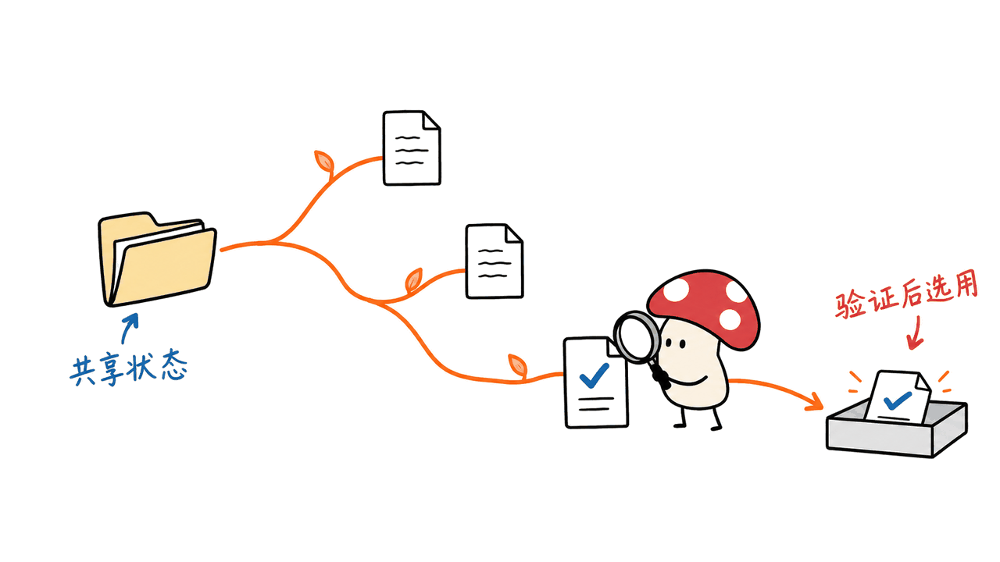
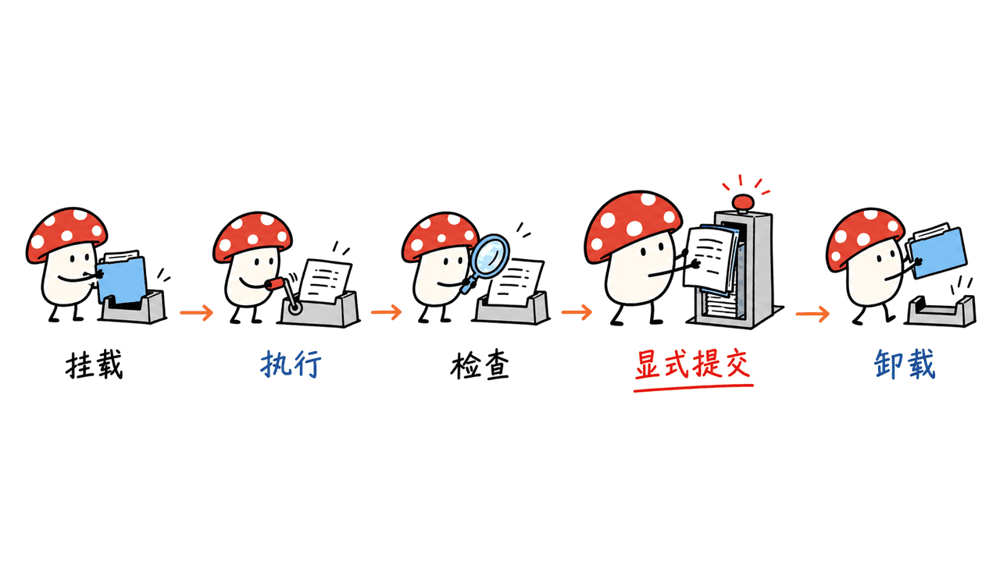
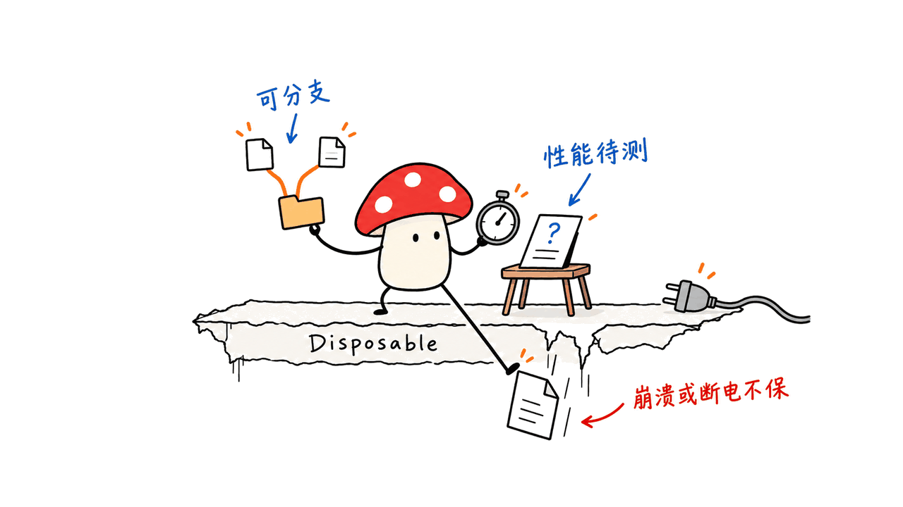

LayerFS 让多个 AI Agent 各自在一份完整的文件工作区里试错，再把选中的文件改动提交、合并到共同历史。它希望降低“复制整个环境、维护多份目录、手工收拾结果”的成本，尤其适合一个任务展开多条候选路径的场景。

官方仓库是 Ephemeral-AI-Lab/layerfs，采用 MIT 协议；v1.0.0 于 2026 年 10 月 21 日发布。本文固定到标签提交 `2aaf2552ce21154928b9f9c83582e41a637f5910`，依据发布说明、SDK、DSH 接入文档和仓库测试记录整理。

**先记住限制：v1.0.0 只有 Disposable Store，不保证崩溃或断电后的数据持久性。** 它还是源码发布，没有现成 npm 包、预编译二进制或公共镜像。把它当成 Agent 文件状态实验基础设施，会比当成生产备份系统更准确。

仓库：https://github.com/Ephemeral-AI-Lab/layerfs

发布说明：https://github.com/Ephemeral-AI-Lab/layerfs/releases/tag/v1.0.0

## “递归文件系统”究竟递归在哪里？

假设 Agent 要修一个构建错误。它可以从同一份初始状态分出 A、B 两个 Branch：A 修改依赖，B 修改源码。B 路线还可以继续分成 B1、B2，分别试不同实现，最后由上层程序运行检查、挑选结果。

这里的递归，是“分支还能继续分支”。已有内容通过共享历史和内容寻址复用，创建候选分支不必先完整复制整个项目。它并没有自动提供搜索算法、正确性评分器或自我进化机制；这些仍由 Agent Harness 和任务验证器负责。

和只管理提交进版本库的源代码相比，它关心的是工具运行时看到的整个文件树，包括依赖和生成物。对于已经有 Git worktree、缓存和容器方案的团队，值得比较的是完整环境的创建与收拢成本，而非单独比较 fork API 的调用时间。



## Store、Branch、Commit、Workspace 怎么分工？

| 对象 | 实际作用 | 接入时要理解的边界 |
| --- | --- | --- |
| Store | 用一个 SQLite 文件保存分支、提交和内容对象 | 当前要求共享的本地 Linux 文件系统，并非分布式数据库服务 |
| Branch | 一条可继续写入的提交历史 | 分支可以从已有引用派生，不代表复制进程状态 |
| Commit / Layer | Commit 保存文件变化；将分支发布到 main 会增加 Layer | 文件历史与命令是否成功是两个问题 |
| Workspace | 已提交视图叠加私有可写 overlay，通过 FUSE 暴露给工具 | 临时未提交的文件变化需要明确保存 |

`project`、`fs`、`branch` 的 Store 操作在调用进程中直接打开数据库，不需要为每次文件读取都启动 Sandbox。Bash 等普通程序则通过 Linux Sandbox 中的 Workspace 操作文件。

已保存内容按内容复用，相同内容无需反复存储；变化可以复用已有字节并以增量表示。这解释了它为什么针对大量相似环境有吸引力，但不能推出“任意工作负载零成本”，也不能忽略不断增长的历史占用。

初始化会收录完整源目录，包括 `.git`、被忽略的依赖、缓存、生成物和符号链接。这省去了每个候选环境重新安装依赖的工作，也意味着 `.env` 等文件可能进入 Store。导入边界应按实际目录内容决定。

## 接到 Agent 里，一轮工作怎么走？

官方 SDK 的关键流程可以压缩为：初始化项目 → 建立候选分支 → 挂载工作区 → 执行工具 → 检查结果 → 显式提交 → 卸载 → 按上层策略发布。

下面是完成同版本源码构建、原生插件和运行环境配置之后的调用示意，并非可以直接通过 npm 安装运行的独立脚本：

```js
import { LayerFS } from "@layerfs/sdk";

const l = new LayerFS("website", {
  storePath: "/layerfs-store/global/store.sqlite"
});
await l.project.init("./website");
await l.branch.fork("candidate");
const ws = await l.workspace.mount("candidate");
const result = await l.workspace.exec(ws, "npm test", "Validate candidate");
// 由调用方检查 result，并决定是否保存文件变化。
await l.workspace.commit(ws, "Save candidate state");
await l.workspace.unmount(ws);
```

`workspace.exec` 的说明消息不会自动生成历史，Bash 执行后需要调用 `workspace.commit` 保存变化。读文件也不等于创建提交；没有变化时不会仅为一段消息制造新 Commit。Harness 可以封装自动检查点，但这是上层接入策略。

同一 Workspace 的操作应按顺序执行；并行候选各用自己的 Workspace。两个结果能否并入共同历史，还取决于冲突。`.lww` 可以为指定文件采用后写覆盖规则，但它不能判断业务逻辑是否正确，不能替代测试或代码审查。



## Mac 能跑吗，v1.0.0 应该怎样开始？

底层 Store 调用要求 Linux，且 Store 位于 daemon 共享的本地 ext4、xfs 或 btrfs。直接在 macOS/APFS 上调用这条路径，会收到 `Unsupported`，不能把 JavaScript SDK 误读为跨平台原生文件系统。

官方提供 LayerFS × DSH，即 DeepSeek Harness 插件接入路径：Mac 运行客户端，Linux 原生插件和 daemon 在 Docker 环境内工作。文档当前覆盖的是 `dsh web`，桌面版本尚未测试；Pi 集成仍列为计划。

建议按三个检查点推进：

1. 固定 `v1.0.0`，按官方指南构建 Linux daemon、原生 addon 和本地运行镜像，三者与 SDK 保持同标签。
2. 构建 DeepSeek Harness 和 LayerFS 插件，使用独立 `DSH_HOME` 配置实验环境，再启动 web 模式。
3. 检查 `/layerfs/status`、执行一次小文件修改与显式提交，再卸载、重新挂载，确认提交内容仍可读取。之后才加入并行候选、合并和真实项目。

DSH 指南要求 Node.js 至少 22.19、pnpm 和 Docker；Mac 需要 Docker Desktop。它不是下载一个公共镜像即可启动的发行形态。v0.1.7 及以前创建的 Store 会被拒绝，需重新初始化，旧 `sandbox.*` API 也已经改为 `workspace.*`。

固定版本 SDK 指南：https://github.com/Ephemeral-AI-Lab/layerfs/blob/v1.0.0/sdk/js/README.md

DSH 接入指南：https://github.com/Ephemeral-AI-Lab/layerfs/blob/v1.0.0/dsh/README.md

DeepSeek Harness：https://github.com/deepseek-ai/deepseek-harness

## 官方成绩能说明它更快吗？

发布说明强调，每套测试只运行一次，使用较早的 main 提交 `e5c7aaae05`，并非本文固定标签的独立复测。测试环境是 arm64 Mac 上的 Docker Desktop Linux，8 CPU、约 8.3GB 内存，记录包含当时负载。

| 官方记录 | 结果 | 应怎样理解 |
| --- | --- | --- |
| fs-bench，12 个场景 | 合计 5.20 秒，对照 8.88 秒；10 个场景更快 | 这一套工作负载的约 1.71 倍，不能外推所有文件操作 |
| dsh-dedup，157 个项目快照 | Store 100.1MB，对照 Btrfs + zstd 的 1,994.6MB | 反映相似快照的去重收益，不是任意数据都压缩 19.9 倍 |
| fio，顺序写入 | 吞吐是 passthrough FUSE 对照的 0.31 倍 | 大块顺序写入可能明显更慢 |
| pjdfstest | 发布摘要称没有“意外”失败 | 不等于完整 POSIX 兼容，必须看已声明的差异 |

仓库的 pjdfstest 详细记录明确列出 707 个“LayerFS 失败、对照通过”的断言，其中包括前置失败引发的连锁结果。归因涉及 FIFO/UNIX socket 节点、特殊权限位、atime 与 ctime 语义。它们不能被“0 unexpected failures”这句摘要抹掉，也不能把 707 当成 707 个独立缺陷。

另一个容易误读的数字来自 fio：同步写入有 6.9 倍优势，但记录自己解释，Disposable 模式的 fsync 不做持久性刷新。拿它直接证明“可靠落盘更快”会比较不同的工作。

我的判断是，LayerFS 的价值更可能集中在“大量候选状态共享内容、频繁提交与收拢”的任务。如果你的关键路径是大文件顺序写入、特殊文件节点或可靠数据库写入，先验证语义和持久性需求，再谈替换现有方案。

官方测试入口：https://layerfs.ai/benchmarks/

POSIX 原始记录：https://github.com/Ephemeral-AI-Lab/layerfs/blob/v1.0.0/benchmark/pjdfstest/records/20261019T224251Z.md

fio 原始记录：https://github.com/Ephemeral-AI-Lab/layerfs/blob/v1.0.0/benchmark/fio/records/20261020T000148Z.md



## 哪些工程任务值得接入？

我的建议是先挑一个可验证的任务，例如修复一个失败测试，同时尝试三条补丁路径。为每条路径记录分支引用、工具结果、测试结论和最终选择，再比较现有 worktree/容器方案的准备时间、收尾时间与新增存储。

验收标准也要覆盖失败路径：未提交的变化怎样处理，同一文件冲突如何返回，容器中断后哪些状态不可恢复。文件版本化不保存进程内存、网络连接或外部 API 副作用；它也不单独构成完整的安全沙箱。

本文完成的是固定版本文档与官方记录核对。本机没有 Docker，未运行 FUSE 挂载、DSH 插件、崩溃恢复或性能测试。上面的接入检查点属于工程建议，尚不是我们的跑通报告。

对 Agent 终端与运行状态的另一层问题，可参看 ThinkTerm 的分析：https://blog.mushroom.cv/blog/thinkterm-multi-agent-terminal/

## 常见问题

### LayerFS 会自动让 Agent 越用越聪明吗？

不会自动实现。它提供文件状态的分支、保存与合并能力，候选生成、奖励、评分和选择仍需要外部系统。

### Commit 之后就能放心断电吗？

不能。v1.0.0 发布说明明确只有 Disposable Store，没有崩溃或断电持久性保证。正常卸载后读取提交历史，与断电恢复保证不是同一件事。

### 可以把它直接装到 Mac 的项目目录上吗？

当前原生 Store 路径不支持 APFS。Mac 的官方 DSH 接入依赖 Linux Docker 环境，并且需要自行构建相同版本组件。

---

> © 2026 Author: Mycelium Protocol. 本文采用 [CC BY 4.0](https://creativecommons.org/licenses/by/4.0/deed.zh) 授权——欢迎转载和引用，须注明作者姓名及原文链接，不得去除署名后以原创发布。

<!--EN-->

LayerFS gives AI agents separate writable views of a shared file history. An agent can explore a candidate change, save its file state, and pass the selected result back to a common history without first copying every byte of the project.

Ephemeral-AI-Lab released v1.0.0 on October 21, 2026 under MIT. This article reviews tag commit `2aaf2552ce21154928b9f9c83582e41a637f5910`, the SDK guide, DSH integration instructions and upstream benchmark records. It is a source review; we did not run the filesystem.

**The most important boundary is durability: v1.0.0 only runs the Disposable Store profile and offers no crash or power-loss durability.** It is also a source-only release, with no npm package, prebuilt binary or public runtime image.

Repository: https://github.com/Ephemeral-AI-Lab/layerfs

Release: https://github.com/Ephemeral-AI-Lab/layerfs/releases/tag/v1.0.0

## What makes the filesystem recursive?

A candidate branch can fork from an existing reference, then fork again. An agent fixing a build error might explore a dependency change on one branch and a code change on another, with further alternatives underneath each.

Shared committed content avoids eagerly copying the complete tree for every candidate. The search policy, scoring function and final selection remain responsibilities of the harness. Filesystem branching alone does not implement recursive self-improvement.

The relevant comparison with Git worktrees and containers is the cost of creating and collecting complete working environments, including dependencies and generated files. A fast fork operation by itself is not a complete agent performance result.


## How do the objects fit together?

| Object | Role | Boundary |
| --- | --- | --- |
| Store | SQLite file holding history and content objects | Shared local Linux storage, not a distributed database service |
| Branch | Writable line of commits | Does not capture running process state |
| Commit / Layer | Saved file changes; publishing adds a Layer to main | Saving files does not prove task correctness |
| Workspace | Committed view plus private writable overlay, exposed through FUSE | Uncommitted changes require explicit handling |

Store operations in the `project`, `fs` and `branch` groups execute in the caller process. Shell commands use a Workspace inside a Linux Sandbox. Content reuse, delta representations and compression target similar environments without promising zero storage or computation cost.

Project initialization captures the whole source tree, including `.git`, ignored dependencies, caches, generated output and symbolic links. That can accelerate bootstrap, but also brings files such as `.env` within the import boundary. Choose the source tree deliberately.

## What should a harness actually call?

The intended lifecycle is initialize, fork, mount, execute, inspect, commit, unmount and then publish according to the harness policy. The JavaScript example in the Chinese section illustrates this lifecycle after building and configuring the same-version SDK, addon and daemon.

An `exec` message creates no history. A shell command needs an explicit `workspace.commit` to preserve file changes; reads do not automatically create commits either. A harness may wrap these calls in an automatic checkpoint policy, but that behavior must be implemented explicitly.

Keep operations within one Workspace sequential and allocate separate Workspaces to parallel candidates. Merge conflict handling and `.lww` rules operate on file state; a last-write-wins policy cannot establish semantic correctness.


## Can Mac developers use v1.0.0?

Direct Store calls require Linux with the Store on local ext4, xfs or btrfs shared by the daemons. The native path is unsupported on macOS/APFS.

The official LayerFS × DSH integration runs Linux components through Docker while the Mac hosts the client. The documented integration covers `dsh web`; the desktop path is untested, and Pi integration remains planned. The DSH guide requires Node.js 22.19 or newer, pnpm and Docker, with Docker Desktop on Mac.

Start with the pinned build instructions rather than looking for a ready-made public image. Build the daemon, native addon and SDK from the same tag, build the runtime and plugin, and use a separate `DSH_HOME`. Check `/layerfs/status`, save a small edit explicitly, and remount to confirm normal readback before introducing parallel branches.

Stores created by v0.1.7 or earlier are refused and need reinitialization. The old `sandbox.*` API has been replaced by `workspace.*`.

SDK guide: https://github.com/Ephemeral-AI-Lab/layerfs/blob/v1.0.0/sdk/js/README.md

DSH guide: https://github.com/Ephemeral-AI-Lab/layerfs/blob/v1.0.0/dsh/README.md

DeepSeek Harness: https://github.com/deepseek-ai/deepseek-harness

## How should we read the benchmarks?

The release measurements used earlier main commit `e5c7aaae05`, one sample per case, on an arm64 Mac running Docker Desktop Linux with eight CPUs and about 8.3GB memory. They are upstream measurements, not our reproduction of the release tag.

| Upstream result | Reported value | Interpretation |
| --- | --- | --- |
| fs-bench, 12 scenarios | 5.20s versus 8.88s, faster in 10 cases | About 1.71× for this suite, not all filesystem operations |
| dsh-dedup, 157 snapshots | 100.1MB versus 1,994.6MB for Btrfs + zstd | A similar-snapshot deduplication result, not a universal compression ratio |
| fio sequential write | 0.31× passthrough FUSE throughput | A substantial regression on this workload |
| pjdfstest | “No unexpected failures” in the release summary | Declared differences still matter |

The detailed pjdfstest receipt lists 707 assertions that fail on LayerFS and pass on the comparison filesystem, including cascading failures. The causes concern FIFO and UNIX socket nodes, special mode bits, and atime/ctime semantics. This is neither full POSIX conformance nor 707 independent defects.

The fio receipt also explains that its 6.9× synchronous-write advantage arises because Disposable fsync does not flush for durability. It cannot establish faster durable writes when the two systems perform different work.

Benchmark entry: https://layerfs.ai/benchmarks/

POSIX receipt: https://github.com/Ephemeral-AI-Lab/layerfs/blob/v1.0.0/benchmark/pjdfstest/records/20261019T224251Z.md

fio receipt: https://github.com/Ephemeral-AI-Lab/layerfs/blob/v1.0.0/benchmark/fio/records/20261020T000148Z.md


## Where would I start an engineering evaluation?

I would choose a bounded task with a verifiable outcome, such as three candidate patches for one failing test. Record each branch reference, tool result, test verdict and selection. Compare preparation time, collection time and added storage with the team's existing worktree/container approach.

Include failure handling: uncommitted edits, same-file conflicts and container interruption. File history does not preserve process memory, network connections or external API side effects, and is not a complete security sandbox by itself.

Our machine had no Docker available. We reviewed pinned documentation and published records, without running FUSE mounts, the DSH plugin, crash recovery or performance tests. The proposed evaluation is engineering guidance, not a completed deployment report.

Related discussion of agent terminals and runtime state: https://blog.mushroom.cv/blog/thinkterm-multi-agent-terminal/

## Frequently asked questions

### Does LayerFS make an agent improve itself?

It supplies file-state branching and history. Candidate generation, evaluation and selection still need a separate harness and verifier.

### Does committing guarantee power-loss recovery?

No. The v1.0.0 release explicitly excludes crash and power-loss durability for its Disposable Store. Normal remount readback is a different property.

### Is it a native Mac filesystem?

The direct Store path does not support APFS. The documented Mac integration uses Linux Docker components that must be built from matching versions.

---

> © 2026 Author: Mycelium Protocol. Licensed under [CC BY 4.0](https://creativecommons.org/licenses/by/4.0/) — free to share and adapt with attribution. You must credit the author and link to the original; removing attribution and republishing as original is not permitted.
