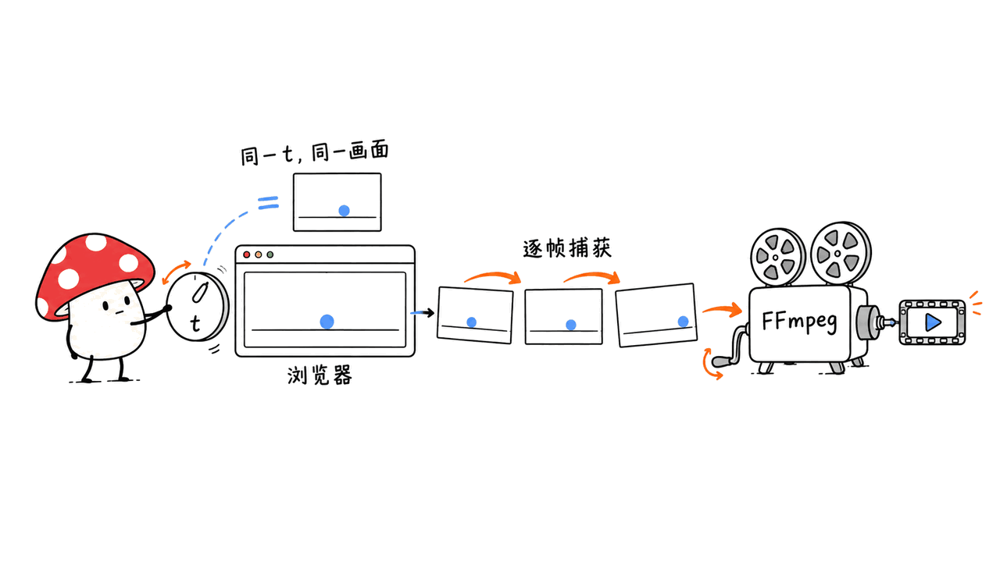

Lemo Opuscar 能让编码 Agent 把一个主题做成有画面、声音和剪辑的短片。它的核心是将导演方法、风格提示与渲染工具放进同一套工作流，让 Agent 写代码来制作影片。

官方仓库是 `lemomo-ai/lemo-opuscar`，作者为 Lemomo（`@lemomo_ai`）。截至2026年10月20日，本次 GitHub API 快照为3,783星；我们核对了51种正式风格，另有一个不计入数量的模板目录。素材里的“2800+”是较早的热度描述，不影响项目的实际用法。

**这套工具的主要路线是 Canvas/WebGL 逐帧渲染，而非调用视频生成模型抽取镜头。** 它省掉了一部分视频模型依赖，但制作仍需要编码模型、浏览器、FFmpeg、声音工具和成片验收。

## 它把哪些制作工作交给Agent？

可以把它理解成一个小型制片流程：先确定影片要讲什么，再写处理方案与分镜，画面由网页程序绘制，声音按同一条时间线生成或组织，最后混音并封装为 MP4。

| 环节 | 仓库提供的基础 | 仍需Agent或创作者决定的事情 |
|---|---|---|
| 导演 | `DIRECTOR.md` | 主题、叙事、镜头、节奏和表演 |
| 视觉风格 | `styles/<style>/STYLE.md` | 如何把自己的故事画成该风格 |
| 技术制作 | `TECHNIQUE.md`、`core/` | 场景代码、声音事件、资源加载 |
| 输出与复核 | 静帧、视频、字幕和混音工具 | 是否好看、准确、易读、声音自然 |

它不是一个只有“神级提示词”的列表。共享工具让画面、声音和输出遵守相对明确的接口，风格样片则提供可参照的视觉语言。不过，现成样片存在，不代表任意新主题都能自动达到同等质量。


官方也要求先写 `TREATMENT.md`，再参考样片技术，避免把原片只换名字重新交付。这一点比“直接抄作业”更值得学：可复用的是制作方法，故事和表达仍应重新设计。

## 51种风格，应该怎样选？

风格库覆盖水彩、油画厚涂、浮世绘、像素游戏、纸艺、低多边形、玻璃产品渲染等路线。选择时先看内容适合什么视觉结构，而不是只选一个漂亮名字。

例如，讲一个温暖的小故事可以先试水彩或纸艺；说明系统关系可以试信息图；介绍真实产品结构，可以查看拆解路线。10月16日新增的8种 Evidence Films 则围绕真实材料，包括卫星影像、激光扫描、档案、CAD和实测数据等。

Evidence Films 是一种以材料和证据驱动创作的方向，不是自动事实核查证明。数据来自哪里、坐标是否一致、单位有没有混淆，都需要实际检查。影片画得可信，不代表里面的数值就可信。

仓库还有展示影片 OPUSCAR 98，以及配套的98段风格资料。这是另一套作品与分析入口，不能把它直接当作主风格库“有98种可用模板”的统计。

10月19日加入的自定义风格流程也很实用：把修改后的风格保存在 `~/lemo-my-styles/`，与共享库分开，并先做15–30秒测试片。先检验一个短段落，再投入整片，是更容易控制返工成本的方式。

## 如何安装并开始第一部短片？

官方面向 Claude Code 的安装入口是：

```bash
claude plugin marketplace add lemomo-ai/lemo-opuscar
claude plugin install lemo-opuscar@lemolab
```

这是使用说明，我们没有在本次研究中安装插件或让它自动接管当前工作区。首次使用时，Skill 会获取共享指南、工具和风格提示，默认库目录是 `~/lemo-opuscar`；新影片工程位于发起任务的目录下。

也可以克隆仓库，在仓库内工作。为便于复核，下面固定本次研究的提交：

```bash
git clone https://github.com/lemomo-ai/lemo-opuscar.git
cd lemo-opuscar
git checkout b5e8ef93930b6d828f352055a689320f138237b1
claude
```

这种方式的影片工程通常放在 `films/<name>/`。其他 Agent 可以读取该 Skill 的目录，但作者明确说明风格针对 Opus 5.5 调整，换模型不保证相同效果；“能读SKILL.md”与“能完成同样的影片”是两个验收项。

系统需要 Node 20+、FFmpeg、Python 3.11+或 uv。官方主要在 Apple Silicon macOS 开发，Linux建议按文档配置，Windows使用WSL；3D和大量着色器的风格还要考虑GPU。插件之外还会下载浏览器、Python依赖，以及所需的语音模型或采样库。语音依赖文件特别注明Kokoro需要Python 3.11–3.13，建议用独立环境，别直接假设最新系统Python可用。

第一条需求可以写得具体一点：

```text
做一部30秒水彩风格短片，解释阳台番茄从开花到结果。
面向第一次种菜的人，16:9，中文旁白，最多四个镜头。
先给我看处理方案和分镜，再制作。
我没有自己的录音和音乐；先列出声音方案及联网需求。
成片之外，保留字幕、素材来源、源码和一键重建脚本。
```

主题、观众、时长、镜头上限和验收阶段一旦确定，Agent就少了很多猜测。需要先看分镜时，应明确说出来；官方默认允许用户选择是否经过这个暂停点。

## 为什么它能用代码稳定生成视频？

核心工具要求网页提供三个约定：资源就绪后设置 `window.READY`；用 `window.render(t)` 绘制指定时刻；用 `window.DUR` 描述总时长。渲染器启动无头浏览器，按帧率给出时间点，再把截图通过管道交给 FFmpeg 编码。

关键在于 `render(t)` 必须由时间决定画面。不能依赖浏览器今天跑得快不快，也不能靠上一帧累积状态；随机效果需要固定种子。这样同一时间点才能单独检查，多工作进程也才能渲染不同片段。

例如，30秒、24 FPS的影片有720帧；这只是帧数计算，不是生成速度承诺。增加分辨率、复杂着色器、字体、粒子或后处理，都可能改变总渲染时间。



在已有影片网页之后，可以先看几个时间点，再渲染完整画面：

```bash
node core/render/still.mjs films/tomato-story 0 5 12 --size 1280x720
node core/render/video.mjs films/tomato-story \
  --fps 24 --workers 3 --size 1280x720
```

这些命令需要已经存在的 `index.html` 及上述接口，并不会仅凭目录名自动写好故事。静帧工具默认输出到 `stills/`，视频工具默认生成 `out/video.mp4`，后者还不是已经完成旁白和混音的最终交付片。

## 配音和音乐是否完全免费、完全离线？

开源许可与运行成本需要分开看。作者估计一部影片通常需要 Agent 工作30–60分钟，并消耗较多Token；这是作者的经验说明，不是本次测量，也没有给所有片长或复杂度设定统一价格。

| 成本或数据路径 | 当前默认路线 | 判断时要注意 |
|---|---|---|
| 编码Agent | 主要针对Opus 5.5设计 | 模型订阅或API成本另算 |
| 英文旁白 | Kokoro，本地推理 | 首次仍需下载模型和依赖 |
| 中文旁白 | edge-tts，在线服务 | 文本需要发送到相应语音服务 |
| 音乐 | 编写乐谱、采样与合成 | 采样库下载、许可证及混音需核对 |
| 渲染 | Chrome与FFmpeg | 占用本机计算、存储与制作时间 |

仓库也允许使用用户自己的录音、音乐或指定声音。文档提到Kokoro有离线中文声音，但对自然度有自己的评价，不能把默认的在线中文方案宣传成离线无网络。

它提供逐句ASR回查、字幕时间、声音压缩与混音规范。回查能帮助发现漏读和错读，却不能证明情感自然、表演合适。中文短句还可能出现识别误差；文档允许人工听确认后指定预期识别文本，因此“检查通过”仍需要结合实际听感解释。

## 我们实际跑通了哪一小段？

本次在隔离的临时目录中，使用固定提交的渲染工具和自制的简单Canvas场景：白底上一个蓝色圆形随时间移动。我们检查了两个时间点的静帧、同一时间点重新渲染的结果，以及两秒、640×360、24 FPS的无声H.264视频。

这段检查用于验证网页时间接口、浏览器捕获和FFmpeg编码链路。我们没有调用Opus、安装完整Skill、生成51种风格样片，也没有验证旁白、音乐或完整导演流程；不能把它写成“已实测一键做出专业短片”。

检查结果和输出属性保存在研究记录中。它证明的是最小渲染基础可以独立运行，不证明新故事的审美质量，也不构成任何模型或硬件速度基准。

## 怎样验收，才算真正完成一部影片？

先验收处理方案：故事是否适合目标观众，每个镜头是否承担一个明确任务。再验收静帧与关键动作：主体有没有变形，字能否读完，镜头运动是否支持表达。最后全速播放带声音的最终文件，检查对白、音乐、字幕和剪辑是否一致。


官方交付清单不止一个MP4，还包括海报、需要时的SRT、`TREATMENT.md`、第三方素材`CREDITS`、源码和`build.sh`。这些文件能让你以后改一句旁白、调整画幅或替换一个镜头，而不必从一个不可编辑的最终视频重新开始。

许可也分层：代码和文档采用MIT；演示影片及剧照采用CC BY 4.0，复用时需署名LemoLab、链接仓库并说明修改；第三方素材保留自己的许可。README表示用库制作的新影片归创作者，但这不会自动清除录音、字体、采样或输入素材的第三方要求。

我们的判断是，它尤其适合程序化动画、信息解释、风格化短故事和有明确数据来源的视觉说明。要求真人细腻表演、复杂实拍质感或完全自由的摄影效果时，应先做测试镜头，再决定是否采用这条路线。“人人都能当导演”是愿景，能否把一个具体故事做好，仍取决于表达、素材与迭代。

也可以结合本站Hypit文章比较：不同项目将视频组织成可编程结构的方式不同，别把“有开源工作流”当成同一套镜头和素材能力。
https://blog.mushroom.cv/blog/hypit-ai-agent-video-workflow-svml-claude-code-codex/

## 常见问题

### 这是另一个文生视频模型吗？

主要不是。它是一套让编码Agent写画面程序、组织声音和输出文件的Skill与工具库，主要画面路径是Canvas/WebGL逐帧渲染。

### 可以把Opus换成便宜的本地模型吗？

可以研究适配，但作者明确说风格针对Opus 5.5调优，其他模型可能不能复现。先检验理解风格、完成代码、修复渲染和声音组织的能力，再讨论替换后的总成本。

### 开源是不是意味着一部影片零成本？

不是。代码许可、模型费用、语音服务、素材条件以及本机渲染成本彼此独立。应按自己的影片复杂度和服务配置计算，不能从MIT许可推导出零费用。

## 来源与复核范围

复核日期：2026年10月20日。源码固定为 `b5e8ef93930b6d828f352055a689320f138237b1`。本次只做了自制极简场景的渲染链路检查，没有进行完整Agent制片、语音质量或速度测试；封面为概念图。

- 官方仓库：https://github.com/lemomo-ai/lemo-opuscar
- 影片画廊：https://lemomo-ai.github.io/lemo-opuscar/
- 固定版本：https://github.com/lemomo-ai/lemo-opuscar/tree/b5e8ef93930b6d828f352055a689320f138237b1
- 导演方法：https://github.com/lemomo-ai/lemo-opuscar/blob/b5e8ef93930b6d828f352055a689320f138237b1/DIRECTOR.md
- 技术路线：https://github.com/lemomo-ai/lemo-opuscar/blob/b5e8ef93930b6d828f352055a689320f138237b1/TECHNIQUE.md
- 工具接口：https://github.com/lemomo-ai/lemo-opuscar/blob/b5e8ef93930b6d828f352055a689320f138237b1/core/README.md
- 风格索引：https://github.com/lemomo-ai/lemo-opuscar/blob/b5e8ef93930b6d828f352055a689320f138237b1/styles/README.md

---

> © 2026 Author: Mycelium Protocol. 本文采用 [CC BY 4.0](https://creativecommons.org/licenses/by/4.0/deed.zh) 授权——欢迎转载和引用，须注明作者姓名及原文链接，不得去除署名后以原创发布。

<!--EN-->

Lemo Opuscar helps a coding agent turn a topic into a short film with picture, sound and editing. It combines directing guidance, style instructions and production tools so the agent can build the film in code.

The official repository is `lemomo-ai/lemo-opuscar`, by Lemomo, `@lemomo_ai`. Our October 20, 2026 API snapshot recorded 3,783 stars. We counted 51 actual style directories, excluding an additional template directory.

Its principal picture pipeline uses Canvas/WebGL pages rendered frame by frame, rather than a video-generation model. Coding-model usage, browsers, FFmpeg, audio tools and editorial review remain part of production.

## What does the workflow organize?

`DIRECTOR.md` covers narrative, shots, performance, rhythm and review. `TECHNIQUE.md` explains implementation. Each `STYLE.md` provides a visual approach. Shared tools capture frames, generate or organize audio, mix and export the result.

The guides ask the agent to write a treatment before studying demo implementation. This encourages a new story rather than replacing names in the reference film. Reusable production methods are valuable; a strong reference does not guarantee an equally strong result for every topic.


## Which style should you choose?

The main library spans watercolor, impasto, ukiyo-e, pixel/game aesthetics, paper construction, low-poly scenes and product rendering. Choose according to the content's visual structure, not only the prettiest example.

Eight Evidence Films styles added on October 16 work with real material such as satellite images, laser scans, archives, CAD and measured data. This is a sourcing-oriented creative approach, not proof of automatic fact checking. Inputs, units, coordinates and claims still need verification.

OPUSCAR 98 and its 98 style analyses are a separate showcase. They should not be confused with the count of reusable styles in the main library. The October 19 custom-style workflow stores personal variants outside the library and makes a 15–30 second test film before committing to more production.

## How do you start?

The documented Claude Code installation is:

```bash
claude plugin marketplace add lemomo-ai/lemo-opuscar
claude plugin install lemo-opuscar@lemolab
```

On first use, it obtains a shared library, normally at `~/lemo-opuscar`. Film projects live in the folder where the task begins. Alternatively, clone the repository, pin the reviewed commit and launch Claude there; projects then normally go under `films/<name>/`.

```bash
git clone https://github.com/lemomo-ai/lemo-opuscar.git
cd lemo-opuscar
git checkout b5e8ef93930b6d828f352055a689320f138237b1
claude
```

We did not install the plugin or invoke an agent filmmaking run in this research. Other agents can read the skill, but the author explicitly tunes the styles for Opus 5.5 and does not promise equivalent results from other models.

Requirements include Node 20+, FFmpeg and Python 3.11+ or uv. The project was developed on Apple Silicon macOS, with Linux guidance and WSL for Windows. Three-dimensional or shader-heavy styles need appropriate graphics resources. Browsers, Python packages, voices and instrument samples are additional downloads. The voice requirements specifically note Python 3.11–3.13 for Kokoro, so use a compatible isolated environment.

For a first request, specify a 30 second watercolor explanation of a balcony tomato plant, a beginner audience, four shots, Chinese narration and 16:9. Ask to approve the treatment and storyboard first, list audio/network requirements and preserve source, captions, credits and a rebuild script.

That brief makes creative decisions and acceptance points explicit. A request to see a storyboard matters because the documented workflow lets the user choose whether it pauses at that stage.

## Why does the renderer need a time-based contract?

A film page exposes `window.READY`, a deterministic `window.render(t)` and `window.DUR`. The renderer starts a headless browser, requests the correct time for every frame and pipes screenshots into FFmpeg.

The same time must produce the same picture independently of previous frames. Avoid unseeded randomness and wall-clock-driven animation. Independent time evaluation permits isolated frame inspection and rendering different segments in separate workers.

A30second film at 24 FPS contains 720 frames. That arithmetic is not a speed claim. Resolution, effects, fonts, particles and shading all influence the actual work.


After an actual film page exists, inspect frames and then render picture:

```bash
node core/render/still.mjs films/tomato-story 0 5 12 --size 1280x720
node core/render/video.mjs films/tomato-story \
  --fps 24 --workers 3 --size 1280x720
```

These commands require an existing `index.html` implementing the page contract. They do not generate a story from a directory name. The default `out/video.mp4` is picture output, not automatically the completed narrated and mixed film.

## What costs money, and what goes online?

The author estimates 30–60 minutes of agent work and substantial token use for a film. That is an author estimate, not our measurement or a price guarantee.

The default English voice path uses local Kokoro inference after model download. Chinese narration normally uses online edge-tts. User recordings or specified audio can replace defaults; the documentation also mentions offline Chinese Kokoro voices, with quality qualifications. The default Chinese path should not be described as entirely offline.

Music uses written scores, sampled instruments and synthesis. Sample downloads and licensing still matter. Chrome/FFmpeg consume local compute and storage. Coding-model subscription or API costs remain separate from the repository's open-source license.

ASR checks help detect missed or misread speech. They do not establish emotional performance or naturalness. The Chinese workflow allows manual listening and an expected-ASR override for recognition errors, another reason to interpret a passed automated check carefully.

## What did we actually check?

In an isolated temporary directory, we used the pinned renderer files and an original minimal Canvas scene: a blue circle moves across a white background. We checked two still timestamps, a repeated render of the same timestamp, and a silent two-second 640×360 video at 24 FPS.

This checks the page contract, browser capture and FFmpeg encoding. We did not call Opus, install the full skill, reproduce the style collection or test narration, music and the complete directing process. It is not a model or hardware performance benchmark.

The output properties and check records are preserved with the research. A small functioning render path establishes a useful implementation foundation, not the aesthetic quality of a newly generated story.

## What counts as a finished delivery?

Review the treatment, then stills and key actions, then the final film at normal speed with sound. Verify text readability, narration, music, captions and transitions together.


The documented deliverables include MP4, poster, SRT where relevant, treatment, third-party `CREDITS`, source and a one-command `build.sh`. An editable project is more useful for future revisions than a lone flattened video.

Code and documents are MIT-licensed. Demo films and stills use CC BY 4.0 with LemoLab credit, repository link and change disclosure. Third-party assets retain their licenses. The README says new films made with the library belong to their creators; that does not erase obligations attached to recordings, fonts, samples or other inputs.

Our assessment is that the approach is particularly suitable for procedural animation, visual explanations, stylized stories and sourced-data films. Test a representative shot before choosing it for demanding live-action appearance or subtle human performance. The workflow reduces production friction; a clear story, suitable assets and iteration still determine the result.

Compare the related Hypit article for another approach to programmable video structures:
https://blog.mushroom.cv/blog/hypit-ai-agent-video-workflow-svml-claude-code-codex/

## FAQ

### Is this another text-to-video model?

Its principal route is a skill/toolkit that guides a coding agent to implement scenes, audio and exports. Picture is mainly generated through frame-by-frame Canvas/WebGL rendering.

### Can a cheaper local model replace Opus?

It can be investigated, but the author tunes the collection for Opus 5.5 and warns about other models. Check style interpretation, implementation, rendering repair and audio organization before comparing total costs.

### Does open source make each film free?

No. Code licensing, coding-model usage, speech services, asset conditions and rendering resources are separate. Estimate them for the actual brief and configuration.

## Sources and scope

Reviewed October 20, 2026 at commit `b5e8ef93930b6d828f352055a689320f138237b1`. We checked a minimal original scene through the renderer, not a complete agent filmmaking run, voice-quality evaluation or speed test. The cover is conceptual.

- Repository: https://github.com/lemomo-ai/lemo-opuscar
- Gallery: https://lemomo-ai.github.io/lemo-opuscar/
- Directing: https://github.com/lemomo-ai/lemo-opuscar/blob/b5e8ef93930b6d828f352055a689320f138237b1/DIRECTOR.md
- Technique: https://github.com/lemomo-ai/lemo-opuscar/blob/b5e8ef93930b6d828f352055a689320f138237b1/TECHNIQUE.md
- Tool contract: https://github.com/lemomo-ai/lemo-opuscar/blob/b5e8ef93930b6d828f352055a689320f138237b1/core/README.md
- Style index: https://github.com/lemomo-ai/lemo-opuscar/blob/b5e8ef93930b6d828f352055a689320f138237b1/styles/README.md

---

> © 2026 Author: Mycelium Protocol. Licensed under [CC BY 4.0](https://creativecommons.org/licenses/by/4.0/) — free to share and adapt with attribution. You must credit the author and link to the original; removing attribution and republishing as original is not permitted.
