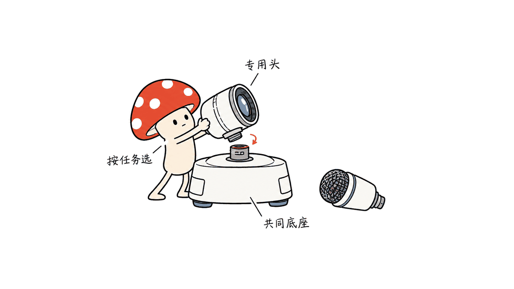
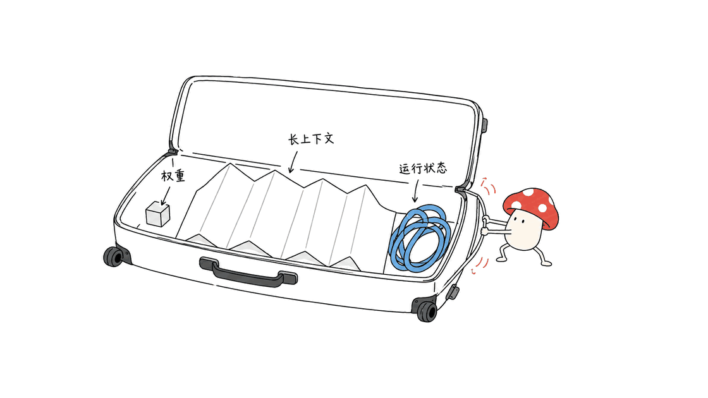

LFM3 是一组面向本地应用的小模型：按输入模态和任务选型，比把所有请求都交给一个全模态模型更合理。文本款已在本文的 Mac 短任务测试中跑通，但权重能下载，并不等于六款都能通过同一个工具完整运行。

Liquid AI 于 2026 年 10 月 27 日发布这个开放权重家族。六款后训练模型来自共同的 `LFM3-1.7B-Base`；底座另外公开，因此是“六款应用模型，加一个底座”。它们采用 LFM Open License v1.0，不能直接按 MIT 或 Apache-2.0 理解。

官方公告：https://www.liquid.ai/blog/lfm3

官方模型合集：https://huggingface.co/collections/LiquidAI/lfm3

## 六款 LFM3 分别解决什么问题？

下表来自 2026 年 10 月 29 日逐项核对的官方模型卡。上下文是对应检查点的规格，不是本文已验证的可用长度，也不代表所有输入都能以相同速度处理。

| 模型 | 参数量 | 上下文 | 输入与输出 | 更合适的任务 |
| --- | --- | --- | --- | --- |
| LFM3-1.7B | 1.73B | 256K | 文本 → 文本、工具调用 | 本地助手、结构化任务、领域微调 |
| LFM3-VL-2B | 1.92B | 128K | 文本、图片、视频 → 文本 | 看图问答、文档与视频理解 |
| LFM3-Audio-2B | 约 2B | 32K | 文本、音频 → 文本、语音 | 转录、合成、翻译、声音理解 |
| LFM3-Omni-2B | 2.17B | 32K | 文本、图片、视频、音频 → 文本、语音 | 需要同时看和听的交互 |
| d1-2B | 1.92B | 128K | 文本、图片、视频 → 类型化答案与概率 | 路由、分类、抽取、视觉判断 |
| d1-Omni-2B | 2.17B | 128K | 增加音频与口述问题 → 类型化答案与概率 | 语音消息分流、声音相关决策 |

底座 `LFM3-1.7B-Base` 为 1.73B、256K，主要用于继续预训练或较重的后训练。普通聊天应优先选择后训练的 `LFM3-1.7B`，不要把 Base 当成开箱即用的助手。

共享底座也不意味着一份模型文件切换几个开关，就能得到全部能力。不同检查点带有不同编码器、输出头和处理流程；同时部署多款时，内存与维护成本仍要分别计算。



## 三混合架构为什么值得看？

文本骨干有 24 层：13 层门控短卷积、5 层滑动窗口注意力、6 层全局注意力。官方配置给出的滑动窗口为 256 token，短卷积核长度为 7。它通过不同层分担局部处理和远距离信息交互，而不是用一个统一的全注意力结构处理所有位置。

这不是 MoE 的“总参数很多、每次只激活少数专家”路线。Liquid AI 强调的是面向设备重新选择序列算子的组合。22T token 预训练、最后阶段增加工具与 Agent 轨迹等说法，均来自官方训练说明，不是本文对训练数据的独立审计。

模型卡列出了 Agent 场景成绩，但文本款同时明确表示：受体量所限，不推荐用于复杂多步推理和 agentic coding。适合工具调用或办公流程，并不能直接推出它能替代大模型长期修改代码仓库。选型应从实际任务开始，而不是只比较参数量和榜单中的某一行。

文本模型卡：https://huggingface.co/LiquidAI/LFM3-1.7B

## 视频、18种语言和全模态，需要怎样理解？

VL 首次为这一系列加入视频输入。官方默认预处理会对视频抽帧；这不是把无限长度的原始视频不加处理地送进去。视频帧、分辨率和文字都会消耗资源，128K 的规格不能直接换算为固定的视频分钟数。

Audio 支持 18 种语音语言，包含中文，英语又区分英式与美式 locale。它涵盖转录、语音合成和翻译等任务；但同一张模型卡仍把 Voice chat 标为目前仅支持英语。应按任务模式理解语言支持，不能把“18种语言”外推成每种语言的所有交互模式都同样成熟。

Omni 可以同时接收视频画面与声音，也能接收“图片加口述问题”。它输出文字、语音或交错的文字与语音，不会因为叫全模态就生成图片或视频。它的上下文为 32K，与文本款的 256K 不同。

d1-Omni 的语音语言范围也应单独查卡，不能直接照抄 Audio 的 18 种。模型家族共享技术，不代表各成员的输入、输出和训练范围完全相同。

## d1 为什么不生成回答，却仍然需要验证？

d1 从一次前向计算中读取类型化结果与概率，不进行普通聊天模型那样的逐 token 答案生成。例如，同一份工单可以同时询问是否退款、该交给哪个部门、紧急程度是多少，或从单据中抽取字段。

这种方式适合嵌在流程中的判断步骤：先决定交给哪种工具或人工队列，再由后续系统执行。官方接口支持 Choice、Score、Noul，以及文本、数字、日期、位置框等结果类型；不同类型的输出含义应按接口说明解释。


配图中的类型与概率是接口示意，不是本文实测的 d1 输出。

**不生成输出 token，不等于端到端延迟恒定。** 输入长度、图像或音频编码、批量大小和硬件仍然影响耗时。官方展示的毫秒级结果要连同设备和输入条件一起读，不能直接套到个人笔记本。

概率也应在自己的数据上检查。客服、内容审核和设备控制，可以先验证置信度与错误率的对应关系，设置不确定时交给人工或更强模型的路径。d1-Omni 模型卡甚至提醒：没有音频需求时，d1-2B 在文本、部分定位和校准等方面更合适。模态越多不代表所有子任务都更强。

决策模型：https://huggingface.co/LiquidAI/d1-2B

带音频的决策模型：https://huggingface.co/LiquidAI/d1-Omni-2B

## Mac 本地测试：跑通了什么，哪里失败了？

Mycelium Protocol 在 M4、16GB 内存、macOS 26.6.2 上，用隔离临时目录运行官方 `llama.cpp` b11960 Apple Silicon 发布包。二进制打印版本为 `0.8.0-dev`，构建号 11960。下载包摘要与 GitHub 官方资产 SHA-256 一致，没有全局安装或替换现有工具。

模型使用官方 `LFM3-1.7B-Q4_K_M.gguf`，文件为 1,099,627,808 字节，约 1.02 GiB，摘要与 Hugging Face LFS 记录一致。测试设置为 4096 上下文、单并发、温度 0，每轮最多先生成 96 个 token，通过本地 HTTP 服务完成三个合成样例。

| 短测试 | 首轮结果 |
| --- | --- |
| 17 + 25，只返回整数 | 返回 `42`，符合预期 |
| 中文重复扣款工单，只选一个部门 | 返回 `billing`，符合预期 |
| 提取 3 本 notebooks 为指定 JSON | 达到 96 token 上限，最终正文为空 |

第三项没有被记作通过。随后保留原记录，只将该请求的 `max_tokens` 改成 512；这次共生成 125 个 token，正常结束并返回 `{"name":"notebooks","quantity":3}`。返回结构还包含单独的 reasoning 字段，说明生成预算不能只按最终 JSON 的几个词来估算。

这不是“2/3准确率”的能力榜单：样例很少、人工挑选、没有真实业务分布。它验证的是文本模型能加载、处理中文短指令并产生可检查输出，也暴露了预算截断这一集成问题。本文没有实测视觉、音频、Omni 或 d1 推理，没有测完整 256K 上下文、峰值内存或同硬件速度对比。

## Mac 部署要先核对哪些版本？

核验时，官方文本 GGUF 卡标注的支持条件是：`llama.cpp` b11960 / v0.8.0 或更新版本；Ollama 为 v0.40.12 或更新版本；LM Studio 需要 llama.cpp engine 2.65.1 或更新版本。这里说的是文本检查点，不能直接当成六款模型的统一兼容清单。

官方文本 GGUF：https://huggingface.co/LiquidAI/LFM3-1.7B-GGUF

支持版本的 `llama-cli` 可按模型卡启动：

```bash
llama-cli -hf LiquidAI/LFM3-1.7B-GGUF:Q4_K_M \
  --temp 0.1 --top-k 50 --repeat-penalty 1.1
```

Apple Silicon 用户可以先从短上下文、单并发的 GGUF 路线验证。本文的 16GB 是实测主机配置，不是官方最低内存要求；其他芯片、Intel Mac 和移动设备没有在本文测试。实际需求还取决于模型格式、缓存精度、输入模态与同时运行的应用。

MLX 的情况必须另外说明：官方已经提供 `LFM3-1.7B-MLX-4bit` 权重，但核验版本的模型卡明确写着 `mlx-lm` 支持仍在推进。不要只复制卡中的示例命令就默认当前稳定版已可用，更不要把文本 MLX 与音频所需的 MLX-VLM 混为一谈。

官方 MLX 状态：https://huggingface.co/LiquidAI/LFM3-1.7B-MLX-4bit

## “约1GB”为什么不是完整内存账？

官方约 1GB 的表述针对文本模型的 4-bit 部署规模，不能拿来覆盖所有上下文和模态。运行时还要容纳缓存、临时计算与其他组件。

可以从文本配置做一个有边界的估算：只计算 6 层全局注意力，4 个 KV head、每头 128 维，K/V 各一份，每元素 2 字节，则每 token 为 12,288 字节。累积到 262,144 token 时，单这部分约 3 GiB；尚未加入权重、滑动窗口缓存、卷积状态和运行时开销。

这只是特定缓存精度下的结构估算，不是本文测得的内存峰值。不同后端的缓存量化与实现会改变结果。它说明的是：即使权重很小，长上下文仍然需要独立预算。



## 开放权重，商业使用就没有条件吗？

LFM Open License v1.0 允许多种使用、修改和分发，但包含商业使用限制，以年收入 1000 万美元为门槛，并规定适用主体等定义。部署方应核对自身主体、用途及条款；不能因为可以下载权重，就套用 MIT 或 Apache-2.0 的商业使用预期。

许可证原文：https://huggingface.co/LiquidAI/LFM3-1.7B/blob/ac2586a34f1a1c03329dbdcdefabd8b6478ddaa7/LICENSE

对普通项目，建议先选择真正需要的模态，建立小而可复核的任务集，记录截断、拒答、结构错误和不确定性，再决定是否微调或部署更多成员。LFM3 的价值在于提供可选的专用小模型起点，实际产品质量仍由数据、工具链和业务验证共同决定。

相关背景：早期 d1-3B 与实验性 d1-omni-600M 的介绍，属于上一轮产品，不应把其测试数字移植到本次新模型：https://blog.mushroom.cv/blog/liquidai-d1-3b-omni-600m-decision-model-zero-output-tokens-edge/

## 常见问题

### 六款模型包括 Base 吗？

不包括。六款是文本、视觉、音频、Omni 和两款决策检查点，Base 另外公开，共七个主要检查点。

### d1 能当聊天或语音转录模型吗？

不应这样使用。它返回类型化判定和概率，d1-Omni 模型卡也明确说明不输出转录或语音。

### 这次测试证明整个家族都能在16GB Mac运行吗？

没有。本文仅验证了文本 Q4_K_M 的短任务运行，其他模态、完整上下文和实际内存峰值尚未测试。

资料：模型卡与下载入口均见官方合集；文本规格 https://huggingface.co/LiquidAI/LFM3-1.7B ；视觉 https://huggingface.co/LiquidAI/LFM3-VL-2B ；音频 https://huggingface.co/LiquidAI/LFM3-Audio-2B ；全模态 https://huggingface.co/LiquidAI/LFM3-Omni-2B

---

> © 2026 Author: Mycelium Protocol. 本文采用 [CC BY 4.0](https://creativecommons.org/licenses/by/4.0/deed.zh) 授权——欢迎转载和引用，须注明作者姓名及原文链接，不得去除署名后以原创发布。

<!--EN-->

LFM3 is a family of compact models for local applications. Selecting the modality and output type a task actually needs is more useful than sending everything to an omni model. The text checkpoint ran in this Mac smoke test, but downloadable weights do not establish full support for every family member in one runtime.

Liquid AI announced the family on October 27, 2026. Six post-trained models share `LFM3-1.7B-Base`, which is available separately: six application checkpoints plus one base model. Their LFM Open License v1.0 should not be treated as MIT or Apache-2.0.

Announcement: https://www.liquid.ai/blog/lfm3

Official collection: https://huggingface.co/collections/LiquidAI/lfm3

## Which LFM3 model fits which task?

These specifications were checked against the official model cards on October 29. Context lengths are checkpoint specifications, not lengths independently exercised in this review.

| Model | Parameters | Context | Inputs and outputs |
| --- | --- | --- | --- |
| LFM3-1.7B | 1.73B | 256K | Text to text and tool calls |
| LFM3-VL-2B | 1.92B | 128K | Text, images and video to text |
| LFM3-Audio-2B | About 2B | 32K | Text or audio to text and speech |
| LFM3-Omni-2B | 2.17B | 32K | Text, images, video and audio to text and speech |
| d1-2B | 1.92B | 128K | Text, images and video to typed answers and probabilities |
| d1-Omni-2B | 2.17B | 128K | Adds audio and spoken questions for typed decisions |

The separate 1.73B Base checkpoint has 256K context and targets continued pre-training or substantial post-training. Use the post-trained text model for ordinary chat and tools. Sharing a backbone does not mean one downloaded file switches between every capability; checkpoints have different encoders, heads and processing paths.


## What changes in the tri-hybrid architecture?

The text backbone combines 13 gated short-convolution layers, five sliding-window attention layers and six global attention layers. The configured sliding window is 256 tokens and the convolution kernel length is seven. Local processing and long-range interaction are distributed across different operators.

This is not an MoE approach based on activating a few experts from a much larger parameter pool. Liquid AI describes hardware-informed selection of sequence operators, 22T pre-training tokens and increased agentic data in later training. Those training claims are official descriptions, not independently audited results.

The text model card reports agent benchmarks while also advising against agentic coding and complex multi-step reasoning because of the model's size. Tool calling and office workflows do not imply reliable long-running repository engineering. Start with the application's task distribution rather than extrapolating from one benchmark row.

Text card: https://huggingface.co/LiquidAI/LFM3-1.7B

## What do video, eighteen languages and omni actually mean?

VL adds video input to this series, using frame sampling in its default preprocessing. Video duration, resolution, frame count and text all affect the workload; a 128K context specification is not a fixed number of video minutes.

Audio supports transcription, synthesis and translation across eighteen speech languages, including Chinese, with British and American English treated as separate locales. Its card nevertheless labels the Voice chat mode as currently English-only. Language support must be read per task rather than transferred indiscriminately across modes or models.

Omni can process a video's picture and soundtrack together, or an image with a spoken question. It produces text and speech, not generated images or video. Its 32K context differs from the text model's 256K. The speech scope of d1-Omni also needs its own model-card check rather than borrowing Audio's language list.

## Why does d1 need validation if it generates no answer tokens?

d1 reads typed answers and probabilities from a single forward pass instead of autoregressively generating a chat response. A workflow can ask several named questions over a ticket or document, then route the result to another tool or a human queue. Supported result types include Choice, Score, Noul and several extraction or localization types.


The illustrated label and probability are interface examples, not measured d1 outputs.

No generated answer tokens does not make end-to-end latency constant. Input length, media encoding, batch size and hardware still matter. Official millisecond figures should be read with their device and workload conditions.

Check probabilities against errors on application data, and provide an escalation path for uncertain cases. The d1-Omni card itself recommends d1-2B without audio needs, citing advantages on text, some localization tasks and calibration. More modalities do not guarantee better performance on every subtask.

Cards: https://huggingface.co/LiquidAI/d1-2B and https://huggingface.co/LiquidAI/d1-Omni-2B

## What ran on the Mac, and what failed?

Mycelium Protocol used an M4 Mac with 16 GB memory and macOS 26.6.2. The official isolated `llama.cpp` b11960 Apple Silicon binary reported `0.8.0-dev`, build 11960. Its archive digest matched the GitHub asset digest. No global installation or existing tool replacement was performed.

The official `LFM3-1.7B-Q4_K_M.gguf` file contains 1,099,627,808 bytes, about 1.02 GiB, with a digest matching Hugging Face's LFS record. The local HTTP server used 4096 context, one concurrent slot and temperature zero. Three synthetic prompts initially had a 96-token generation budget.

The arithmetic prompt returned `42`. A Chinese duplicate-charge routing prompt returned `billing`. The JSON extraction prompt exhausted its budget and produced no final visible content. That third result was retained as a failure.

Only its `max_tokens` setting was then increased to 512. It completed after 125 generated tokens and returned the expected `{"name":"notebooks","quantity":3}`. A separate reasoning field explained why counting only the words in the final JSON understates the required generation budget.

This is not a two-out-of-three accuracy benchmark: the examples are few, handpicked and unrepresentative of production. They verify a working text integration and expose a truncation problem. Vision, audio, Omni and d1 inference, full 256K context, peak memory and comparative throughput were not tested.

## Which runtime versions should Mac users check?

The inspected text GGUF card requires `llama.cpp` b11960 / v0.8.0 or later, Ollama v0.40.12 or later, or LM Studio's llama.cpp engine 2.65.1 or later. These are text-checkpoint requirements, not a universal compatibility table for all six models.

Official GGUF: https://huggingface.co/LiquidAI/LFM3-1.7B-GGUF

On a supported CLI:

```bash
llama-cli -hf LiquidAI/LFM3-1.7B-GGUF:Q4_K_M \
  --temp 0.1 --top-k 50 --repeat-penalty 1.1
```

Apple Silicon users can start with GGUF, short context and one slot. The tested 16 GB machine is an observation, not an official minimum. Other chips, Intel Macs and mobile devices were not evaluated here. Cache precision, modality and other running applications affect memory requirements.

Official MLX weights are available, but their pinned card says LFM3 support in `mlx-lm` is still in progress. An example command is not evidence that a current stable release works. Text MLX and the MLX-VLM path used for audio are also distinct integrations.

MLX status: https://huggingface.co/LiquidAI/LFM3-1.7B-MLX-4bit

## Why is approximately one GB not the full memory bill?

The official approximate four-bit text-model footprint cannot cover every context or modality. Runtime state and temporary computation need additional space.

Using the pinned text configuration, six global attention layers with four KV heads, 128 dimensions per head, separate K and V, and two bytes per element require 12,288 bytes per token. At 262,144 tokens, this global KV component alone is about three GiB, before weights, sliding-window caches, convolution state and runtime overhead.

This is a bounded structural estimate, not measured peak RAM. Cache quantization and backend implementation can change it. Small weights still require a separate long-context budget.


## Does open weight mean unrestricted commercial use?

LFM Open License v1.0 contains commercial-use restrictions with a ten-million-dollar annual revenue threshold and definitions of the applicable entity. Check the original terms against the deployment's entity and use; do not assume MIT or Apache-2.0 conditions.

Pinned license: https://huggingface.co/LiquidAI/LFM3-1.7B/blob/ac2586a34f1a1c03329dbdcdefabd8b6478ddaa7/LICENSE

Start with the required modality and a small reproducible task set. Record truncation, abstention, malformed output and uncertainty before fine-tuning or adding more family members. LFM3 offers specialized starting points; application quality still depends on data, integration and validation.

Earlier-generation background, whose measurements should not be transferred to these new checkpoints: https://blog.mushroom.cv/blog/liquidai-d1-3b-omni-600m-decision-model-zero-output-tokens-edge/

## FAQ

### Is Base included among the six models?

No. Six specialized checkpoints plus the separate Base make seven main checkpoints.

### Can d1 act as a chat or transcription model?

It is intended for typed decisions and probabilities. The d1-Omni card explicitly says it produces neither transcripts nor speech.

### Does the test prove the entire family runs on a 16 GB Mac?

No. It tested short text tasks with Q4_K_M. Other modalities, full context and actual peak RAM remain untested.

Additional cards: https://huggingface.co/LiquidAI/LFM3-VL-2B ; https://huggingface.co/LiquidAI/LFM3-Audio-2B ; https://huggingface.co/LiquidAI/LFM3-Omni-2B

---

> © 2026 Author: Mycelium Protocol. Licensed under [CC BY 4.0](https://creativecommons.org/licenses/by/4.0/) — free to share and adapt with attribution. You must credit the author and link to the original; removing attribution and republishing as original is not permitted.
