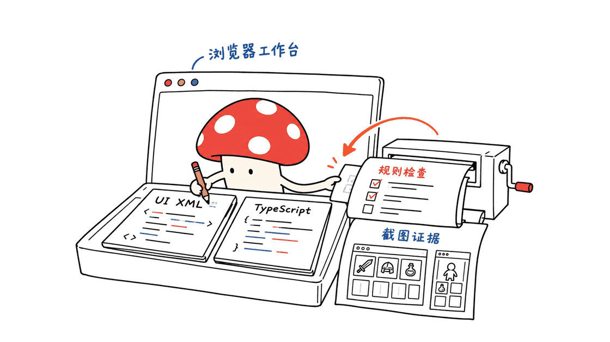
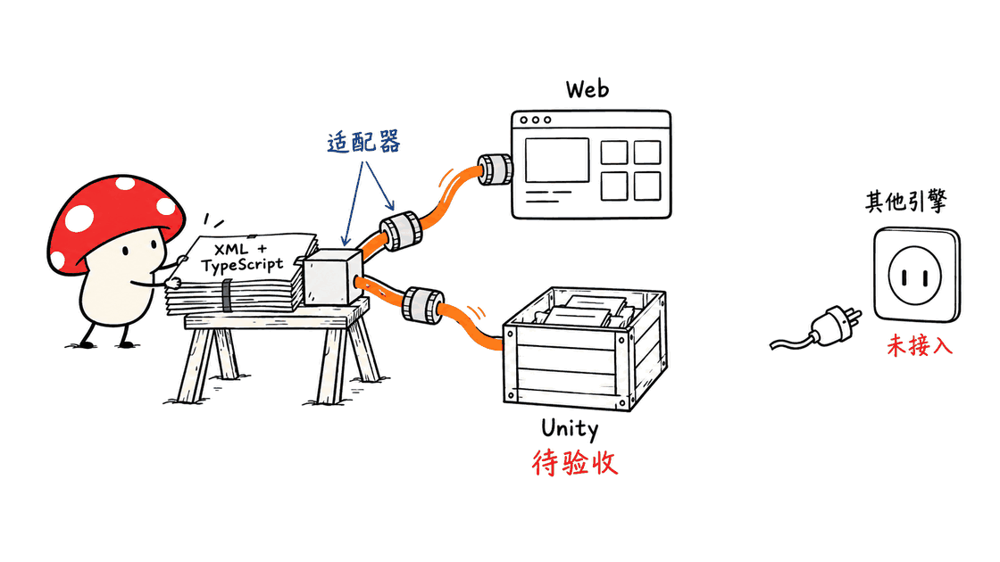
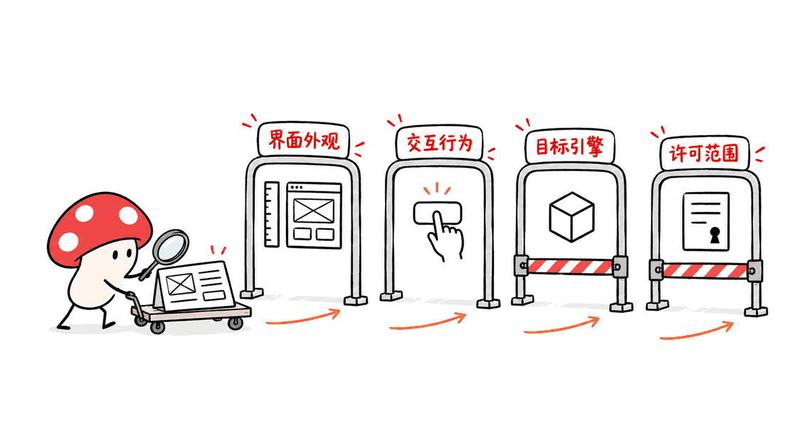

LGUI把游戏UI的日常开发搬进浏览器：Agent修改界面文件和TypeScript代码，再运行检查、测试与截图命令。它让界面制作更容易被编程工具接管，接入实际游戏时仍要处理引擎适配与发布要求。

项目来自LumioGames，源码仓库是 `LumioGames/LGUI`。当前许可为PolyForm Shield加额外授权，允许制作商业游戏，但限制竞争性UI框架和开发工具用途，不能当成MIT或Apache式的宽松开源项目。

仓库：https://github.com/LumioGames/LGUI

在线示例：https://lumiogames.github.io/LGUI/

官网：https://lumio.games/

本次核查日期为2026年10月31日，固定到提交 `6b448511409861bdea68c5958e09b220a8d8ccfa`。主分支插件版本是0.3.0，但CHANGELOG把它标为“未发布”，并说明它与0.2.0不兼容。以下讨论针对这份源码，不把它包装成已经完成稳定发布的版本。

封面采用官方背包示例的横竖屏展示图。

## 什么工作真正离开了游戏引擎？

传统游戏UI研发经常需要在编辑器里摆控件、修改脚本，再启动工程观察结果。LGUI将日常操作组织成文件和命令，让Agent能够读懂输入，也能取得明确的检查结果。

| 层次 | 源文件或接口 | 承担的工作 |
|---|---|---|
| 界面 | `ui/`，FairyGUI格式 | 控件、布局、图片、动效与横竖屏版本 |
| 业务 | `src/`，TypeScript MVC | 数据、视图绑定、动作与服务访问 |
| 文本 | `i18n/` | 翻译、格式化和语言切换 |
| 验证 | 检查、测试、截图命令 | 规则诊断、流程执行与视觉复核 |
| 发布 | backend与Unity导出 | 将同一份源文件接到运行环境 |

这里不是“写一段任意HTML，再自动转换成Unity界面”。它要求使用规定的FairyGUI数据格式和`lgui`接口，通过不同后端解释与运行。要保持业务代码可迁移，就需要遵守这套结构。

这种做法的实际价值，是缩短“改文件—看结果”的路径，并让审查有可复核的产物。是否更快完成整个游戏，仍取决于素材、交互复杂度和引擎接入成本。



## 为什么它强调Agent，而不只是一个UI编辑器？

仓库提供五个Skill，分别负责安装配置、界面、代码、验证和Unity迁移。命令支持JSON输出，诊断包含错误码、文件位置与修复提示，适合Agent把结果继续作为下一步输入。

| Skill | 主要工作 |
|---|---|
| `lgui-setup` | 检查环境、创建工程、开启预览 |
| `lgui-ui` | 处理界面XML、布局、美术切图与动效 |
| `lgui-code` | 编写Model、View、Controller、Service和测试 |
| `lgui-verify` | 执行测试、截图和调试快照 |
| `lgui-unity` | 导出并检查Unity接入流程 |

它还带有可保存回`ui/`的可视化编辑器。源码所述的美术切图工具，可以把生成的图集拆成控件素材；这不等于框架自带一个无需模型费用的图片生成服务。

更值得关注的是验证分工：`check`检查约束，`test`在headless后端执行交互流程，`verify`在真实浏览器中截图。静态规则无法证明视觉正确，截图也不能替代完整交互测试，三者要一起使用。

Skill目录：https://github.com/LumioGames/LGUI/tree/main/plugin/skills

## 本地到底跑通了哪些步骤？

本次使用Apple M4、16GB内存、macOS 26.6.2、Node 26.10.0与已安装的Chrome，在独立临时目录检出仓库，没有把插件全局安装到日常Agent环境。

| 检查 | 实际结果 | 范围 |
|---|---|---|
| `doctor --json` | 通过 | Node、平台、随插件工具与浏览器 |
| 仓库发布面检查 | 通过 | 目录、相对链接与生成清单一致性 |
| 背包示例 `check` | 0错误、0告警 | TypeScript及UI、MVC等规则 |
| 背包示例 `test` | 18通过、0失败 | headless交互测试，3个测试文件 |
| 背包示例 `verify --view BagView` | 8张截图，0页面脚本错误 | 桌面、超宽屏、手机和平板等尺寸与方向 |

示例测试覆盖分类排序、使用和出售道具、长按分解、奖励、语言切换等逻辑。其中服务由本地模拟或测试替身提供，不能据此证明真实支付、多人服务器或线上网络链路已经接通。

截图中可看到：横屏采用物品列表和详情左右分栏，竖屏则上下排列；手机安全区也被纳入截图配置。但这些是桌面Chrome中的尺寸模拟，不是iPhone或安卓真机兼容性测试。

本次另执行了一组上游单元、规则和示例端到端测试：共500项，499通过、0失败、1跳过。它不是仓库完整测试集，结果也不等于Unity真机验证。没有运行完整Unity构建与Player验收，也没有复现官方“30分钟完成”案例的效率数字。

## 怎么在Mac上开始？

官方声明需要Node 24或以上，以及Chrome或Edge。TypeScript、esbuild、sharp、OpenFairyGUI和playwright-core等工具随插件提供。本次环境检查实际加载成功；它们是依赖，并不是框架完全没有依赖。

对于只想看现有示例的人，可以先走源码路径：

```bash
git clone --depth 1 https://github.com/LumioGames/LGUI.git
cd LGUI
# 本文核查的提交；以后拉取到新版时先核对CHANGELOG和LICENSE
node plugin/tools/lgui.mjs doctor --json
node scripts/sync-examples.mjs
cd examples/inventory
node ../../plugin/tools/lgui.mjs check --json
node ../../plugin/tools/lgui.mjs test --json
node ../../plugin/tools/lgui.mjs verify --view BagView --json
node ../../plugin/tools/lgui.mjs dev --no-open
```

预览地址以命令输出为准；结束后用Ctrl+C关闭服务。示例需要先同步框架副本，普通新建工程则走`init`流程，不能漏掉这两种场景的区别。

Mac不需要为了这条网页验证流程先装Unity，也没有官方“大显存Mac Studio起步”的要求。不过，本次16GB机器跑通不代表测出了项目的最低内存配置。

想长期接入Claude Code或Codex时，再按官方README安装插件并开启新会话。插件安装和使用模型可能涉及不同的环境及费用，浏览器示例本身不是本地大模型。

## 同一份UI怎样接到Unity？

LGUI将业务代码约束在`lgui`API之上，再由后端处理平台差异。当前官方列出的状态需要分开看：

| 后端 | 当前用途与状态 |
|---|---|
| Web/H5 | 日常预览与截图，本次已运行 |
| Headless | Node交互测试，本次已运行 |
| Unity | 已接入，0.3.0 API仍在核查；本次未运行Unity |
| Cocos、LayaAir、Unreal等 | 有适配思路，尚未提供对应LGUI后端 |

Unity路径指定Unity 6000.6.x和PuerTS Core/V8 3.0.3。`lgui unity export`导出界面包、图集、翻译、脚本及启动场景，**只导出文件，不会直接完成Unity构建或生成PuerTS原生桥。**

后续仍需Unity导入与运行验证。官方Windows IL2CPP流程还要求相应构建支持、原生桥生成以及MSVC、Windows SDK等环境，不能把Mac上的网页检查写成Windows成品已经通过。

此外，当前Unity后端没有WebSocket支持，会报告`LGUI-RT-001`。这对需要实时联网的界面有实际影响。FairyGUI有多个引擎运行时，也不等于LGUI已经为那些引擎完成适配。

Unity接入说明：https://github.com/LumioGames/LGUI/blob/main/plugin/references/unity.md



## 当前许可允许做什么？

当前LICENSE明确将LGUI定义为源码可用项目。附加授权允许用它开发自己的游戏、应用、网站等产品，包括商业产品；非竞争限制针对提供相同或近似能力的UI框架、工具包、编辑器、UI资产管线与游戏开发工具，免费提供也不自动豁免。

做一款使用LGUI的游戏，与把它改名做成另一套UI开发平台，是不同用途。将其内置到自有引擎或开发工具时，官方要求另外联系授权；公开fork与贡献也不等于可以独立营销该fork。

商标和第三方组件另有边界。可以真实说明产品使用LGUI，但不能把LGUI、Lumio或LumioGames的名称与标志当成自己的品牌；随插件提供的第三方代码保留各自许可。

更新记录说明，换许可前按MIT发布的提交和版本继续遵循原MIT。不能因此把最新主分支也写成MIT。分发相关内容时，还应保留LICENSE要求的通知：

> Required Notice: Copyright © 2026 LumioGames (https://lumio.games)
>
> Required Notice: LGUI is licensed under the PolyForm Shield License 1.0.0 with an Additional Permission and a Trademarks notice from LumioGames. See https://github.com/LumioGames/LGUI/blob/main/LICENSE

许可原文：https://github.com/LumioGames/LGUI/blob/main/LICENSE

第三方说明：https://github.com/LumioGames/LGUI/blob/main/plugin/THIRD_PARTY_NOTICES.md

## 哪些团队适合先试？

更适合先试的是有明确背包、商店、任务或弹窗需求，希望让Agent参与修改，又愿意维护TypeScript与测试的团队。先做一屏有列表、按钮、确认框和失败状态的完整流程，比只看一张漂亮截图更能评估价值。

验收时可以依次看四件事：界面是否符合设计，交互是否正确，目标引擎能否稳定运行，以及当前许可是否覆盖产品用途。前两项可以提前到浏览器完成，后两项仍要独立确认。

素材提到的DS服务器、8人联机和后续SDK属于更大的产品链路。本次没有对这些服务进行端到端核验，不用它们替LGUI的联网与发布能力背书。

如果需要更完整的游戏生成管线，可结合GameFactory-3A调研；像素特效制作则可参考pixelfx。它们分别处理不同环节，本次没有验证三者已经集成。

https://blog.mushroom.cv/blog/gamefactory-3a-open-source-coding-agent-game-generation-ue5-blender-unity/

https://blog.mushroom.cv/blog/pixelfx-pixel-effects-guide/



## 常见问题

### LGUI是否完全不需要游戏引擎？

网页界面的制作、预览和Node测试可以不打开引擎。接入Unity游戏仍需要对应版本、PuerTS及引擎构建流程，其他引擎还要完成后端适配。

### 能直接把网页结果当成手机游戏验收吗？

不能。浏览器尺寸模拟能提前发现布局问题，但触摸、系统字体、性能和实际设备行为，还需要目标设备与目标引擎验证。

### 当前代码是否是MIT开源？

不是。此次检查的主分支使用PolyForm Shield加附加授权，存在竞争性用途限制。旧MIT版本与最新代码要分别核对，不应混用许可结论。

---

> © 2026 Author: Mycelium Protocol. 本文采用 [CC BY 4.0](https://creativecommons.org/licenses/by/4.0/deed.zh) 授权——欢迎转载和引用，须注明作者姓名及原文链接，不得去除署名后以原创发布。

<!--EN-->

LGUI moves everyday game UI authoring into the browser. An agent edits interface files and TypeScript, then runs checks, tests and screenshots. Shipping inside a game still requires backend integration and the target engine's release process.

LumioGames publishes the source as `LumioGames/LGUI`. The current license is PolyForm Shield plus additional permission, allowing commercial games while restricting competing UI frameworks and development tools. It is not an MIT/Apache-style permissive release.

Repository: https://github.com/LumioGames/LGUI

Demo: https://lumiogames.github.io/LGUI/

Company: https://lumio.games/

This review pins `6b448511409861bdea68c5958e09b220a8d8ccfa`, checked October 31, 2026. The plugin identifies itself as 0.3.0, but the changelog marks that version unreleased and incompatible with 0.2.0. The article reviews that source snapshot, not a confirmed stable 0.3 release.

The cover is the official inventory example's orientation showcase.

## What actually moves outside the engine?

| Layer | Source/interface | Responsibility |
|---|---|---|
| UI | FairyGUI-format `ui/` | Controls, layout, assets, motion and orientation variants |
| Business logic | TypeScript MVC in `src/` | Data, bindings, actions and services |
| Text | `i18n/` | Localization and formatting |
| Verification | Check, test and screenshot commands | Diagnostics, flows and visual review |
| Delivery | Backends and Unity export | Target-runtime integration |

This is not arbitrary HTML automatically converted into Unity screens. The workflow uses a defined FairyGUI format and the `lgui` API. Backends interpret those shared inputs, and portable business code must follow the framework's boundaries.

The useful change is a shorter, inspectable edit-and-review loop. Overall game-development speed still depends on assets, interaction complexity and engine integration.


## What makes it useful to an agent?

Five skills cover setup, UI, code, verification and Unity migration. Commands expose JSON results with error codes, file locations and suggested fixes, so the agent can inspect the result of its work.

| Skill | Responsibility |
|---|---|
| `lgui-setup` | Environment, projects and previews |
| `lgui-ui` | XML, layout, slicing and transitions |
| `lgui-code` | Models, views, controllers, services and tests |
| `lgui-verify` | Tests, screenshots and snapshots |
| `lgui-unity` | Unity export and validation workflow |

A visual editor saves into `ui/`; art tools slice prepared image sheets. Those tools do not establish a bundled, free image-generation service.

Verification has distinct layers: `check` enforces rules, `test` executes flows in a headless backend and `verify` captures real-browser screenshots. None substitutes for the others.

Skills: https://github.com/LumioGames/LGUI/tree/main/plugin/skills

## What ran locally?

Checks used Apple M4, 16 GB RAM, macOS 26.6.2, Node 26.10.0 and installed Chrome in an isolated checkout. No global agent plugin installation was performed.

| Check | Result | Scope |
|---|---|---|
| Doctor | Passed | Runtime, platform, bundled tools and browser |
| Repository release-surface check | Passed | Directories, links and generated manifests |
| Inventory `check` | Zero errors/warnings | TypeScript and UI/MVC rules |
| Inventory `test` | 18 passed, zero failed | Three headless flow-test files |
| BagView browser verification | Eight screenshots, zero page-script errors | Desktop, ultrawide, phone and tablet dimensions/orientations |

Tests include sorting, using/selling items, long-press dismantling, rewards and language changes. Services are local simulations or test doubles, not proof of production payments or multiplayer networking.

Screenshots show side-by-side inventory/details in landscape and stacked layout in portrait. Safe-area configuration is included, but desktop Chrome emulation is not actual iPhone or Android testing.

A selected upstream unit/rule/example suite reported 500 tests: 499 passed, zero failed and one skipped. This was not the full repository suite or a real Unity runtime test. No Unity Editor/IL2CPP/Player acceptance or vendor 30-minute productivity claim was reproduced.

## How does a Mac user start?

The declared requirement is Node 24 or newer and Chrome/Edge. TypeScript, esbuild, sharp, OpenFairyGUI and playwright-core are bundled dependencies; this review verified loading them on the tested host.

```bash
git clone --depth 1 https://github.com/LumioGames/LGUI.git
cd LGUI
# Review CHANGELOG and LICENSE if the fetched version differs from this review.
node plugin/tools/lgui.mjs doctor --json
node scripts/sync-examples.mjs
cd examples/inventory
node ../../plugin/tools/lgui.mjs check --json
node ../../plugin/tools/lgui.mjs test --json
node ../../plugin/tools/lgui.mjs verify --view BagView --json
node ../../plugin/tools/lgui.mjs dev --no-open
```

Use the printed preview URL and stop the server with Ctrl+C. Repository examples first need framework synchronization; ordinary new projects use `init` instead.

The browser workflow does not require installing Unity or purchasing a high-memory Mac Studio. The tested 16 GB host does not establish a minimum RAM specification. Persistent Claude Code/Codex integration follows the official plugin setup and requires a new session; model usage can have separate costs.

## What does Unity integration still require?

| Backend | Current position |
|---|---|
| Web/H5 | Preview/screenshots; exercised here |
| Headless | Node flow tests; exercised here |
| Unity | Connected, with 0.3.0 API validation ongoing; not run here |
| Cocos, LayaAir, Unreal and others | Adapter paths discussed, corresponding LGUI backends not implemented |

The documented Unity path targets 6000.6.x and PuerTS Core/V8 3.0.3. `unity export` produces UI packages, atlases, translations, scripts and a boot scene. It exports files; it does not run a Unity build or generate the PuerTS native bridge.

The subsequent Windows IL2CPP process requires engine build support, native bridge generation and the appropriate MSVC/Windows SDK environment. A passing browser run on Mac does not validate a Windows executable.

The Unity backend also lacks WebSocket support and reports `LGUI-RT-001`. Existing FairyGUI runtimes for other engines do not establish completed LGUI adapters.

Unity guide: https://github.com/LumioGames/LGUI/blob/main/plugin/references/unity.md


## What does the current license permit?

The additional permission allows using LGUI within one's own games, apps, websites and other products, including commercial ones. Competitive-use restrictions concern similar UI frameworks, toolkits, editors, UI asset pipelines and game-development tools, including free or rebranded products.

Making a game with LGUI differs from marketing a competing development platform. Embedding it into an engine or development tool may require a separate license. Permission to fork and contribute does not automatically permit independently marketing the fork.

Trademarks and third-party components have separate terms. Earlier MIT releases remain under their original terms according to the changelog; that does not make the current branch MIT. Preserve required notices when distributing relevant content:

> Required Notice: Copyright © 2026 LumioGames (https://lumio.games)
>
> Required Notice: LGUI is licensed under the PolyForm Shield License 1.0.0 with an Additional Permission and a Trademarks notice from LumioGames. See https://github.com/LumioGames/LGUI/blob/main/LICENSE

License: https://github.com/LumioGames/LGUI/blob/main/LICENSE

Third-party notices: https://github.com/LumioGames/LGUI/blob/main/plugin/THIRD_PARTY_NOTICES.md

## Who should try it first?

Teams with inventory, shop, quest or popup requirements, comfortable with TypeScript and maintained tests, can evaluate a complete small flow. Include list selection, confirmation and failure states instead of judging only a polished static screen.

Review the UI, interaction logic, target runtime and licensed use separately. Browser tooling can bring the first two forward; it does not complete the latter two.

The submitted material's DS server, eight-player demo and future networking SDK belong to a broader product chain and were not validated here. They are not evidence of LGUI networking completeness.

Related reviews cover GameFactory-3A's wider game-generation pipeline and pixelfx's pixel effects. No combined integration was tested.

https://blog.mushroom.cv/blog/gamefactory-3a-open-source-coding-agent-game-generation-ue5-blender-unity/

https://blog.mushroom.cv/blog/pixelfx-pixel-effects-guide/


## FAQ

### Does LGUI eliminate the game engine?

UI authoring, browser preview and Node tests can happen outside it. Unity shipping still needs its engine, PuerTS and build workflow; other engines need adapters.

### Do browser screenshots validate the mobile game?

No. They expose layout issues early. Device input, fonts, performance and target-runtime behavior need further validation.

### Is the current source MIT?

No. The inspected branch uses PolyForm Shield plus additional permission with competitive-use restrictions. Check earlier MIT versions separately from current code.

---

> © 2026 Author: Mycelium Protocol. Licensed under [CC BY 4.0](https://creativecommons.org/licenses/by/4.0/) — free to share and adapt with attribution. You must credit the author and link to the original; removing attribution and republishing as original is not permitted.
