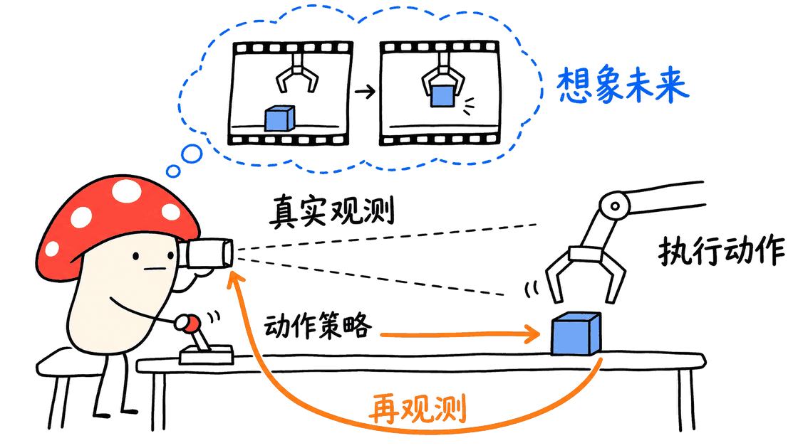

LingBot 不是一个能直接接管所有机器人的单一模型，而是灵波科技 Robbyant 发布的一组具身智能研究模型。它们覆盖视觉表征、深度补全、三维重建、动作策略、世界预测和视频生成。选型的第一步，是分清想解决的是“看清环境”“生成未来”还是“输出动作”。

截至 2026 年 11 月 5 日，本次在 Robbyant 官方组织下核对到 9 个名称含 LingBot 的公开仓库。官网还介绍了若干 2.0 版本，但官网演示、论文、代码和权重的发布进度并不完全一致。**生态复用值得关注，具体能部署什么仍要按仓库、版本和许可证逐一确认。**

## 先看完整地图：七类能力，九个仓库

| 能力 | 对应模型与仓库 | 主要用途 |
| --- | --- | --- |
| 视觉骨干 | `lingbot-vision` | 输出图像特征，供分割、深度等下游任务使用 |
| 空间深度 | `lingbot-depth` | 改善缺失、透明或反光表面的深度感知 |
| 流式三维重建 | `lingbot-map` | 从连续图像恢复深度、相机位姿与场景几何 |
| 视觉语言动作 | `lingbot-vla`、`lingbot-vla-v2` | 按图像、语言及机器人状态预测动作块 |
| 视频动作模型 | `lingbot-va` | 联合未来视频预测与动作推断，支持闭环研究 |
| 可交互世界 | `lingbot-world`、`lingbot-world-v2` | 根据条件与控制生成连续变化的视频世界 |
| 视频生成 | `lingbot-video` | 图像、视频生成及具身场景的视频预训练 |

代码总入口：https://github.com/Robbyant

模型与论文导航：https://technology.robbyant.com/

这张地图不是一条已经接通的流水线。不同项目的输入、相机布局、动作空间和运行环境需要额外对齐，不能把同一品牌名称当成接口兼容的证明。


## 视觉、深度与地图：先解决“看到了什么”

LingBot-Vision 是视觉编码器。它通过边界相关的自监督学习获得密集特征，提供 Small、Base、Large、Giant 等骨干。本次实际运行的 Small 约 2,160 万参数；公开的 `model.pt` 是骨干权重，不包含所有下游任务头。拿到特征张量，并不等于已经得到准确的深度图或机器人动作。

仓库：https://github.com/Robbyant/lingbot-vision

轻量权重：https://huggingface.co/robbyant/lingbot-vision-vit-small

LingBot-Depth 面向空间深度建模，尤其关注真实传感器在透明、反射和缺失区域的困难。官网与 Vision 仓库还介绍了以 LingBot-Vision 初始化视觉编码器的 Depth 2.0。应区分原 Depth 仓库、Depth 2.0 的论文介绍和 Vision 的骨干权重，不能把它们视为同一个可直接替换的文件包。

仓库：https://github.com/Robbyant/lingbot-depth

模型集合：https://huggingface.co/collections/robbyant/lingbot-depth

LingBot-Map 处理连续画面下的流式三维重建，适合需要场景几何、位姿和点云的研究。它关注长视频逐帧处理，与在地图上规划机器人运动仍是不同层次；点云看起来完整也不能证明定位闭环、尺度和控制精度已满足产品要求。

仓库：https://github.com/Robbyant/lingbot-map

权重：https://huggingface.co/robbyant/lingbot-map

## VLA 与 VA：动作策略和未来预测有什么区别？

LingBot-VLA 直接面向视觉、语言与动作策略学习。1.0 仓库提供训练、后训练和评测入口，介绍了约 2 万小时、9 类双臂配置的预训练数据。它更适合研究“给定指令与观测，下一段动作该怎么做”。

仓库：https://github.com/Robbyant/lingbot-vla

LingBot-VLA 2.0 有独立仓库和 6B 级权重，加入跨具身的统一表达、动作专家及感知相关训练。其 55 维规范化状态/动作空间是模型接口设计，不表示任意机器人都有 55 个自由度，更不表示新硬件无需校准就能执行。

仓库：https://github.com/Robbyant/lingbot-vla-v2

权重：https://huggingface.co/robbyant/lingbot-vla-v2-6b

LingBot-VA 则将视频预测与动作推断组织到同一自回归框架中。对它的理解不应停在“先幻想一段视频再照做”：真实观测需要持续参与闭环，动作、视觉历史和缓存的更新方式影响部署效果。仓库公开了 RoboTwin、LIBERO 相关推理与后训练入口。

仓库：https://github.com/Robbyant/lingbot-va

基础权重：https://huggingface.co/robbyant/lingbot-va-base

官网另有 LingBot-VA 2.0 页面，描述原生视频动作预训练和异步执行；目前对应页面主要提供技术报告。本次仓库根目录确认有 VA2 论文，但 README 下载表仍以原有 base、RoboTwin 与 LIBERO 权重为主。因此，不能仅凭 2.0 的演示页面，就声称已经取得完整的 VA2 部署代码和权重。

VA2 介绍：https://technology.robbyant.com/lingbot-va-v2

## World 与 Video：能生成世界，不等于能可靠控制机器人

LingBot-World 1.0 从视频生成走向可控制的世界模拟，提供 Base 和 Fast 等模型入口。它适合研究画面如何随相机或动作条件演化。

仓库：https://github.com/Robbyant/lingbot-world

LingBot-World 2.0 / Infinity 有独立仓库，公开 14B 的 causal-fast、causal-pretrain、bidirectional，以及 1.3B causal-fast 变体。1.3B 包当前主要包含 DiT，需要共享的 T5、VAE、tokenizer 等配套资源，不能只看参数量就估算完整部署成本。

仓库：https://github.com/Robbyant/lingbot-world-v2

轻量变体：https://huggingface.co/robbyant/lingbot-world-v2-1.3b-causal-fast

该仓库明确说明不会发布其内部部署代码，并指向 SGLang、NVIDIA flashdreams 等部署实现。公开脚本的多卡配置、发布者的实时演示和社区优化方案属于不同条件，不能合并成“随便一台电脑都能实时运行”。生成的视频即便连贯，也还需要另外检验物理一致性和控制用途。

LingBot-Video 是视频生成与预训练路线，提供 Dense 1.3B、MoE 30B-A3B 及相关蒸馏变体。MoE 的活跃参数量与需要存放的全部权重不是一回事；Video 模型也不能直接当作可执行的机器人策略。

仓库：https://github.com/Robbyant/lingbot-video

轻量权重：https://huggingface.co/robbyant/lingbot-video-dense-1.3b



## 海外复用的几条说法，分别核实到了哪里？

斯坦福 OpenWAM：组件复用可以核实。 本次检查的是斯坦福项目页面链接的 `OpenWAM/OpenWAM`，不要与另一个 `OpenWAM-Official/OpenWAM` 混淆。其训练文档明确从 LingBot-VA base 取用参考 Transformer 格式、文本编码器和 tokenizer，并结合 Wan2.2 的视觉资源。这证明了组件复用，不表示 OpenWAM 就是给 LingBot 改个名字。

项目：https://openwam.stanford.edu/

代码：https://github.com/OpenWAM/OpenWAM

证据：https://github.com/OpenWAM/OpenWAM/blob/main/docs/pretraining/training.md

KAIST 与成均馆大学：论文数字可以核实，但“单步”需要解释。 FastOPD 论文在 RoboTwin 2.0 上比较轻量学生与 LingBot-VLA 教师。下表是论文的作者结果，不是本次重跑：

| 方法 | 参数规模 | NFE | Clean / Random 平均成功率 |
| --- | --- | --- | --- |
| 基础 SmolVLA 学生 | 450M | 1 | 35.3% |
| LingBot-VLA 教师 | 4.2B | 10 | 85.8% |
| FastOPD 学生，以 LingBot-VLA 为教师 | 451M | 1 | 51.2% |

这里增加的是 **15.9 个百分点**。NFE=1 表示策略采样/去噪中的一次函数评估，并非“机械臂单次物理动作有 51.2% 成功概率”。成功率对应任务评测；学生也没有因此追平 85.8% 的教师。论文与项目页可读，但项目页的代码入口仍标为 TBA。

论文：https://arxiv.org/abs/2610.02832

项目：https://fastopd.github.io/

LeRobot 与 timm：上游接口证据可以核实。 LeRobot 已有 LingBot-VA 和 LingBot-VLA 2.0 的官方策略文档，覆盖训练、评估和处理器接口；timm 的 `eva.py` 有 LingBot-Vision 模型入口与预训练配置。它们分别对应动作策略接入和视觉骨干接入，不是整个 LingBot 家族都进入同一个库。

LeRobot VA：https://huggingface.co/docs/lerobot/main/lingbot_va

LeRobot VLA2：https://huggingface.co/docs/lerobot/main/en/lingbot_vla_v2

timm 代码：https://github.com/huggingface/pytorch-image-models/blob/main/timm/models/eva.py

AMD 大会演示：场次与配置仍需保留核验边界。 可追溯到 Robbyant 官方账号的 9 月 5 日贴文，其公开镜像谈的是 IFA Berlin 开幕演示，而非素材里的 PyTorch 北美大会。本次未取得 AMD 原始会场视频和同配置测试记录，因此不把该线索写成已验证的性能结论。

原帖入口：https://x.com/robbyant_brain/status/2096139745135137111

公开镜像核对：https://teapawt.org/robbyant_brain

## 具身大模型挑战赛，现在处于哪个阶段？

Robbyant 10 月 27 日的主办方新闻稿介绍，挑战赛以 LingBot-VLA 2.0 为基础，与魔搭和阿里云天池合作，登记超过 1,800 支队伍、覆盖 13 个国家，上海真机决赛计划在 11 月 14—16 日举行。

截至本文核验日 11 月 5 日，决赛尚未举行。报名数量属于主办方披露，不等于全部队伍完成真机验证。比赛的实际价值在于提供较统一的训练、仿真与真机适配场景，最终仍需看评测协议、提交产物和结果。

主办方新闻稿：https://www.businesswire.com/news/home/20261027768483/en/

## 开源许可证和部署成本，为什么要逐项看？

多数上述代码仓库标注 Apache-2.0，但 **LingBot-World 2.0 仓库明确采用 CC BY-NC-SA 4.0，包含非商业与相同方式共享条件**。不能把 World 1.0 的 Apache 声明沿用到 World 2.0。

代码、权重、训练数据与依赖教师模型也可能存在不同条款。比如 LeRobot 的 VLA2 文档分别列出训练时使用的教师及其许可。开源接口已适配，不代表许可证或硬件条件自动统一。

工程上还要对齐图像预处理、相机顺序、动作维度、归一化统计、控制频率和故障恢复。一个在模拟器中得到高成功率的 checkpoint，不能省略这些步骤就放上实体机器人。

## 本次上手：CPU 跑通了哪一部分？

本次选择成本较低的 LingBot-Vision Small，固定源码 `151e46321bae4399f8568829f190c7bdec216b49`，以及 Hugging Face 权重版本 `127cbcec380de0bcd55bdc1b1fad3819850a6514`。

本机为 macOS ARM64、PyTorch 2.14.0，使用 CPU、FP32、仓库自带示例图片和 224×224 输入。实际加载 188 个权重项，缺失与多余项均为 0；模型参数为 21,601,152，输出 `[1,196,384]`，对应 14×14 patch 网格，输出全部为有限值。

核心调用如下，`revision` 应使用上面的固定版本：

```python
backbone, dim = load_pretrained_backbone(
    variant="small", device="cpu", dtype=torch.float32,
    revision="127cbcec380de0bcd55bdc1b1fad3819850a6514",
)
tokens, grid = extract_patch_tokens(backbone, image, "cpu", torch.float32)
```

其中 `image` 是按仓库 `load_image` 预处理后的张量。运行依赖放在独立临时目录，没有替换现有 PyTorch；下载遇到 Xet 传输停滞后切换 HTTP 路径成功。

这只是一次真实预训练视觉骨干的加载与前向检查，不是分类、深度、地图精度或机器人成功率评测。本次没有运行世界模型视频生成，也未复现 FastOPD、真机控制或任何宣传吞吐。


对第一次接触 LingBot 的开发者，最合适的顺序是从一项可核验输出开始：视觉特征、深度或小段几何重建；需要动作学习再进入 LeRobot 的策略接口；世界模型则单独核算权重、配套编码器、显存与延迟。先跑通一条任务链路，再讨论是否需要组合整个模型家族。

## FAQ

### LingBot 是一个可以直接替代机器人整套软件的模型吗？
不是。它是一组不同任务的模型与研究代码，需要结合传感器、策略接口、控制器和评测环境适配。

### 35.3% 到 51.2% 是所有机器人都能获得的提升吗？
不是。这是 FastOPD 论文中指定 RoboTwin 设置、学生规模与 NFE 下的作者结果。

### 全部 LingBot 模型都可以按 Apache-2.0 商用吗？
不能这样概括。尤其 World 2.0 明确有非商业条款，代码、权重、数据与依赖还需分别检查。

---

> © 2026 Author: Mycelium Protocol. 本文采用 [CC BY 4.0](https://creativecommons.org/licenses/by/4.0/deed.zh) 授权——欢迎转载和引用，须注明作者姓名及原文链接，不得去除署名后以原创发布。

<!--EN-->

LingBot is a family of embodied-AI research models from Robbyant, not a single plug-in brain for every robot. Its repositories address visual features, depth, streaming geometry, action policies, world prediction and video generation. Choosing a project starts with the output required by the actual task.

As of November 5, 2026, nine official repositories with LingBot in their names were checked. Website demonstrations, papers, executable code and checkpoints do not always have the same release status.

## A map of the repositories

| Area | Repository | Purpose |
| --- | --- | --- |
| Visual backbone | `lingbot-vision` | Dense image features for downstream perception |
| Depth | `lingbot-depth` | Spatial depth modeling and difficult sensor regions |
| Streaming geometry | `lingbot-map` | Depth, poses and scene geometry from image sequences |
| Action policies | `lingbot-vla`, `lingbot-vla-v2` | Vision-language-state inputs to action chunks |
| Video-action modeling | `lingbot-va` | Coupled future-video and action prediction |
| Interactive worlds | `lingbot-world`, `lingbot-world-v2` | Conditioned, controllable video-world generation |
| Video generation | `lingbot-video` | Video pretraining and generation, including embodied scenes |

Organization: https://github.com/Robbyant

Official navigation: https://technology.robbyant.com/

This is a model map, not an already integrated pipeline. Inputs, camera layouts, action spaces and runtime dependencies still need alignment.


## Perception: Vision, Depth and Map

LingBot-Vision supplies Small, Base, Large and Giant visual backbones. Released `model.pt` files contain backbone weights rather than every downstream task head. The approximately 21.6M-parameter Small model checked here produces patch features, not robot actions or a complete depth solution.

Code: https://github.com/Robbyant/lingbot-vision

Small weights: https://huggingface.co/robbyant/lingbot-vision-vit-small

LingBot-Depth addresses spatial depth, including missing or difficult transparent and reflective regions. The Vision repository and official site also describe Depth 2.0 using a LingBot-Vision encoder. Keep the original Depth implementation, the newer research description and the visual backbone package distinct.

Code: https://github.com/Robbyant/lingbot-depth

Models: https://huggingface.co/collections/robbyant/lingbot-depth

LingBot-Map reconstructs streaming geometry from sequential imagery. Depth, poses and point clouds are useful outputs, but they do not by themselves establish a complete navigation or control stack, accurate scale or closed-loop localization.

Code: https://github.com/Robbyant/lingbot-map

Weights: https://huggingface.co/robbyant/lingbot-map

## Policies and video-action models

LingBot-VLA provides training and evaluation tools for action prediction. The first version reports pretraining with approximately 20,000 hours across nine dual-arm configurations. LingBot-VLA 2.0 has a separate repository and a 6B checkpoint. Its canonical 55-dimensional state/action representation is a model interface, not a claim that every robot has 55 physical degrees of freedom.

VLA: https://github.com/Robbyant/lingbot-vla

VLA 2.0: https://github.com/Robbyant/lingbot-vla-v2

VLA2 weights: https://huggingface.co/robbyant/lingbot-vla-v2-6b

LingBot-VA couples video prediction and action inference in an autoregressive framework, with RoboTwin and LIBERO post-training and inference entrypoints. Real observations must re-ground the loop; imagined futures alone do not establish correct execution.

Code: https://github.com/Robbyant/lingbot-va

Base weights: https://huggingface.co/robbyant/lingbot-va-base

The official VA 2.0 page describes native video-action pretraining and asynchronous execution, but currently mainly links a technical report. A VA2 paper exists in the repository, while the inspected README download table still lists the original base, RoboTwin and LIBERO packages. A research announcement is not proof of a complete VA2 deployment release.

VA2 page: https://technology.robbyant.com/lingbot-va-v2

## World and Video are different from controllers

LingBot-World provides controllable video-world research through Base and Fast variants. World 2.0, also called Infinity, has its own repository and 14B causal-fast, causal-pretrained and bidirectional variants, plus a 1.3B causal-fast release.

World: https://github.com/Robbyant/lingbot-world

World 2.0: https://github.com/Robbyant/lingbot-world-v2

Small World2: https://huggingface.co/robbyant/lingbot-world-v2-1.3b-causal-fast

The 1.3B package primarily contains DiT weights and needs shared T5, VAE and tokenizer assets. The repository explicitly says its internal deployment implementation will not be released and directs users to other serving implementations. Multi-GPU scripts, stage demonstrations and community optimizations have different conditions. Coherent generated video also does not guarantee physical accuracy.

LingBot-Video offers Dense 1.3B and MoE 30B-A3B routes, plus distilled variants. Active MoE parameters are not the total resident checkpoint, and a video generator is not an executable robot policy.

Video: https://github.com/Robbyant/lingbot-video

Dense weights: https://huggingface.co/robbyant/lingbot-video-dense-1.3b


## Which downstream claims hold up?

Stanford OpenWAM’s linked repository is `OpenWAM/OpenWAM`, distinct from another similarly named project. Its training documentation identifies LingBot-VA base as the reference transformer format and text assets, alongside Wan2.2 visual resources. This is concrete component reuse, not evidence that the frameworks are identical.

Stanford: https://openwam.stanford.edu/

Code and evidence: https://github.com/OpenWAM/OpenWAM/blob/main/docs/pretraining/training.md

FastOPD, from KAIST and Sungkyunkwan researchers, reports a RoboTwin 2.0 comparison: a 450M base student at one function evaluation averages 35.3% success; a 451M distilled student using LingBot-VLA as teacher reaches 51.2%. The 4.2B teacher at ten evaluations reaches 85.8%.

The gain is 15.9 percentage points. “Single-step” means NFE=1 in policy sampling/denoising, not a 51.2% chance of completing one physical robot movement. These are paper results, not a reproduction here. The project’s code link remains TBA at inspection.

Paper: https://arxiv.org/abs/2610.02832

Project: https://fastopd.github.io/

LeRobot documents LingBot-VA and LingBot-VLA 2.0 as policies with training, evaluation and processor integration. timm’s `eva.py` contains LingBot-Vision entrypoints and pretrained configurations. These are specific integrations, not all-family compatibility with every robot.

LeRobot VA: https://huggingface.co/docs/lerobot/main/lingbot_va

LeRobot VLA2: https://huggingface.co/docs/lerobot/main/en/lingbot_vla_v2

timm: https://github.com/huggingface/pytorch-image-models/blob/main/timm/models/eva.py

The AMD event claim needs a narrower status. A public mirror of Robbyant’s September 5 post points to an IFA Berlin demonstration, while the supplied material names a North American PyTorch event. The original AMD event video and matched configuration were not obtained, so no verified performance conclusion is drawn from it.

Original-post entry: https://x.com/robbyant_brain/status/2096139745135137111

Public mirror: https://teapawt.org/robbyant_brain

## Challenge and licensing

The organizer’s October 27 release reports over 1,800 teams from 13 countries for a LingBot-VLA 2.0 challenge with ModelScope and Alibaba Cloud Tianchi. The Shanghai real-robot final is scheduled for November 14–16, still in the future at this article’s November 5 cutoff. Registration is not evidence that every team completed a real-robot evaluation.

Organizer release: https://www.businesswire.com/news/home/20261027768483/en/

Most checked repositories declare Apache-2.0, but World 2.0 explicitly uses CC BY-NC-SA 4.0, including noncommercial and share-alike conditions. World 1.0’s license must not be carried over to the successor. Code, checkpoints, datasets and frozen teacher dependencies also need separate checks; LeRobot’s VLA2 documentation lists teacher-specific licenses.

## A real, limited CPU check

LingBot-Vision Small was loaded at source commit `151e46321bae4399f8568829f190c7bdec216b49` and checkpoint revision `127cbcec380de0bcd55bdc1b1fad3819850a6514`.

On macOS ARM64 with PyTorch 2.14.0, CPU and FP32, the repository example image was processed at 224×224. All 188 weight entries matched, with zero missing or unexpected entries. The 21,601,152-parameter model produced finite `[1,196,384]` patch tokens on a 14×14 grid.

Extra dependencies were isolated in a temporary directory. An initially stalled Xet transfer was replaced by the HTTP download path. This checks real pretrained weight loading and one feature-extraction forward pass; it does not measure classification, depth, map accuracy, robot success or generation throughput. No world model, FastOPD experiment or physical robot was run.


Start with one verifiable output, then choose the policy or generation path needed for the actual application. Camera order, normalization, action mappings, control rate and recovery behavior remain engineering work even when an upstream integration exists.

## FAQ

### Is LingBot a complete replacement for robot software?
No. It is a collection of models and research tools requiring sensors, controllers, interfaces and evaluation.

### Is the 35.3% to 51.2% gain universal?
No. It belongs to the paper’s specified benchmark, student and NFE conditions.

### Is the entire family Apache-2.0 for commercial use?
No. World 2.0 has explicit noncommercial terms, and assets and dependencies must be checked individually.

---

> © 2026 Author: Mycelium Protocol. Licensed under [CC BY 4.0](https://creativecommons.org/licenses/by/4.0/) — free to share and adapt with attribution. You must credit the author and link to the original; removing attribution and republishing as original is not permitted.
