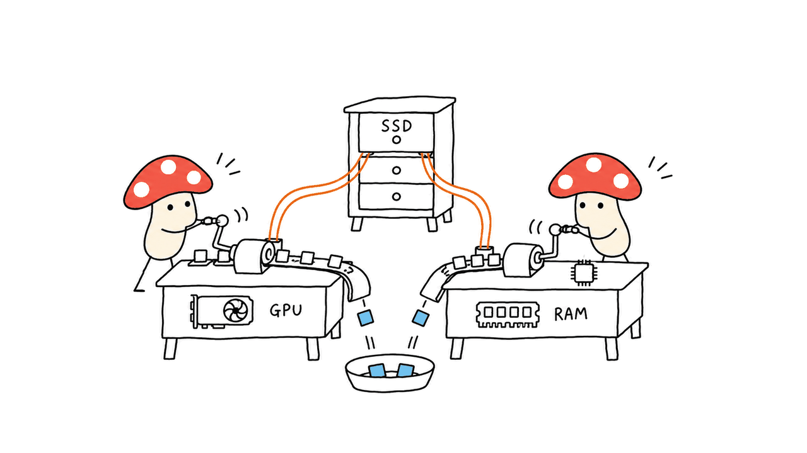

Linger把个人智能体和记忆放到自己的电脑上，PolyStrata则帮助大模型跨显存与内存运行。12GB显卡能承载125B模型的关键，是量化、稀疏计算和整机协作，仍需支付内存、等待时间与质量方面的代价。

截至2026年11月20日，我们核对了SimplexAI的两个官方仓库：Linger提交`8b8aea78`与PolyStrata提交`3e164216`。它们分别解决个人Agent的产品组织和本地推理问题，许可也不相同。

## 先把两个仓库分清楚

Linger包含桌面入口、服务端、连接本机的Computer组件、运行时接入、个人Wiki、记忆、任务和审批等。模型运行只是其中一环，产品还要安排谁执行任务、如何保存上下文、什么时候通知用户。

PolyStrata负责模型运行及兼容API。当前文档明确区分两条引擎路线：Qwen3.8-Flash-Next沿用Strata项目的引擎；另外11个模型使用为PolyStrata编写的`strata-poly`，文档仍将它们标为实验性支持。不同路线的模型支持、平台和参数不能直接互换。

这也意味着不能把所有底层能力都归为Linger从头独立实现。仓库致谢列出了Strata、Hindsight、Cua、LiveKit等项目，工程价值体现在集成、适配以及整套个人Agent的工作方式。

## 125B为什么不需要125B参数都放显存？

MoE每个token只选择部分专家参与计算，总参数量与当次激活量不同。PolyStrata的Qwen路线把常用专家放在显存缓存，CPU可以直接计算RAM中的其他专家，与GPU工作并行。

因此，不能把它完全理解成“每次都把选中的专家从SSD搬到GPU”。默认内存充足时，大量专家驻留RAM；GPU还承担注意力等公共计算、KV缓存及部分草稿生成。显存越大，通常能减少CPU承担的专家计算。

磁盘也不只有冷专家。Qwen路线的文档列出了约28.8GB的n-gram查找表，由SSD和系统缓存服务。内存不足、较大量化文件或启用受限专家池时，专家也可能按需从文件读入，读盘开销才会更加突出。

官方尺寸文档把Q2_0与IQ2_XS的RAM+VRAM需求列为约37.6GB和39.2GB，但下载包含其他部分，较小版本也约66—76GB，首次启动还可能补充MTP层。模型页建议约80GB可用磁盘。宣传中的“39GB”不能同时当成总下载量、总内存占用和显存要求。

## 45.5和179 tokens/秒，应该怎么读？

Linger README确实列出Qwen3.8-Flash-Next在RTX3060上的45.5、RTX5090上的179 tokens/秒，栏目是生成速度。该表没有为这两个单元格提供足够完整的对应量化、提示长度、并发和首字时间，不能据此当作人人可复现的端到端体验。

PolyStrata保存了一份更详细的社区记录，可帮助理解同型号显卡的变化。它不是我们自己的测试，也不能仅凭数字相同，就断定是宣传表的原始来源。

| 2026年10月9日社区记录 | 生成速度 | 首字等待 |
|---|---:|---:|
| RTX3060 12GB、i7-12700、64GB RAM，IQ2_XS，4K提示 | 45.5 tokens/秒 | 约5.0秒 |
| 同配置，32K提示 | 40.8 tokens/秒 | 约35.4秒 |
| 同配置，约128K提示 | 37.6 tokens/秒 | 约143.6秒 |

这份Windows、Strata0.1.41记录给出了三次有效运行的中位数及范围，还注明量化版本的放置策略不同、存在GPU热降速。它支持“实际消费显卡可以运行”的判断，同时说明上下文越长，看到第一个字前可能等得越久。

另一个容易混淆的表来自Linger的自动规划文档：“Linux NVIDIA12GB+32GB”使用的是96GB显卡限制到12GB预算、内存限制到28GB的模拟配置。该记录短提示生成约21.3 tokens/秒，62K提示后约34.1，首字约3分钟。它既不是RTX3060实测，也不能拿来直接否定另一配置的45.5。

对Personal Agent而言，一轮任务可能包含读提示、生成思考、调用工具、等待结果和多次重试。生成速度只覆盖其中一段。完整完成时间、首字延迟与成功率，比单个最高tokens/秒更接近用户感受。

## 量化与“Claude级能力”还隔着什么？

能装下模型，不代表压缩后的质量等于原始权重。模型、量化方式、上下文和任务类型都应一起记录。官方还区分保留全部专家的版本与裁掉部分专家的Coder版本，后者在代码以外和部分语言任务上的表现不能直接沿用完整模型结论。

Linger的SimplexAI分数及“接近某云模型”是它的选型尺度，不是我们对所有任务的等效认证。README中有些宣传图的推荐与正文更新后的配置也不同，应优先核对当前文字表格和条件说明。

同样，Mac支持不等于16GB Mac能舒适运行125B。Linger目前给16GB档推荐的是4B级模型；部分Mac档速度是在更大、更快的Mac上调整规划预算得到，文档明确说常见设备会慢一些。

## 本地个人Agent的价值在哪里？

Linger把邮件、会议、文件和对话整理为共享记忆，再让不同Agent查找；主动通知、后台任务和交互任务共享运行资源。它的调度文档尤其强调：同一个模型多接一项工作，可能拖慢已有工作，因此需要优先级、并发调节和后台让路。

对个人产品，这种资源治理很关键。用户正在等一句回复时，不能让后台整理Wiki一直占满本机。记忆写入也要有来源、更新和复核机制，才能避免把一次误解变成长期事实。

“本地”还需要按实际配置判断。Linger支持Local、Subscription和BYOK；本地推理可以避免云端token费用，但订阅运行时或远程BYOK仍可能把相关输入发送到远程。官方文档说明，后台记忆与Wiki也受所选运行时和默认端点影响。

这不是否定本地部署的价值。它让用户可以选择模型、保留资产和管理连接，只是是否离线、哪些数据出机，应根据连接器和端点逐项核对，不能只看宣传标题。

## 开放源码，能直接拿去做托管服务吗？

PolyStrata仓库采用MIT，模型文件及部分组件另有各自许可。Linger本体的LICENSE则写明：它基于Apache2.0增加条件，对向组织外用户提供托管或代管服务，以及移除或修改前端标识等情况，要求商业许可或相关授权。

因此，Linger源码可以查阅和部署，但不能把它的许可写成没有附加限制的原版Apache2.0。企业内部使用、对外托管、去品牌前端与只调用后端，要对照许可条文分别判断。这里描述的是仓库公开条件，不代替具体使用场景的许可确认。

## 我们实际验证了什么？

Mycelium Protocol在本机运行了PolyStrata原仓库三个测试模块：`serve.test_models`、`serve.test_context_overflow`与`serve.test_vram`，50项测试全部通过。

它们覆盖模型注册与切换、上下文超限时兼容接口的报错、显存调整命令和HTTP路由。部分用例启动本地HTTP服务，但底层使用模拟引擎和合成GGUF元数据；通过测试不代表真实GPU缓存和显存分配已经验证。

本次没有下载125B权重，没有复现CUDA、HIP或Metal推理速度，没有测试完整Linger桌面、邮件操作、长期记忆或LoCoMo成绩。我们确认的是公开代码的一部分服务行为，并核对官方与社区材料的条件边界。

## 工程师可以怎样开始？

先按实际剩余内存选一个小模型，跑通一项可撤销的本地任务，再决定是否下载大模型。将模型版本、量化、CPU、RAM、显卡、上下文、提示缓存、MTP、并发与磁盘冷热状态记下来。

验收至少分四项：冷启动与首字等待；开始生成后的速度；相同任务的质量；多轮工具调用的完成时间。再让一个后台记忆任务同时运行，观察交互是否被拖慢。更大参数量只有在这些指标上改善了目标任务，才值得增加占用。

参考官方安装说明时也要区分组件：Docker Compose主要运行Linger服务，模型与Agent运行在连接的电脑上。服务器启动成功，不等于模型已经加载，更不等于本地Agent已经能执行任务。

## FAQ

### 没有64GB RAM，只有12GB显卡，能照抄125B配置吗？

不能仅按显存判断。模型版本、空闲RAM与磁盘读取共同决定可行性。官方为较低内存准备了其他推荐，低内存读盘模式也可能显著降低速度。

### 专家分层会自动保留原始模型质量吗？

需要区分放置、量化、裁剪和投机解码。正确放置可保留计算含义，但量化和裁剪可能改变模型；不同引擎选项也应依据实际验证判断，不能统一承诺无损。

### 本地推理是不是没有成本？

可以没有云端token账单，仍有硬件、电力、存储、维护与等待成本。若使用远程端点或订阅运行时，其服务成本和数据路径也要另算。

来源与配置复核：

Linger：https://github.com/simplexai-labs/linger

Linger许可：https://github.com/simplexai-labs/linger/blob/8b8aea78820f52e687d3e709dbb56da3e8b982aa/LICENSE

PolyStrata：https://github.com/simplexai-labs/PolyStrata

模型和放置说明：https://github.com/simplexai-labs/PolyStrata/blob/3e1642161198c50ff1abed4046f4e4f476099dbb/docs/MODELS.md

RTX3060社区记录：https://github.com/simplexai-labs/PolyStrata/tree/3e1642161198c50ff1abed4046f4e4f476099dbb/bench/results/2026-10-09-community-rtx-3060-0141

相关本地推理阅读：https://blog.mushroom.cv/blog/cheetah-rust-local-llm-memory-loading-guide/

---

> © 2026 Author: Mycelium Protocol. 本文采用 [CC BY 4.0](https://creativecommons.org/licenses/by/4.0/deed.zh) 授权——欢迎转载和引用，须注明作者姓名及原文链接，不得去除署名后以原创发布。

<!--EN-->

Linger puts a personal agent and its memory on a user's computer. PolyStrata helps large models run across GPU and system memory. Fitting a 125B model behind a 12GB GPU relies on quantization, sparse computation and the rest of the machine, with tradeoffs in memory, latency and quality.

This review checks SimplexAI's official repositories on November 20, 2026: Linger at `8b8aea78` and PolyStrata at `3e164216`. They address different layers and use different licenses.

## Which repository does what?

Linger includes desktop entry points, server services, a connected Computer component, runtime integration, Wiki, memory, tasks and approvals. Model inference is one part of deciding who executes work, how context persists and when the user should be notified.

PolyStrata provides inference and compatible APIs. Its current documentation distinguishes two engines: Qwen3.8-Flash-Next uses the Strata project's unchanged engine, while eleven other models use `strata-poly`, with support still labeled experimental. Model support, platforms and options differ between these paths.

Linger credits Strata, Hindsight, Cua, LiveKit and other projects. Its engineering contribution includes integration and adaptation into a personal-agent workflow; it should not be credited with independently inventing every underlying capability.

## How can 125B parameters fit behind a 12GB GPU?

An MoE selects only some experts for each token. Total parameters differ from active computation. On the documented Qwen path, frequent experts stay in a GPU cache while the CPU computes other experts directly from RAM, concurrently with GPU work.

Not every selected expert must travel from SSD to GPU. With sufficient RAM, many experts remain resident there. The GPU also handles common computation, KV storage and parts of drafting. More VRAM can reduce the expert work assigned to the CPU.

The SSD has another role: the Qwen documentation describes a roughly 28.8GB n-gram lookup table served through storage and OS caching. Low-RAM configurations, larger quantizations or bounded resident expert pools can additionally read expert data from files, making disk behavior more important.

The size guide lists approximately 37.6GB and 39.2GB of RAM-plus-VRAM requirements for Q2_0 and IQ2_XS. Downloads include other parts: smaller variants total about 66–76GB, with additional MTP data possible on first start. The model page recommends roughly 80GB of disk space. A “39GB” headline is not simultaneously the download size, total memory use and VRAM requirement.

## What do 45.5 and 179 tokens per second mean?

Linger's README lists Qwen3.8-Flash-Next generation speeds of 45.5 tokens/s on an RTX3060 and 179 on an RTX5090. That table does not provide sufficiently complete quantization, prompt, concurrency and first-token conditions for those cells to establish a universal end-to-end experience.

A separate detailed community report in PolyStrata illustrates variation on an actual RTX3060. It is not our measurement, and matching one number does not establish that it supplied the promotional table.

| October 9, 2026 community configuration | Decode | Time to first token |
|---|---:|---:|
| RTX3060 12GB, i7-12700, 64GB RAM, IQ2_XS, 4K prompt | 45.5 tokens/s | About 5.0s |
| Same setup, 32K prompt | 40.8 tokens/s | About 35.4s |
| Same setup, approximately 128K prompt | 37.6 tokens/s | About 143.6s |

The Windows, Strata0.1.41 report includes medians and ranges across three valid runs, placement differences between quantizations and observed GPU thermal slowdown. It supports feasibility on consumer hardware while showing that long prompts can cause substantial waiting before generation starts.

Linger's planning documentation includes another configuration labeled “Linux NVIDIA12GB+32GB.” It uses a 96GB card constrained to a 12GB budget and a 28GB memory cap. It reports about 21.3 tokens/s on short prompts and 34.1 after a 62K prompt, with roughly three minutes to first token. It is not an actual RTX3060 measurement and cannot directly invalidate the other configuration's 45.5 result.

A personal-agent task includes prompt processing, reasoning, tool calls, waiting and retries. Decode speed measures one segment. Completion latency, first-token delay and success rate better reflect the whole experience.

## What about quantization and “Claude-class” quality?

Loading a model does not establish quality parity with its original weights. Record model version, quantization, context and task together. The documentation distinguishes full-expert versions from a pruned Coder variant, whose coding results do not establish equal performance on other tasks or languages.

Linger's SimplexAI scores and cloud-model comparisons form its selection scale. We have not certified equivalence across workloads. Some promotional graphics also differ from updated textual recommendations; consult the current tables and conditions.

Mac support does not imply comfortable 125B inference on a 16GB Mac. Linger currently recommends a 4B-class model for that tier. Some Mac-tier speeds come from a larger, faster Mac with altered planning budgets; the documentation warns that common devices are slower.

## Where is the personal-agent value?

Linger organizes mail, meetings, files and conversations into shared memory, then lets agents search it. Interactive tasks, proactive work and background jobs compete for the same resources. Its scheduling documentation explicitly addresses priority, adaptive concurrency and background work yielding to interaction.

This matters on a personal computer: a Wiki refresh should not indefinitely block a reply the user is waiting for. Memory also needs sources, updates and review so an incorrect inference does not become a persistent fact.

Local operation depends on configuration. Linger supports Local, Subscription and BYOK. Local inference can avoid cloud token fees, but subscription runtimes or remote BYOK endpoints can receive task inputs. Its documentation states that background memory and Wiki calls also depend on runtime placement and default endpoints.

The product offers control over models, assets and connections. Whether a deployment is offline, and which inputs leave it, still requires checking connectors and endpoints individually.

## Can the released code become a hosted service?

PolyStrata uses MIT, with separate terms for models and some components. Linger's LICENSE adds conditions to Apache2.0: hosted or managed service for users outside one's organization and certain frontend branding changes require commercial licensing or authorization under its terms.

The Linger source is public and deployable, but its license is not unmodified Apache2.0. Internal use, external hosting, frontend rebranding and backend-only use must be considered against the actual clauses. This describes the published terms rather than resolving a particular legal use case.

## What did we verify locally?

Mycelium Protocol ran three original PolyStrata modules: `serve.test_models`, `serve.test_context_overflow` and `serve.test_vram`. All 50 tests passed.

They cover registration and model switching, context-overflow errors across compatible interfaces, and VRAM-control commands and HTTP routes. Some cases start real local HTTP services, but use mock engines and synthetic GGUF metadata. Passing does not validate actual GPU caching or memory allocation.

We did not download 125B weights, reproduce CUDA, HIP or Metal performance, or test the complete Linger desktop, mail actions, long-term memory or LoCoMo scores. We verified selected public server behaviors and audited the conditions in official and community material.

## How should engineers start?

Choose a small model against actual free memory, complete one reversible local task, then decide whether a large download is justified. Record model, quantization, CPU, RAM, GPU, context, prompt caching, MTP, concurrency and warm versus cold storage.

Measure cold start and first-token delay, decode speed, task quality and multi-turn tool completion separately. Run a background memory task concurrently and observe interaction. Extra parameters are useful when they improve the target task enough to justify their resource cost.

Also distinguish deployment components: Docker Compose primarily runs Linger services; models and agents run on connected computers. A healthy server does not prove a model is loaded or an agent can execute work.

## FAQ

### Can a 12GB GPU replace the need for 64GB RAM?

VRAM alone cannot determine feasibility. Model variant, free RAM and disk traffic matter. Lower-memory tiers have different recommendations, and storage-backed operation can be substantially slower.

### Does expert placement preserve original quality automatically?

Separate placement, quantization, pruning and speculative decoding. Correct placement can preserve computation, while quantization and pruning may change the model. Engine options require their own verification rather than a blanket lossless claim.

### Is local inference free?

It can avoid a cloud token bill while retaining hardware, power, storage, maintenance and waiting costs. Remote endpoints and subscription runtimes have separate costs and data paths.

Sources:

Linger: https://github.com/simplexai-labs/linger

Pinned Linger license: https://github.com/simplexai-labs/linger/blob/8b8aea78820f52e687d3e709dbb56da3e8b982aa/LICENSE

PolyStrata: https://github.com/simplexai-labs/PolyStrata

Pinned model and placement guide: https://github.com/simplexai-labs/PolyStrata/blob/3e1642161198c50ff1abed4046f4e4f476099dbb/docs/MODELS.md

RTX3060 community report: https://github.com/simplexai-labs/PolyStrata/tree/3e1642161198c50ff1abed4046f4e4f476099dbb/bench/results/2026-10-09-community-rtx-3060-0141

Related local-inference analysis: https://blog.mushroom.cv/blog/cheetah-rust-local-llm-memory-loading-guide/

---

> © 2026 Author: Mycelium Protocol. Licensed under [CC BY 4.0](https://creativecommons.org/licenses/by/4.0/) — free to share and adapt with attribution. You must credit the author and link to the original; removing attribution and republishing as original is not permitted.
