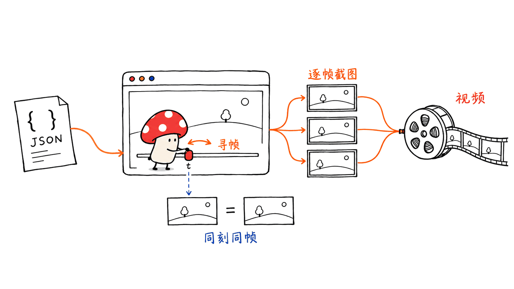

live-panel 把一份 JSON 系统描述变成会动的架构讲解图：盒子位置保持稳定，连线上的数据包、日志、计数器和状态条随时间变化，最终输出网页或 MP4。它适合解释系统怎样协作，而不需要真的搭一套业务系统再录屏。

正确仓库是 ythx-101/live-panel-skill，代码采用 MIT 协议。本文固定提交 `439c9addce7e7ac2b4e384aa847a351926c8f945`，结合 README、渲染脚本、浏览器回放测试与本机短样片检查介绍。

仓库：https://github.com/ythx-101/live-panel-skill

## 它是视频工具，还是实时监控？

名称里有 live，画面里也有 token、请求数和日志，但这些元素可以完全由配置中的计数规则产生。没有真实数据输入时，它们只是讲解动画，不是 Agent 正在运行的证据，也不是可以直接接入生产指标的监控平台。

项目的最小示例甚至直接写了 “all numbers are illustrative”。如果你要展示真实请求量，就要给数据来源、时间范围和单位；如果只是表达执行流程，就标注为示意。把两者分清，画面才有解释力。


## 一个 JSON 如何成为视频？

配置描述画布、主题、文字、方框、连线和状态机。HTML 模板负责呈现；Python 通过 Chrome/Chromium 的 DevTools 管道逐帧设置时间并截图，再把画面交给 ffmpeg 编码 H.264 MP4。

关键接口是 `window.seek(t)`。画面由给定时间决定，而不是靠真实时钟、无种子随机数或不断累加的动画状态推进。浏览器播放与离线逐帧导出共用同一套时间函数，这也让“先跳到后面，再跳回来”可以被测试。

依赖是 Python 3.8+、本地 Chrome/Chromium 和 ffmpeg，渲染器使用 Python 标准库，不要求模型 API key。让 Claude Code 写配置可能产生模型费用；工具本身离线渲染不等于整个 AI 创作流程零成本。

## 如何做第一条架构讲解片？

下载固定版本到独立目录，从 `examples/minimal/config.json` 开始，先把三个节点换成你自己的业务角色。初次只做一种状态变化和一条数据流，不要马上堆满仪表盘。

```bash
python3 scripts/render.py \
  --config examples/minimal/config.json \
  --out demo.mp4 --html-out demo.html

python3 scripts/check_frames.py \
  --config examples/minimal/config.json \
  --out-dir checked-frames --repeat
```

以上命令在仓库目录运行。用作 Skill 时，把完整仓库放到 Agent 的技能目录，例如 Claude Code 的 `~/.claude/skills/live-panel/`；只复制 `SKILL.md` 会漏掉脚本、模板和素材。本文没有替你修改本机技能安装目录。

`terminal-dark` 适合终端架构风格，`light-pastel` 适合浅色信息图。坐标是画布绝对像素，`--width/--height` 只缩放并可能加留白，不能自动重排为另一种长宽比。要做 3:4 与横屏两个版本，应分别调整布局。



## 本机实际验证了什么？

我们取固定提交的原始 Python 脚本、HTML 模板与所需视图文件，运行仓库 `tests/test_cycle_replay.py`。三个浏览器测试全部通过：检查可选字段切换、回到同一时间后的文字/高亮，以及像素回放一致性。这是原有测试，不是另写一组只验证我们解释的测试。

还对最小配置做了 124 个采样时间点检查，报告 0 个布局问题；四次重复寻帧的像素差为 0。这只覆盖这一份配置与本机字体环境。

另外把最小例子导出为 2 秒、12fps、600×750 的短样片。ffprobe 确认视频为 H.264、24 帧，带 AAC 音轨；静音音轨不是自动配音。这个检查验证了本机 Chrome 到 ffmpeg 的小规模导出链路，未做速度评测，也未验证所有主题、字体和复杂图表。

官方另有三套例子、约 120 个采样时间点和重复寻帧检查的结果。不要把它们与我们的三个测试、短样片合并成一次“所有样例实测”。画面是否讲清系统、事实是否准确，也不在像素一致性测试的证明范围内。

## 开源代码，为什么仍要看示例署名？

代码许可与示例设计权利分开。仓库明确说明，Codex agent-tree 示例复刻自 @thedelost 的设计，另一套 Agent 架构图来自小红书 @林纾，它们不在 MIT 的授权范围内。署名说明来源，不会自动替你获得对原设计的全部使用许可。

更稳妥的实践是复用配置驱动方法与渲染代码，为自己的系统重新组织节点、文案、配色和故事；展示真实数字时保留原始信源。不要将第三方视觉稿和示意计数器包装成自己的生产实况。


我的判断：live-panel 最适合做“系统的动态说明书”。相比让视频生成模型猜每一帧，配置和确定性时间轴更容易修改、复查和版本管理。代价是布局仍要自己设计，它不会自动判断系统架构是否正确。

原始测试：https://github.com/ythx-101/live-panel-skill/blob/439c9addce7e7ac2b4e384aa847a351926c8f945/tests/test_cycle_replay.py

配置说明：https://github.com/ythx-101/live-panel-skill/blob/439c9addce7e7ac2b4e384aa847a351926c8f945/references/config-schema.md

如果只需要静态 Mermaid 图，另看 Ondine：https://blog.mushroom.cv/blog/ondine-rust-mermaid-compiler/

## 常见问题

### 不买模型 API 也能渲染吗？

可以。已有配置的渲染依赖本机 Python、Chrome 和 ffmpeg；使用 Agent 帮你编写配置的费用另计。

### 会自己读取服务器上的 token 和请求量吗？

默认不会。配置动画可以模拟这些数字，真实指标需要你提供数据与接入逻辑，并在画面中标清口径。

### Windows 能直接运行吗？

项目文档不支持原生 Windows 的这条 DevTools 管道路径，建议使用 WSL；本文只验证了 macOS 上的小规模路径。

---

> © 2026 Author: Mycelium Protocol. 本文采用 [CC BY 4.0](https://creativecommons.org/licenses/by/4.0/deed.zh) 授权——欢迎转载和引用，须注明作者姓名及原文链接，不得去除署名后以原创发布。

<!--EN-->

live-panel turns a JSON system description into an animated architecture explanation. Boxes stay in place while packets, logs, counters and status bars change over time. It exports a live web page or MP4 without requiring the depicted business system to be running.

The MIT code is at ythx-101/live-panel-skill. This article pins commit `439c9addce7e7ac2b4e384aa847a351926c8f945`, reviews the source, and reports a small local browser/rendering check.

Repository: https://github.com/ythx-101/live-panel-skill

## Is it monitoring or storytelling?

A dashboard appearance is not evidence of live telemetry. Counters and logs may be generated entirely from animation rules; the minimal example explicitly labels all numbers illustrative. Actual metrics need a source, time range, units and an integration you supply.


## How does the pipeline work?

JSON defines the canvas, theme, elements and state machines. A template renders the diagram. Python drives Chrome/Chromium through a DevTools pipe, seeks to each frame time, captures it and feeds ffmpeg for H.264 encoding.

The central interface is `window.seek(t)`. Visual state derives from time rather than a wall clock or accumulated animation steps. Fixed-seed choices allow seeking away and returning to the same picture, which is useful for repeatable exports.

Requirements are Python 3.8+, local Chrome/Chromium and ffmpeg. Rendering uses the Python standard library and needs no model API key. An agent used to author the JSON may still incur model charges.

## How should a first project start?

Use the full repository and begin with `examples/minimal/config.json`. Replace the three roles, then add one state change and one data flow. Run `scripts/render.py` to export and `scripts/check_frames.py --repeat` to inspect layout and replay behavior; the Chinese section provides the commands.

Install the complete folder in a skill directory if needed, rather than copying only `SKILL.md`. We did not install it into the user's agent environment.

The terminal and pastel themes serve different presentations. Coordinates are absolute canvas pixels. Width/height overrides rescale and may letterbox; changing aspect ratio is not automatic responsive re-layout.


## What did we verify locally?

We ran the pinned upstream browser regression suite. All three tests passed: optional-field transitions, text/highlight restoration after out-of-order seeks, and pixel replay consistency.

The minimal configuration also passed 124 sampled time-point checks with zero distinct layout problems; four seek-away/return comparisons had zero visible pixel differences. This is limited to that configuration and our font environment.

We also exported the minimal example as a two-second, 12fps, 600×750 clip. ffprobe identified H.264 video with 24 frames and an AAC track. The silent audio track is not generated narration. This verifies a small Chrome-to-ffmpeg path on our Mac, not rendering speed, every theme, all fonts or every complex layout.

Upstream separately reports three examples and roughly 120 sampled time points per example. Those results must not be combined with our three tests as though we reproduced them all. Pixel consistency also says nothing about factual accuracy or explanatory quality.

## What rights do the examples carry?

The code is MIT. Credited recreations of @thedelost's agent-tree design and @林纾's architecture infographic are explicitly excluded from the MIT grant. Attribution identifies the source; it does not automatically supply every permission for the original design.

Reuse the renderer and configuration approach to explain your own system. Source factual numbers and mark simulated motion honestly.


Our assessment: the project is useful as an animated system explanation with editable, versionable state. It does not design the architecture or validate its correctness for you.

Pinned tests: https://github.com/ythx-101/live-panel-skill/blob/439c9addce7e7ac2b4e384aa847a351926c8f945/tests/test_cycle_replay.py

Configuration: https://github.com/ythx-101/live-panel-skill/blob/439c9addce7e7ac2b4e384aa847a351926c8f945/references/config-schema.md

For static Mermaid compilation, see Ondine: https://blog.mushroom.cv/blog/ondine-rust-mermaid-compiler/

## Frequently asked questions

### Does rendering require a paid model API?

No. Existing configurations render with local Python, Chrome and ffmpeg. Agent-assisted authoring is a separate cost.

### Are token counters connected to real servers?

Not by default. Animated counters can be illustrative. Real telemetry requires supplied data and integration logic.

### Does it run natively on Windows?

The documented DevTools pipe path requires POSIX file descriptors; upstream recommends WSL. Our local check covered macOS only.

---

> © 2026 Author: Mycelium Protocol. Licensed under [CC BY 4.0](https://creativecommons.org/licenses/by/4.0/) — free to share and adapt with attribution. You must credit the author and link to the original; removing attribution and republishing as original is not permitted.
